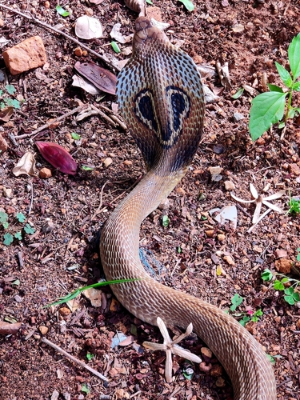
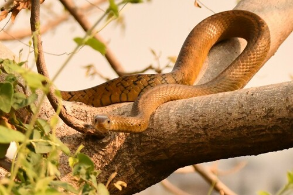
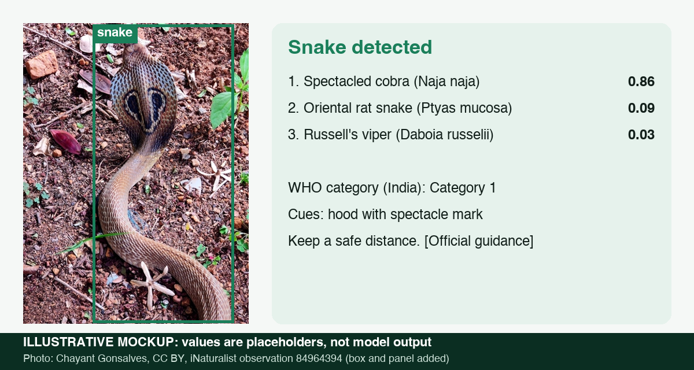
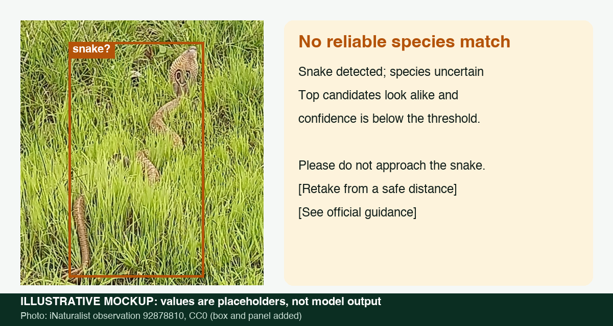

# Milestone 1: Project Report

Project: SerpentGuard AI, offline snake detection, classification and safety support<br>
Team: Group 5, DS and AI Lab Project. Team lead Jayesh Bansal; members Vikas, Puneet Bajaj and Manas Rastogi<br>
Status: problem definition, literature review and proposed plan. No model has been trained yet.<br>
Date: 25 October 2026 (updated after Milestone 1 review)

## 1. Problem statement

Snakebite kills far more people in India than official records show. The Registrar General of India's Million Death Study estimated 46,000 snakebite deaths in 2005 (99% CI 41,000 to 51,000), more than 20 times the official figure [15]. People who encounter a snake may panic, kill a non-venomous species, or approach a venomous one they mistake for a harmless snake. The need is for a cautious, offline decision-support tool that helps a person keep a safe distance, communicate a possible identification and reach emergency help after a bite.

SerpentGuard AI is proposed as an Android-first, fully offline edge application for Indian snake encounters. A compact segmentation and classification pipeline will identify supported species, return confidence, and label species outside its trained set as “unknown”—never as non-venomous. It is intended for cautious decision support and education, not diagnosis or treatment. The project’s research question is whether a phone-sized, custom multi-task model trained with merged Indian data and segmentation supervision can improve useful coverage and safety-aware performance over published and untuned baselines. This direction responds to the TA’s novelty feedback; the claim remains a hypothesis to validate through a paper and code review and measured comparisons.

The motivation applies to people in both rural and urban settings. Some rural residents may recognize familiar local snakes, while urban residents may have less practical exposure; those are hypotheses raised in team discussion, not established evidence. The app should be evaluated for users who need help identifying an unfamiliar snake, without assuming that any population has uniform knowledge or behavior.

### 1.1 Scope and boundaries

| In scope | Out of scope |
|---|---|
| Initial labelled core of 27 Indian snake species with at least 200 research-grade, CC-licensed iNaturalist observations each (section 3.1), with planned dataset expansion by merging compatible subsets from multiple sources | Species outside the model's supported set, which the system reports as "unknown" and never as non-venomous |
| Two input modes that share the same models: a still photo, and a live camera feed processed frame by frame | Bite diagnosis, dosing, treatment advice, or any claim that an area is safe |
| Top-3 species, calibrated confidence, an explicit "uncertain" state, and each candidate's WHO medical-importance category | Generated (LLM) text. All safety text is fixed and quoted from official sources |
| Optional coarse location (Indian state) used to re-rank candidates | Letting location override what the image shows |
| Android-first app, designed to work without internet; offline model-size target of 25–30 MB | iOS support in the first release; a claim that every Indian snake species is identified |

### 1.2 Stakeholders

| Stakeholder | Interest | How they use or judge the system |
|---|---|---|
| People in homes, farms, campuses and other places where they encounter unfamiliar snakes | Knowing to keep away, treating the prediction as uncertain where needed, and finding help | Primary users; capture only from a safe distance |
| Snake rescuers and forest department staff | Faster triage of rescue calls from photos sent by the public | Users of the photo mode and a source of real-world feedback |
| Doctors and first responders | Context only, since species ID never replaces clinical assessment | Not users of the tool, which is one reason diagnosis is out of scope |
| Herpetologists and citizen-science communities (iNaturalist) | Accurate labels and fewer harmless snakes killed | Source of labels and possible reviewers of hard cases |
| Course team (instructors and TAs) | A reproducible end-to-end deep learning project | Assess each milestone against the measurable objectives |
| Our team | Hands-on work in detection, fine-grained classification, calibration and edge deployment | Builders |

### 1.3 Objectives and measurable targets

These targets are proposals. We will test them at Milestone 5 on a locked test set grouped by observation and by observer (section 3.3), and revisit them once the Milestone 2 split exists. If we change a target, the report will say what changed and why.

| # | Objective | Metric | Target (proposal) | Basis |
|---|---|---|---|---|
| O1 | Identify supported Indian species (initial core: 27) | Macro-F1 / top-3 accuracy | ≥ 0.80 / ≥ 0.93 | A 45-species benchmark reported F1 0.83 [3]. The global ViT reached 92.2% macro-F1 on 772 species with about 386k photos [2] |
| O2 | Catch dangerous snakes | Recall of the medically important group: the share of images of the 7 WHO Category 1 and 2 species that are predicted as any of those 7 | ≥ 0.95 | Safety goal, using the WHO SEARO 2016 category list [15] |
| O3 | Avoid the most harmful error | Share of medically important images predicted as a not-listed species (non-abstained predictions only) | ≤ 2% | Asymmetric error cost, as in SnakeCLEF 2024 [4] |
| O4 | Know when it does not know | Expected calibration error after temperature scaling; error at 80% coverage; share of out-of-list snakes flagged "unknown" | ECE ≤ 0.05; error ≤ 5%; ≥ 70% flagged | Calibration method [20] |
| O5 | Find the snake first | Detector precision and recall at IoU 0.5 | ≥ 0.90 each | Prior YOLO work reported 87% to 88% precision [13, 14] |
| O6 | Work on live video | Pipeline speed; label flips per 10-second clip; time to first stable label | ≥ 10 FPS on a laptop CPU; ≤ 1 flip; ≤ 2 s | Usability goal for the live demo |
| O7 | Run offline on Android | Total model package size and median latency per frame on one Android phone | 25–30 MB target; latency to be measured and target reset after prototype | Edge goal, measured on the device |
| O8 | Use location safely | Macro-F1 change with the correct state, and with a missing or wrong state | ≥ +2 points / no worse than −1 point | The global study gained about 3 points from geography [2] |

### 1.4 Research questions

- How well does a compact pretrained vision model identify the 27 species on a test set that keeps observations and observers apart, so no snake or photographer appears in both training and test?
- If we run the same image model on each frame of a live feed and add tracking and smoothing over time, are the labels stable and correct under motion, blur and occlusion?
- Does calibration plus a reject option keep dangerous-species errors low without abstaining on most images?
- Does coarse location help with lookalikes, and does it hurt when it is missing or wrong?
- Can a custom compact segmentation and classification model improve safety-aware performance over untuned baselines while meeting the 25–30 MB offline Android target?

### 1.5 Updated problem statement for the Milestone 1 review

People in India who encounter an unfamiliar snake may not know whether to keep away or whom to contact, while general image classifiers and published global models may not cover local species well and typically need substantial compute or network access. We propose SerpentGuard, an Android-first offline application that detects and segments a snake, classifies supported Indian species, and reports an explicit confidence or “unknown” result for unsupported species. We will merge compatible subsets of multiple datasets, use segmentation masks to train a custom phone-sized architecture, and compare it with untuned baselines and published results. The system will present cautious safety information and an SOS pathway, but will not diagnose bites or recommend treatment. Our objective is to measure whether this design can provide useful identification and reduce unsafe certainty within a 25–30 MB on-device model budget.

## 2. Problem and existing evidence

Snake recognition is a fine-grained visual classification problem. Markings change with age and geography, similar-looking species can differ medically, and photos may show only part of an animal or include distracting backgrounds. The data are also heavily imbalanced. SnakeCLEF 2021 describes 414,424 photos across 772 species and 188 countries; the most represented species had 22,163 images and one species had only 10. Its dataset included online biodiversity observations and noisy Flickr examples, plus an expert-identified private test set, and the challenge warns about age- and location-dependent morphology and venomous/non-venomous lookalikes [1].

A global Vision Transformer study (Bolon, Picek et al. 2022) trained on 386,006 photos covering 772 species from 188 countries, including 198 medically important venomous species. The authors report 96.0% top-1 accuracy, 92.2% species macro-F1, 99.0% genus top-1 accuracy and 94.2% country macro-F1 on a 23,673-image test set. Adding geographic information improved country F1 and species F1 by 2.93 and 3.11 points, which the authors describe as a 33.3% relative error reduction. They released the trained model (ONNX) and data under a BSD-3-Clause licence, with code on GitHub [2], so we can run it on our own test images.

The same study points out its limits. Only 772 of roughly 3,921 known species met the ten-image training threshold, 77% of photos came from the United States and Canada, and iNaturalist test images may be easier than urgent field photos with blur, partial bodies or poor lighting. Country-level F1 exceeded 90% in 88% of countries but fell to 36% in Martinique, so a high global average can hide weak regions [2].

An earlier challenge on 45 North American species reported 84% accuracy and F1 0.83 on a post-challenge iNaturalist set. On expert-labelled private photos, accuracy was 72% across the 27 species represented (F1 0.73). Performance varied by species, and human participants did better on some poor-quality images, which suggests curated online test sets overstate real-world reliability [3].

SnakeCLEF 2023 and 2024 moved to medically important scenarios. They evaluated generalization in India, Central America and southern Africa and weighted errors unevenly, so a venomous snake predicted as harmless costs more [4]. Top-1 accuracy alone is therefore not enough for this project.

For detection, two studies report YOLO-based snake detectors. Naresh et al. (2024) report 87% detection precision [13]. Najm et al. (2025) trained YOLOv8-Nano on 8,500 images of 10 species and report precision 0.88, recall 0.91 and mAP@0.5 0.892 at 142 FPS in their Table 1. Their abstract gives 92.7 mAP@0.5, which does not match that table, so we quote the table [14]. Najm et al. report no calibrated confidence or abstention, and the Naresh et al. abstract gives only precision.

## 3. Data samples and data plan

### Data samples

Two photos from the dataset we plan to use: research-grade iNaturalist observations from India with CC BY licences. They show one of the lookalike pairs the system must separate: the cobra is WHO Category 1, and the rat snake is not WHO-listed.

| Spectacled cobra (*Naja naja*), class 3 | Oriental rat snake (*Ptyas mucosa*), class 2 |
|---|---|
|  |  |
| © Chayant Gonsalves, CC BY, [iNaturalist 84964394](https://www.inaturalist.org/observations/84964394) | © Surabhi Srivastava, CC BY, [iNaturalist 212098553](https://www.inaturalist.org/observations/212098553) |

### 3.1 How much data is available

We queried the public iNaturalist API on 22 October 2026 [16] for research-grade snake observations in India (place 6681, taxon 85553, community-agreed species ID) whose photos carry CC0 or CC-BY family licences. That returned 24,092 observations across 273 species. A random sample of 200 observations averaged 1.99 photos each, and 23 of the 200 (12%) had obscured coordinates.

Twenty-seven species have at least 200 such observations, 18,413 in total or roughly 36,000 images. These 27 species are our class list. The other 246 species, about 5,700 observations, give us a ready-made out-of-list "unknown" set.

To check the method, we queried a US-only rattlesnake (*Crotalus atrox*), which returns 0 Indian records, and re-queried *Naja naja* by taxon id, which reproduced its count exactly. Queries must use taxon ids: a name search for "Naja naja" returned a damselfly.

| # | Species | Common name | CC obs. | WHO category in India [15] |
|---|---|---|---:|---|
| 1 | *Fowlea piscator* | Checkered keelback | 2,611 | not listed |
| 2 | *Ptyas mucosa* | Oriental rat snake | 2,000 | not listed |
| 3 | *Naja naja* | Spectacled (Indian) cobra | 1,505 | Category 1 |
| 4 | *Craspedocephalus malabaricus* | Malabar pit viper | 1,120 | Category 2 |
| 5 | *Amphiesma stolatum* | Buff-striped keelback | 903 | not listed |
| 6 | *Daboia russelii* | Russell's viper | 842 | Category 1 |
| 7 | *Craspedocephalus gramineus* | Bamboo pit viper | 714 | Category 2 |
| 8 | *Indotyphlops braminus* | Brahminy blind snake | 696 | not listed |
| 9 | *Coelognathus helena* | Common trinket snake | 691 | not listed |
| 10 | *Lycodon aulicus* | Indian wolf snake | 670 | not listed |
| 11 | *Python molurus* | Indian rock python | 619 | not listed |
| 12 | *Dendrelaphis tristis* | Common bronzeback | 592 | not listed |
| 13 | *Bungarus caeruleus* | Common krait | 527 | Category 1 |
| 14 | *Echis carinatus* | Saw-scaled viper | 525 | Category 1 |
| 15 | *Ahaetulla oxyrhynca* | Indian vine snake | 487 | not listed |
| 16 | *Ahaetulla borealis* | Northern Western Ghats vine snake | 472 | not listed |
| 17 | *Hypnale hypnale* | Hump-nosed pit viper | 469 | Category 1 (south-west) |
| 18 | *Oligodon taeniolatus* | Streaked kukri snake | 466 | not listed |
| 19 | *Eryx conicus* | Rough-scaled sand boa | 425 | not listed |
| 20 | *Lycodon travancoricus* | Travancore wolf snake | 365 | not listed |
| 21 | *Ahaetulla farnsworthi* | Farnsworth's vine snake | 276 | not listed |
| 22 | *Lycodon fasciolatus* | Russell's wolf snake | 271 | not listed |
| 23 | *Sahyadriophis beddomei* | Nilgiri keelback | 246 | not listed |
| 24 | *Boiga trigonata* | Common cat snake | 240 | not listed |
| 25 | *Oligodon arnensis* | Banded kukri snake | 237 | not listed |
| 26 | *Rhabdophis plumbicolor* | Green keelback | 229 | not listed |
| 27 | *Eryx johnii* | Red sand boa | 215 | not listed |

"Not listed" means the species is not in WHO's Category 1 or 2 for India. It does not mean the snake is harmless to handle, and the interface will never say so. WHO also notes that bites by the non-venomous checkered keelback (our class 1) are common and that medical staff sometimes mistake them for venomous bites [15].

### 3.2 Sources by task

| Task | Source | Licence / terms | Use |
|---|---|---|---|
| Species classifier (primary) | iNaturalist research-grade observations of Indian snakes, filtered by each photo's licence [16] | Check the photo licence, not just the observation licence; record attribution and honor NC, SA and ND terms. The open-data bucket provides photo files and attribution metadata [34] | Best current fit for species labels and India coverage. Keep the existing grouped splits; never redistribute the image collection without checking each licence |
| General snake segmentation | Open Images V7 `Snake` instances (MID `/m/078jl`), which is included in its official segmentation-class list [17, 33] | Google licenses annotations CC BY 4.0; images are listed as CC BY 2.0, but Google asks users to verify each image's licence [17] | Strong candidate for real, human-corrected snake masks and detector warm-up. Generic global images, no species-level labels; inventory mask counts and image locations before use |
| Indian field-image evaluation / possible training supplement | Manna et al. 2026 describe 1,494 images from 20 Indian species; the paper says a minimal dataset is on OSF [32] | Confirm OSF file access, per-image rights, consent/privacy limits and permitted reuse with the authors before training or redistribution | Useful candidate for a separate real-world robustness evaluation if permission is clear. Labels are described as venomous/non-venomous, so do not infer species labels from the paper's species list |
| Indian venomous/non-venomous image archive | Indian-Snakes-Dataset on Zenodo, 429.1 MB [35] | Landing page does not expose a clear dataset licence; inspect repository files and obtain permission if unclear | Candidate for a label/format audit only. Do not merge into training until species labels, image provenance, duplicates and reuse rights are verified |
| Pre-training or extra data | SnakeCLEF 2024 training set [18] | Dataset page does not state an image licence; obtain/verify the competition terms before download or use | Optional species-classification supplement after permission and deduplication against our locked test set |
| Published baseline | Bolon et al. 2022 ViT (ONNX, 1.13 GB) with its released data and code [2] | BSD-3-Clause | Run on our test images (section 6) |
| Snake localization and masks | Open Images V7 boxes and instance masks for the generic `Snake` class (`/m/078jl`) [17, 33] | Verify each image's source licence; annotation licence is CC BY 4.0 [17] | Use for generic snake localization/segmentation pretraining and detector baselines, not Indian species claims. Roboflow community sets [19] remain per-project licence gated |
| Medical importance | WHO SEARO 2016 guidelines, India box on PDF p. 87 [15] | WHO publication | Per-species category used in metrics O2 and O3 |
| Live video evaluation | We found no public species-labelled snake video set; Wikimedia Commons has 0 to 2 videos for each species we checked | None | Build our own clips (section 3.4) |

**Recommendation from the online source check (29 October 2026):** keep licensed Indian iNaturalist photos as the species-classification backbone; add the subset of Open Images V7 with generic snake masks for supervised segmentation pretraining; then generate candidate masks on licensed Indian classifier photos with SAM and manually audit a stratified sample. Open Images is the only source found here with snake masks already attached, but those masks do not supply Indian provenance or species IDs. Treat the Manna/OSF and Zenodo Indian collections as gated audit/evaluation candidates until access, image-level rights and label granularity are confirmed. Do not use SnakeCLEF 2024 images until its dataset terms have been verified.

Before committing to a merged dataset, build a source inventory with counts by species/class, country, mask/box availability, licence, split, and duplicate group. Check exact Open Images Snake mask counts from `masks_data.csv`; the 350-class segmentation set is a subset of the 600 box classes, and class availability alone does not establish how many usable images there are. Keep source-specific evaluation slices so broader global data cannot hide weak Indian performance.

### 3.3 Splits and leakage control

All photos of one observation stay in one split, and so do all observations from one iNaturalist user, so the same person, camera or individual snake cannot appear on both sides. The test set takes only observations uploaded on or after 1 January 2022. The PLOS and SnakeCLEF 2021 data were collected before then, so the published model has not seen our test images; we will confirm that model's exact data cutoff at Milestone 2. Perceptual hashing removes near-duplicate images across all splits. Each species is split roughly 70/15/15, with a minimum test count per class. A script checks that no observation id, observer id or image hash appears in more than one split, and its output goes in the Milestone 2 report.

No herpetologist reviewer is confirmed, so our labels are iNaturalist research grade: at least two identifiers, with more than two-thirds agreeing at species level. We will check a stratified sample of 200 images ourselves against field-guide characters and report disagreements. If an expert reviewer becomes available, they will start with the hardest lookalike pairs.

### 3.4 Video data

A video is a sequence of images, so the same detector and classifier run on every frame and we do not train a separate video model. We need video data only to evaluate live behaviour: how stable the label is, how long the first label takes, and how often the system raises a false alarm. We will build three clip sets, all from test-split images so nothing leaks from training:

1. Synthetic clips. We take 20 test photos per species (540 clips, about 81,000 frames) and turn each into a 10-second, 15 FPS clip with a random camera path (pan, zoom, rotation, hand shake), motion blur, low-light and noise simulation, JPEG compression, and leaf-shaped masks covering 30% to 70% of the snake. The clip keeps the photo's label, and every generation parameter is logged and seeded. The figure below, from the PLOS study, shows the kind of transforms involved: two iNaturalist photos (by chiuluan, iNaturalist 207060926, and Alex Karasoulos, iNaturalist 207359674, both CC BY) next to augmented versions. [Original Figure 2 and attribution](https://journals.plos.org/plosntds/article/figure?id=10.1371/journal.pntd.0010647.g002)

   

2. Re-captured clips. Team members film test photos on a screen with a moving phone, which adds real sensor noise and the autofocus and exposure changes that synthetic warps miss.
3. No-snake clips built from Open Images scenes without snakes, to measure false alarms.

Neither synthetic nor re-captured clips show a snake actually moving. We will report that limitation and add real clips if we find any with usable licences.

### 3.5 Data risks

Disputed or mis-identified taxa, rare classes, geographic and platform bias, repeated images of the same individual, captive snakes, taxonomic renames (for example *Xenochrophis* to *Fowlea* and *Trimeresurus* to *Craspedocephalus*), photos with several snakes, obscured coordinates (12% of sampled observations) and the mix of licences. Research grade applies to the observation, not to each photo: the first of five photos in [iNaturalist 251871933](https://www.inaturalist.org/observations/251871933), a research-grade *Ptyas mucosa*, shows a shed skin, which a per-photo dataset would label as the species. The Milestone 2 data report will include a check for each risk.

### 3.6 Lookalike species pairs

WHO warns that even medical staff mistake harmless mimics for venomous snakes, or one venomous species for another [15, PDF p. 126]. To see which of our classes people actually confuse, we queried iNaturalist's similar-species count for India on 22 October 2026 [16]: for each pair, the number of observations of one species that received an identification of the other. These are human confusions, not model errors, so we use them to choose which pairs to test, not as a baseline. Across our 27 classes, 25 pairs join a WHO-listed species with a not-listed one, with 107 confusions in total. The first six rows below cover 9 of those pairs and 82 of the confusions, and the first two rows alone account for 63. The other 16 pairs have 1 to 4 confusions each, 25 in total; the largest is common krait with oriental rat snake (4). The last row is different: it joins dangerous species with each other, and is one of 6 such pairs with 21 confusions between them.

| Pair (WHO category in India) | iNat confusions | What tells them apart |
|---|---:|---|
| Spectacled cobra (1) / Oriental rat snake (not listed) | 41 | Cobra: hood with the spectacle mark; like all elapids, no loreal scale between the nasal and preocular. Rat snake: two or three loreal scales [15, PDF p. 34]. A threatened rat snake inflates its throat and growls, which may mimic a cobra [29] |
| Common krait (1) / Indian, Travancore and Russell's wolf snakes (not listed) | 13 + 5 + 4 | WHO names wolf snakes (*Lycodon*) as krait mimics [15, PDF p. 70]. Krait: no loreal scale [15, PDF p. 34] |
| Russell's viper (1) / rough-scaled sand boa, Indian rock python (not listed) | 5 + 2 | Viper: three rows of large dark, black-edged spots that often join into a chain [30] |
| Saw-scaled viper (1) / common cat snake (not listed) | 5 | Vipers have many small rough scales on top of the head [15, PDF p. 30], and the saw-scaled viper makes a grating rasp when threatened [15, PDF p. 70] |
| Spectacled cobra (1) / checkered keelback (not listed) | 4 | Keelback bites are common and confuse medical staff [15, PDF p. 87] |
| Bamboo pit viper (2) / green keelback (not listed) | 3 | Pit vipers have a heat-sensing pit between the nostril and the eye [15, PDF p. 30] |
| Hump-nosed pit viper (1) / Malabar pit viper (2), saw-scaled viper (1) | 7 + 1 | Both sides are dangerous, but Indian polyvalent antivenom is raised against the Big Four and may not work on hump-nosed or Malabar pit vipers [15, PDF p. 143]. Hump-nosed bites in Kerala were misidentified as saw-scaled viper bites [31] |

How we will use this:

- At Milestone 5 we report the confusion rate in both directions for all 25 pairs that join a dangerous and a not-listed species, including the 16 not shown in the table. Dangerous to not-listed counts toward O3; not-listed to dangerous is a false alarm that can get a harmless snake killed.
- Confusions between two dangerous classes, such as hump-nosed pit viper and saw-scaled viper, are reported separately. O2 treats the 7 dangerous species as one group and O3 counts only dangerous snakes labelled as not-listed, so neither target penalises these confusions.
- We will check Grad-CAM maps for each pair to see whether the model looks at the head and markings. A 2026 study on Indian snakes used Grad-CAM++ this way, and MobileViT-S had the lowest venomous recall of its four models (85.98%) [32], so these pairs are where we test whether MobileViT is good enough.
- Some classes are also confused with recently split species outside our list (for example *Oligodon tillacki*, *Sahyadriophis uttaraghati* and *Craspedocephalus anamallensis*). These classes go first in the 200-image label check (section 3.3).

## 4. Existing solutions and comparison

| Option | What it offers | Strengths | Limitations relevant to this project |
|---|---|---|---|
| Google Search / Google Lens | A camera or uploaded image starts a visual search that returns visually similar pages; Lens can identify plants and animals | Fast, with a broad index; works from a camera or an image | Search matches are not a calibrated classifier with a fixed snake label set. Results vary with the web, there is no measured abstention or risk score, and it needs internet [6] |
| Gemini Live | Users share a camera feed and ask spoken questions | Natural, interactive live-camera help | General-purpose answers that have not been evaluated on regional snakes. Needs a live connection [7] |
| ChatGPT camera/video | Voice mode supports camera and video sharing in supported mobile apps | Conversational follow-up and broad image understanding | Not trained or calibrated for our class list, and a direct answer can sound confident without any validation [8] |
| iNaturalist and Seek | Upload or point a camera at an organism and get ranked species suggestions from a model trained on iNaturalist records [5] | Covers Indian snakes, with a large community that confirms identifications | A general wildlife tool built for biodiversity records; we found no published accuracy for Indian snakes, and it is not designed for safety decisions |
| Direct response from a general LLM | The user describes the snake or uploads an image | No setup, and it explains its reasoning | No fixed label set, no reproducible score, and no reliable way to tell real uncertainty from a plausible guess. Useful as a qualitative comparison only |
| Global PLOS ViT (Bolon et al. 2022) | A 772-species classifier with optional geography | 92.2% macro-F1 on its benchmark; weights and code released under BSD-3 | The ONNX model is about 1.1 GB, too large for a phone; trained mostly on North American photos; not tested on Indian field photos [2] |
| SnakeCLEF challenge systems | Shared datasets and held-out evaluation, with a 2023 and 2024 focus on medically important scenarios including India | Reproducible research setup; DINOv2 features explored, with released code [12] | Evaluated on static photos on a server GPU and not designed for live, on-device video |
| YOLO snake detectors | Real-time detection: 87% precision [13]; YOLOv8-Nano at 0.88 precision and 142 FPS on 10 species [14] | Show that real-time detection on edge hardware is practical | Detection only, or coarse species; we found no calibrated abstention in either |
| Earlier mobile and video snake systems | Offline iOS classification [9], video-based recognition [10], and Serpent-ID with YOLOv8-nano and TensorFlow Lite [11] | Show that offline and video snake recognition already exist | Species coverage, independent validation and safety behaviour vary. We compare against them and do not claim camera input as new |
| SerpentGuard AI (ours, proposed) | Detector, tracker and 27-species classifier on photos and on every live frame; calibrated abstention; offline export | Fixed Indian class list, measured dangerous-species recall, temporal stability, and no LLM or API in the loop | Still a proposal with no measured model. Labels come from community agreement without expert review |

General assistants and earlier snake apps already accept camera input. What we add is one detector and one fine-tuned classifier for a bounded list of Indian species, run on photos and on every live frame with tracking and smoothing, plus a calibrated reject option and an evaluation that weights the most harmful error: a dangerous snake labelled as a not-listed species. We compare the system against the released global model on the same Indian test images.

## 5. Proposed architecture

The architecture is under investigation following the review. The proposed main path is a segmentation-guided, multi-task student model; exact encoder, decoder and temporal components will be selected by experiments and the novelty review.

```text
photo or video frame
  -> compact shared encoder
  -> snake mask head (Open Images masks plus audited SAM candidate masks supervise training; SAM is not required on device)
  -> mask-guided species / genus / danger heads
  -> calibrated confidence; unsupported or low-confidence result = "unknown"
  -> for video, aggregate frame predictions (majority vote baseline; temporal mask reuse under study)
  -> fixed offline safety guidance and optional SOS actions
```

- Segmentation supervision: use verified Open Images Snake instance masks where available and investigate Meta Segment Anything (SAM) to generate candidate masks on licensed Indian species photos. SAM masks are pseudo-labels, not ground truth: manually inspect a stratified sample and report mask quality by source, scene and occlusion. SAM is a training-time annotation aid, not the proposed phone model.
- Student model: train a custom compact shared encoder and segmentation/species heads; MobileViT (“mobile with” in the meeting notes) is one candidate encoder, alongside lightweight segmentation baselines. YOLOv8n-seg remains a baseline rather than the proposed primary approach.
- Dataset: merge compatible, licensed subsets from multiple datasets, deduplicate and retain provenance and licence metadata. The initial 27-species collection is not a claim of adequate coverage of India's roughly 300–400+ species; supported coverage and rare-class performance will be reported explicitly.
- Video: process frames and use majority vote as the initial temporal baseline; assess tracking or mask reuse only if it fits the edge budget.
- Calibration and abstention: temperature scaling on the validation split [20]. The system shows a label only when the aggregated top-1 probability passes a threshold set on validation data to meet the O4 coverage target.
- Location (optional): candidates are re-ranked by how often each species appears in each state, counted on the training split only.
- Safety knowledge base: species facts and first-aid text quoted word for word from official sources such as WHO SEARO 2016 [15], always shown with the source. The system generates no text, and "no snake detected" is never shown as "safe".
- Deployment: Android-first, with a fully offline on-device pipeline. Target total model package is 25–30 MB (the precise accounting boundary—weights only or runtime assets included—will be stated in the benchmark). iOS may be considered after the Android milestone.

### 5.1 Compute plan: Kaggle and Colab only

We have no paid compute, so every step must fit the free tiers of Kaggle and Google Colab. Neither publishes a fixed quota. Third-party summaries from 2026 report about 30 GPU hours per week per Kaggle account (one P100 or two T4s), 12-hour Kaggle GPU sessions that can run in the background, and Colab T4 sessions of up to 12 hours with a 90-minute idle timeout and no guaranteed GPU [25, 26]. We will use Kaggle as the main platform and Colab as a backup, and keep the prepared dataset as a private Kaggle Dataset so both can load it.

| Step | Where | Estimated cost |
|---|---|---|
| Build the manifest (about 120 iNaturalist API requests) and download about 36,000 photos (about 4 GB at 500 px) | Kaggle or Colab with internet on | Under an hour of CPU time. The API asks for at most 60 requests per minute [16]; photos come from the public `inaturalist-open-data` bucket, not the API |
| Deduplicate, split, check leakage, generate 540 synthetic clips | Kaggle CPU | About an hour |
| Train classifiers (about 25,000 training images, around 30 epochs per run) | Kaggle T4/P100 | About 0.5 to 1.5 GPU hours per run, so 10 to 15 runs need 10 to 20 GPU hours |
| Train the YOLOv8n detector | Kaggle T4 | About 1 to 2 GPU hours |
| Run the PLOS ViT baseline (1.13 GB ONNX) on about 5,400 test images | Kaggle T4 with ONNX Runtime | Minutes |
| Run detector, tracker and classifier on the 540 clips | Kaggle T4 | Under an hour |
| Export int8 TFLite/ONNX models | Colab | Minutes |

GPU estimates will be revised after the SAM mask pilot and first custom-model run. Kaggle or Colab may be used for training and preprocessing, but end-user inference is intended to run locally on Android with no internet connection. Android device access and the final export/runtime choice are prerequisites for validating the 25–30 MB and latency targets. The project does not depend on a hosted Gradio or web demo.

## 6. Baselines and evaluation plan

The required comparison matrix will separate published scores on their original datasets from untuned baselines run on our locked test set and from our trained approaches. Each row will record task, dataset/classes, metric and score, whether weights are released, model size, compute/device, and comparability limits. Published scores will not be presented as directly comparable unless the test set and protocol match.

### 6.1 Published external baselines

| Reference | Scope / test set | Reported result | How we use it |
|---|---|---|---|
| Durso et al. 2021 [3] | 45 North American species | 84% accuracy and 0.83 F1 on iNaturalist; 72% and 0.73 on the private expert set | Scale reference for O1 |
| Bolon et al. 2022, global ViT [2] | 772 species; 23,673-image test set | 96.0% top-1; 92.2% macro-F1 | We run it on our post-2022 Indian test images, restricted to our 27 classes |
| Naresh et al. 2024 [13] | Snake detection | 87% precision | Detector reference for O5 |
| Najm et al. 2025 [14] | 10 species, YOLOv8-Nano | Precision 0.88, recall 0.91, mAP@0.5 0.892, 142 FPS (Table 1) | Detector and speed reference for O5 and O6 |

### 6.2 Project baselines (to be measured)

We have no measured project result yet. At Milestones 3 and 4 we will measure the following on identical splits:

1. majority class;
2. ResNet-50 and EfficientNet-B0 fine-tuned on full images;
3. MobileViT on full images;
4. detector crop followed by MobileViT;
5. model 4 with location;
6. model 4 with temperature scaling and abstention.

For every run we record the split manifest, class counts, library versions and random seeds.

### 6.3 How we plan to improve on the baselines

Each step below is tested as an ablation on the same locked test set, so we can say which change moved which metric:

1. Transfer learning from ImageNet-pretrained backbones, with class-balanced sampling or loss weighting for the rarer species.
2. Augmentation that keeps diagnostic patterns intact: lighting, crop, rotation, blur and compression, but no colour shifts strong enough to change banding.
3. Cropping to the detector's box before classification, compared with classifying the full image.
4. Location re-ranking, used only when a state is known.
5. Temperature scaling and a reject option, so low-confidence and out-of-list snakes come back as "uncertain" or "unknown".
6. Full fine-tuning against LoRA for MobileViT, and int8 quantization checked separately on rare classes and on calibration.

### 6.4 Current results compared with our expected results

| Measure | Best current result we found | What we expect |
|---|---|---|
| Species identification | 92.2% macro-F1 on 772 species with about 386k photos [2]; 0.83 F1 on 45 species, falling to 0.73 on expert-labelled private photos [3] | Macro-F1 ≥ 0.80 on 27 Indian species with about 36k photos (O1). Lower than the global model, which has ten times more data, but measured on Indian, post-2021 photos it has never seen |
| Snake detection | 87% to 88% precision [13, 14] | Precision and recall ≥ 0.90 (O5) |
| Dangerous-species safety | Not reported by Najm et al. [14] or in the Naresh et al. abstract [13]; weighted in SnakeCLEF scoring [4] | Recall ≥ 0.95 on WHO Category 1 and 2 species; ≤ 2% of them labelled as not-listed (O2, O3) |
| Calibrated abstention | Not reported by Najm et al. [14] or in the Naresh et al. abstract [13] | ECE ≤ 0.05, error ≤ 5% at 80% coverage (O4) |
| Speed and size | 142 FPS for YOLOv8-Nano on a GPU [14]; the global ViT model file is about 1.1 GB [2] | ≥ 10 FPS on a laptop CPU (O6); both models ≤ 25 MB on a phone (O7) |
| Live video | No published clip-level results found for snake ID | ≤ 1 label flip per 10-second clip and a first stable label within 2 s (O6) |

### 6.5 Metrics

Top-1 and top-3 accuracy, macro-F1, balanced accuracy, per-class precision and recall, the confusion matrix, ECE with a reliability diagram, the risk-coverage curve, recall on medically important species, and the rate at which dangerous snakes are labelled as not-listed species. For the detector we report precision, recall and mAP@0.5. For video we report clip-level accuracy, label flips per clip, time to the first stable label and false alarms per minute. For deployment we report FPS, median and p95 latency, and model size. Headline metrics come with bootstrap 95% confidence intervals.

### 6.6 Evaluation protocol

1. Every model is scored on the same locked, grouped test set (section 3.3), stratified by species, region, image quality and WHO category.
2. Location ablation: image only, image with the correct state, and image with a missing or wrong state.
3. Video: the synthetic, re-captured and no-snake clips from section 3.4, comparing single-frame decisions with temporal smoothing. Adjacent frames never count as independent test samples.
4. Market tools, all on the same fixed, stratified 100-image subset. iNaturalist's identification suggestions, the closest existing product, return a ranked species list for an uploaded photo, so we record top-1 and top-3 agreement with our labels; we also try Seek, iNaturalist's camera app, by hand on 30 of the images. We send the 100 images to two multimodal LLM APIs (Gemini and GPT) with a fixed prompt that asks for the top 3 from our 27-species list or "unknown", and run Google Lens by hand on 30. Gemini Live and ChatGPT camera mode give no reproducible ranked output, so we record them only as a qualitative demo. For each tool we log the version, date and prompt, and we estimate any API cost before running. Test images uploaded to iNaturalist after 2021 may already be in iNaturalist's own training data, so its scores are an upper bound, and we report them that way.
5. Error analysis on a stratified sample of failures, uncertain predictions and high-risk predictions, checked by the team against field-guide characters and, if possible, by an expert.

## 7. Expected product outputs (illustrative mockups)

These two mockups show what the finished system should return. The photos are real samples from our planned dataset. The boxes, scores and labels are placeholders we chose by hand, not predictions from a trained model.

### Example A: confident, in-scope photo



The detector draws a box around the snake and the classifier lists the top three species with calibrated scores. The panel gives the WHO category of the top candidate, the visual cue behind it, and a link to official guidance. Live video shows the same panel for each tracked snake, updated from the smoothed scores of recent frames.

### Example B: uncertain image



When the snake is partly hidden or the top candidates are close, the system shows that it found a snake but will not name the species. It asks the user to keep away and retake the photo from a safe distance. "See official guidance" shows only text quoted from official sources, with the source named.

## 8. Gaps, opportunities, and project response

| Gap in existing work | Opportunity | Planned response |
|---|---|---|
| Long-tailed data and weak coverage of rare species | Merge compatible subsets and measure supported coverage honestly | Start from 27 classes with at least 200 observations; expand only when label and sample quality allow. Unsupported species are "unknown", never “non-venomous”; report per-class metrics |
| Geographic bias (77% of the global set is from the US and Canada) | A bounded Indian use case | Indian-only training and test data, compared with the global model on the same images |
| Similar-looking species with different risk | Explicit error costs | Recall on WHO-category species (O2) and the dangerous-as-not-listed error rate (O3); abstain when ambiguous |
| Benchmark images are cleaner than field photos | Harder test conditions | Results by image quality; synthetic blur, low light and occlusion; re-captured clips |
| High headline accuracy hides overconfidence | Calibrated, communicated uncertainty | Temperature scaling, a reject option and risk-coverage reporting |
| The global model is too large for a phone (about 1.1 GB) | Compact, exportable models | Custom segmentation/classification student, with size and latency measured against the 25–30 MB target (O7) |
| General assistants already take camera input | Compete on measured behaviour | The same models on photos and every live frame, with stability metrics (O6) |
| Live video flickers and can be confidently wrong | Tracking, smoothing and abstention | ByteTrack, frame voting and an "uncertain" state, scored with clip-level metrics |
| Hosted LLMs need a network and can generate unsafe text | No LLM in the loop | Offline models and fixed, quoted safety text only |

## 8.1 Review feedback and proposed product features

The review identified a novelty gap: a conventional YOLO detector followed by a classifier resembles common detection/classification projects. In response, the team will manually inspect relevant papers and GitHub repositories, build a comparison matrix of untuned baselines and best published scores, and investigate SAM-assisted mask generation followed by a custom segmentation/classification architecture. Merging subsets of multiple datasets is planned, subject to compatible labels, licences, and duplicate checks. No novelty claim is final until this review and same-test-set comparisons are complete.

The following are proposed features for the updated proposal; feasibility and safe offline behavior still require design work:

- Bite SOS: provide a one-tap path to emergency contacts and hospitals/ambulance services. Calling or SMS requires cellular service; “offline” means no internet or mobile data is assumed, not that calls work without signal. The app should show vetted, sourced emergency guidance and must not provide diagnosis or treatment instructions.
- Device-to-device alerts: investigate Android peer-to-peer communication for opt-in, short-lived nearby snake alerts that can be relayed between app users. Location sharing requires user consent and controls for expiry, distance and false reports.
- Crowd review: let users submit an unknown observation for review. The suggested threshold—about 70% agreement from 10–20 voters—is a proposal only. It should not automatically change the production model; labels need moderation and provenance before inclusion in a future dataset.
- Local Qwen 2.5 0.5B: suggested for general snake information, but not committed. Any use must be evaluated for offline size and must not generate first-aid or treatment advice; safety-critical text remains fixed and sourced.

The team discussed whether city residents may benefit particularly because rural residents might know local species. This is not an evidence-backed segmentation of users; the proposal targets anyone facing an unfamiliar snake and leaves user research to validate differing needs.

## 9. Conclusion and milestone plan

Snake classification, camera input and YOLO-based detection are established directions, and the TA specifically asked us to address the lack of novelty. We therefore propose to investigate segmentation-supervised training of a custom compact model, merge multiple data sources, and compare against untuned baselines and published results. These are proposed contributions, not established novelty claims; the team must manually review relevant papers and repositories and report what is genuinely distinct. The product direction is Android-first and offline, with explicit unknown handling and safety-aware SOS and community-review concepts.

| Milestone (due) | Deliverable | Done when |
|---|---|---|
| M2 Dataset (29 Oct) | Preprocessed, cleaned, model-ready dataset; merged-source manifest and licence audit; grouped splits and leakage check; SAM mask pilot with 500 masks manually reviewed | Dataset build report records species counts, source provenance, exclusions, leakage results and mask quality |
| M3 Architecture (5 Nov) | Segmentation and compact-model baselines, with end-to-end Android feasibility study | Reproducible comparison on a fixed subset with accuracy, mask quality, size and latency |
| M4 Training (19 Nov) | Baselines, MobileViT full fine-tuning against LoRA, augmentation and regularisation sweeps, detector training | A hyperparameter table with at least 6 runs, with checkpoints and configs saved |
| M5 Evaluation (26 Nov) | All metrics in section 6.5 against targets O1 to O8, the PLOS baseline, and error analysis | Every target reported as met or missed, with confidence intervals |
| M6 Deployment (10 Dec) | Android-first offline application prototype; SOS and device-to-device alert proof of concept if feasible | A working Android build, documented offline behavior and on-device latency/model-size results |

## References

1. Picek L. et al. (2021). [SnakeCLEF 2021 challenge description and dataset](https://www.aicrowd.com/challenges/snakeclef2021-snake-species-identification-challenge). AIcrowd.
2. Bolon I., Picek L., Durso A. M., Alcoba G., Chappuis F., Ruiz de Castañeda R. (2022). [An artificial intelligence model to identify snakes from across the world: Opportunities and challenges for global health and herpetology](https://journals.plos.org/plosntds/article?id=10.1371/journal.pntd.0010647). *PLOS Neglected Tropical Diseases* 16(8): e0010647. Model and data: [LINDAT release](https://lindat.mff.cuni.cz/repository/xmlui/handle/20.500.12800/1-4773) (BSD-3-Clause); code: [picekl/PlosNTD-GlobalSnakeID](https://github.com/picekl/PlosNTD-GlobalSnakeID).
3. Durso A. M. et al. (2021). [Supervised learning computer vision benchmark for snake species identification from photographs](https://pmc.ncbi.nlm.nih.gov/articles/PMC8093445/). *Frontiers in Artificial Intelligence*.
4. Picek L., Hrúz M., Durso A. M. (2024). [Overview of SnakeCLEF 2024: Revisiting Snake Species Identification in Medically Important Scenarios](https://dspace.zcu.cz/items/64e8cf26-55b0-42a1-bc2f-ac6da22c5173). CLEF 2024 Working Notes.
5. iNaturalist, [Computer Vision FAQ](https://www.inaturalist.org/posts/47454-faq) and [Seek app information](https://www.inaturalist.org/pages/seek_app).
6. Google, [Google Lens features](https://blog.google/products-and-platforms/devices/google-lens/google-lens-features/) and [Search by image help](https://support.google.com/websearch/answer/1325808), accessed 22 October 2026.
7. Google, [Gemini Live camera guide](https://blog.google/products-and-platforms/products/gemini/gemini-live-camera-how-to/), accessed 22 October 2026.
8. OpenAI, [ChatGPT Voice FAQ](https://help.openai.com/en/articles/20001274-gpt-live-faq) and [Voice with video](https://m.chatgpt.com/features/voice-with-video/), accessed 22 October 2026.
9. Divya et al. (2021), [Snake Detection and Classification using Deep Learning](https://aisel.aisnet.org/hicss-54/da/mobile_services/3/), HICSS-54. Describes offline on-device and cloud-assisted iOS prototypes.
10. [Smart Snake Identification System using Video Processing](https://rda.sliit.lk/entities/publication/a7482c0f-95a5-441d-8340-ba9750477b44), SLIIT project record describing offline and online video recognition.
11. [Serpent-ID: A Deep Learning-Based Mobile Application for Rapid Snake Identification and Bite Management Guidance](https://ieeexplore.ieee.org/abstract/document/11507553), IEEE Xplore. Implementation details still need checking against the full paper before we use it as a benchmark.
12. [Transfer Learning with Self-Supervised Vision Transformers for Snake Identification](https://arxiv.org/abs/2407.06178) (2024) and the authors' [SnakeCLEF 2024 code](https://github.com/dsgt-arc/snakeclef-2024).
13. Naresh E., Ananda Babu J., Shiva Darshan S. L., Murthy S. V. N. (2024). [A Novel Framework for Detection of Harmful Snakes Using YOLO Algorithm](https://doi.org/10.1007/s42979-023-02366-z). *SN Computer Science*.
14. Najm H., Mohsin Z. R., Abdulhussien W. R. (2025). [Real-Time Detection of Multiple Snake Species in Natural Environments Using YOLOv8-Nano](https://doi.org/10.18280/isi.301025). *Ingénierie des Systèmes d'Information* 30(10): 2807-2814. CC BY 4.0.
15. World Health Organization, Regional Office for South-East Asia (2016). [Guidelines for the Management of Snakebites, 2nd edition](https://cdn.who.int/media/docs/default-source/searo/india/health-topic-pdf/who-guidance-on-management-of-snakebites.pdf). India species categories and the Million Death Study estimate are on PDF p. 87.
16. iNaturalist API v1, [observations and species counts](https://api.inaturalist.org/v1/docs/), queried 22 October 2026 (place 6681 = India; taxon 85553 = Serpentes; research grade; CC0 and CC-BY family photo licences).
17. Google, [Open Images V7 boxable class list](https://storage.googleapis.com/openimages/v7/oidv7-class-descriptions-boxable.csv) (`/m/078jl` = Snake).
18. ImageCLEF, [SnakeCLEF 2024 dataset and task page](https://www.imageclef.org/node/319).
19. Roboflow Universe, for example [yolo_annotate_snake](https://universe.roboflow.com/thisisnew/yolo_annotate_snake) (community-labelled; licence set per project).
20. Guo C., Pleiss G., Sun Y., Weinberger K. Q. (2017). [On Calibration of Modern Neural Networks](https://arxiv.org/abs/1706.04599). ICML.
21. Zhang Y. et al. (2022). [ByteTrack: Multi-Object Tracking by Associating Every Detection Box](https://arxiv.org/abs/2110.06864). ECCV.
22. Ultralytics, [YOLO multi-object tracking](https://docs.ultralytics.com/modes/track/).
23. Mehta S., Rastegari M. (2022). [MobileViT: Light-weight, General-purpose, and Mobile-friendly Vision Transformer](https://arxiv.org/abs/2110.02178). ICLR.
24. Hu E. J. et al. (2021). [LoRA: Low-Rank Adaptation of Large Language Models](https://arxiv.org/abs/2106.09685).
25. GPU Per Hour (21 September 2026). [Free Cloud GPUs in 2026: What Works and What Closed](https://gpuperhour.com/blog/free-cloud-gpus-and-credits). Third-party summary of Kaggle's notebook limits; Kaggle does not publish a fixed weekly quota.
26. Spheron (2026). [Google Colab alternatives: 8 GPU clouds compared](https://www.spheron.network/blog/google-colab-alternatives-8-gpu-clouds-compared-2026/). Third-party summary of Colab free-tier limits.
27. Hugging Face, [Spaces overview](https://huggingface.co/docs/hub/en/spaces-overview), accessed 22 October 2026 (paid plan needed for new Gradio and Docker Spaces; up to 2 free Gradio Spaces on ZeroGPU; static Spaces free).
28. Ultralytics, [YOLOv8 model page](https://docs.ultralytics.com/models/yolov8/), accessed 22 October 2026 (YOLOv8n: 3.2M parameters, 80.4 ms CPU ONNX at 640 px; the test CPU is not stated).
29. Young B. A., Solomon J., Abishahin G. (1999). [How many ways can a snake growl? The morphology of sound production in *Ptyas mucosus* and its potential mimicry of *Ophiophagus*](https://www.thebhs.org/publications/the-herpetological-journal/volume-9-number-3-july-1999/1572-01-how-many-ways-can-a-snake-growl-the-morphology-of-sound-production-in-ptyas-mucosus-and-its-potential-mimicry-of-ophiophagus). *Herpetological Journal* 9(3): 89-94.
30. The Reptile Database, [*Daboia russelii* species account](https://reptile-database.reptarium.cz/species?genus=Daboia&species=russelii), accessed 22 October 2026.
31. Joseph J. K. et al. (2007). [First authenticated cases of life-threatening envenoming by the hump-nosed pit viper (*Hypnale hypnale*) in India](https://doi.org/10.1016/j.trstmh.2006.03.008). *Transactions of the Royal Society of Tropical Medicine and Hygiene* 101(1): 85-90.
32. Manna I. I. A. et al. (2026). [Development of a deep learning based framework for classification of Indian venomous snakes integrated with explainable artificial intelligence for primary and emergency care providers](https://doi.org/10.1371/journal.pntd.0014147). *PLOS Neglected Tropical Diseases* 20(6): e0014147.
33. Google Open Images V7, [official segmentation class list](https://storage.googleapis.com/openimages/v7/oidv7-classes-segmentation.txt) and [download documentation](https://storage.googleapis.com/openimages/web/download_v7.html). The list includes Snake MID `/m/078jl`; counts must be calculated from the mask metadata before selecting a subset.
34. iNaturalist, [open-data photo download and attribution instructions](https://github.com/inaturalist/inaturalist-open-data/blob/main/README.md), accessed 29 October 2026. Photo licensing is per image and must be honored individually.
35. Sunil A. (2020). [Indian-Snakes-Dataset v1.0.0](https://doi.org/10.5281/zenodo.4266398), Zenodo. The record describes venomous/non-venomous Indian-subcontinent images; a clear dataset reuse licence was not visible on the landing page when checked 29 October 2026.

<div style="page-break-before: always"></div>

# Team review and acknowledgment

**This is the final page of the report. Each team member must complete and sign one row before submission.** By signing, each member confirms that they have reviewed the submitted document, understand its contents, and agree with the submission.

| Team member name | Roll Number | Signature / acknowledgment | Date |
|---|---|---|---|
|Jayesh Bansal|24f100185||22/10/2026|
|Vikas|23f3001800|Vikas|22/10/2026|
|Puneet Bajaj|23f3002416|Puneet Bajaj|22/10/2026|
|Manas Rastogi|22f3001477||22/10/2026|
