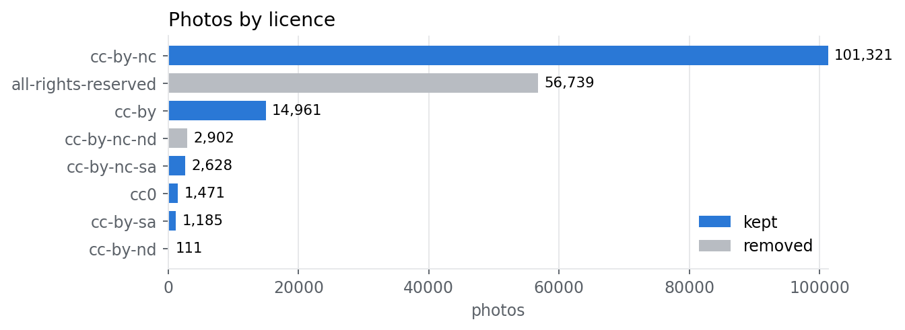
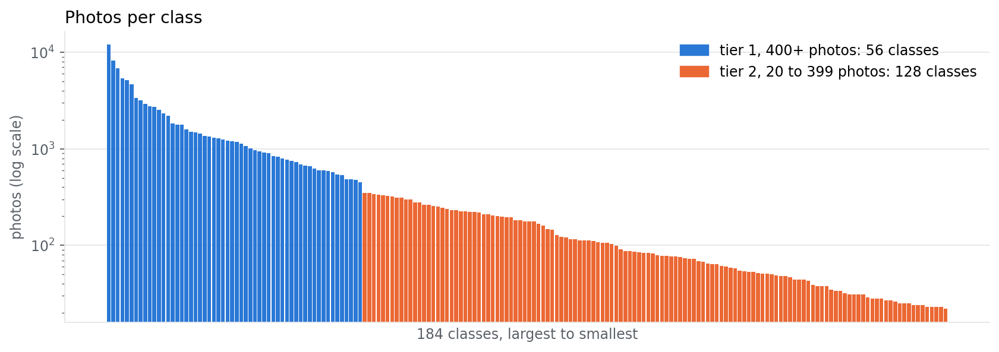
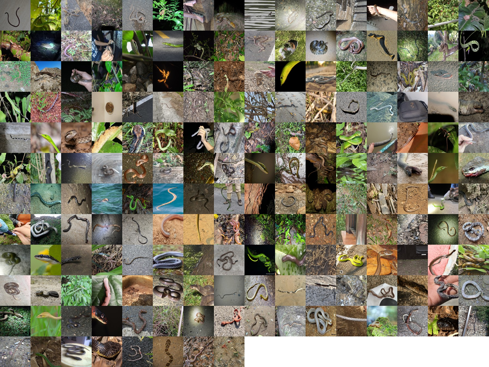
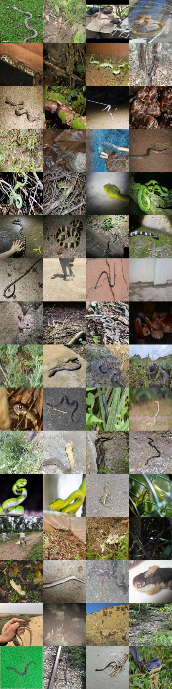
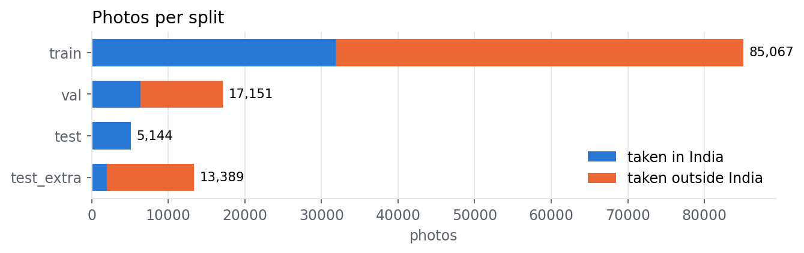
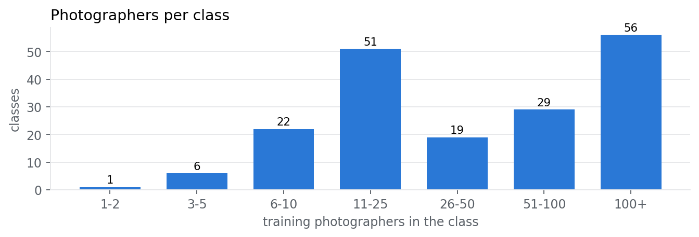
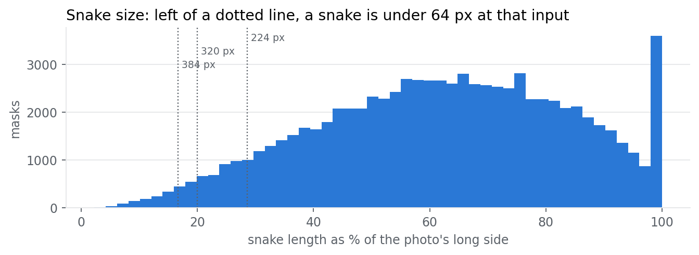
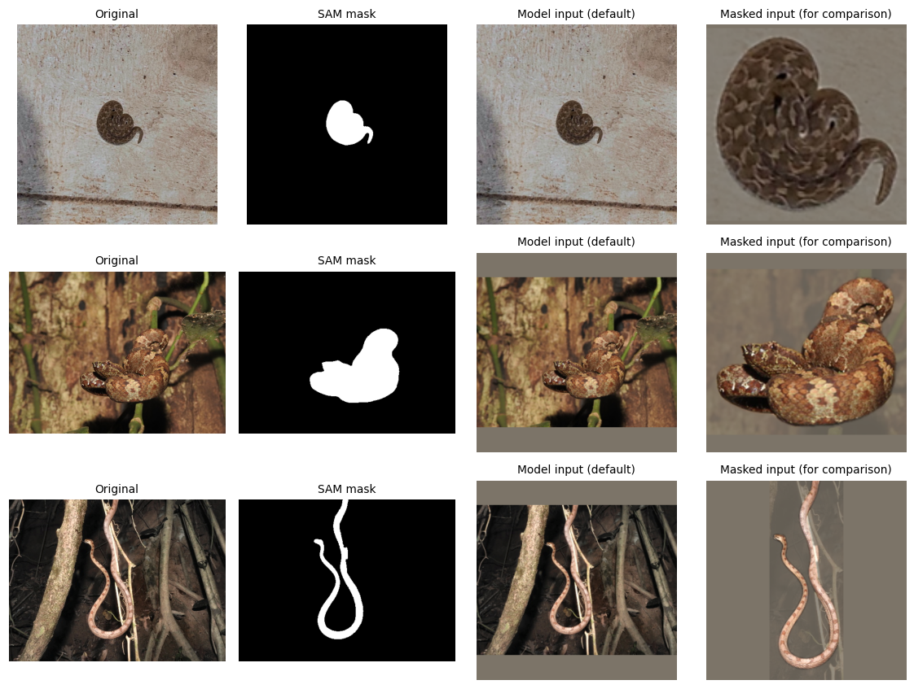
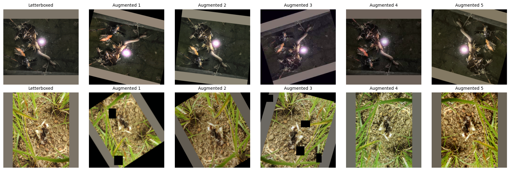
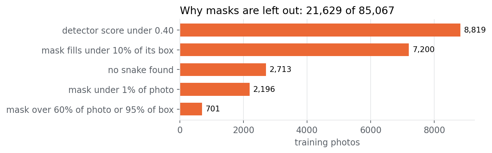

# Milestone 2: Dataset Preparation

Project: SerpentGuard AI, offline snake segmentation, classification and safety support<br>
Team: Group 5, DS and AI Lab Project. Team lead Jayesh Bansal; members Vikas, Puneet Bajaj and Manas Rastogi<br>
Updated: 31 October 2026, after the milestone review

## Summary

| Item | Value |
|---|---|
| Source | iNaturalist research-grade photos of every snake species recorded in India, from anywhere in the world |
| Final dataset | **121,566 photos**, 62,772 observations, 15,842 photographers |
| Classes | **184** (56 tier 1, 128 tier 2), plus 97 rare species held back to test the "unknown" answer |
| WHO medically important classes | 16 (6 Category 1, 10 Category 2), 15,719 photos |
| Split | train 85,067 · val 17,151 · test 5,144 · test_extra 13,389 · unknown_pool 815 |
| Taken in India | 37.8% overall; **test is 100% Indian** |
| Licences kept | CC0, CC BY, CC BY-SA, CC BY-NC, CC BY-NC-SA |
| Snake masks | 82,354 on training photos, 63,438 of them usable |
| Hosted dataset | [`serpentguard-indian-snakes-clean`](https://www.kaggle.com/datasets/puneetbajajiitm/serpentguard-indian-snakes-clean) (private; access on request) |

**Main points**

- **The classes are heavily imbalanced.** The largest has 12,038 photos and the smallest 22, a 547× gap. Thirteen classes hold half the data.
- **We split first and augment afterwards, on training photos only.** Augmenting before the split would put copies of one photo in both train and test.
- **The split is by photographer.** No photographer, observation or identical photo crosses train, validation and the held-out test fold.
- **We never report plain accuracy.** Our metrics are macro-F1, per-class recall and recall on WHO-listed species, and IoU and Dice for masks. A missed venomous snake is the costly error.

## 1. Dataset and source

We use iNaturalist research-grade observations. Members of the public upload photos, and an observation becomes research grade when at least two people have identified it and more than two-thirds agree on the species. We chose it because it covers Indian snakes better than any other public source we found, and every photo has an observer, date, place and licence.

Species were found through the iNaturalist API (place 6681 = India, taxon 85553 = snakes, research grade), using taxon ids because a name search for *Naja naja* returned a damselfly. We then downloaded every research-grade photo of those species worldwide, so rare Indian species such as the king cobra have enough examples: 182,497 photos, 0 failed downloads. Test photos stay Indian.

### Licences

Each photo keeps its photographer's licence and credit, stored in `metadata.csv`. **The main dataset contains only licences that allow this non-commercial course project with credit.** All-rights-reserved and no-derivatives photos are not in the dataset, the repository or this report. All photos shown here have their credits listed. The private raw download still holds them, because the pipeline rebuilds from it, and they are not used for training or testing.



### Other sources

| Source | Decision |
|---|---|
| SnakeCLEF 2023 and `aishanikaggle/indian-snake` | 1,771 extra photos collected and checked for duplicates, **not merged**: SnakeCLEF photos have no recorded licence, and the Kaggle set was scraped from the web |
| Open Images V7 | 296 human-drawn snake masks (CC BY 2.0), kept for scoring segmentation, not for species training |
| India Biodiversity Portal, SnakeCLEF 2021 | Not used: the portal blocks scripted downloads, and the 66 GB mirror stops Kaggle kernels from starting |
| Manna et al. 2026 emergency-department photos | Not used: no species labels. A possible real-world test set if the authors agree |

### Metadata

`metadata.csv` has one row per photo and 33 columns: `path`, `split`, labels (`species`, `genus`, `family`, `who_category`, `tier`), iNaturalist ids (`obs_id`, `photo_id`, `observer_id`), dates, place (`in_india`, `latitude`, `longitude`, `obscured`), `license`, `attribution`, `url`, image size and fingerprints (`sha1`, `phash`). Almost all photos are JPEG; 99.6% have a 500 px long side, the median is 500 × 375 px, and the dataset is 16.4 GB.

## 2. The full pipeline

Each notebook attaches its inputs by handle, does one job and saves a private dataset for the next one.

| # | Step | Notebook | What happens | Time (CPU unless noted) |
|---|---|---|---|---|
| 1 | Load | [`01_build_raw_dataset`](../../notebooks/01_build_raw_dataset.ipynb) | Download photos and a per-photo manifest | 2.5 h |
| 2 | Clean and split | [`02_clean_and_split`](../../notebooks/02_clean_and_split.ipynb) | Remove duplicates and tiny files, add labels, split by photographer | 3 min |
| 3 | Process | [`03_process_dataset`](../../notebooks/03_process_dataset.ipynb) | Apply the licence filter, verify files, remove near copies, set classes and tiers, write the final folders | 30 min |
| 4 | Masks | [`04_sam_masks`](../../notebooks/04_sam_masks.ipynb), [`05_merge_sam_masks`](../../notebooks/05_merge_sam_masks.ipynb) | Make a snake mask for each training photo | 3.8 h per shard on two T4 GPUs |
| 5 | Prepare for training | [`06_segmentation_preprocessing`](../../notebooks/06_segmentation_preprocessing.ipynb) | Exposure, cropping, resizing, augmentation, balancing, PyTorch loaders | a few min |
| 6 | Understand the data | [`07_eda_findings`](../../notebooks/07_eda_findings.ipynb) | The main findings and plots in this report | 4 min |

The full exploratory analysis, with embeddings and photo-quality checks, is [`Group 5 - 2026T3 - DSAI Lab.ipynb`](../../Group%205%20-%202026T3%20-%20DSAI%20Lab.ipynb). It ran before the licence filter, so its counts are higher than the ones here.

## 3. Cleaning

| Stage | Photos | Why |
|---|---:|---|
| Raw download | 182,497 | |
| Exact duplicates (SHA-1) | −928 | One photo must not count twice or cross splits. We keep the Indian copy |
| Same photo under two species | −30 | The label can't be trusted, so all copies go |
| Tiny files (under 5 KB, or short side under 100 px) | −36 | Too little detail for scale and pattern |
| **Clean, then split** | **181,503** | |
| Restricted licences | −59,752 | 56,739 all rights reserved, 2,902 CC BY-NC-ND, 111 CC BY-ND |
| Near copies across splits | −185 | 105 val, 25 test, 55 test_extra. Copies would inflate test scores |
| **Final** | **121,566** | 120,751 in classes, 815 in the unknown pool |

**Near copies.** We drop a validation or test photo within 4 bits of an earlier split's perceptual hash, or identical to one in its own split. Train is never touched. We chose 4 bits from the data before the licence filter: within 2 bits, 89.5% of matches were the same species, but at 5 to 8 bits only 8.5% were, so those are mostly unrelated photos.

**Dark photos stay.** Many species are photographed at night. Dropping dark photos would remove species unevenly, so we correct exposure instead (section 6).

**Label noise.** Research grade applies to an observation, not to each photo. In our 500-photo mask pilot, about 2% of photos showed no live snake. A stratified 200-photo hand check is planned for Milestone 3.

## 4. Classes

A class is one species with at least 20 photos. Of the 281 species with allowed photos, 184 are classes across 69 genera and 13 families. The other 97 species (815 photos) form the unknown pool, which is never trained on and tests whether the model says "unknown".



| Photos per class | Classes | Photos | Share of photos |
|---|---:|---:|---:|
| 1,000 or more | 32 | 89,016 | 73.7% |
| 500 to 999 | 20 | 14,528 | 12.0% |
| 300 to 499 | 14 | 5,165 | 4.3% |
| 100 to 299 | 45 | 8,352 | 6.9% |
| 20 to 99 | 73 | 3,690 | 3.1% |

So **52 classes have 500 or more photos, 66 have 300 or more, and 73 have under 100**. The median class has 178 photos, the Gini coefficient of class sizes is 0.73, and the effective number of classes is 32.6 out of 184. Tier 1 (400+ photos, 56 classes, 105,435 photos) suits normal training. Tier 2 (20 to 399 photos, 128 classes, 15,316 photos) needs stronger augmentation and a genus or family fallback.

### Dangerous species

Labels come from WHO SEARO 2016, India section, PDF pages 86 and 87. Four of the 20 WHO-listed species aren't classes: *Bungarus sindanus* and *Naja sagittifera* have too few allowed photos and sit in the unknown pool, and two *Trimeresurus* names have no research-grade photos, which are likely later taxonomic splits. *Ophiophagus kaalinga* was split from the king cobra in 2024, so it takes that category.

| Species | WHO | Tier | Train | Val | Test | Test extra |
|---|---|---|---:|---:|---:|---:|
| *Naja naja*, spectacled cobra | 1 | 1 | 2,076 | 338 | 324 | 190 |
| *Echis carinatus*, saw-scaled viper | 1 | 1 | 1,238 | 273 | 64 | 196 |
| *Daboia russelii*, Russell's viper | 1 | 1 | 1,123 | 196 | 170 | 99 |
| *Bungarus caeruleus*, common krait | 1 | 1 | 799 | 177 | 107 | 44 |
| *Hypnale hypnale*, hump-nosed pit viper | 1 | 1 | 747 | 155 | 124 | 47 |
| *Naja kaouthia*, monocled cobra | 1 | 1 | 486 | 127 | 22 | 115 |
| *Craspedocephalus malabaricus*, Malabar pit viper | 2 | 1 | 1,236 | 279 | 217 | 57 |
| *Bungarus fasciatus*, banded krait | 2 | 1 | 952 | 140 | 17 | 202 |
| *Craspedocephalus gramineus*, bamboo pit viper | 2 | 1 | 813 | 180 | 298 | 58 |
| *Macrovipera lebetinus*, Levantine viper | 2 | 1 | 709 | 115 | 0 | 116 |
| *Ophiophagus hannah*, king cobra | 2 | 1 | 448 | 66 | 10 | 75 |
| *Trimeresurus erythrurus*, red-tailed pit viper | 2 | 2 | 160 | 38 | 17 | 18 |
| *Ophiophagus kaalinga*, Western Ghats king cobra | 2 | 2 | 70 | 17 | 18 | 2 |
| *Bungarus niger*, black krait | 2 | 2 | 58 | 13 | 8 | 6 |
| *Naja oxiana*, Oxus cobra | 2 | 2 | 30 | 8 | 0 | 6 |
| *Bungarus walli*, Wall's krait | 2 | 2 | 10 | 9 | 0 | 6 |

**How many low-data species are venomous?** We have no venom label, only the WHO list. Vipers and elapids are venomous as whole families, which gives a lower bound. Other families can also be dangerous: WHO warns about the red-necked keelback, a colubrid.

| Group | Species | WHO-listed | Vipers or elapids |
|---|---:|---:|---:|
| Tier 1 classes | 56 | 11 | 15 |
| Tier 2 classes | 128 | 5 | 30 |
| Unknown pool | 97 | 2 | 21 |

So most venomous species in our data have few photos: 51 of the 66 vipers and elapids are in tier 2 or the unknown pool. **"Not listed" never means harmless**, and the app will never say so: 29 of the 168 not-listed classes are vipers or elapids.

### Sample images

Lookalikes the model must separate. The spectacled cobra is WHO Category 1, and the oriental rat snake is not listed.

| Spectacled cobra (*Naja naja*) | Oriental rat snake (*Ptyas mucosa*) |
|---|---|
|  |  |
| © Chayant Gonsalves, CC BY, [iNaturalist 84964394](https://www.inaturalist.org/observations/84964394) | © Surabhi Srivastava, CC BY, [iNaturalist 212098553](https://www.inaturalist.org/observations/212098553) |

**One training photo per class**, largest class first ([credits and order](assets/grid_all_classes_attribution.csv)):



**WHO-listed classes**, four photos each, one row per species in `classes.csv` order ([credits and order](assets/grid_who_listed_attribution.csv)):



## 5. What the data told us

The plots and numbers come from [`07_eda_findings`](../../notebooks/07_eda_findings.ipynb).

| Finding | Evidence | What we do |
|---|---|---|
| **Most training photos aren't Indian** | 37.4% of train and 37.1% of val are Indian, against 100% of test. 47 classes have under 20% Indian training photos, and 7 have none | Test stays Indian. We also score Indian validation photos separately, so any gap shows before the test run |
| **Background could become a shortcut** | In train, 77.8% of Category 1 photos are Indian against 33.0% of not-listed photos, so a model could learn "Indian scene means dangerous" | See the checks below |
| **One photographer dominates test** | One person took 28.1% of test (1,447 of 5,144), and 98.1% of those are portrait. Without them test is 45.0% portrait, close to 43.8% for comparable training photos | Keep the split, bootstrap by photographer, also report scores without them |
| **Some rare classes rely on few people** | Median 42 photographers per class, but 7 classes have 5 or fewer, and one person takes half or more of 12 classes | Photographer cap and camera-style augmentation (sections 7 and 8) |
| **`test` is thin per class** | 36 classes have no `test` photos, including 3 WHO-listed. Among the other 148, the median is 9 photos and 42 have under 5 | Use `test_extra` too, and report bootstrap intervals |
| **Many snakes are small in the frame** | At a 224 px input, 6.9% of snakes are under 64 px, against 2.5% at 320 and 1.5% at 384 | Start at 320; compare sizes in Milestone 3 |
| **Colour is close to ImageNet's** | Average colour is 0.455, 0.439, 0.369 against 0.485, 0.456, 0.406 | Keep ImageNet normalisation for pretrained encoders |

**Checking the background shortcut.** Removing the background isn't enough on its own, so Milestone 3 has three concrete checks: compare whole-photo and masked inputs; score each model on validation photos with the snake blanked out, where a high score means it learned the background; and compare Indian and non-Indian validation scores. Species share features across their range, and the genus and family heads give a fallback, but those benefits are hypotheses until measured.







**From the full analysis, before the licence filter:** once species was removed, a simple classifier on image embeddings couldn't separate the splits (AUC 0.54 for val, 0.51 for test, 0.49 for test_extra), which doesn't prove there is no shift. For 6 of 9 lookalike pairs, the named lookalike was among the 5 nearest species. All nine pairs have test photos on both sides, at least 58 per side, after the filter. A label-checking classifier reached only 24.8% accuracy, so we use its list to choose photos to hand-check and delete nothing automatically.

## 6. Preprocessing

Implemented in [`06_segmentation_preprocessing`](../../notebooks/06_segmentation_preprocessing.ipynb). Cleaning (section 3) comes first; these steps run as each photo loads, the same way in every split unless noted.

| Step | What it does | Why |
|---|---|---|
| Class ids | From `classes.csv`, never folder order | 36 species have no `test` folder, so `ImageFolder` would silently mislabel photos |
| Convert to RGB | Every photo, on its stored pixel grid | Some files are PNGs named `.jpg`, and masks were made on the stored grid |
| Exposure correction | CLAHE on lightness only, for photos with mean brightness under 60 or over 200 (12.1% and 0.2% of a sample) | Lifts dark photos so night species stay usable, without changing colour bands |
| Mask cleaning | Close small gaps, keep the large parts | Removes specks but keeps separate coils |
| Cropping | To the mask +6% in the masked modes | Removes background when a mask is available |
| Resizing | Letterbox to 320×320 with grey padding | Stretching makes a slender vine snake look stout; centre cropping would cut snakes, and 39.3% of training photos are portrait |
| Normalising | ImageNet mean and standard deviation | Pretrained encoders expect it |

**Input modes.** `full`, the default, feeds the whole photo and uses the mask only as the segmentation target. `soft_dim`, `hard_mask` and `rgbm_4ch` crop to the mask and dim the background, remove it or add the mask as a fourth channel. SAM won't run on the phone, so at test time these modes use our own segmentation model's mask. Milestone 3 compares them.

**Output.** Each batch has images `(32, 3, 320, 320)`, masks `(32, 1, 320, 320)`, `mask_valid`, and species, genus, family and WHO risk targets. Photos without a usable mask have `mask_valid = False` and an empty target, so the segmentation loss skips them.



Top to bottom: *Echis carinatus*, © Giri RAO; *Craspedocephalus malabaricus*, © Hopeland; *Boiga nuchalis*, © Hopeland. All CC BY.

## 7. Augmentation

**Order: split first, then augment training photos only, as they load.** Nothing is stored, so copies can't reach validation or test, and those splits are only normalised. Flips, zoom, rotation and shift move the photo and mask together.

| Augmentation | Tier 1 | Tier 2 | Why |
|---|---|---|---|
| Horizontal / vertical flip | 50% / 20% | 50% / 35% | A snake can lie in any direction |
| Zoom, rotation, shift | ±12%, ±25°, ±5%; 60% of the time | ±20%, ±45°, ±8%, shear ±10°; 80% | Rare classes need more variety |
| Brightness, contrast | ±20% | ±30% | Lighting varies |
| Saturation, hue | ±20%, about ±4% | ±25 of 255, about ±4% | Hue stays small because colour bands identify some species |
| Motion blur | None | 25% | Hurried phone photos |
| Cutout | 1 to 4 patches, 35% | 2 to 6 patches, 50% | Leaves and hands hide parts of snakes |
| JPEG compression, downscaling, blur, white-balance shift | 30%, 20%, 15%, 30% | Same | **Makes camera style less useful**, so a class from one or two photographers doesn't teach the model that camera. These are ordinary image changes; we don't add synthetic sensor noise |



Top to bottom: *Fowlea piscator* (tier 1) and *Ophiophagus kaalinga* (tier 2), both © Hopeland, CC BY.

## 8. Handling imbalance

The classes are far from balanced, and loss weighting alone isn't enough, so we combine several steps:

| Step | What it does | Status |
|---|---|---|
| Photographer cap | Up to 50 photos per photographer per class | In notebook 06 |
| Class cap | Up to 1,000 per class, taking photographers in turn | In notebook 06; affects 20 classes |
| Weighted sampling | Weight 1/√(class size), × 1.60 for Category 1, × 1.35 for Category 2 | In notebook 06 |
| Class-balanced or focal loss | Effective-number weights are saved in `class_weights.csv` | Compared in Milestone 3 |
| Hierarchical fallback | Species, then genus, then family, with an "I don't know" threshold | Milestone 3 |
| Genus-level labels for the rarest species | An option for classes too small to learn | Decided from Milestone 3 results |

Together, these flatten the data the model sees:

| Stage | Training photos | Largest / smallest class | Effective classes |
|---|---:|---:|---:|
| All training photos | 85,067 | 876× | 31.9 |
| After the caps | 52,308 | 100× | 76.4 |
| One epoch from the sampler | 52,308 | 15.6× | 118.6 |

The caps apply to training only. Validation and test keep every photo, and the full training set stays available for comparison in Milestone 3. Batches of 32: 1,635 train, 536 val, 161 test, 419 test_extra.

## 9. Masks and annotation quality

Grounding DINO finds the snake with the prompt "a snake.", and a separate pass finds hands and gloves. SAM 2.1 turns the boxes into a mask, and hands are cut out. **SAM is only a teacher for making labels.** It runs on training photos and won't run on the phone. Validation and test photos have no SAM masks, so a model is never scored against SAM's own output.

| | Training photos |
|---|---:|
| Clean training photos | 85,067 |
| With a mask | 82,354 |
| No snake found | 2,713 |
| Hands or gloves cut out | 3,891 |
| Left out by the quality rules, including the 2,713 with no snake | 21,629 (25.4%) |
| **Usable** | **63,438** |



Flag rates are similar across danger levels: 22.0% for Category 1, 18.3% for Category 2 and 26.2% for not listed. These rules catch doubtful masks but don't prove the others are right; an early by-eye pass on 491 pilot masks found about 84% good, 10% partial and 6% wrong. Milestone 3 hand-checks the flagged masks and scores against the 296 human-drawn Open Images masks.

**Segmentation metrics are IoU and Dice.** The median mask covers just 6.1% of its photo, so pixel accuracy would flatter a model that predicts all background.

## 10. Train, validation and test split

| Split | Photos | Share | Observations | Photographers | Classes | Taken in India |
|---|---:|---:|---:|---:|---:|---:|
| train | 85,067 | 70.4% | 43,924 | 11,272 | 184 | 37.4% |
| val | 17,151 | 14.2% | 8,717 | 2,249 | 176 | 37.1% |
| test | 5,144 | 4.3% | 2,744 | 460 | 148 | 100% |
| test_extra | 13,389 | 11.1% | 6,950 | 1,894 | 162 | 14.7% |
| unknown_pool | 815 | not in the shares | 437 | 255 | 97 species | 82.2% |

**How it was made.** Scikit-learn's `StratifiedGroupKFold` with 7 folds and seed 42, grouped by photographer and stratified by species. Five folds are train, one is validation and one is held out for testing, which gave 71 / 14 / 14 before the licence filter. The filter removed slightly more from train, so the final shares are 70 / 14 / 15 of the class photos. We split by photographer because one person often posts the same snake, camera and place, which would inflate scores.

**`test` and `test_extra`.** The held-out fold has 18,533 photos. `test` keeps photos taken in India and uploaded from 1 January 2022, which the published global model can't have trained on. `test_extra` is the rest. It serves classes with too few Indian photos, and shows how photos from abroad transfer. The 73 photographers in both are in the same fold, and neither touches train or val.

**Representation.** Stratifying keeps each species in similar proportions while grouping keeps photographers together. Some classes still can't be evaluated well: 36 have no `test` photos, 8 have no val photos, and 3 have no `test` or `test_extra` photos (*Uropeltis ceylanica*, *Bungarus bungaroides* and *Wallaceophis gujaratensis*).

| Leakage check, between train, val and the test fold | Overlaps |
|---|---:|
| Photographers | 0 |
| Observations | 0 |
| Identical files (SHA-1) | 0 |
| Identical perceptual hashes | 0 |
| Val, test or test_extra photos within 4 bits of a training photo | 0 |

We checked the near-copy rule with a control: a copy with 3 flipped bits is caught and one with 6 is not.

### Folder structure and link

```text
serpentguard-indian-snakes-clean/
├── data/
│   ├── train/<species>/<source>_<photo_id>.jpg
│   ├── val/<species>/...
│   ├── test/<species>/...
│   ├── test_extra/<species>/...
│   └── unknown_pool/<species>/...
├── metadata.csv              one row per photo
├── classes.csv               one row per class, with class_id and per-split counts
├── processing_report.json    counts, removals and leakage checks
└── figures/                  sample grids with credits
```

| Dataset on Kaggle (all private) | Contents |
|---|---|
| [`puneetbajajiitm/serpentguard-indian-snakes-clean`](https://www.kaggle.com/datasets/puneetbajajiitm/serpentguard-indian-snakes-clean) | **The main dataset described here** |
| [`puneetbajajiitm/serpentguard-sam-masks`](https://www.kaggle.com/datasets/puneetbajajiitm/serpentguard-sam-masks) | Masks and quality flags; notebook 06 uses only those of clean training photos |
| `puneetbajajiitm/serpentguard-m2-splits` | Split table, class table and removed photos |
| `puneetbajajiitm/serpentguard-indian-snakes` | Raw download, used only to rebuild |
| `puneetbajajiitm/serpentguard-extended-sources`, `serpentguard-extended-combined` | Extra photos and Open Images masks, not merged |

## 11. Reproducibility

Each step above can be rerun on its own. Every random choice uses a fixed seed. `StratifiedGroupKFold` assigns folds differently between scikit-learn releases, so notebook 02 pins version 1.9.1 and checks its result against the published `splits.csv`; it reproduced the split for 100% of photos. Notebook 03 builds the clean dataset from the raw download and that split. iNaturalist keeps growing, so a fresh notebook 01 downloads more than our 24 October 2026 build.

## 12. Limits and next steps

**Known limits**

- Photos are mostly still, well framed and taken by enthusiasts, unlike hurried phone photos at night.
- There is no public species-labelled snake video, so video is for evaluation only.
- The restricted licences cost us 24 classes, including *Bungarus sindanus*. Many species remain small.
- Most photos are CC BY-NC, so they suit this course project but not a commercial release.

**Edge segmentation candidates for Milestone 3.** Published figures, on general datasets rather than snakes, so we measure size, latency and IoU ourselves. The target is a 25 to 30 MB package on the phone.

| Candidate | Parameters | Published result | Note |
|---|---:|---|---|
| YOLO26n-seg | 2.7 M | Mask mAP 33.9, 53.3 ms on CPU at 640 px | Instance masks; COCO [8] |
| LR-ASPP MobileNetV3 | 3.2 M | Mean IoU 57.9 | Lightest semantic option; [9] |
| U-Net with MobileNetV2 encoder | 2 M, encoder only | None for this pair | Easy to train on our masks; [10] |
| MobileSAM | 9.66 M | 12 ms on one GPU | Needs a box or point prompt, so it depends on a detector; [11] |
| DeepLabV3 MobileNetV3 | 11.0 M | Mean IoU 60.3 | Most accurate here but the heaviest; [9] |

**Milestone 3 work**

1. Shortlist about 3 architectures each for segmentation, species classification and the response model (RAG).
2. Compare them on a stratified 15 to 30% subset that represents the full data, report the numbers and justify the pick.
3. Tune 3 or 4 main hyperparameters on the chosen model only, and log every combination and its result in the repository.
4. Run the pipeline end to end on baseline models, logging each node's output: image, preprocessing, segmentation, species, genus and family, RAG response, final output.
5. Evaluate on unseen photographers, to show performance doesn't collapse.
6. Hand-check 200 photos and the flagged masks.

Full training comes in Milestone 4. The comparison with market solutions comes in Milestone 5, and the app and backend in Milestones 5 and 6.

## Team contributions

| Member | Work this milestone |
|---|---|
| Puneet Bajaj | Data collection, cleaning, splits, licence filter, Kaggle datasets, mask pipeline, notebooks 01 to 05 and 07, fixes to 06, 08 and 09 |
| Manas Rastogi | Full exploratory analysis, with help from Vikas; extra-source research and first versions of notebooks 08 and 09 |
| Vikas | Preprocessing pipeline (notebook 06), presentation, help with the analysis |
| Jayesh Bansal | Team lead: coordination and distributing the work |

The weekly detail is in the [work contribution log](../../work-contribution-log.md).

## References

1. iNaturalist API v1, [documentation](https://api.inaturalist.org/v1/docs/), queried 24 October 2026.
2. iNaturalist, [open-data photo files and attribution](https://github.com/inaturalist/inaturalist-open-data/blob/main/README.md).
3. Bolon I. et al. (2022). [An artificial intelligence model to identify snakes from across the world](https://journals.plos.org/plosntds/article?id=10.1371/journal.pntd.0010647). *PLOS Neglected Tropical Diseases* 16(8): e0010647.
4. World Health Organization, Regional Office for South-East Asia (2016). [Guidelines for the Management of Snakebites, 2nd edition](https://cdn.who.int/media/docs/default-source/searo/india/health-topic-pdf/who-guidance-on-management-of-snakebites.pdf).
5. Manna I. I. A. et al. (2026). [Indian venomous snake classification with explainable AI](https://doi.org/10.1371/journal.pntd.0014147). *PLOS Neglected Tropical Diseases* 20(6): e0014147.
6. Google, [Open Images V7](https://storage.googleapis.com/openimages/web/download_v7.html).
7. Pedregosa F. et al. (2011). [Scikit-learn: Machine Learning in Python](https://jmlr.org/papers/v12/pedregosa11a.html). *JMLR* 12: 2825-2830.
8. Ultralytics, [segmentation models](https://docs.ultralytics.com/tasks/segment/), checked 31 October 2026.
9. PyTorch, [torchvision pretrained models](https://docs.pytorch.org/vision/stable/models.html), checked 31 October 2026.
10. Segmentation Models PyTorch, [encoders](https://smp.readthedocs.io/en/latest/encoders.html), checked 31 October 2026.
11. Zhang C. et al., [MobileSAM](https://github.com/ChaoningZhang/MobileSAM), checked 31 October 2026.

<div style="page-break-before: always"></div>

# Team review and acknowledgment

Each team member signs one row after the review. By signing, each member confirms that they have reviewed this document, understand its contents and agree with the submission.

| Team member name | Roll Number | Signature / acknowledgment | Date |
|---|---|---|---|
| Jayesh Bansal | 24f100185 | | |
| Vikas | 23f3001800 | | |
| Puneet Bajaj | 23f3002416 | | |
| Manas Rastogi | 22f3001477 | | |
