# Milestone 2: Dataset preparation

SerpentGuard AI · Group 5 · IIT Madras DS and AI Lab<br>
Team lead: Jayesh Bansal. Members: Vikas, Puneet Bajaj and Manas Rastogi.<br>
Updated 31 October 2026, after the milestone review.

## 1. Summary

We built a dataset of 121,566 iNaturalist photos covering 184 snake classes, with 97 rarer species held back to test the "unknown" answer. Most of the work went into deciding which photos we may use, keeping related photos out of different splits, and working out what the data can support. No model has been trained on it yet.

| Item | Value |
|---|---|
| Final dataset | 121,566 photos, 62,772 observations, 15,842 photographers |
| Classes | 184 (56 tier 1, 128 tier 2), plus 97 species in the unknown pool |
| WHO-listed classes | 16 (6 Category 1, 10 Category 2), 15,719 photos |
| Split | train 85,067 · val 17,151 · test 5,144 · test_extra 13,389 · unknown_pool 815 |
| Taken in India | 37.8% overall; test is 100% Indian |
| Licences kept | CC0, CC BY, CC BY-SA, CC BY-NC, CC BY-NC-SA |
| Snake masks | 82,354 on training photos, 63,438 of them usable |
| Hosted dataset | [`serpentguard-indian-snakes-clean`](https://www.kaggle.com/datasets/puneetbajajiitm/serpentguard-indian-snakes-clean) (private; access on request) |

The classes are heavily imbalanced: the largest has 12,038 photos and the smallest 22. So we report macro-F1, per-class recall and recall on WHO-listed species, with IoU and Dice for masks. We don't use plain accuracy, because a missed venomous snake is the costly error.

**We split first and augment afterwards, on training photos only.** Augmenting before the split would put copies of one photo in both train and test.

## 2. Source and licences

We use iNaturalist because it covers Indian snakes better than any other public source we found, and every photo has an observer, date, place and licence. An observation becomes research grade when at least two people have identified it and more than two-thirds agree on the species.

We listed the species recorded in India through the iNaturalist API, by taxon id because a name search for *Naja naja* returned a damselfly. We then downloaded their research-grade photos from anywhere in the world, so that rare Indian species such as the king cobra have enough examples: 182,497 photos, with no failed downloads. Test photos stay Indian.

**Only licences that allow this non-commercial course project are in the main dataset**, with each photographer's licence and credit recorded in `metadata.csv`. All-rights-reserved and no-derivatives photos aren't in the dataset, this repository or this report. They remain only in the private raw download, which the pipeline rebuilds from, and we don't train or test on them.

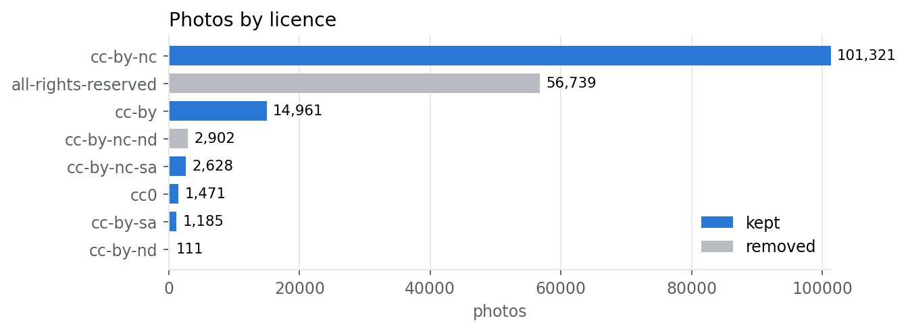

| Other source | Decision |
|---|---|
| SnakeCLEF 2023, `aishanikaggle/indian-snake` | 1,771 checked photos kept apart and not merged: SnakeCLEF photos have no recorded licence, and the Kaggle set was scraped from the web |
| Open Images V7 | 296 human-drawn snake masks (CC BY 2.0), kept for scoring segmentation |
| India Biodiversity Portal, SnakeCLEF 2021 | Not used: the portal blocks scripted downloads, and the 66 GB mirror stops Kaggle kernels from starting |
| Manna et al. 2026 hospital photos | Not used: no species labels. A possible real-world test set if the authors agree |

`metadata.csv` has one row per photo and 33 columns: `path`, `split`, labels (`species`, `genus`, `family`, `who_category`, `tier`), iNaturalist ids (`obs_id`, `photo_id`, `observer_id`), dates, place (`in_india`, `latitude`, `longitude`, `obscured`), `license`, `attribution`, `url`, image size and fingerprints (`sha1`, `phash`). Almost all photos are JPEG, and 99.6% have a 500 px long side (median 500 × 375 px). The dataset is 16.4 GB.

## 3. The pipeline

Each notebook reads named inputs, does one job and saves a private dataset for the next, so any step can be rerun alone.

| Step | Notebook | What happens | Time |
|---|---|---|---|
| Load | [01](../../notebooks/01_build_raw_dataset.ipynb) | Download photos and a per-photo manifest | 2.5 h |
| Clean and split | [02](../../notebooks/02_clean_and_split.ipynb) | Remove duplicates and tiny files, add labels, split by photographer | 3 min |
| Process | [03](../../notebooks/03_process_dataset.ipynb) | Licence filter, file checks, near copies, classes and tiers, final folders | 30 min |
| Masks | [04](../../notebooks/04_sam_masks.ipynb), [05](../../notebooks/05_merge_sam_masks.ipynb) | A snake mask for each training photo | 3.8 h per shard on two T4 GPUs |
| Prepare for training | [06](../../notebooks/06_segmentation_preprocessing.ipynb) | Exposure, cropping, resizing, augmentation, balancing, PyTorch loaders | a few min |
| Understand the data | [07](../../notebooks/07_eda_findings.ipynb), [full analysis](../../Group%205%20-%202026T3%20-%20DSAI%20Lab.ipynb) | Main findings and plots; the longer analysis, where all 87 data checks pass | 4 min; longer on GPU |

Every random choice uses a fixed seed. `StratifiedGroupKFold` assigns folds differently between scikit-learn releases, so notebook 02 pins version 1.9.1, and it reproduced our split for 100% of photos. iNaturalist keeps growing, so a fresh download will have more than our 24 October 2026 build.

## 4. Cleaning

| Stage | Photos | Why |
|---|---:|---|
| Raw download | 182,497 | |
| Exact duplicates (SHA-1) | −928 | One photo must not count twice or cross splits. We keep the Indian copy |
| Same photo under two species | −30 | The label can't be trusted, so all copies go |
| Tiny files (under 5 KB, or short side under 100 px) | −36 | Too little detail for scale and pattern |
| **Clean, then split** | **181,503** | |
| Restricted licences | −59,752 | 56,739 all rights reserved, 2,902 CC BY-NC-ND, 111 CC BY-ND |
| Near copies across splits | −185 | 105 val, 25 test, 55 test_extra. Copies would inflate test scores |
| **Final** | **121,566** | 120,751 in classes, 815 in the unknown pool |

We drop a validation or test photo within 4 bits of an earlier split's perceptual hash, or identical to one in its own split, and never touch train. The threshold comes from the data before the licence filter: within 2 bits, 89.5% of matches were the same species, but at 5 to 8 bits only 8.5% were, so those are mostly unrelated photos.

We keep dark photos, because many species are photographed at night and dropping them would remove species unevenly. Exposure correction handles them instead (section 7).

Research grade applies to an observation, not to each photo, and about 2% of our 500-photo mask pilot showed no live snake. We don't correct labels automatically. A stratified 200-photo hand check is planned for Milestone 3.

## 5. What the dataset covers

A class is one species with at least 20 photos. Of the 281 species with allowed photos, 184 are classes, across 69 genera and 13 families. The other 97 species form the unknown pool, which is never trained on. Tier 1 (400+ photos) has 56 classes and 105,435 photos, enough for normal training. Tier 2 (20 to 399 photos) has 128 classes and 15,316 photos, and needs stronger augmentation and a genus or family fallback.

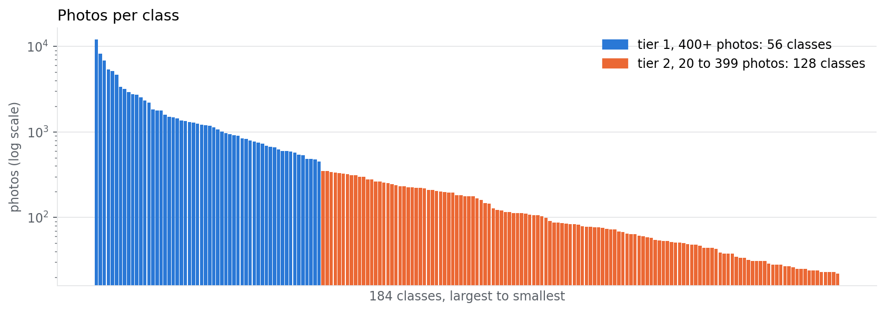

| Photos per class | Classes | Photos | Share of photos |
|---|---:|---:|---:|
| 1,000 or more | 32 | 89,016 | 73.7% |
| 500 to 999 | 20 | 14,528 | 12.0% |
| 300 to 499 | 14 | 5,165 | 4.3% |
| 100 to 299 | 45 | 8,352 | 6.9% |
| 20 to 99 | 73 | 3,690 | 3.1% |

So 52 classes have 500 or more photos, 66 have 300 or more, and 73 have under 100. Thirteen classes hold half the data. The median class has 178 photos, the Gini coefficient is 0.73, the largest class is 547× the smallest, and the effective number of classes is 32.6 out of 184.

### Dangerous species

Labels come from WHO SEARO 2016 [4]. Sixteen of the 20 WHO-listed species for India are classes. *Bungarus sindanus* and *Naja sagittifera* have too few allowed photos and sit in the unknown pool, and two *Trimeresurus* names have no research-grade photos, likely because of later taxonomic splits. *Ophiophagus kaalinga* was split from the king cobra in 2024, so it takes that category.

| Species | WHO | Tier | Train | Val | Test | Test extra |
|---|---|---|---:|---:|---:|---:|
| *Naja naja*, spectacled cobra | 1 | 1 | 2,076 | 338 | 324 | 190 |
| *Echis carinatus*, saw-scaled viper | 1 | 1 | 1,238 | 273 | 64 | 196 |
| *Daboia russelii*, Russell's viper | 1 | 1 | 1,123 | 196 | 170 | 99 |
| *Bungarus caeruleus*, common krait | 1 | 1 | 799 | 177 | 107 | 44 |
| *Hypnale hypnale*, hump-nosed pit viper | 1 | 1 | 747 | 155 | 124 | 47 |
| *Naja kaouthia*, monocled cobra | 1 | 1 | 486 | 127 | 22 | 115 |
| *Craspedocephalus malabaricus*, Malabar pit viper | 2 | 1 | 1,236 | 279 | 217 | 57 |
| *Bungarus fasciatus*, banded krait | 2 | 1 | 952 | 140 | 17 | 202 |
| *Craspedocephalus gramineus*, bamboo pit viper | 2 | 1 | 813 | 180 | 298 | 58 |
| *Macrovipera lebetinus*, Levantine viper | 2 | 1 | 709 | 115 | 0 | 116 |
| *Ophiophagus hannah*, king cobra | 2 | 1 | 448 | 66 | 10 | 75 |
| *Trimeresurus erythrurus*, red-tailed pit viper | 2 | 2 | 160 | 38 | 17 | 18 |
| *Ophiophagus kaalinga*, Western Ghats king cobra | 2 | 2 | 70 | 17 | 18 | 2 |
| *Bungarus niger*, black krait | 2 | 2 | 58 | 13 | 8 | 6 |
| *Naja oxiana*, Oxus cobra | 2 | 2 | 30 | 8 | 0 | 6 |
| *Bungarus walli*, Wall's krait | 2 | 2 | 10 | 9 | 0 | 6 |

We have no venom label, only the WHO list. Vipers and elapids are venomous as whole families, which gives a lower bound on how many low-data species are venomous:

| Group | Species | WHO-listed | Vipers or elapids |
|---|---:|---:|---:|
| Tier 1 classes | 56 | 11 | 15 |
| Tier 2 classes | 128 | 5 | 30 |
| Unknown pool | 97 | 2 | 21 |

So 51 of the 66 vipers and elapids have few photos. **"Not listed" never means harmless**, and the app will never say so: 29 of the 168 not-listed classes are vipers or elapids, and WHO warns that the red-necked keelback, a colubrid, can also be dangerous.

### Sample images

The spectacled cobra (WHO Category 1) and the oriental rat snake (not listed) are one of the lookalike pairs the model must separate.

| *Naja naja* | *Ptyas mucosa* |
|---|---|
|  |  |
| © Chayant Gonsalves, CC BY, [iNaturalist 84964394](https://www.inaturalist.org/observations/84964394) | © Surabhi Srivastava, CC BY, [iNaturalist 212098553](https://www.inaturalist.org/observations/212098553) |

One training photo per class, largest first ([credits and order](assets/grid_all_classes_attribution.csv)):

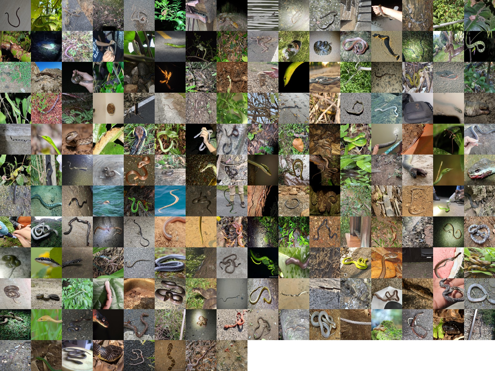

The WHO-listed classes, four photos each, one row per species ([credits and order](assets/grid_who_listed_attribution.csv)):

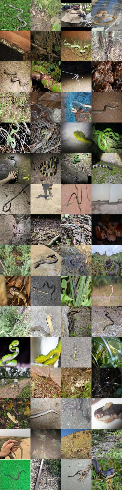

## 6. What the data told us

| Finding | Evidence | What we do |
|---|---|---|
| Most training photos aren't Indian | 37.4% of train and 37.1% of val are Indian, against 100% of test. 47 classes have under 20% Indian training photos, and 7 have none | Test stays Indian. We also score Indian validation photos separately, so any gap shows before the test run |
| Background could become a shortcut | In train, 77.8% of Category 1 photos are Indian against 33.0% of not-listed photos, so a model could learn "Indian scene means dangerous" | The three checks below |
| One photographer dominates test | One person took 28.1% of test (1,447 of 5,144), and 98.1% of those are portrait. Without them test is 45.0% portrait, close to 43.8% for comparable training photos | Keep the split, bootstrap by photographer, also report scores without them |
| Some rare classes rely on few people | Median 42 photographers per class, but 7 classes have 5 or fewer, and one person takes half or more of 12 classes | Photographer cap and camera-style augmentation (sections 8 and 9) |
| `test` is thin per class | 36 classes have no `test` photos, including 3 WHO-listed. Among the other 148, the median is 9 photos and 42 have under 5 | Use `test_extra` too, and report bootstrap intervals |
| Many snakes are small in the frame | At a 224 px input, 6.9% of snakes are under 64 px, against 2.5% at 320 and 1.5% at 384 | Start at 320; compare sizes in Milestone 3 |
| Colour is close to ImageNet's | Average colour is 0.455, 0.439, 0.369 against 0.485, 0.456, 0.406 | Keep ImageNet normalisation for pretrained encoders |

Removing the background isn't enough to rule out a shortcut, so Milestone 3 has three checks: compare whole-photo and masked inputs, score each model on validation photos with the snake blanked out, and compare Indian and non-Indian validation scores. Species share features across their range, and genus and family heads give a fallback, but those benefits stay hypotheses until measured.

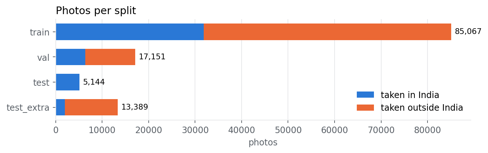

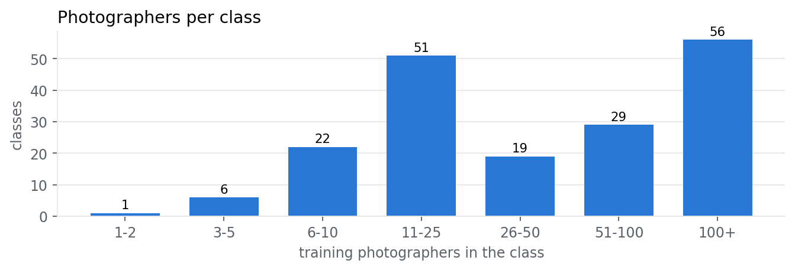

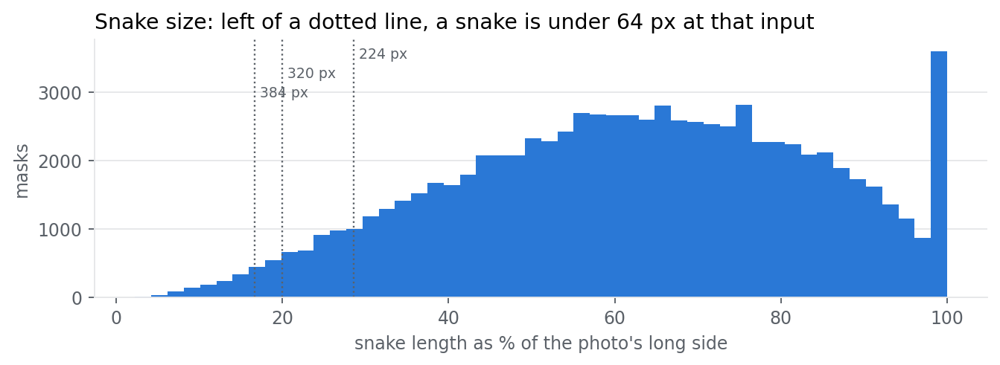

The full analysis adds three results. Once species is removed, a simple classifier on DINOv2 embeddings barely separates train from val (AUC 0.53), test (0.50) or test_extra (0.56), though that doesn't prove there is no shift. The closest photo from another photographer is the same genus 35.7% of the time, against 3.0% by chance, so genus and family heads have something to learn from. A label-checking classifier reached only 25.9% accuracy, so we use its list only to choose photos to hand-check. Only 9 photos have a match from another photographer at similarity 0.9 or more, and none reaches 0.95.

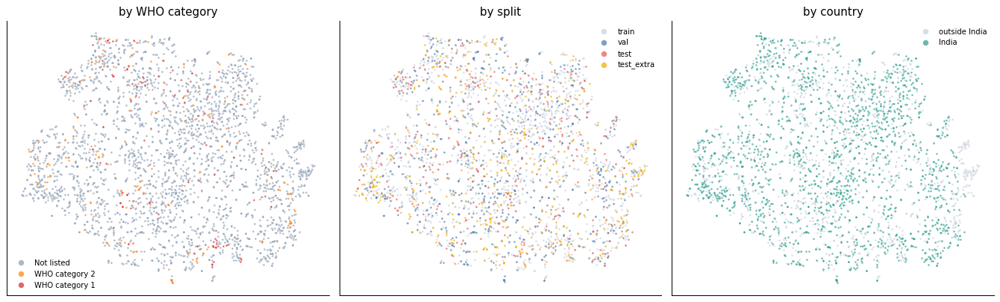

**Lookalikes.** We studied nine pairs that join a WHO-listed species with a not-listed lookalike. All nine have at least 58 test photos per side, so each mix-up can be measured in both directions. In the embeddings, 4 of the 9 named lookalikes are among the 5 nearest of 183 species. For 15 of the 16 dangerous species, the closest not-listed species isn't on our list at all, so nine pairs is only a start.

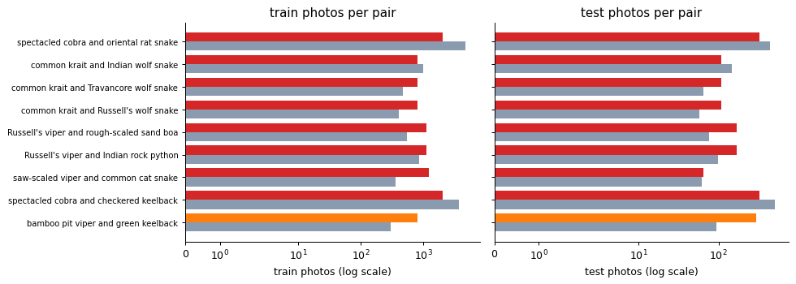

## 7. Preprocessing

Notebook 06 applies these steps as each photo loads, the same way in every split.

| Step | What it does | Why |
|---|---|---|
| Class ids | From `classes.csv`, never folder order | 36 species have no `test` folder, so `ImageFolder` would silently mislabel photos |
| Convert to RGB | Every photo, on its stored pixel grid | Some files are PNGs named `.jpg`, and masks were made on the stored grid |
| Exposure correction | CLAHE on lightness only, for mean brightness under 60 or over 200 (12.1% and 0.2% of a sample) | Lifts dark photos so night species stay usable, without changing colour bands |
| Mask cleaning | Close small gaps, keep the large parts | Removes specks but keeps separate coils |
| Cropping | To the mask +6%, in the masked modes | Removes background when a mask is available |
| Resizing | Letterbox to 320×320 with grey padding | Stretching makes a slender vine snake look stout, and centre cropping would cut snakes; 39.3% of training photos are portrait |
| Normalising | ImageNet mean and standard deviation | Pretrained encoders expect it |

The default input, `full`, is the whole photo, with the mask used only as the segmentation target. `soft_dim`, `hard_mask` and `rgbm_4ch` crop to the mask and dim the background, remove it or add the mask as a fourth channel. SAM won't run on the phone, so at test time these modes use our own segmentation model's mask, and Milestone 3 compares them.

Each batch has images `(32, 3, 320, 320)`, masks `(32, 1, 320, 320)`, `mask_valid`, and species, genus, family and WHO risk targets. Photos without a usable mask have `mask_valid = False`, so the segmentation loss skips them.

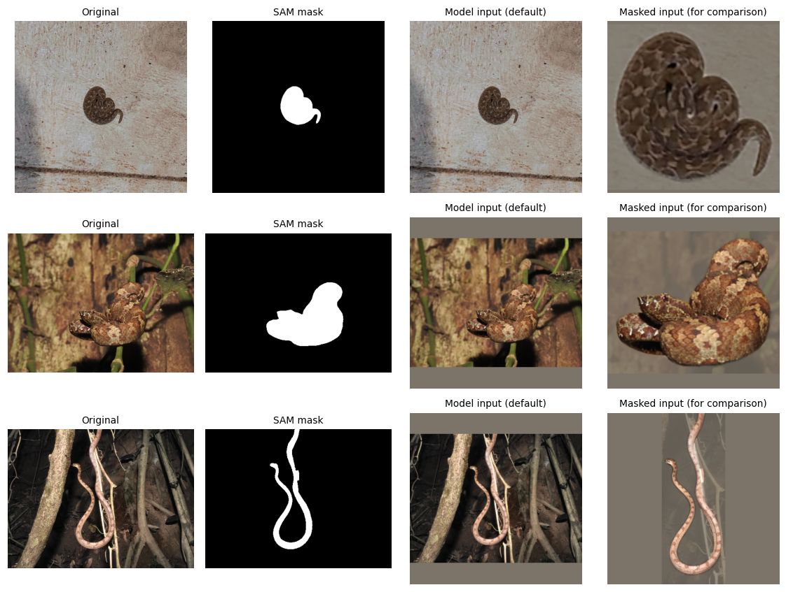

Top to bottom: *Echis carinatus*, © Giri RAO; *Craspedocephalus malabaricus*, © Hopeland; *Boiga nuchalis*, © Hopeland. All CC BY.

## 8. Augmentation

Augmentation runs on training photos only, as they load, so nothing is stored and copies can't reach validation or test. Flips, zoom, rotation and shift move the photo and mask together.

| Augmentation | Tier 1 | Tier 2 | Why |
|---|---|---|---|
| Horizontal / vertical flip | 50% / 20% | 50% / 35% | A snake can lie in any direction |
| Zoom, rotation, shift | ±12%, ±25°, ±5%; 60% of the time | ±20%, ±45°, ±8%, shear ±10°; 80% | Rare classes need more variety |
| Brightness, contrast | ±20% | ±30% | Lighting varies |
| Saturation, hue | ±20%, about ±4% | ±25 of 255, about ±4% | Colour bands identify some species, so hue stays small |
| Motion blur | None | 25% | Hurried phone photos |
| Cutout | 1 to 4 patches, 35% | 2 to 6 patches, 50% | Leaves and hands hide parts of snakes |
| JPEG compression, downscaling, blur, white-balance shift | 30%, 20%, 15%, 30% | Same | So a class from one or two photographers doesn't teach the model that camera. We don't add synthetic sensor noise |

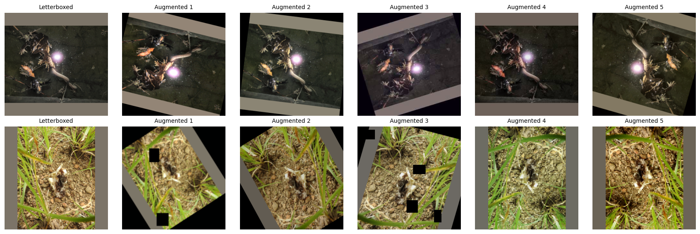

Top to bottom: *Fowlea piscator* (tier 1) and *Ophiophagus kaalinga* (tier 2), both © Hopeland, CC BY.

## 9. Handling imbalance

Loss weighting alone isn't enough here, so several steps work together. Training keeps up to 50 photos per photographer per class and up to 1,000 per class, taking photographers in turn; the class cap affects 20 classes. A sampler then draws each photo with weight 1/√(class size), times 1.60 for Category 1 and 1.35 for Category 2.

| Stage | Training photos | Largest / smallest class | Effective classes |
|---|---:|---:|---:|
| All training photos | 85,067 | 876× | 31.9 |
| After the caps | 52,308 | 100× | 76.4 |
| One epoch from the sampler | 52,308 | 15.6× | 118.6 |

Validation and test keep every photo. Batches of 32: 1,635 train, 536 val, 161 test, 419 test_extra.

Milestone 3 adds the rest: it compares class-balanced and focal loss (weights are saved in `class_weights.csv`), adds the species, genus, family fallback with an "I don't know" threshold, and decides from the results whether the rarest species should be labelled at genus level.

## 10. Masks and annotation quality

Grounding DINO finds the snake with the prompt "a snake.", and a separate pass finds hands and gloves. SAM 2.1 turns the boxes into a mask, and hands are cut out. SAM is only a teacher for making labels: it runs on training photos and won't run on the phone. Validation and test photos have no SAM masks, so a model is never scored against SAM's own output.

Of 85,067 clean training photos, 82,354 have a mask, 2,713 had no snake found, and hands or gloves were cut out of 3,891. The quality rules leave out 21,629 (25.4%), including those with no snake, which leaves 63,438 usable. Flag rates are similar across danger levels: 22.0% for Category 1, 18.3% for Category 2 and 26.2% for not listed.

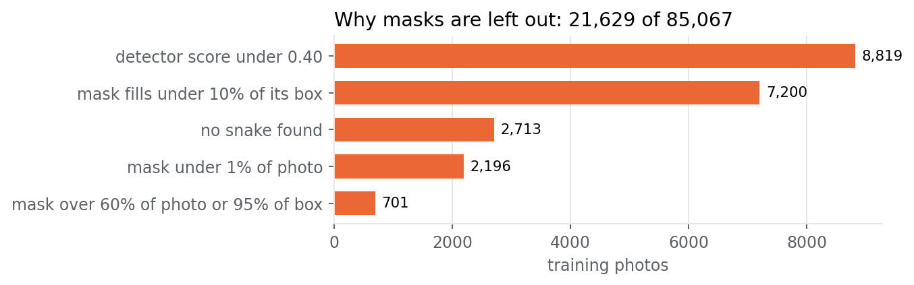

The rules catch doubtful masks but can't prove the others are right. An early by-eye pass on 491 pilot masks found about 84% good, 10% partial and 6% wrong. Milestone 3 hand-checks the flagged masks and scores against the 296 human-drawn Open Images masks, using IoU and Dice, because the median mask covers just 6.1% of its photo and pixel accuracy would flatter a model that predicts all background.

## 11. Split, folders and link

| Split | Photos | Share | Observations | Photographers | Classes | Taken in India |
|---|---:|---:|---:|---:|---:|---:|
| train | 85,067 | 70.4% | 43,924 | 11,272 | 184 | 37.4% |
| val | 17,151 | 14.2% | 8,717 | 2,249 | 176 | 37.1% |
| test | 5,144 | 4.3% | 2,744 | 460 | 148 | 100% |
| test_extra | 13,389 | 11.1% | 6,950 | 1,894 | 162 | 14.7% |
| unknown_pool | 815 | not in the shares | 437 | 255 | 97 species | 82.2% |

We used scikit-learn's `StratifiedGroupKFold` [7] with 7 folds and seed 42, grouped by photographer and stratified by species. Five folds are train, one is validation and one is held out, which gave 71 / 14 / 14 before the licence filter and 70 / 14 / 15 of the class photos after it. We group by photographer because one person often posts the same snake, camera and place, which would inflate scores.

The held-out fold has 18,533 photos. `test` keeps those taken in India and uploaded from 1 January 2022, which the published global model [3] can't have trained on. `test_extra` is the rest: it serves classes with too few Indian photos and shows how photos from abroad transfer. The 73 photographers in both stay in that fold, away from train and val.

Between train, validation and the held-out fold there are no shared photographers, observations, SHA-1 hashes or perceptual hashes, and no validation or test photo is within 4 bits of a training photo. A control confirms the near-copy rule: a copy with 3 flipped bits is caught and one with 6 is not. Some classes still can't be evaluated well: 36 have no `test` photos, 8 have no val photos, and 3 have neither `test` nor `test_extra` photos (*Uropeltis ceylanica*, *Bungarus bungaroides* and *Wallaceophis gujaratensis*).

```text
serpentguard-indian-snakes-clean/
├── data/
│   ├── train/<species>/<source>_<photo_id>.jpg
│   ├── val/<species>/...
│   ├── test/<species>/...
│   ├── test_extra/<species>/...
│   └── unknown_pool/<species>/...
├── metadata.csv              one row per photo
├── classes.csv               one row per class, with class_id and per-split counts
├── processing_report.json    counts, removals and leakage checks
└── figures/                  sample grids with credits
```

| Dataset on Kaggle (all private) | Contents |
|---|---|
| [`puneetbajajiitm/serpentguard-indian-snakes-clean`](https://www.kaggle.com/datasets/puneetbajajiitm/serpentguard-indian-snakes-clean) | The main dataset |
| [`puneetbajajiitm/serpentguard-sam-masks`](https://www.kaggle.com/datasets/puneetbajajiitm/serpentguard-sam-masks) | Masks and quality flags; notebook 06 uses only those of clean training photos |
| `puneetbajajiitm/serpentguard-m2-splits` | Split table, class table and removed photos |
| `puneetbajajiitm/serpentguard-indian-snakes` | Raw download, used only to rebuild |
| `puneetbajajiitm/serpentguard-extended-sources`, `serpentguard-extended-combined` | Extra photos and Open Images masks, not merged |

## 12. Limits and Milestone 3

The photos are mostly still, well framed and taken by enthusiasts, unlike hurried phone photos at night. There is no public species-labelled snake video, so video is for evaluation only. The licence filter cost us 24 classes, including *Bungarus sindanus*. Most photos are CC BY-NC, so they suit this course project but not a commercial release.

We haven't chosen an edge segmentation model yet. These are the candidates, with published figures on general datasets rather than snakes, so we will measure size, latency and IoU ourselves. The target is a 25 to 30 MB package on the phone.

| Candidate | Parameters | Published result | Note |
|---|---:|---|---|
| YOLO26n-seg [8] | 2.7 M | Mask mAP 33.9, 53.3 ms on CPU at 640 px | Instance masks, COCO |
| LR-ASPP MobileNetV3 [9] | 3.2 M | Mean IoU 57.9 | Lightest semantic option |
| U-Net with MobileNetV2 encoder [10] | 2 M, encoder only | None for this pair | Easy to train on our masks |
| MobileSAM [11] | 9.66 M | 12 ms on one GPU | Needs a box or point prompt, so it depends on a detector |
| DeepLabV3 MobileNetV3 [9] | 11.0 M | Mean IoU 60.3 | Most accurate here but the heaviest |

For Milestone 3 we will:

1. Shortlist about 3 architectures each for segmentation, species classification and the response model (RAG).
2. Compare them on a stratified 15 to 30% subset that represents the full data, report the numbers and justify the pick.
3. Tune 3 or 4 main hyperparameters on the chosen model only, and log every combination and its result in the repository.
4. Run the pipeline end to end on baseline models, logging each node's output: image, preprocessing, segmentation, species, genus and family, RAG response, final output.
5. Evaluate on unseen photographers, to show performance doesn't collapse.
6. Hand-check 200 photos and the flagged masks.

Full training comes in Milestone 4, the comparison with market solutions in Milestone 5, and the app and backend in Milestones 5 and 6.

## Team contributions

| Member | Work this milestone |
|---|---|
| Puneet Bajaj | Data collection, cleaning, splits, licence filter, Kaggle datasets, mask pipeline, notebooks 01 to 05 and 07, fixes to 06, 08 and 09 |
| Manas Rastogi | Full exploratory analysis, with help from Vikas; extra-source research and first versions of notebooks 08 and 09 |
| Vikas | Preprocessing pipeline (notebook 06), presentation, help with the analysis |
| Jayesh Bansal | Team lead: coordination and distributing the work |

Weekly detail is in the [work contribution log](../../work-contribution-log.md).

## References

1. iNaturalist API v1, [documentation](https://api.inaturalist.org/v1/docs/), queried 24 October 2026.
2. iNaturalist, [open-data photo files and attribution](https://github.com/inaturalist/inaturalist-open-data/blob/main/README.md).
3. Bolon I. et al. (2022). [An artificial intelligence model to identify snakes from across the world](https://journals.plos.org/plosntds/article?id=10.1371/journal.pntd.0010647). *PLOS Neglected Tropical Diseases* 16(8): e0010647.
4. World Health Organization, Regional Office for South-East Asia (2016). [Guidelines for the Management of Snakebites, 2nd edition](https://cdn.who.int/media/docs/default-source/searo/india/health-topic-pdf/who-guidance-on-management-of-snakebites.pdf). India section, PDF pages 86 and 87.
5. Manna I. I. A. et al. (2026). [Indian venomous snake classification with explainable AI](https://doi.org/10.1371/journal.pntd.0014147). *PLOS Neglected Tropical Diseases* 20(6): e0014147.
6. Google, [Open Images V7](https://storage.googleapis.com/openimages/web/download_v7.html).
7. Pedregosa F. et al. (2011). [Scikit-learn: Machine Learning in Python](https://jmlr.org/papers/v12/pedregosa11a.html). *JMLR* 12: 2825-2830.
8. Ultralytics, [segmentation models](https://docs.ultralytics.com/tasks/segment/), checked 31 October 2026.
9. PyTorch, [torchvision pretrained models](https://docs.pytorch.org/vision/stable/models.html), checked 31 October 2026.
10. Segmentation Models PyTorch, [encoders](https://smp.readthedocs.io/en/latest/encoders.html), checked 31 October 2026.
11. Zhang C. et al., [MobileSAM](https://github.com/ChaoningZhang/MobileSAM), checked 31 October 2026.

<div style="page-break-before: always"></div>

# Team review and acknowledgment

Each team member signs one row after the review. By signing, each member confirms that they have reviewed this document, understand its contents and agree with the submission.

| Team member name | Roll Number | Signature / acknowledgment | Date |
|---|---|---|---|
| Jayesh Bansal | 24f100185 | | |
| Vikas | 23f3001800 | | |
| Puneet Bajaj | 23f3002416 | Puneet Bajaj | 31/10/2026 |
| Manas Rastogi | 22f3001477 | | |
