# Milestone 3: Model architecture and end-to-end pipeline

SerpentGuard AI · Group 5 · IIT Madras DS and AI Lab 
Team lead: Jayesh Bansal. Members: Vikas, Puneet Bajaj and Manas Rastogi. 
Draft of 5 November 2026, for the team review; the signatures at the end are added at that review.

## Summary

We chose a model for each stage of SerpentGuard, compared each one against baselines on a 16.4% training subset, and ran the whole chain from a photo or a clip to a verdict with WHO first-aid guidance. Every number below comes from the runs listed in section 8.

**How this report is organised.** Sections 1 to 6 follow the six Milestone 3 requirements:

| Milestone 3 requirement | Section |
|---|---|
| Model architecture selection: each architecture used or tried, and the overall approach | 1 |
| Architecture justification: suitability, comparison with the alternatives, design changes, trade-offs | 2 (comparison table, then 2.1 to 2.9) |
| Baseline model performance: the candidate subset, evaluation metrics, baselines and industry benchmarks | 3 |
| Hyperparameter tuning: parameters, search, chosen values, impact, plots, tuned against default | 4 |
| End-to-end setup: data flow, architecture overview, training, validation, evaluation, outputs | 5 |
| Architecture visualization: the pipeline and SnakeID diagrams | 6 |
| Limitations, Milestone 4 and reproducibility | 7 and 8 |

**Results at a glance.**

| Item | Value |
|---|---|
| Candidate subset | 13,925 photos (16.4% of train), all 184 classes, 6,576 photographers |
| Encoder (E1) | MobileViT-S: head macro-F1 0.256, against 0.231 and 0.237 for EfficientNet-B0 (two seeds) and 0.196 for MobileNetV4-S |
| Species head (E2) | ArcFace: 0.263 macro-F1 with photographer-balanced prototypes, against 0.2546 for cross-entropy (mean of 3 seeds) |
| Noise floor (N0) | 3 cross-entropy seeds span 0.2535 to 0.2560, so a difference under 0.005 counts as none |
| Best baseline with no training on our photos | B1, the published SnakeCLEF 2021 model: 0.257 macro-F1, an upper bound, at about 1.13 GB |
| Front end (S1, D1, FE) | A crop to our fine-tuned YOLO26n's box (mAP@0.5 0.935) lifts head macro-F1 from 0.257 to 0.311 and cuts false alarms from 0.410 to 0.279; masks from the best segmenter (U-Net, IoU 0.837) add nothing |
| Verdicts of the final model (head scoring, lower-bound fit) | WHO-listed snakes called dangerous 94.8% (95% interval 93.0 to 96.3%); called "not listed" 2.1%; false alarms 31.1% |
| Unknown species | Only 7.5% of unknown-pool photos flagged as unfamiliar (target 70%) |
| Response retrieval (Q1) | The M3 package ships BM25 (Recall@3 0.47, against 0.40 for a fixed lookup); MiniLM-L6 (0.68) is the upgrade once the size budget allows |
| End to end (P1) | 100 validation photos and 5 clips through the final model, every node logged; 87.4 ms per photo on a laptop CPU, detector included |
| Robustness (R1) | With the snake blanked, 17.8% of the photos the final model gets right stay right, against 23.6% on the whole photo; Indian photos score 15.6 points lower on top-1 |
| Video (V1) | On 200 damaged synthetic clips, the 4-of-6 vote cuts verdict flips from 26.2 to 6.1 per clip, and dangerous clips that ever show "not listed" from 0.294 to 0.059; the clip verdict is right on 29.5%, against 58.5% on the clean photos |
| Video demo | A snake clip in, an annotated video and an insights file out; 79.9 to 88.2 ms per frame on the laptop |
| Tuning (H1) | 24 random trials of 8 epochs; the best, 0.260, used learning rate 9.5e-4 and weight decay 1.6e-3 |
| Final model (retrain, N1) | H1_top1, the tuned recipe on the F1 crop: head macro-F1 0.3668, mean of 3 seeds that span 0.0014, against 0.311 for the default recipe on the same crop. We ship seed 1, H1_top1_s1 |
| Against B1, scored the same way | Macro-F1 0.367 against 0.257, and 0.357 against 0.252 on photos uploaded from 2022, a lead that comes from coverage: B1 cannot name 122 of our 184 species. On the 62 species both know, B1 leads on top-1, 0.801 against 0.682 |
| Size and speed (X1) | A 13.6 MB package with BM25, against 30 MB; 84.9 ms per photo (11.8 FPS) on one laptop CPU thread, against 10 FPS |

What we learned, good and bad:

- **The best published model is still better on the species it knows.** Our final model, MobileViT-S (4.94M parameters) with the tuned recipe on the detector's crop, reaches 0.367 macro-F1 against 0.257 for the SnakeCLEF 2021 model, and 0.357 against 0.252 on photos uploaded from 2022. That lead comes from coverage: the published model cannot name 122 of our 184 species, and each of them counts as zero. On the 62 species both models know, it leads by about 12 points of top-1, 0.801 against 0.682. Ours is about 1% of its size (10.7 MB against about 1.13 GB) and trained on 16% of our photos; training on all of them is M4.
- **The face-recognition head helps a little, and costs false alarms.** ArcFace beats cross-entropy by 0.0082, beyond the noise floor, and raises raw WHO recall from 0.716 to 0.741. But its verdicts call 42.2% of the snakes that are neither WHO-listed nor vipers or elapids dangerous, against 36.4 to 37.9% for cross-entropy.
- **Cropping to the snake helps; segmentation does not.** A crop to the detector's box raises head macro-F1 by 0.053, about ten times the noise floor. Dimming or removing the background, an auxiliary mask loss and mask-guided pooling add nothing on top, so the segmenter leaves the pipeline. The crop also cuts false alarms from 41.0% to 27.9%, but its WHO recall on validation falls below the target; the lower-bound threshold fit brings the final model back to 0.948, just under it.
- **The crop leans less on the scenery, but not on nothing.** With the snake blanked, 17.8% of the photos the final model gets right stay right, against 23.6% on the whole photo, and with another photo's scenery behind the snake it keeps its own class on 46.0% against 32.4%.
- **Tuning added about as much as the crop did.** The best setting from the H1 search, retrained on the crop, lifts head macro-F1 from 0.311 to 0.3668 (mean of 3 seeds), and its seeds span only 0.0014.
- **The end-to-end check caught a train/serve skew.** The app padded a lone photo differently from the training batches, so its detector boxes drifted from the training boxes. With every call padded to the same square, P1 matches the training run's outputs on 98% of verdicts, up from 89%.
- **Three ideas bought nothing.** Triplet loss, the 5× danger weight and logit-adjusted cross-entropy did not raise macro-F1, and logit adjustment cut top-1 accuracy to 37.3%. We report them as findings.
- **A smarter decision rule does not cut false alarms.** On the final model, none of 6 other rules beats the current one at the same 0.95 WHO recall target. We read the false alarms as lookalike confusion in the classifier, so the cut has to come from a better model.
- **Voting steadies the verdict on video, but damaged clips are hard.** On 200 synthetic clips with leaves over 30 to 70% of the snake, the 4-of-6 vote cuts verdict flips from 26.2 to 6.1 per clip, and only 0.059 of dangerous snakes' clips ever show "not listed", against 0.294 frame by frame. The clip verdict is right on only 29.5%.
- **The package fits the phone budget in fp16, not in int8.** fp16 SnakeID, the detector with int8 weights and BM25 come to 13.6 MB against 30 MB and run at 11.8 FPS on one laptop CPU thread. fp16 loses nothing, but full int8 breaks trained models: on the final model it keeps the float32 top-1 species on only 8.0 to 9.3% of photos.
- **The final model's verdicts sit just under the WHO recall target and just over the error target.** 94.8% of WHO-listed photos get "dangerous", against the M1 target of 0.95, and 2.1% get "not listed", just above the 2% target. False alarms fall to about 3 in 10, from 4 in 10 for E2, and unknown-species detection does not work yet.

## 1. Model architecture selection

SerpentGuard runs offline on the phone and generates no text. A photo, or each frame of a live clip, passes through five stages: preprocessing, a front end that finds the snake, SnakeID, a decision layer and a response step. A phone-sized network, SnakeID, turns each photo into a 256-number fingerprint and names the species by its closest known fingerprint, the way face recognition works. Genus, family and WHO heads give a fallback. A decision layer turns the outputs into one of three verdicts, and the response step quotes fixed WHO passages with their page. Section 6 draws the pipeline and SnakeID itself, and [notebook 15](../../notebooks/15_m3_end_to_end.ipynb) has the pipeline chart in more detail.

| Stage | Input → output | Chosen (section) |
|---|---|---|
| Preprocess | photo → `(B, 3, 320, 320)`, notebook 06 unchanged | M2 |
| Front end | photo → crop to the YOLO26n box plus 6%, or "no snake found" | YOLO26n box crop, F1 (2.5) |
| SnakeID | image → 256-d embedding; species (184), genus (69), family (13) and WHO (3) outputs | MobileViT-S, ArcFace head, tuned recipe (2.1 to 2.4, 4) |
| Decision | outputs → dangerous / not on the WHO list, still keep away / we don't know, with a reason | rules with thresholds fitted on a calibration set (2.6) |
| Response | verdict and top species → species card and WHO passages | BM25 retrieval plus the fixed first-aid lookup (2.7) |

**What counts as dangerous.** Our danger table (`data/m3/medical_importance.csv`) marks 50 of the 184 classes: 6 WHO Category 1, 10 WHO Category 2, 29 more vipers and elapids (every species in those families is venomous) and 5 *Rhabdophis* keelbacks, which the guideline names. Each row cites its guideline page. "Not listed" is always shown as "not on the WHO list, still keep away".

**Architectures we used or tried.**
- SnakeID encoders: MobileNetV4-S, EfficientNet-B0 and MobileViT-S, all pretrained on ImageNet (E1).
- Species heads: cross-entropy and ArcFace, each with and without a batch-hard triplet loss, a P×K sampler alone and logit-adjusted cross-entropy (E2), with genus, family and WHO heads (E3) and a danger-weighted WHO loss (E4).
- Front ends: four segmenters (U-Net MobileNetV2, YOLO26n-seg, LR-ASPP MobileNetV3 and a mask head on SnakeID), two detectors (YOLO26n fine-tuned on our boxes and yolov8n-oiv7 as is) and seven ways to feed the snake to SnakeID (S1, D1, FE).
- Decision rules: the listed-mass rule and four alternatives (DR).
- Retrievers for the response: a fixed lookup, BM25 and two MiniLM sentence encoders (Q1).
- Export precisions: fp32, fp16, int8 weights and int8 arithmetic (X1).
- Baselines with no training on our photos: a class prior, the published SnakeCLEF 2021 model, BioCLIP, our frozen encoders and DINOv2 (section 3).

**Overall approach: one recipe, one rule.** Every run uses the same recipe: AdamW at learning rate 3e-4 (encoder at 0.1×), weight decay 0.05, cosine schedule after 1 warm-up epoch, 20 epochs, batch 64, mixed precision, 320 px input and notebook 06's augmentation and sampler. Each run changes only what it tests, and its settings sit in `configs/m3/<run>.yaml`. We pick the highest validation macro-F1 among models whose raw WHO recall and O3 error are no worse than cross-entropy's beyond noise. Within noise, we pick the smaller and faster model, then the one with fewer parts.

## 2. Architecture justification

Each stage was chosen by the rule in section 1, on the 17,151 validation photos. The table lists the alternatives at each stage, the score that decided, and the winner. The subsections give the full results, why the winner suits our data, the changes we made to each architecture, and the trade-offs. Sources are numbered in square brackets and listed under References.

| Stage | Alternatives tried | Deciding score | Winner | Details |
|---|---|---|---|---|
| Encoder (E1) | MobileNetV4-S, EfficientNet-B0 (2 seeds), MobileViT-S | Head macro-F1 0.196; 0.231 and 0.237; 0.256 | MobileViT-S | [2.1](#21-encoder-e1) |
| Species head (E2) | Cross-entropy (3 seeds), ArcFace, cross-entropy + triplet, ArcFace + triplet, P×K sampler alone, logit-adjusted cross-entropy | Best macro-F1 0.2546, 0.263, 0.254, 0.257, 0.252, 0.250 | ArcFace | [2.2](#22-species-head-e2) |
| Genus and family heads (E3) | With and without | Head macro-F1 0.256 with, 0.255 without | Kept, for the fallback | [2.3](#23-genus-and-family-heads-e3) |
| WHO loss weight (E4) | 5× and 1× | Macro-F1 0.2546 at 5× (3 seeds), 0.263 at 1× | 1× | [2.4](#24-danger-weighted-who-loss-e4) |
| Segmenter (S1) | U-Net MobileNetV2, YOLO26n-seg, LR-ASPP MobileNetV3, mask head | IoU on human masks 0.837, 0.828, 0.787, 0.772 | U-Net, then dropped by FE | [2.5](#25-front-end-s1-d1-fe) |
| Detector (D1) | YOLO26n fine-tuned, yolov8n-oiv7 as is | mAP@0.5 0.935, 0.514 | YOLO26n | [2.5](#25-front-end-s1-d1-fe) |
| Front end (FE) | Whole photo, box crop, mask-box crop, dimmed or removed background, mask loss, mask pooling | Head macro-F1 0.257, 0.311, 0.312, 0.291, 0.259, 0.250, 0.259 | Box crop (F1) | [2.5](#25-front-end-s1-d1-fe) |
| Decision rule (DR) | DR0 to DR4 | False alarms at the 0.95 target 0.311, 0.326, 0.394 and 0.397, 0.314 and 0.302, 0.162 (a variant at 0.842 recall) | DR0, the current rule | [2.6](#26-decision-layer) |
| Species ranking | Head, prototypes | Unknown-species AUROC on the final model 0.692, 0.616 | Head | [2.6](#26-decision-layer) |
| Retriever (Q1) | Fixed lookup, BM25, MiniLM-L6, MiniLM-L3 | Recall@3 0.40, 0.47, 0.68, 0.53 | BM25, for size | [2.7](#27-response-retrieval-q1) |
| Export precision (X1) | fp16, int8 weights, int8 arithmetic (static, dynamic) | Top-1 agreement with fp32 100.0%, 92.3%, 9.3% and 8.0% | fp16 | [2.8](#28-size-and-speed-x1) |
| Hyperparameters (H1) | Default and the 3 best of 24 trials, 3 seeds each | Head macro-F1 on the crop 0.311; 0.3668, 0.3630, 0.3551 | H1_top1 | [4](#4-hyperparameter-tuning-h1) |

**Design changes to the original architectures.** SnakeID keeps MobileViT-S's ImageNet weights and replaces its classifier: a linear layer with batch normalisation makes a 256-number embedding, an ArcFace head (s = 30) names the species from it, and genus, family and WHO heads give the fallback (5.2, 6). We train at 320 px, with the encoder at 0.1× the learning rate of the new layers. YOLO26n is fine-tuned to a single snake class on Grounding DINO boxes, and its box is widened by 6% before the crop. ArcFace's margin, the learning rate, weight decay and augmentation strength come from the H1 search (section 4).

**Noise floor (N0).** The E1 winner trained with seeds 42, 1 and 2 gives head macro-F1 0.2560, 0.2541 and 0.2535: a spread of 0.0025. Twice that, 0.005, is the smallest difference we call real. One seed per variant is a limit. N1, the final recipe's three seeds, spans 0.0014 (section 4), but the second-best tuned setting spans 0.0137, so the floor depends on the recipe.

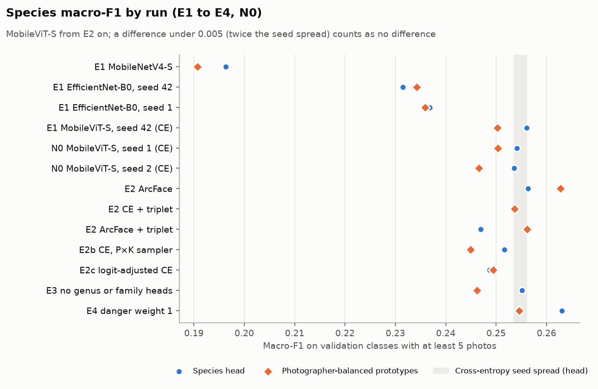

### 2.1 Encoder (E1)

| Encoder | Parameters | Head macro-F1 | Prototype macro-F1 | Top-1 | Top-3 | Tier 1 / tier 2 | WHO recall (raw) | s per epoch | GPU waiting for data |
|---|---:|---:|---:|---:|---:|---:|---:|---:|---:|
| MobileNetV4-S | 1.26M | 0.196 | 0.191 | 45.4% | 64.3% | 0.385 / 0.093 | 0.637 | 160 | 86% |
| EfficientNet-B0, seed 42 | 4.01M | 0.231 | 0.235 | 49.2% | 67.7% | 0.430 / 0.123 | 0.673 | 181 | 62% |
| EfficientNet-B0, seed 1 | 4.01M | 0.237 | 0.237 | 49.3% | 68.1% | 0.431 / 0.130 | 0.661 | 162 | 56% |
| **MobileViT-S** | 4.94M | **0.256** | **0.254** | **53.4%** | **71.9%** | 0.479 / 0.134 | **0.717** | 183 | 17% |

**MobileViT-S wins.** EfficientNet-B0's two seeds differ by 0.0054, and MobileViT-S leads their mean by 0.022, four times that. It also has the best raw WHO recall. Its attention layers see the whole snake at once, which suits long thin bodies and patterns spread along them. **Trade-off:** it is the largest of the three. Full int8 breaks every trained encoder we tried (2.8), so MobileViT-S ships in fp16, and it stays because it meets the size and frame-rate targets on the laptop (2.8); EfficientNet-B0 is next. Manna et al. found MobileViT-S the weakest of four models on venomous recall [5], so we watch that number: ours is 0.717 raw and 0.957 at the verdict.

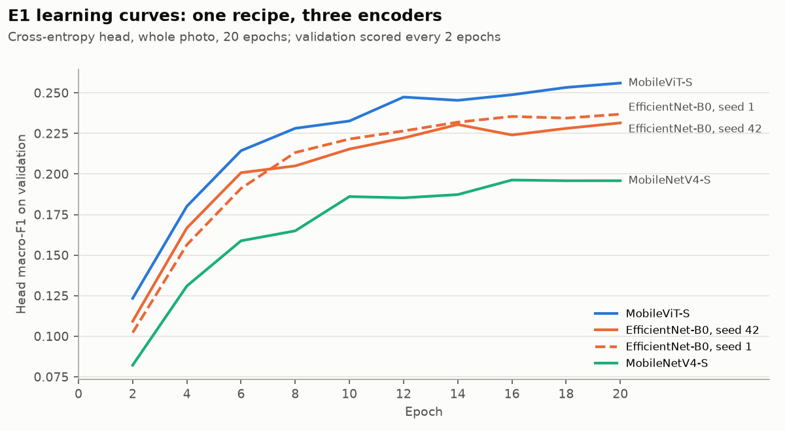

MobileViT-S and both EfficientNet-B0 runs still gain a little at epoch 20, their best epoch, while MobileNetV4-S peaks at epoch 16. The full-data training in M4 can test a longer schedule.

### 2.2 Species head (E2)

| Run | Change from E1's MobileViT-S | Head | Prototypes | Balanced prototypes | Top-1 | WHO recall (raw) | O3 (raw top-1) | Verdict false alarms |
|---|---|---:|---:|---:|---:|---:|---:|---:|
| E1_mvits | cross-entropy (CE), seed 42 | 0.256 | 0.254 | 0.250 | 53.4% | 0.717 | 0.283 | 0.379 |
| N0_s1 | CE, seed 1 | 0.254 | 0.253 | 0.250 | 53.1% | 0.714 | 0.286 | 0.376 |
| N0_s2 | CE, seed 2 | 0.254 | 0.248 | 0.247 | 53.3% | 0.717 | 0.283 | 0.364 |
| **E2_arcface** | ArcFace (s = 30, m = 0.3) | 0.256 | 0.262 | **0.263** | 52.9% | **0.741** | **0.259** | 0.422 |
| E2_ce_triplet | CE + batch-hard triplet, P×K sampler | 0.254 | 0.254 | 0.254 | 53.4% | 0.725 | 0.275 | 0.376 |
| E2_arcface_triplet | ArcFace + triplet, P×K sampler | 0.247 | 0.257 | 0.256 | 51.9% | 0.726 | 0.274 | 0.394 |
| E2b | CE with the P×K sampler only | 0.252 | 0.248 | 0.245 | 53.6% | 0.727 | 0.273 | 0.350 |
| E2c | logit-adjusted CE | 0.249 | 0.250 | 0.249 | 37.3% | 0.694 | 0.306 | 0.421 |

**ArcFace wins.** Its best score, 0.263 with balanced prototypes, beats cross-entropy's best (mean of head or prototypes over 3 seeds, 0.2546) by 0.0082, above the 0.005 floor. Its raw WHO recall is 0.741 against 0.716, and its raw O3 error 0.259 against 0.284. It also beats the long-tail baseline E2c by 0.013. An embedding head lets us add a species later from a few photos, without retraining (K1).

**Trade-offs and negative results.**
- ArcFace's verdicts raise false alarms to 0.422, against 0.364 to 0.379 for the cross-entropy seeds. The selection rule weighs macro-F1 with raw WHO guardrails, so it picks ArcFace; the final model is checked again at the verdict level.
- Triplet loss added nothing: CE + triplet scores 0.254 at best, against 0.2546 for CE alone, and ArcFace + triplet 0.257, against 0.263 for ArcFace alone. E2b shows the P×K sampler alone doesn't help either.
- Logit-adjusted CE didn't raise macro-F1 and cut top-1 to 37.3%: it buys rare-class recall with common-class errors.
- ArcFace's scores are overconfident before temperature scaling: ECE 0.193, against 0.036 after.
- We picked ArcFace on balanced prototypes, but the decision layer ranks species by the head by default (0.256 here). The final model ships with the head: on H1_top1_s1 the head scores 0.367 against 0.356 with prototypes, and across its three seeds the head separates unknown species better (AUROC of the top softmax probability 0.696 against 0.622). Its verdicts are reported both ways in 2.6.

### 2.3 Genus and family heads (E3)

Dropping the genus and family heads changed head macro-F1 from 0.256 to 0.255, inside the noise, so we keep them: the fallback needs them. When the verdict is "we don't know", E2's model shows a genus for 17.5% of those photos and is right 67.8% of the time; it shows a family for 86.7% and is right 79.5% of the time. Summing species probabilities beats the separate heads: genus accuracy 0.612 against 0.591 on E1's model, and family 0.789 against 0.758. They disagree on the genus of 20.1% of photos. M4 will use the summed version and keep the heads for training.

### 2.4 Danger-weighted WHO loss (E4)

The 5× weight on "listed predicted as not listed" bought nothing. Without it (E4) head macro-F1 is 0.263, against 0.2546 for the cross-entropy seeds, and the verdicts are no worse: WHO-listed called "not listed" 0.029 (seeds 0.027 to 0.030) and false alarms 0.359 (seeds 0.364 to 0.379). The joint threshold fit switched the WHO head off in 7 of 11 runs, because the species head alone reached the recall target with fewer false alarms. The recipe from here is ArcFace, with genus and family heads, danger weight 1 (`R_F0`).

### 2.5 Front end (S1, D1, FE)

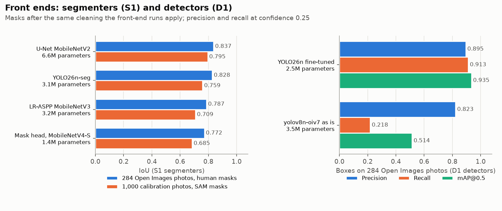

| Segmenter (S1) | Parameters | IoU, human masks | Dice | IoU, SAM masks on unseen photographers |
|---|---:|---:|---:|---:|
| **U-Net MobileNetV2** | 6.6M | **0.837** | 0.902 | 0.795 |
| YOLO26n-seg | 3.1M | 0.828 | 0.896 | 0.759 |
| LR-ASPP MobileNetV3 | 3.2M | 0.787 | 0.867 | 0.709 |
| Mask head on SnakeID's MobileNetV4-S | 1.4M | 0.772 | 0.859 | 0.685 |

The U-Net wins by 0.009, outside the 0.005 tie band, though YOLO26n-seg is half its size. On its own training photos it scores 0.837 against SAM, so the gap to unseen photographers is 0.042. **D1:** YOLO26n fine-tuned on the Grounding DINO boxes reaches mAP@0.5 0.935 (precision 0.895, recall 0.913), against 0.514 for yolov8n-oiv7 as is (recall 0.218). On validation, 99.95% of photos get a box above confidence 0.05, 91.9% above 0.25, and 93.2% a usable mask.

**FE: does a front end beat the whole photo?** Each run takes the recipe from 2.4 and changes only the input. F1 to F3 train and validate on the boxes and masks our own detector and U-Net predicted, never on SAM masks.

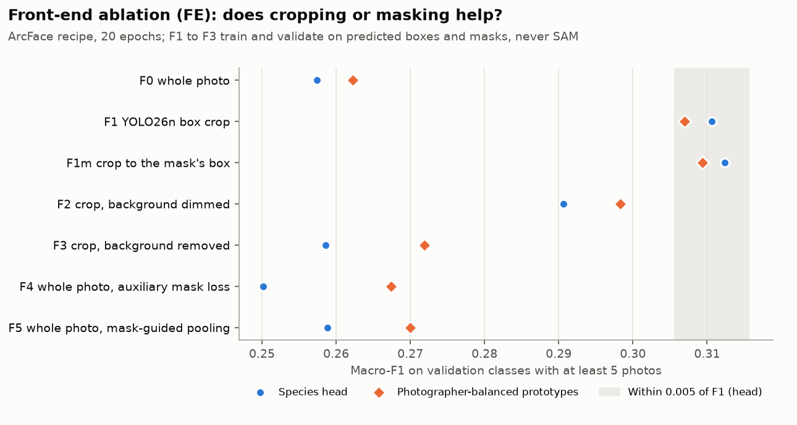

| Run | Input | Head | Prototypes | Balanced prototypes | Top-1 | WHO recall (raw) |
|---|---|---:|---:|---:|---:|---:|
| R_F0 | F0: whole photo | 0.257 | 0.264 | 0.262 | 53.1% | 0.736 |
| **FE_F1** | **F1: crop to the YOLO26n box plus 6%** | **0.311** | 0.309 | 0.307 | **58.3%** | 0.758 |
| FE_F1m | F1m: crop to the predicted mask's box, no masking | 0.312 | 0.311 | 0.309 | 58.3% | 0.763 |
| FE_F2 | F2: crop, background dimmed | 0.291 | 0.298 | 0.298 | 56.3% | 0.750 |
| FE_F3 | F3: crop, background removed | 0.259 | 0.273 | 0.272 | 53.2% | 0.740 |
| FE_F4 | F4: whole photo, auxiliary mask loss (mask head dropped at export) | 0.250 | 0.269 | 0.267 | 53.0% | 0.732 |
| FE_F5 | F5: whole photo, mask-guided pooling | 0.259 | 0.271 | 0.270 | 53.2% | 0.727 |

**F1 wins.** Cropping to the detector's box raises head macro-F1 from 0.257 to 0.311 (+0.053) and the best of the three scores from 0.264 to 0.311 (+0.046), each more than nine times the 0.005 floor. Top-1 rises from 53.1% to 58.3% and raw WHO recall from 0.736 to 0.758. F1m ties with F1 (0.002 apart, inside the floor) but needs the 6.6M-parameter U-Net, while F1 needs only the 2.5M-parameter YOLO26n, which the pipeline runs anyway to say "no snake found". Within noise the rule takes the smaller model with fewer parts: F1.

**Segmentation does not beat a crop.** Once the photo is cropped, dimming the background (F2) costs 0.020 of head macro-F1 and removing it (F3) costs 0.052; we read this as the scenery next to the snake carrying useful information. Teaching the encoder where the snake is, by a mask loss (F4) or mask-guided pooling (F5), leaves the whole photo where it was: 0.250 and 0.259 against 0.257. Masks also cover fewer photos: 93.2% of validation photos have a usable predicted mask, against 99.95% with a box. So the U-Net leaves the pipeline. At the verdict level the crop also cuts false alarms (2.6). Whether the model leans on the background as a shortcut is R1's question (5.5), not an accuracy one. The 0.005 floor was measured with cross-entropy on the whole photo; N1 measures the final recipe's spread.

### 2.6 Decision layer

Thresholds are fitted on the calibration set (566 WHO-listed photos), never on validation. A photo is **dangerous** if the species probability on WHO-listed species reaches θ_d, the top species is in the danger table, or vipers and elapids together reach 0.5. θ_d is the largest value that keeps WHO recall at 0.95 or more; it came out at about 0.05 for both models. It is **we don't know** if the top species is unsure or far from every prototype, and never "not listed" for a genus with a WHO-listed species. 73 classes have no calibration photos, because all their training photos, or all their photographers, are in the subset.

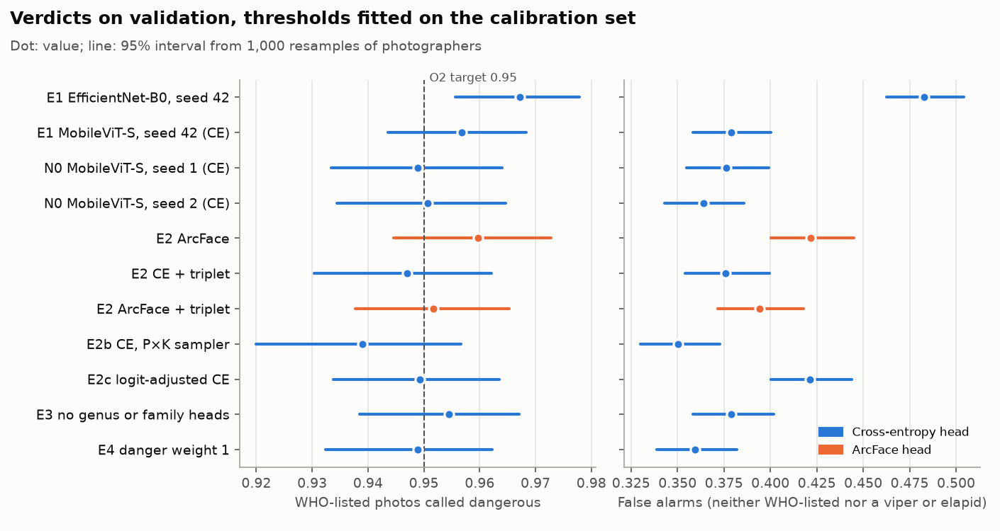

| On validation (17,151 photos) | E1 MobileViT-S, CE | E2 ArcFace | M1 target |
|---|---:|---:|---:|
| WHO-listed called dangerous (O2) | 0.957 (0.944 to 0.968) | 0.960 (0.945 to 0.973) | ≥ 0.95 |
| WHO-listed called "not listed", all photos (O3) | 0.027 | 0.027 | ≤ 2% |
| Same, answered photos only (coverage) | 0.027 (0.984) | 0.028 (0.987) | |
| Raw top-1 species error on WHO-listed photos | 0.283 | 0.259 | |
| Vipers and elapids called dangerous | 0.949 | 0.951 | |
| False alarms (neither WHO-listed nor a viper or elapid) | 0.379 (0.358 to 0.400) | 0.422 (0.400 to 0.445) | |
| "We don't know" | 7.6% | 6.6% | |
| ECE before / after temperature | 0.019 / 0.024 | 0.193 / 0.036 | ≤ 0.05 |
| Error at 80% coverage | 0.376 | 0.380 | ≤ 5% |

The rules turn a 25.9% species error on WHO-listed snakes into 2.7% wrong verdicts. The price is false alarms: about 4 in 10 snakes that are neither WHO-listed nor vipers or elapids are called dangerous. Calibration meets its target after temperature scaling, but the error at 80% coverage is far from 5%.

**Front ends and K1 at the verdict level** (head scoring, thresholds fitted on each run's own calibration outputs):

| Run | WHO-listed called dangerous | False alarms | WHO-listed called "not listed" | We don't know | Unknown-pool photos flagged | No snake found (validation photos) |
|---|---:|---:|---:|---:|---:|---:|
| R_F0 (whole photo) | 0.957 | 0.410 | 0.031 | 6.7% | 7.5% | |
| K1 (10 species held out) | 0.954 | 0.404 | 0.032 | 7.0% | 8.2% | |
| FE_F1 (box crop) | 0.922 | 0.279 | 0.035 | 12.0% | 7.8% | 151 |
| FE_F1m | 0.932 | 0.301 | 0.030 | 10.2% | 7.5% | 151 |
| FE_F2 | 0.937 | 0.328 | 0.033 | 9.5% | 6.4% | 151 |
| FE_F3 | 0.954 | 0.416 | 0.025 | 6.1% | 7.5% | 151 |
| FE_F4 | 0.937 | 0.356 | 0.037 | 9.2% | 5.8% | |
| FE_F5 | 0.939 | 0.358 | 0.039 | 9.1% | 8.4% | |

The box crop cuts false alarms from 0.410 to 0.279, the largest drop of any change in M3. But its WHO recall on validation falls to 0.922 (95% interval 0.899 to 0.943), although the same thresholds reach 0.951 on the calibration set. That is a shift from calibration photos to validation photos. The crop also answers "we don't know" more often, 12.0% against 6.7%, partly because 151 validation photos have no box above the no-snake threshold of 0.102; such photos still get first aid. For the final model we fit θ_d so that the lower end of the 95% photographer-bootstrap interval of calibration recall, not the point value, reaches 0.95. This trades some of the crop's false-alarm gain for recall.

**The final model's verdicts.** H1_top1_s1 on the F1 crop, with thresholds from the lower-bound fit, as shipped with species ranked by the head, and with species ranked by prototypes:

| On validation (17,151 photos) | Head (shipped) | Prototypes | M1 target |
|---|---:|---:|---:|
| WHO-listed called dangerous (O2) | 0.948 (0.930 to 0.963) | 0.948 (0.930 to 0.964) | ≥ 0.95 |
| WHO-listed called "not listed", all photos (O3) | 0.021 | 0.015 | ≤ 2% |
| Same, answered photos only (coverage) | 0.021 (0.969) | 0.016 (0.963) | |
| Raw top-1 species error on WHO-listed photos | 0.232 | 0.299 | |
| Vipers and elapids called dangerous | 0.945 | 0.942 | |
| False alarms (neither WHO-listed nor a viper or elapid) | 0.311 (0.292 to 0.331) | 0.320 (0.301 to 0.340) | |
| False alarms among species outside the danger table | 0.296 | 0.306 | |
| "We don't know" | 9.5% | 10.9% | |
| ECE before / after temperature | 0.211 / 0.030 | 0.178 / 0.015 | ≤ 0.05 |
| Error at 80% coverage | 0.268 | 0.326 | ≤ 5% |
| Unknown-pool photos flagged (AUROC of the top softmax probability) | 7.5% (0.692) | 7.5% (0.616) | 70% |
| No snake found (validation photos) | 151 | 151 | |
| Flagged dark or blurry (validation photos) | 2,811 | 2,811 | |

The crop and the tuned recipe cut false alarms from E2's 0.422 to 0.311, with WHO recall still near the target: 0.948 on validation, just under 0.95, although the fit's lower bound on calibration reaches 0.952. O3 is 0.021, just above 2%. Ranking species by prototypes meets the O3 target (0.015), but it raises false alarms and "we don't know" and separates unknown species worse, so the head stays. Calibration meets its target after temperature scaling; the error at 80% coverage, 0.268, is still far from 5%. The photo quality table changes reason labels only: 202 "we don't know" photos now give "the photo is dark or blurry" as their reason, and every verdict count equals the selection run's decision file.

**Decision rules (DR): can a different rule cut false alarms?** With the final model, about 3 in 10 snakes that are neither WHO-listed nor vipers or elapids are still called dangerous. We asked whether a smarter rule cuts that at the same 0.95 WHO recall target. Every rule is fitted on the calibration set and measured once on validation, on the final model with head scoring ([notebook 19](../../notebooks/19_m3_decision.ipynb)). The other ways to be called dangerous (a dangerous top species, the viper and elapid mass, the genus guard) stay on for every rule.

- **DR0**, the current rule: the listed mass reaches θ_d or the WHO head reaches θ_who.
- **DR1**, a learned danger score: logistic regression on 8 features of the outputs (listed mass, WHO head, top-1 probability and whether it is listed, entropy, margin, the genus head's listed mass, viper and elapid mass), cross-fitted on calibration in 5 folds grouped by photographer, so neither the weights nor θ_d see their own photos.
- **DR2**, the listed mass among the top 3 or top 5 species only.
- **DR3**, the species listed mass combined with the genus head's: the larger of the two, or a mix weighted on calibration.
- **DR4**, a variant: DR0's thresholds, but a call that only a weak WHO signal makes (listed mass and WHO head both under 0.5) becomes "we don't know (keep away)".

| Rule, 0.95 target, lower-bound fit, on validation | WHO-listed called dangerous | False alarms (95% interval) | WHO-listed called "not listed" | We don't know |
|---|---:|---:|---:|---:|
| **DR0, current rule** | 0.948 | 0.311 (0.292 to 0.331) | 0.021 | 9.5% |
| DR1, learned score | 0.954 | 0.326 (0.306 to 0.347) | 0.016 | 9.5% |
| DR2, top 3 species | 0.939 | 0.394 (0.376 to 0.413) | 0.015 | 10.8% |
| DR2, top 5 species | 0.950 | 0.397 (0.379 to 0.416) | 0.013 | 10.0% |
| DR3, larger of species and genus | 0.950 | 0.314 (0.295 to 0.335) | 0.019 | 9.7% |
| DR3, weighted mix | 0.948 | 0.302 (0.283 to 0.323) | 0.020 | 10.3% |
| DR4, variant | 0.842 | 0.162 (0.148 to 0.177) | 0.021 | 22.8% |

**No rule beats DR0, so DR0 stays.** The weighted mix comes lowest, 0.302 against 0.311, but its interval overlaps DR0's; DR1 and the larger-of-two rule are no better, and DR2 is clearly worse, which we read as the top species dropping the small listed masses that recall needs. Recall is matched on the calibration set, so the validation recalls differ a little (0.939 to 0.954), and part of each difference is a move along the trade-off. DR4 cuts false alarms to 0.162, but calls only 0.842 of WHO-listed snakes dangerous and answers "we don't know" for 22.8% of photos: it changes what the verdict promises, so it is not adopted. With DR0, the final model calls 0.021 of WHO-listed photos "not listed" at the lower-bound fit (0.028 at the point fit), just above the 2% target.

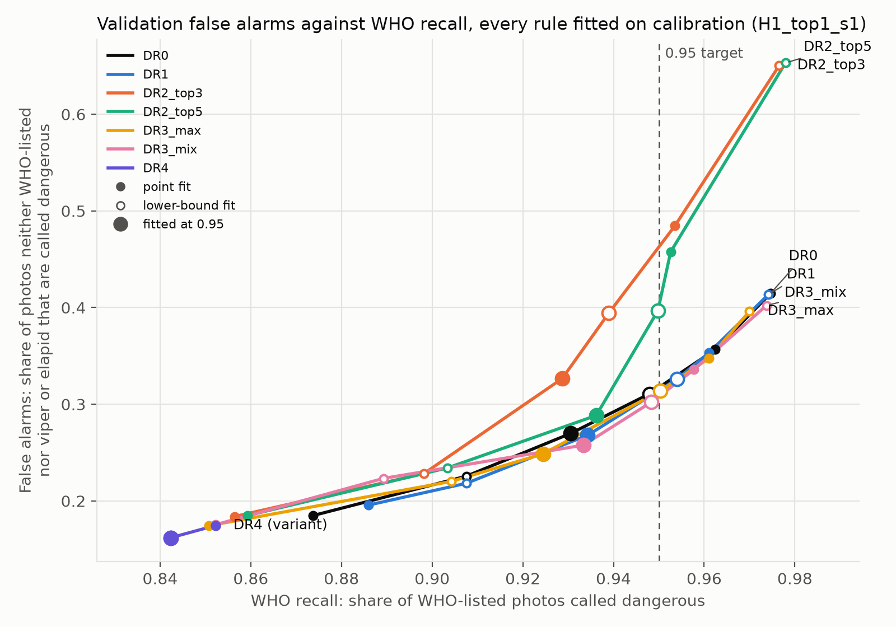

**The trade-off is one curve.** Moving DR0's target trades recall for false alarms on validation: 0.908 recall comes with 0.226 false alarms (lower-bound fit at 0.90), 0.931 with 0.270 (point fit at 0.95), 0.948 with 0.311 (lower-bound fit at 0.95) and 0.975 with 0.415 (lower-bound fit at 0.975). Every rule but DR2 lies on nearly the same curve. Our reading: the false alarms come from the classifier confusing lookalikes, not from the rule, so cutting them needs a better model, which M4 trains on all the training photos.

### 2.7 Response retrieval (Q1)

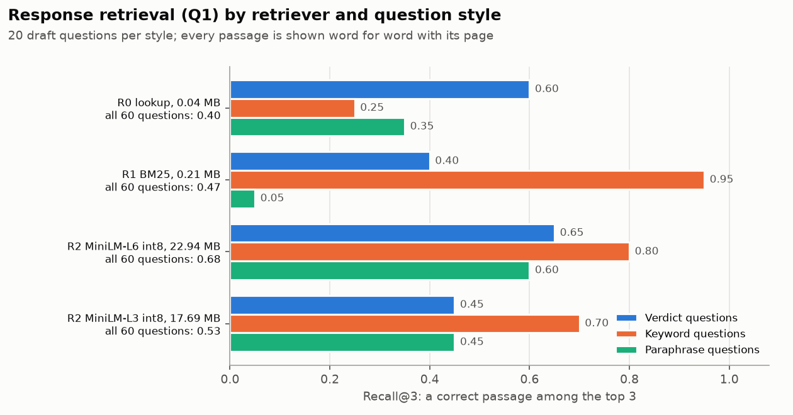

| Retriever | Recall@1 | Recall@3 | MRR | ms per query | MB |
|---|---:|---:|---:|---:|---:|
| R0 lookup by verdict and species | 0.10 | 0.40 | 0.265 | 0.0007 | 0.04 |
| R1 BM25 | 0.42 | 0.47 | 0.455 | 0.13 | 0.21 |
| **R2 MiniLM-L6, int8** | 0.40 | **0.68** | **0.573** | 1.31 | 22.94 |
| R2 MiniLM-L3, int8 | 0.33 | 0.53 | 0.462 | 0.69 | 17.69 |

The knowledge base is 168 WHO passages and 184 species cards in our own words; the 60 questions are drafts for the team to check, 20 each of verdict, keyword and paraphrase questions. MiniLM-L6 beats BM25 on 20 questions and loses on 7 (sign test p = 0.019), and the gain is all paraphrases: 11 to 0, p = 0.001. BM25 is best on keyword questions (0.95) but finds 0.05 of paraphrases. MiniLM-L3 is not better than BM25 (p = 0.52). **The M3 package ships BM25.** With the fp16 SnakeID and the detector, MiniLM-L6 takes the package to 36.24 MB and MiniLM-L3 to 30.99 MB, both over the 30 MB budget (2.8), and MiniLM-L3 does not clearly beat BM25 anyway (p = 0.52). MiniLM-L6 is clearly better than BM25 (p = 0.019), so it is the upgrade once the budget allows, for example as an optional download. The verdict screen never depends on retrieval: R0 always shows the first-aid passages.

### 2.8 Size and speed (X1)

**Full int8 does not survive training.** On 300 validation photos taken one class at a time (notebook 20's first run, on a Kaggle CPU), the float32 ONNX export of E1's MobileViT-S agrees with the training run's saved outputs on 99% of photos and gets top-1 0.217. Static int8 (attention kept in float) gets 0.040 and agrees with float32 on only 6.7% of top-1 species; dynamic int8 also gets 0.040. The cause is in the trained weights: activations with outliers (a SiLU output peaking near 100 where most values are under 1) that one int8 range per tensor rounds away, and depthwise weights that spread up to 46x between channels once BatchNorm is folded in. Untrained models, which our first export tests used, don't have these outliers, so they hid the problem; the export tests now build a model that has them. The final model, rerun on the laptop below, collapses the same way: int8 arithmetic keeps the float32 top-1 species on 9.3% (static) and 8.0% (dynamic) of photos. The phone package therefore keeps activations in float: MobileViT-S ships as fp16, and the size fallback is int8 weights with float arithmetic.

**Laptop run.** Each network of the package, timed on the laptop CPU (Apple M4 Pro, 14 cores, the O6 device) at 320 px, batch 1, median of 100 runs:

| Network | Precision | MB | ms, 1 thread | ms, 4 threads | Agrees with float32 |
|---|---|---:|---:|---:|---:|
| SnakeID (MobileViT-S) | fp32 | 20.7 | 50.9 | 21.7 | |
| SnakeID | **fp16, shipped** | 10.6 | 75.0 | 39.0 | 100.0% |
| SnakeID | int8 weights, float arithmetic | 5.5 | 58.9 | 24.9 | 92.3% |
| SnakeID | int8 arithmetic, static (attention in float) | 6.0 | 55.3 | 30.7 | 9.3% |
| SnakeID | int8 arithmetic, dynamic | 5.5 | 71.0 | 42.7 | 8.0% |
| Detector (YOLO26n) | fp32 | 9.7 | 6.7 | 4.7 | |
| Detector | fp16 | 4.9 | 7.6 | 5.3 | 100.0% |
| Detector | **int8 weights, shipped** | 2.6 | 9.9 | 7.7 | 99.7% |
| Detector | int8 arithmetic, static | 3.0 | 8.8 | 4.4 | 67.4% |

MB and times come from exports with untrained weights; the final model's own files are a little larger (below). Agreement is measured on 300 validation photos with trained weights. For SnakeID it is the share of photos that keep float32's top-1 species, with the final model on crops from the shipped detector; for the detector, the share of photos where float32 finds a snake and the variant finds the same box, with our fine-tuned YOLO26n. The final model's crops come from the deployed detector (int8 weights at 320 px), not from the boxes its training run used, so its float32 export agrees with the run's saved validation outputs on 0.92 of top-1 species, against 0.99 for E1 on whole photos. The precision comparison is unaffected, since each precision is compared with float32 on the same crops.

**The final model loses nothing in fp16.** Its fp16 file, 10.67 MB, gets the same top-1 as float32 on the 300 photos, 0.363, with an embedding cosine of 1.0000. With int8 weights, 5.63 MB, top-1 is also 0.363, and 96.3% of the photos float32 gets right stay right. The absolute top-1 is low because the 300 photos spread over 176 species with at most 2 photos each, so rare species dominate; the model's full-validation accuracy per species, weighted to that mix, is consistent with it. Only the comparison between precisions matters here.

**The package fits.** fp16 SnakeID, its prototypes and the detector at int8 weights come to 13.30 MB, or 13.51 MB with BM25, against the 30 MB budget. Together the two networks take 84.9 ms per photo (11.8 FPS) on one thread and 46.7 ms (21.4 FPS) on four, against the O6 target of 10 FPS on a laptop CPU. MiniLM-L3 in place of BM25 would make the package 30.99 MB and MiniLM-L6 36.24 MB, so neither fits. The final model's own fp16 file is 0.07 MB larger than the timed export, which puts its package at 13.58 MB with BM25.

**Detector precision.** A precision goes in the package only if the detector's top box agrees with float32's on at least 95% of the 300 photos (the same box at IoU 0.5, or no box from either), and the smallest passing precision wins. Float32 finds a snake in 97.0% of the photos; on those, int8 weights find the same box 99.7% of the time and static int8 67.4%, so the detector ships with int8 weights. Its static int8 version breaks the way SnakeID's does.

**The times are upper bounds.** Other jobs were running on the laptop while it was timed (one-minute load average 3.4 to 7.8), so an idle machine would be faster. On this CPU fp16 is slower than fp32, 1.5 times on one thread and 1.8 times on four, because ONNX Runtime computes in fp32 on the CPU and casts the fp16 values. fp32 is therefore the speed option on a laptop: about 23.7 MB with BM25, and 16.4 FPS on one thread. We keep fp16 because download size is the phone's constraint, and both meet 10 FPS.

### 2.9 Challenges and trade-offs

- **Accuracy against size.** MobileViT-S is the largest encoder we tried, and full int8 breaks it, so it ships in fp16, still well inside the size budget (2.1, 2.8).
- **Macro-F1 against false alarms.** ArcFace and the danger rules buy WHO recall and macro-F1 with false alarms. The crop and the tuned recipe cut them, and no other decision rule does better (2.2, 2.6).
- **Recall against the error target.** The lower-bound threshold fit brings WHO recall close to its target but leaves O3 just above 2% (2.6).
- **Calibration shift.** Thresholds fitted on calibration photos lose some recall on validation photos (2.6).
- **Retrieval quality against size.** MiniLM-L6 retrieves better than BM25 but does not fit beside the detector (2.7).
- **Rare species and unknown species.** Macro-F1 rewards the long tail, but the model still cannot tell when a snake is outside its classes (5.5).

## 3. Baseline model performance

We built the candidate subset first, then scored each candidate model in its default or pretrained form, before any training on our photos, with the metrics below. Published results on other datasets give the industry reference.

### 3.1 Candidate subset and evaluation sets

**Rule.** For each class we take 15% of its training photos, but at least 20 (all of them if the class has fewer). Photographers take turns, so one person can't fill a small class. The seed is 42. Validation and test are untouched. [Notebook 10](../../notebooks/10_m3_subset.ipynb) builds it and saves `subset.csv` and `subset_report.json` to the private Kaggle dataset `serpentguard-m3-subset`; every run records the subset's SHA-256, which starts `40196d19a68e`.

| Option | Photos | Share of train | Median class | Indian | WHO-listed | JS divergence of class mix |
|---|---:|---:|---:|---:|---:|---:|
| Full train | 85,067 | 100% | | 37.4% | 12.9% | |
| **15%, floor 20 (chosen)** | **13,925** | **16.4%** | **20** | **39.7%** | **12.1%** | **0.012** |
| 15%, floor 30 | 14,773 | 17.4% | 30 | | 11.7% | 0.021 |
| 15%, floor 40 | 15,615 | 18.4% | 40 | | 11.2% | 0.028 |
| 20%, floor 20 | 17,964 | 21.1% | 24 | | 12.4% | 0.007 |

**Why it is representative.** It sits inside the 15 to 30% the TA asked for. It keeps every class, with 6,576 of the 11,272 training photographers. It stays within 2.3 points of full train on the Indian share and the WHO mix, and portrait photos are 40.2% against 39.3%. The floor of 20 lifts rare classes on purpose: tier 2 classes hold 19.9% of the subset against 12.7% of train. Higher floors help rare classes more but pull the class mix further from train (JS divergence 0.021 and 0.028), and a 20% subset has 29% more photos to train on for a closer mix. Notebook 10's run reports each of these figures.

Training applies notebook 06's caps to the subset (50 photos per photographer per class, 1,000 per class), which leaves 13,611 training photos. Thresholds are fitted on a **calibration set**: 7,999 training photos in 111 classes, outside the subset and from photographers not in it. M3 never trains on them.

| Set | Photos | Used for |
|---|---:|---|
| Validation | 17,151 in 176 classes; 158 classes have at least 5 photos | Every model choice. 8 classes have no validation photos and 18 have 1 to 4: we list them as not measurable, never as zero |
| Calibration | 7,999 | Temperatures and verdict thresholds |
| Unknown pool, half A | 451 photos of 49 species | Unknown detection (U1); half B is kept for M5 |
| Open Images | 284 photos with human masks and boxes (CC BY 2.0) | Segmenter and detector scores |
| `test`, `test_extra` | locked | Not read by any M3 code; a test enforces it |

### 3.2 Evaluation metrics

Our classes are long-tailed and our mistakes are not equal: calling a krait "not listed" is far worse than calling a rat snake dangerous. So we report class-balanced accuracy, the two danger errors separately, and whether the model knows when it is unsure. Every metric is computed on validation, never on test.

| Metric | What it measures | Why we use it |
|---|---|---|
| Macro-F1 (head, prototypes, balanced prototypes) | Mean F1 over the 158 classes with at least 5 validation photos. The head ranks species by the species head; prototypes rank them by cosine to each class's mean embedding; balanced prototypes average each photographer first | Every class counts equally, so the long tail weighs as much as common species. Our main score |
| Tier 1 / tier 2 macro-F1 | The same over classes with 400 or more photos / 20 to 399 | Shows whether a gain comes from common or rare species |
| Top-1, top-3 | Share of photos whose species is first, or among the first three | Photo-weighted, so common species dominate; what a user sees on screen |
| WHO recall (raw) | Share of WHO-listed photos whose top-1 species is WHO-listed, before any rule | The model's own danger signal |
| WHO-listed called dangerous (O2) | Share of WHO-listed photos the decision layer calls dangerous; target at least 0.95 | The WHO recall target: a missed WHO-listed snake is the worst error |
| WHO-listed called "not listed" (O3) | Share of WHO-listed photos called "not listed", over all photos and over answered photos (with the coverage); target at most 2% | The dangerous error; "we don't know" still says keep away |
| False alarms | Share of snakes neither WHO-listed nor a viper or elapid that are called dangerous; also over species outside the danger table | The price of the WHO recall target |
| "We don't know" | Share of photos the decision layer declines to name | Abstention is allowed, but too much makes the app useless |
| ECE | Expected calibration error of the top-1 probability, 15 equal-width bins; target at most 0.05 | Thresholds on probabilities only work if the probabilities are honest |
| Error at 80% coverage | Top-1 error among the 80% most confident photos; target at most 5% | How much confidence ranking helps |
| Unknown-species AUROC, share flagged | How well a score separates unknown-pool photos from known ones, and the share flagged at the fitted threshold; target 70% | The open-set problem: species outside our 184 |
| IoU, Dice; precision, recall, mAP@0.5 | Mask overlap for segmenters; box quality for detectors | Standard front-end scores |
| Recall@3, Recall@1, MRR | Whether a correct WHO passage is among the top 3 or first retrieved, and its mean reciprocal rank | The response step's job is to surface the right passage |
| MB, ms per photo, FPS | Package size and CPU latency; targets 25 to 30 MB and at least 10 FPS on a laptop CPU | The phone budget and live video |

Verdict rates come with 95% intervals from 1,000 resamples of photographers, since photos from one photographer are not independent. A difference in macro-F1 under the noise floor of 0.005 counts as none (section 2).

### 3.3 Baselines before training on our photos

| ID | Baseline | Macro-F1 | Top-1 | WHO recall (raw) | Note |
|---|---|---:|---:|---:|---|
| B0 | Predict class frequency | 0.001 | 9.5% | 0.000 | The floor |
| B1 | Bolon et al. 2022 global ViT (SnakeCLEF 2021 data), labels mapped to ours | 0.257 | 68.3% | 0.778 | Knows 62 of 184 classes (85% of photos). 0.252 on photos uploaded from 2022, after its training data ends |
| B2 | BioCLIP zero-shot with species names | 0.187 | 35.4% | 0.437 | Upper bound: its training data may include our photos |
| B3 | Each encoder frozen (ImageNet), nearest prototype from the subset | 0.140 / 0.092 / 0.135 | 22.9% / 15.7% / 21.7% | 0.451 / 0.328 / 0.443 | EfficientNet-B0 / MobileNetV4-S / MobileViT-S |
| B4 | DINOv2 ViT-S/14 frozen, linear probe (prototypes) | 0.105 (0.078) | 18.0% | 0.353 | The large reference |
| B5 | yolov8n-oiv7 as is, boxes on Open Images | precision 0.82, recall 0.22, mAP@0.5 0.51 | | | Finds few snakes off the shelf |
| R0 | Response lookup by verdict | Recall@3 0.40 | | | The response floor |

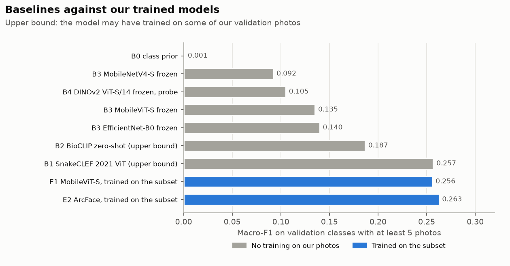

Training on 16% of our photos takes MobileViT-S from 0.135 (frozen) to 0.256. B1's full-validation number may include photos it trained on; on photos it cannot have seen it scores 0.252. The Grounding DINO + SAM teacher (B6) moved to M4: M2 already found about 84% of its masks good by eye.

### 3.4 Our final model against B1

| On our validation set | Ours (H1_top1_s1, section 4) | B1 |
|---|---:|---:|
| Macro-F1 | **0.367** | 0.257 |
| Tier 1 (400+ photos) / tier 2 (20 to 399) macro-F1 | 0.576 / **0.252** | **0.604** / 0.066 |
| Top-1 | 62.2% | **68.3%** |
| Top-3 | 76.2% | **77.1%** |
| WHO recall (raw) | 0.768 | **0.778** |
| Macro-F1, photos uploaded from 2022 (13,947) | **0.357** | 0.252 |
| Top-1, photos uploaded from 2022 | 61.7% | **67.4%** |
| WHO recall (raw), photos uploaded from 2022 | 0.754 | **0.776** |
| Size | **10.7 MB** in fp16 | about 1.13 GB |
| Trained on | 13,611 of our photos (the 16.4% subset) | SnakeCLEF 2021 data, all from before 2022 |

Both models are scored with the same function, the one B1 was scored with ([notebook 21](../../notebooks/21_m3_summary.ipynb), section 9). As checks, it reproduces our run's own macro-F1 exactly, and with shuffled labels our model scores 0.006. Ours leads on macro-F1 by 0.110 on full validation and by 0.105 on the photos uploaded from 2022, which B1 cannot have trained on. B1 wins on top-1, by about 6 points on both sets, on top-3, by about 1 point, and on raw WHO recall, by 0.010 on full validation and 0.022 on the 2022 photos. The macro-F1 lead is a coverage effect: B1 cannot name 122 of our classes, which hold 15% of the photos, and each of them scores zero in its macro-F1.

**On the 62 species both models know, B1 is clearly better:**

| On the 62 species B1 knows | Ours | Ours, answering only with those 62 | B1 |
|---|---:|---:|---:|
| Top-1, full validation (14,610 photos) | 0.682 | 0.701 | **0.801** |
| Mean recall, full validation | 0.585 | 0.603 | **0.755** |
| Macro-F1, full validation | 0.568 | | 0.653 |
| Top-1, photos uploaded from 2022 (11,931) | 0.679 | 0.697 | **0.788** |
| Mean recall, photos uploaded from 2022 | 0.577 | 0.594 | **0.737** |

On these species B1 leads by about 12 points of top-1, and by 10 points even when ours may answer only with the same 62 species. Top-1 and mean recall are exact for both models. B1's macro-F1 here is soft: we have only its per-class figures, not its per-photo outputs, so its precision still counts photos of species it cannot know. As a check, notebook 21 rebuilds each model's own top-1 from those per-class figures. Ours is about 1% of B1's size and trained on 16% of our photos; training on the full set is M4.

### 3.5 Industry benchmarks (other datasets, never directly comparable)

| Source | Task and data | Reported result |
|---|---|---|
| Bolon et al. 2022 [2] | 772 species, 23,673 test photos | 96.0% top-1, 92.2% macro-F1, 99.0% genus top-1 |
| Durso et al. 2021 [3] | 45 North American species | 84% accuracy, F1 0.83; 72% and 0.73 on expert-labelled photos |
| Manna et al. 2026 [5] | Indian venomous species, four models | MobileViT-S had the lowest venomous recall, 85.98% |
| Najm et al. 2025 [6] | YOLOv8-Nano, 10 species | Precision 0.88, recall 0.91, mAP@0.5 0.892, 142 FPS |
| Naresh et al. 2024 [7] | YOLO snake detection | 87% precision |
| torchvision, Ultralytics [8, 9] | COCO, general objects | LR-ASPP MobileNetV3 mean IoU 57.9; DeepLabV3 MobileNetV3 60.3; YOLO26n-seg mask mAP 33.9 |
| SnakeCLEF 2021 winner, BME-TMIT [1] | 772 training species, scored per country | Country-averaged macro F1c 0.903; species macro-F1 0.855 |
| SnakeCLEF 2023 winner, word2vector [10] | 1,784 training species; private test of 182 species from 8 countries | Venomous-aware Track 1 score 91.43% (91.31% in the same paper's discussion); macro-F1 53.58%, against 61.39% for the round's best; India subset Track 1 89.74% |
| SnakeCLEF 2024 winner, upupup [4] | 1,784 training species; private test of 199 species from 12 countries | Track 1 score 83.6%; India subset 81.16%; macro-F1 not reported |
| DINOv2, linear probe on ViT-g/14 [14] | iNaturalist 2018 and 2021, all species | Top-1 81.6% and 85.7% |

None of these uses our 184 classes, our split or our metric. The SnakeCLEF Track 1 score weighs venomous mistakes and is not macro-F1; the nearest number to ours is the 2023 winner's 53.58% macro-F1, over a far larger, long-tailed label set. Every value was read from the cited source, listed under References, on 5 November 2026.

## 4. Hyperparameter tuning (H1)

**Parameters.** Four, on the recipe above: learning rate (1e-4 to 1e-3, log scale), weight decay (1e-4 to 0.1, log scale), ArcFace margin m (0.1 to 0.5) and augmentation strength (0.5 to 1.5 times notebook 06's settings). Input size stays at 320; X1 measures its cost.

**Search.** Random search, 24 trials of 8 epochs, run as 6 slices of 4 trials on three Kaggle accounts and merged into one Optuna study. Random search spends no trials learning the space and lets the slices run in parallel; with pruning off, every trial is a clean sample for the parameter-importance plot. The top 3 are then retrained for 20 epochs and compared with the default recipe ([notebook 14](../../notebooks/14_m3_tuning.ipynb)).

**Result.** All 24 trials completed. The best validation macro-F1 per trial ranged from 0.140 to 0.260 (median 0.192), and every trial was still improving at its last epoch. The search used 15.7 GPU-hours on T4s.

| | Learning rate | Weight decay | Augmentation strength | ArcFace margin | Macro-F1 |
|---|---:|---:|---:|---:|---:|
| Default recipe (R_F0) | 3e-4 | 0.05 | 1.0 | 0.3 | 0.220 at epoch 8 of 20 |
| Trial ranked 1 | 9.5e-4 | 1.6e-3 | 0.75 | 0.356 | 0.260 at epoch 8 of 8 |
| Trial ranked 2 | 9.4e-4 | 1.5e-2 | 0.91 | 0.346 | 0.251 |
| Trial ranked 3 | 5.8e-4 | 4.6e-3 | 0.56 | 0.391 | 0.248 |

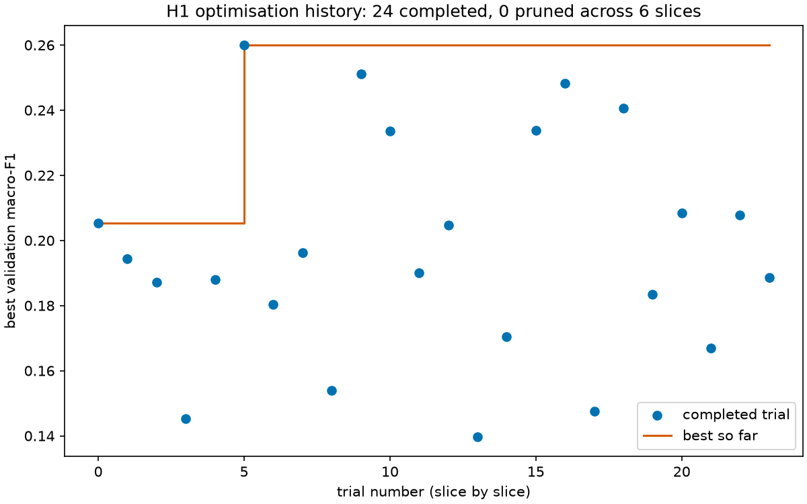

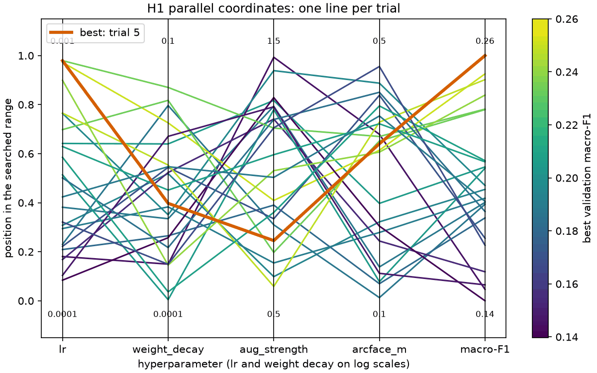

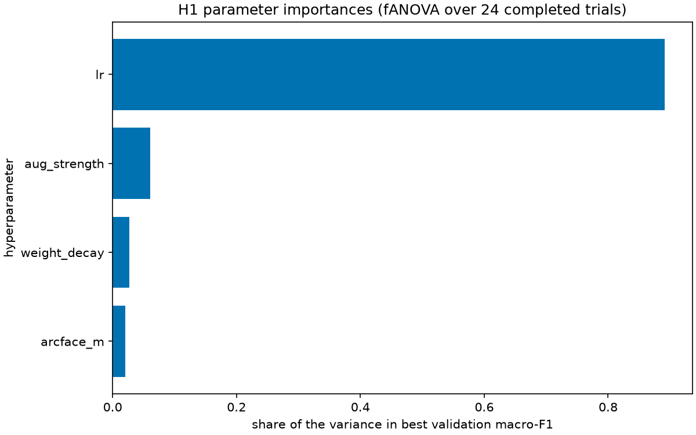

The learning rate matters most: it takes most of the variance in the importance plot, and the two best trials sit at the top of its range. Weight decay, augmentation strength and the ArcFace margin matter much less. The default recipe's 0.220 at epoch 8 is not a fair comparison, since its learning rate was still high on a 20-epoch schedule while each trial's schedule ended at epoch 8; a higher learning rate may simply converge faster. The 20-epoch retrain decides whether the gain holds.

**Assumption.** The search ran on the whole photo (R_F0) at the same time as FE, to save a day. The retrain carries the three best settings over to the F1 crop, for 20 epochs with seeds 1, 2 and 42 each (runs `H1_top1_s1` to `H1_top3_s42`).

**Retrain (N1).** Each of the three settings trained on the F1 crop for 20 epochs, once with each seed. The verdict columns use the lower-bound fit of 2.6 and head scoring; they choose between settings and are not the final scoring.

| Setting | Head macro-F1, mean (range over the 3 seeds) | Top-1, mean | WHO recall (raw), mean | WHO-listed called dangerous, mean (range) | False alarms, mean (range) |
|---|---:|---:|---:|---:|---:|
| **H1_top1** | **0.3668** (0.3660 to 0.3674) | 61.9% | 0.766 | 0.949 (0.947 to 0.953) | 0.322 (0.311 to 0.334) |
| H1_top2 | 0.3630 (0.3563 to 0.3701) | 61.9% | 0.772 | 0.949 (0.939 to 0.959) | 0.314 (0.299 to 0.336) |
| H1_top3 | 0.3551 (0.3528 to 0.3580) | 60.6% | 0.761 | 0.949 (0.944 to 0.955) | 0.331 (0.319 to 0.348) |

**Choice.** H1_top1 has the highest mean, but H1_top2 is only 0.0038 behind, inside the 0.005 floor, so the two tie. Neither tie-break separates them. False alarms average 0.322 against 0.314, a gap of 0.008, smaller than either setting's own range across seeds. Raw WHO recall averages 0.766 against 0.772: H1_top2 is higher on all 3 seeds, but by less than H1_top1's own range across seeds (0.006), and the difference is gone at the verdict, where both call 0.949 of WHO-listed photos dangerous. So stability decides: H1_top1's seeds span 0.0014 of head macro-F1, H1_top2's 0.0137.

**The final model** is H1_top1: learning rate 9.5e-4, weight decay 1.6e-3, augmentation strength 0.75 and ArcFace margin 0.356, with everything else as in the recipe of 2.4, on the F1 crop. We ship its median seed by head macro-F1, H1_top1_s1, not its luckiest, and score it with the head, which separates unknown species better than prototypes across the three seeds (AUROC 0.696 against 0.622).

**N1.** The final recipe's seeds span 0.0014 of head macro-F1, less than the 0.0025 of the cross-entropy seeds (N0). At the verdict they call 0.947 to 0.953 of WHO-listed photos dangerous, so only 1 of the 3 seeds reaches the 0.95 target on validation, with 0.311 to 0.334 false alarms. H1_top2's seeds span 0.0137, so the 0.005 floor holds for the final recipe but not for every recipe.

**Tuned against default, on the same crop:**

| Run | Recipe on the F1 crop | Head | Prototypes | Balanced prototypes | Tier 1 / tier 2 | Top-1 | Top-3 | WHO recall (raw) |
|---|---|---:|---:|---:|---:|---:|---:|---:|
| FE_F1 | default, seed 42 | 0.311 | 0.309 | 0.307 | 0.532 / 0.189 | 58.3% | 74.1% | 0.758 |
| **H1_top1_s1** | tuned, seed 1 (shipped) | **0.367** | 0.356 | 0.356 | 0.576 / 0.252 | 62.2% | 76.2% | 0.768 |

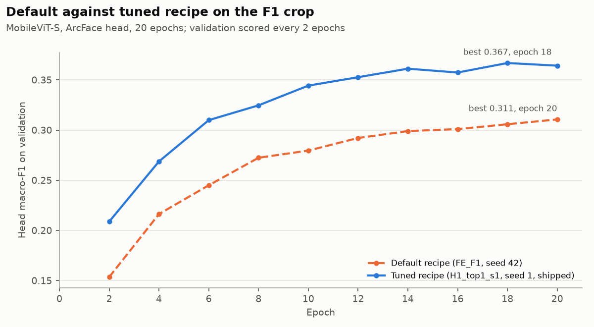

The search's values, found on the whole photo, carry over to the crop: head macro-F1 rises by 0.056 on average over the 3 seeds, more than ten times the floor, and the gain is largest on rare classes (tier 2 from 0.189 to 0.252). The tuned recipe leads at all 10 scored epochs and peaks at epoch 18. The default was still rising at epoch 20, so a longer schedule might close part of the gap, which M4 can test.

## 5. End-to-end setup

### 5.1 Input data flow

A photo is read as RGB, its exposure fixed, letterboxed to 320 × 320 and normalised with ImageNet statistics, as notebook 06 does in M2. The YOLO26n detector then finds the snake. With the F1 front end, SnakeID sees the detector's box widened by 6%, and a photo whose best box scores under the no-snake threshold of 0.102 gets "no snake found" without running SnakeID. A clip is read at most 10 frames a second, always the newest frame, and each kept frame takes the same path; the screen shows a 4-of-6 vote over the frame verdicts. Training reads the same preprocessing, with the boxes the detector predicted for every photo beforehand. Each step below is a notebook, and its run's output holds the results:

| Step | Notebook | Input → output |
|---|---|---|
| Subset and calibration set | [10](../../notebooks/10_m3_subset.ipynb) | clean metadata → `subset.csv`, `calibration.csv`, `subset_report.json` |
| Baselines B0 to B5, C1 | [11](../../notebooks/11_m3_baselines.ipynb) | subset, validation → baseline scores |
| Training E1 to E4, N0, FE, K1, N1 | [12](../../notebooks/12_m3_train.ipynb) | a run name → checkpoint, `final_metrics.json`, `metrics.jsonl`, saved outputs |
| Segmenters and detectors | [13](../../notebooks/13_m3_frontends.ipynb) | SAM masks, Grounding DINO boxes → S1/D1 scores, predicted masks and boxes |
| Tuning | [14](../../notebooks/14_m3_tuning.ipynb) | recipe → study, plots, retrain configs |
| End to end | [15](../../notebooks/15_m3_end_to_end.ipynb) | photo or clip → verdict, top 3, reason, passages, per-node log |
| Response | [16](../../notebooks/16_m3_response.ipynb) | WHO PDF, cards, questions → retrieval scores |
| Robustness, video | [17](../../notebooks/17_m3_robustness.ipynb), [18](../../notebooks/18_m3_video.ipynb) | a run's checkpoint → R1 and V1 results |
| Decision layer | [19](../../notebooks/19_m3_decision.ipynb) | a run's saved outputs → `decision_metrics.json` |
| Export and latency | [20](../../notebooks/20_m3_x1.ipynb) | checkpoints → ONNX, int8, latency, package table |

### 5.2 Model architecture overview

SnakeID is MobileViT-S [12], pretrained on ImageNet, with its classifier removed. Its last feature map is averaged into one vector, and a linear layer with batch normalisation turns it into the 256-number embedding, which is then L2-normalised. The ArcFace head [11] compares the normalised embedding with one learned direction per species, for all 184 classes, and scales the cosine by s = 30. The genus (69), family (13) and WHO (3) heads read the same embedding before normalisation. Prototypes, the mean normalised embedding of each species' training photos, give a second way to name the species and let us add a species from a few photos (K1). The decision layer reads all of these, and the response step turns its verdict into the screen. Section 6 draws both the pipeline and SnakeID.

### 5.3 Training pipeline

Each run is one file, `configs/m3/<run id>.yaml`. Notebook 12 reads it on a Kaggle T4 GPU and trains with `train.py`:

- **Data:** the subset after notebook 06's caps (13,611 photos), with the weighted sampler and notebook 06's augmentation, scaled by the run's augmentation strength. Runs on the F1 crop read the detector boxes saved for every photo.
- **Losses:** ArcFace for species (cross-entropy in the runs that test it), and cross-entropy for genus, family and WHO. Batch-hard triplet and Dice + BCE mask losses appear only in the runs that test them.
- **Optimiser and schedule:** AdamW with the encoder at 0.1× the learning rate, linear warm-up for 1 epoch, then cosine decay to zero; gradient clipping at norm 5; mixed precision on the GPU; batch 64; 20 epochs.
- **Scoring and outputs:** the full validation set is scored every 2 epochs, and the best epoch by macro-F1 is kept. Each run writes its settings, `final_metrics.json`, `metrics.jsonl`, `versions.json` and the subset hash, and keeps its checkpoint and saved outputs (embeddings and logits for validation, calibration and the unknown pool) on Kaggle. Notebook 19 then fits the decision layer on the saved calibration outputs.

The final model's tuned values are in section 4: learning rate 9.5e-4, weight decay 1.6e-3, augmentation strength 0.75 and ArcFace margin 0.356.

**Speed.** The first smoke run's GPUs spent 76 to 89% of their time waiting for photos from the Kaggle dataset mount. Reading every file once in parallel before training cut an epoch from 423 s to 189 s for MobileViT-S and 194 s for MobileNetV4-S; an E1 MobileViT-S run then took 88 minutes on a T4.

### 5.4 Validation strategy

- **Photographer-disjoint splits.** M2 split the data with folds grouped by photographer and stratified by species, so no photographer's photos sit on both sides. Validation (17,151 photos) decides every model choice; `test` and `test_extra` stay locked (3.1).
- **A separate calibration set.** Temperatures and verdict thresholds are fitted on 7,999 training photos outside the subset, from photographers not in it, and never on validation. The final thresholds use the lower end of a photographer-bootstrap interval of calibration recall (2.6).
- **Seeds and the noise floor.** The subset uses seed 42. Three seeds of the same recipe set the noise floor (N0, section 2): a difference under 0.005 counts as none. The final recipe ran with seeds 1, 2 and 42 (N1, section 4).
- **Classes with few photos.** Macro averages cover the 158 classes with at least 5 validation photos; the others are listed as not measurable, never as zero.
- **Intervals.** Verdict rates come with 95% intervals from 1,000 photographer-grouped resamples.

### 5.5 Evaluation methodology

Each model is scored on the full validation set with the metrics of 3.2, and the decision layer on its verdicts, with thresholds from the calibration set. Five further checks test the whole system or a known weakness: an end-to-end run (P1), synthetic video (V1), robustness to the scenery (R1), unknown species (U1) and rare species added from a few photos (K1).

#### End-to-end check (P1)

**P1 on 100 validation photos and 5 clips.** We ran the final model through the full pipeline on a laptop CPU: the YOLO26n detector's crop, H1_top1_s1 and the shipped decision file, on one photo from each of 100 classes ([notebook 15](../../notebooks/15_m3_end_to_end.ipynb), run on the laptop). Against the training run's saved outputs it gives the same verdict on 98% of photos and the same top-1 species on 98%; the control, each photo paired with the next photo's saved outputs, agrees on 37% and 1%, so the check can fail. Median times per photo were 6.8 ms for preprocessing, 13.9 ms for the detector, 66.0 ms for SnakeID, 0.347 ms for the decision and 0.01 ms for the response: 87.4 ms in all, in PyTorch float32.

**A train/serve skew, found by this check and fixed.** The first P1 run matched the saved outputs on only 0.89 of verdicts and 0.84 of top-1 species. The cause was the detector's padding: it padded a lone photo to the smallest rectangle around it, while the mixed batches that made the training boxes were padded to a square, so the app's boxes drifted from the boxes the model trained on. On the 100 P1 photos, the app's boxes overlapped the training boxes at a median IoU of 0.944, at worst 0.215, and only 82% reached 0.9. Every detector call now pads to the same square: the median IoU is 0.999, the worst 0.963, and 100% reach 0.9. The P1 numbers here come from the rerun. The decision files, R1 and X1 were not affected: they use the training boxes, or the ONNX detector's fixed square input.

| | Called dangerous | Not listed | We don't know |
|---|---:|---:|---:|
| 26 photos of danger-table species | 25 | 0 | 1 |
| 74 photos outside the table | 21 | 40 | 13 |

So 1 dangerous snake was missed, a mountain pit viper (*Ovophis monticola*) called "we don't know", and 21 others were false alarms: 28% of the photos outside the table, against 0.296 on the whole validation set. All 12 WHO-listed photos were called dangerous. Of the 5 clips, 4 ended "dangerous", 3 of them false alarms (a cat snake, an *Oligodon* and a python), and 1 ended "we don't know" because the frames never agreed, with 14 flips on screen. Each clip read 101 of its 150 frames at the 10 frames-per-second cap, and the first real verdict appeared after 0.4 to 0.9 s.

#### Video (V1) and robustness (R1)

**Video (V1).** We made 200 synthetic clips from validation photos of 176 classes with the M1 recipe: 10 s at 15 FPS, a moving camera, motion blur, low light, noise, JPEG, and leaves over 30 to 70% of the snake, placed on the predicted mask in 191 clips and in a central ellipse in the other 9 ([notebook 18](../../notebooks/18_m3_video.ipynb), run on a Kaggle GPU). Every frame goes through the detector, the final model and the shipped decision file. We play each clip two ways: every frame at 15 FPS, and on the laptop's schedule, where the package's 84.9 ms per photo gives 11.8 FPS and 21.3% of the frames are skipped. On screen, each clip shows the per-frame verdict, an EMA (α = 0.3) of the outputs, or the 4-of-6 vote. 1,898 of the 30,000 frames (6.3%) have no snake box above the no-snake threshold, spread over 95 clips; none of the undamaged photos lacks one. We reran V1 after the detector padding fix (see P1 above): the numbers here are from the rerun, and they moved only slightly from the first run, except that frames with no snake box fell by about half.

| Schedule, method | Verdict flips per clip (mean) | Clips with at most 1 flip | Stable within 2 s | Clip verdict right (95% interval) | Same, of clips whose clean photo is right | Clip species right | Dangerous clips ever showing "not listed" |
|---|---:|---:|---:|---:|---:|---:|---:|
| Every frame, per frame | 33.2 | 17.0% | 59.5% | 0.285 (0.222 to 0.348) | 0.453 | 0.070 | 0.294 |
| Every frame, EMA | 15.5 | 33.0% | 81.0% | 0.305 (0.239 to 0.373) | 0.470 | 0.120 | 0.078 |
| Every frame, 4-of-6 vote | 7.7 | 38.5% | 94.5% | 0.295 (0.229 to 0.363) | 0.462 | 0.100 | 0.078 |
| Laptop, per frame | 26.2 | 18.0% | 63.0% | 0.280 (0.220 to 0.342) | 0.444 | 0.070 | 0.294 |
| Laptop, EMA | 12.1 | 37.0% | 83.0% | 0.290 (0.223 to 0.357) | 0.453 | 0.125 | 0.078 |
| Laptop, 4-of-6 vote | 6.1 | 40.5% | 93.0% | 0.295 (0.231 to 0.363) | 0.462 | 0.095 | 0.059 |

**Voting removes most of the flicker.** On the laptop schedule, the vote cuts verdict flips from 26.2 to 6.1 per clip and raises the clips stable within 2 s from 63.0% to 93.0%. It also removes most "not listed" flashes on dangerous snakes: with the vote, 3 of the 51 dangerous clips (0.059) ever show "not listed", against 15 (0.294) with per-frame verdicts. With every method, 1 dangerous clip ends on "not listed". The EMA sits between the two. Even with the vote, only 40.5% of clips meet the O6 target of at most 1 flip. Skipping a fifth of the frames on the laptop changes little.

**Clip accuracy is far below photo accuracy on these clips.** The clean photos get the right verdict 58.5% of the time and the right species 36.5%. On the clips, the voted verdict is right on 29.5% and the species on 9.5%, and even among clips whose clean photo is right, the verdict is right on only 46.2%. These clips are damaged on purpose, with leaves over 30 to 70% of the snake as well as blur and low light, so the numbers measure that damage; we have not yet measured real snake videos.

**Robustness (R1).** We rescored the validation photos that have a predicted mask (15,977 of 17,151) on the final model and on R_F0, the same recipe on the whole photo, in two ways: with the snake blanked to grey, and with the snake moved onto the scenery of a photo of another class (the donor), whose own snake is blanked first. The final model sees both through the detector's crop. As a check, both runs' untouched photos reproduce their saved top-1 species on 99.9% of photos.

| On validation | R_F0, whole photo | Final model, F1 crop |
|---|---:|---:|
| Top-1 as is | 53.1% | 62.2% |
| Top-1 with the snake blanked | 14.3% | 12.8% |
| Shortcut rate: still right with the snake blanked, of those right as is (95% interval) | 0.236 (0.215 to 0.258) | 0.178 (0.163 to 0.194) |
| Same, Indian / other photos | 0.154 / 0.271 | 0.133 / 0.200 |
| Background swapped: keeps its own class | 32.4% | 46.0% |
| Follows the donor's class (control: donor's class as is) | 3.8% (1.0%) | 2.4% (0.7%) |
| Donor's blanked photo alone called the donor's class (silhouette) | 14.3% | 12.6% |
| Follows the donor, leaving out the swaps a silhouette explains | 1.9% | 1.7% |
| Verdict changed, snake blanked | 43.1% | 53.1% |
| Dangerous to "not listed", snake blanked (photos) | 516 | 336 |
| "We don't know", snake blanked | 18.1% | 24.9% |
| Verdict changed, background swapped | 34.4% | 31.2% |

| Slice | Photos | R_F0: top-1 gap to the rest, points (95% interval) | Final model: same |
|---|---:|---:|---:|
| India | 6,367 | -18.8 (-22.9 to -15.0) | -15.6 (-19.5 to -11.8) |
| Dark | 2,292 | 4.5 (0.1 to 9.2) | 3.8 (-0.3 to 7.7) |
| Blurry | 701 | 5.5 (-0.4 to 11.8) | 0.9 (-5.1 to 7.4) |
| Few photographers (29 classes with at most 10) | 119 | -30.6 (-39.0 to -21.5) | -39.8 (-48.7 to -30.6) |

**What the crop changed.** The crop leans less on the scenery. Of the photos it gets right, 17.8% stay right with the snake blanked, against 23.6% on the whole photo, and the two intervals do not overlap. With another photo's scenery behind the snake it keeps its own class on 46.0% of photos against 32.4%, and follows the donor less often (2.4% against 3.8%). Part of this is by design, since the crop keeps only the scenery next to the snake, and neither run is free of the shortcut. Blanking changes more of the crop's verdicts (53.1% against 43.1%), 94% of them towards "dangerous" or "we don't know": with no snake to see, it is less sure. Fewer dangerous snakes turn "not listed" when blanked, 336 against 516. Indian photos are harder for both models, by 15.6 points of top-1 on the final model. Dark and blurry photos are not worse. The few-photographer classes get 22.7% top-1 with both models, so the final model gained on the rest and not on them, and their gap widened to 39.8 points.

#### Unknown species (U1)

We scored four signals on 451 unknown-pool photos of 49 species against validation, with E2's model. None works well: AUROC 0.654 for the top softmax probability, 0.637 for energy, 0.574 for prototype distance and 0.557 for the top-2 cosine margin. At the threshold fitted to keep 95% of known calibration photos, only 7.3% of unknown photos are flagged (6.6% from genera we train on, 17.2% of the 29 photos of 7 species from genera we don't), far below the 70% target. The danger rules still catch the two WHO-listed species in the pool: with both models, *Bungarus sindanus* is called dangerous in 15 of 16 photos and *Naja sagittifera* in 3 of 3. With E1's model, the one miss had no *Bungarus* as its top species or top genus: the krait and wolf snake confusion from M1. The final model is no better: it flags 7.5% of unknown photos, with AUROC 0.692 for the top softmax probability and 0.702 for energy. It calls *Bungarus sindanus* dangerous in 13 of 16 photos and "not listed" in 2, and *Naja sagittifera* dangerous in 3 of 3.

#### Rare and new species (K1)

The reference is frozen DINOv2 with prototypes from a few photos (C1, 28 tier 2 classes, 5 draws): top-1 0.238 from 5 photos, 0.301 from 10 and 0.359 from 20.

K1 holds 10 tier 2 species out of training (none of them dangerous) and keeps their 969 photos for enrolment, so the recipe trains on 13,407 photos. On the classes it still has, head macro-F1 is 0.260 and prototypes 0.271, close to R_F0's 0.257 and 0.264: holding species out did not hurt the rest. At the verdict level it matches R_F0 too: WHO recall 0.954 against 0.957, false alarms 0.404 against 0.410. The average runs over 149 measurable classes instead of 158, so the two numbers are not the same average.

**Enrolling the 10 species** from a few photos each, by storing their mean embedding as a new prototype (5 draws, plain prototypes, scored on photos from other observations):

| Photos enrolled per species | New-species top-1 | Same, photos by other photographers | New-species photos called a known species | Known-species top-1 |
|---|---:|---:|---:|---:|
| 0 (before enrolment) | | | | 0.434 |
| 1 | 0.039 | 0.038 | 0.945 | 0.432 |
| 5 | 0.198 | 0.182 | 0.772 | 0.427 |
| 10 | 0.262 | 0.255 | 0.698 | 0.427 |

Enrolment adds species without retraining and leaves the known species almost untouched: their top-1 (prototype scoring) moves from 0.434 to 0.427. Accuracy on the new species grows with each photo and barely drops on other photographers' photos, so it is not just matching the enrolling photographer. But at 10 photos, 69.8% of the new species' photos are still taken for a known species: the open-set weakness of U1 again. Photographer-balanced prototypes come within 0.005 of every number here. C1's DINOv2 curve uses a different class set, so the two are not directly comparable.

### 5.6 Expected model outputs

For each photo the app returns:

- a verdict, "dangerous", "not on the WHO list, still keep away" or "we don't know", always with keep away, and its reason: the WHO category, a venomous family, an unclear species, an unfamiliar photo, a dark or blurry photo, or no snake found;
- the top 3 species with their probabilities and, on "we don't know", the likeliest genus when the model is sure enough of it;
- the species card and the WHO first-aid passages, quoted with their page.

For a clip, the screen shows the voted verdict, and the video demo writes an annotated video and an insights file. Examples from P1 on the final model (full logs in the P1 run's output):

| Photo of | Screen | Top 3 | Note |
|---|---|---|---|
| *Calliophis bibroni* (coral snake) | dangerous: WHO Category 2 | *Bungarus fasciatus* 0.48, *Calliophis bibroni* 0.36, *Bungarus andamanensis* 0.02 | right verdict; the category is the top species', a banded krait |
| *Ophiophagus hannah* (king cobra) | dangerous: could be a WHO-listed species: *Naja naja* (Category 1) | *Ptyas mucosa* 0.59, *Naja naja* 0.06, *Coelognathus helena* 0.05 | right verdict from the WHO-listed mass, wrong species: a rat snake on top |
| *Oligodon cinereus* | not on the WHO list, still keep away | *Psammodynastes pulverulentus* 0.36, *Oligodon cinereus* 0.17, *Oreocryptophis porphyraceus* 0.10 | right verdict, wrong species |
| *Sibynophis subpunctatus* | not on the WHO list, still keep away | *Psammophis schokari* 0.51, *Coelognathus helena* 0.13, *Grypotyphlops acutus* 0.04 | right verdict, wrong species |
| *Dendrelaphis bifrenalis* | we don't know: unclear between species | *Dendrelaphis tristis* 0.27, *Psammophis schokari* 0.15, *Chrysopelea ornata* 0.10 | shows genus *Dendrelaphis*, 0.67, the right one |
| *Rhabdops aquaticus* | we don't know: unclear between species | *Amphiesma stolatum* 0.23, *Coelognathus helena* 0.17, *Coelognathus flavolineatus* 0.15 | shows genus *Coelognathus*, 0.68, a wrong one |
| *Ovophis monticola* (mountain pit viper) | we don't know: unclear between species | *Boiga multomaculata* 0.35, *Ovophis monticola* 0.19, *Eryx conicus* 0.10 | **missed danger**: a cat snake on top, its own species second |
| *Boiga siamensis* (cat snake) | dangerous: WHO Category 1 | *Daboia russelii* 0.33, *Naja naja* 0.32, *Boiga multomaculata* 0.12 | **false alarm**: lookalike of WHO Category 1 snakes |

Notes describe the species on screen: a venomous top species that is not WHO-listed reads "venomous family, not on WHO's priority list" (7 photos), and the Category 2 on the coral snake photo belongs to its top species, the banded krait, not to the coral snake. Every screen shows WHO first-aid passages with their page, whatever the verdict.

**Video demo.** Section 5 of [notebook 15](../../notebooks/15_m3_end_to_end.ipynb) takes a snake video (`DEMO_VIDEO`), or a photo filmed into a clip (`DEMO_PHOTO`, `DEMO_SEED`), through the same pipeline and writes an annotated video and a summary of what it saw.

The video is H.264, with the verdict banner, the top 3, the detector's box and a line per frame. `insights.json` and `insights.md` give the stable verdict and when it appeared, the flips, the top species over time, the species card, the WHO passages with their pages, and the milliseconds per node. We have no real snake video yet, so the three demos film validation photos with V1's clip recipe, on the final model with the shipped decision file:

- a common krait, *Bungarus caeruleus*: "dangerous: WHO Category 1" from 0.4 s, with *Bungarus caeruleus* the top species in 100% of the 101 frames read, and 6 WHO passages from PDF pages 110 to 120;
- *Coelognathus helena*: "not on the WHO list, still keep away" from 0.5 s, and the top species in 82% of frames. Its frame-by-frame verdict flips 20 times, of which the 4-of-6 vote lets 7 through to the screen;
- *Dendrelaphis subocularis*: "we don't know: unclear between species", with its own genus, *Dendrelaphis*, as the likeliest at 0.63. The top species wanders, with *Fowlea piscator* and *Dendrelaphis tristis* each on top in 31% of frames; the frames flip 14 times and the screen 2 times.

The clips took 79.9 to 88.2 ms per frame on the idle laptop. The videos are not committed, since they are made from other people's photos under their own licences; the command regenerates them.

## 6. Architecture visualization

**The pipeline.** One photo, or each kept frame of a clip, runs from left to right; the stage table in section 1 names the part chosen at each stage.

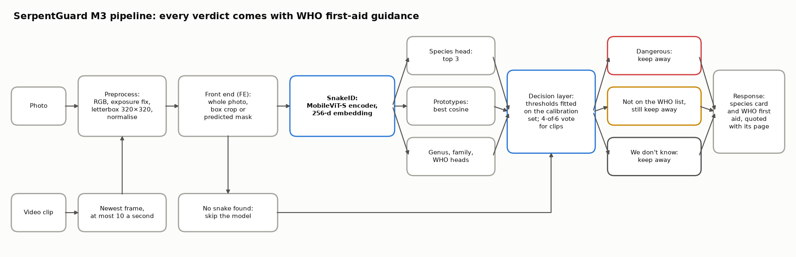

**SnakeID.** The final model on the F1 crop, with the shape of each output. The dimensions are read from the run's config and the model code.

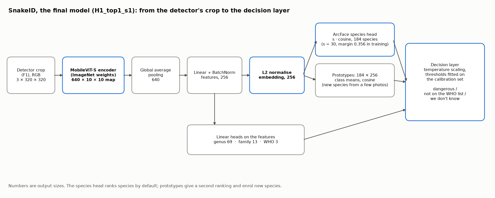

## 7. Limitations and Milestone 4

- **Calibration does not carry over to validation for the crop.** With F1, thresholds that reach 0.951 WHO recall on calibration photos give 0.922 on validation. The final model is fitted to the lower bound of the calibration interval instead, and reaches 0.948 on validation, still just under 0.95.
- **Thresholds come from training photos.** The calibration set is training photos from other photographers, and 73 classes have none. Thresholds are frozen before any test run in M5.
- **Unknown detection fails** (7.5% flagged against 70% on the final model), and **false alarms are high**: about 3 in 10 for the final model, and no decision rule we tried cuts them (2.6). M4 tries cross-photographer positives and several prototypes per species.
- **E2 was picked on prototype macro-F1**, while the decision layer ranks species by the head by default. The final model ships with the head, which separates unknown species better, and its verdicts are reported both ways.
- **The final model's raw ECE (0.211) is not its calibrated ECE (0.030)**: every verdict uses temperature-scaled scores.
- **K1's closed-set prototype numbers** come from the few-shot code's masked scoring, which removes the held-out classes' empty prototype rows, so they are not directly comparable with other runs' prototype scores.
- **V1 counts a stable "we don't know"** as a stable verdict in its stability numbers, including the placeholder shown before the first majority.
- **D1's yolov8n-oiv7 (0.514) is not the B5 number (0.510):** D1 reads photos the way the pipeline does.
- **S1 augmentation differs:** the torch segmenters get camera-style augmentation and YOLO its own, so the S1 ranking partly reflects augmentation.
- **R1's shortcut rate is an upper bound**, since predicted masks can miss snake pixels and blanking leaves them, and the grey silhouette keeps the snake's outline.
- **A train/serve skew in the detector, now fixed.** The app padded a lone photo to a minimal rectangle and training padded mixed batches to a square, so the app's boxes drifted. Every call now pads to the same square (5.5).
- **V1 and the video demo film photos.** We have not yet run a real snake video through the pipeline.
- **X1 times are upper bounds.** The laptop, the O6 device, was running other jobs while it was timed. The phone's own latency is measured in M4.
- **No full int8 model.** Trained weights break int8 activations on every encoder we tried, so the package is fp16, which stores each weight in twice the bits of int8; int8 weights with float arithmetic is the fallback.
- **H1 searched on the whole photo.** The search ran on F0 while FE was running. The retrain on the F1 crop kept the gain (0.311 to 0.3668), but a search on the crop itself might find better values.
- **The noise floor depends on the recipe.** Cross-entropy on the whole photo spans 0.0025 over 3 seeds and the final recipe 0.0014, but the second tuned setting spans 0.0137. Three seeds per recipe is a small sample.
- **`Infinity` marks a switched-off signal** in the decision JSON (θ_who when the WHO head is off). The phone export in M4 needs another encoding.
- **Library versions.** Kaggle ran torch 2.11.0 and our laptop 2.15.0; timm 1.0.31, albumentations 2.0.8 and scikit-learn 1.9.1 are pinned everywhere.
- **Network calls on the desktop.** onnxruntime 1.31.1 and ultralytics attempt network calls on a desktop even when told not to. Neither runs on the phone; the Android build is checked in M4.
- **Launch tooling sits outside the repository.** The scripts that push Kaggle kernels are not committed; each run's executed notebook, kept in its Kaggle kernel's output, is the record.
- **WHO text licence.** The guideline's copyright page reads "© World Health Organization 2016" and "All rights reserved", and asks that requests to reproduce it go to WHO. The repository keeps only passage ids, page numbers and character offsets; we extract the passage text from the PDF when the knowledge base is built and never commit it. Shipping the text in the app needs WHO's permission, a team decision for M4.
- **Draft questions.** The 60 Q1 questions and their gold passages are drafts until the team checks them.

**Milestone 4:** train the final recipe on the full training set for longer, choose the retriever within the size budget, build the Android package, and run the 200-photo hand check promised in M2.

## 8. Reproducibility

Each experiment is reproduced by one notebook or command. A run's outputs (its metrics, saved outputs, checkpoint and executed notebook) stay in that Kaggle kernel's output, which is private; this report quotes them.

- Notebook 10, Kaggle CPU: the candidate subset and the calibration set (3.1).
- Notebook 11, Kaggle GPU: baselines B0 to B5 and C1 (3.3).
- Notebook 12, Kaggle T4 GPU: every training run (E1 to E4, N0, FE, K1 and the H1 retrain, N1), one run name per kernel (section 2 and section 4).
- Notebook 13, Kaggle GPU: the segmenters and detectors, S1 and D1 (2.5).
- Notebook 14, Kaggle T4 GPU: the H1 search (section 4).
- Notebook 19, Kaggle CPU: the decision layer and its thresholds for each run (2.6).
- Notebook 17, Kaggle GPU: robustness, R1 (5.5).
- Notebook 18, Kaggle GPU: video, V1 (5.5).
- Notebook 20, Kaggle CPU and the laptop: size and speed, X1 (2.8).
- Notebook 15, local CPU: the end-to-end check, P1 (5.5).
- Notebook 16, local CPU: response retrieval, Q1 (2.7).
- Local commands on a CPU: the decision-rule ablation (notebook 19 with `DR_RUN` set, 2.6), the video demo (notebook 15, section 5, 5.6) and the B1 comparisons, scored with the same function as B1 (3.4).

The code is in `src/serpentguard/`; each run's settings are in `configs/m3/<run>.yaml`. The library pins are in `requirements-m3.txt`: timm 1.0.31, albumentations 2.0.8, scikit-learn 1.9.1, segmentation-models-pytorch 0.6.0, ultralytics 8.4.202, onnxruntime 1.31.1. Seeds are 42 for the subset and default runs, 1 and 2 for noise floors, and 1, 2 and 42 for the retrain. Every run records its subset hash, library versions, input normalisation and timing.

## References

1. [Overview of SnakeCLEF 2021](https://ceur-ws.org/Vol-2936/paper-125.pdf). CLEF 2021 Working Notes, CEUR-WS Vol-2936, paper 125. Challenge page: [AIcrowd](https://www.aicrowd.com/challenges/snakeclef2021-snake-species-identification-challenge).
2. Bolon I. et al. (2022). [An artificial intelligence model to identify snakes from across the world](https://journals.plos.org/plosntds/article?id=10.1371/journal.pntd.0010647). *PLOS Neglected Tropical Diseases* 16(8): e0010647.
3. Durso A. M. et al. (2021). [Supervised learning computer vision benchmark for snake species identification from photographs](https://pmc.ncbi.nlm.nih.gov/articles/PMC8093445/). *Frontiers in Artificial Intelligence*.
4. Picek L., Hrúz M., Durso A. M. (2024). [Overview of SnakeCLEF 2024](https://ceur-ws.org/Vol-3740/paper-188.pdf). CLEF 2024 Working Notes, CEUR-WS Vol-3740, paper 188.
5. Manna I. I. A. et al. (2026). [Indian venomous snake classification with explainable AI](https://doi.org/10.1371/journal.pntd.0014147). *PLOS Neglected Tropical Diseases* 20(6): e0014147.
6. Najm H. et al. (2025). [Real-time detection of multiple snake species using YOLOv8-Nano](https://doi.org/10.18280/isi.301025). *Ingénierie des Systèmes d'Information* 30(10).
7. Naresh E. et al. (2024). [A novel framework for detection of harmful snakes using YOLO](https://doi.org/10.1007/s42979-023-02366-z). *SN Computer Science*.
8. PyTorch, [torchvision pretrained models](https://docs.pytorch.org/vision/stable/models.html), checked 31 October 2026.
9. Ultralytics, [segmentation models](https://docs.ultralytics.com/tasks/segment/), checked 31 October 2026.
10. [Overview of SnakeCLEF 2023](https://ceur-ws.org/Vol-3497/paper-168.pdf). LifeCLEF 2023 Working Notes, CEUR-WS Vol-3497, paper 168.
11. Deng J. et al. (2019). [ArcFace: additive angular margin loss for deep face recognition](https://arxiv.org/abs/1801.07698). CVPR.
12. Mehta S., Rastegari M. (2022). [MobileViT](https://arxiv.org/abs/2110.02178). ICLR.
13. World Health Organization, Regional Office for South-East Asia (2016). [Guidelines for the Management of Snakebites, 2nd edition](https://cdn.who.int/media/docs/default-source/searo/india/health-topic-pdf/who-guidance-on-management-of-snakebites.pdf). Cited by page; the text is not reproduced here.
14. Oquab M. et al. (2023). [DINOv2: learning robust visual features without supervision](https://arxiv.org/abs/2304.07193). arXiv:2304.07193.

## Team contributions

| Member | Work this milestone |
|---|---|
| Jayesh Bansal | PENDING |
| Vikas | Presentation (PPT) |
| Puneet Bajaj | PENDING |
| Manas Rastogi | PENDING |

# Team review and acknowledgment

Each team member signs one row after the review. By signing, each member confirms that they have reviewed this document, understand its contents and agree with the submission.

| Team member name | Roll Number | Signature / acknowledgment | Date |
|---|---|---|---|
| Jayesh Bansal | 24f100185 | PENDING | PENDING |
| Vikas | 23f3001800 | Vikas | 05/11/2026 |
| Puneet Bajaj | 23f3002416 | PENDING | PENDING |
| Manas Rastogi | 22f3001477 | PENDING | PENDING |
