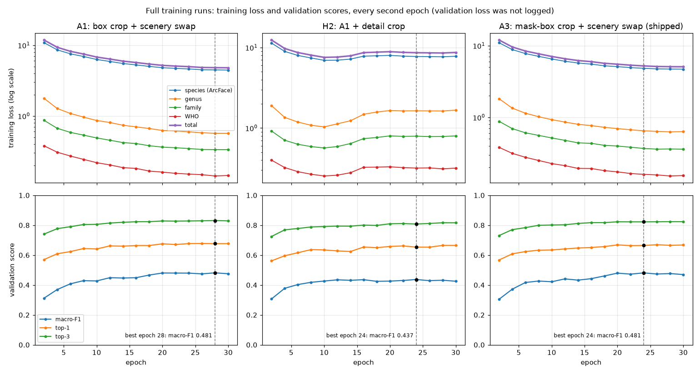
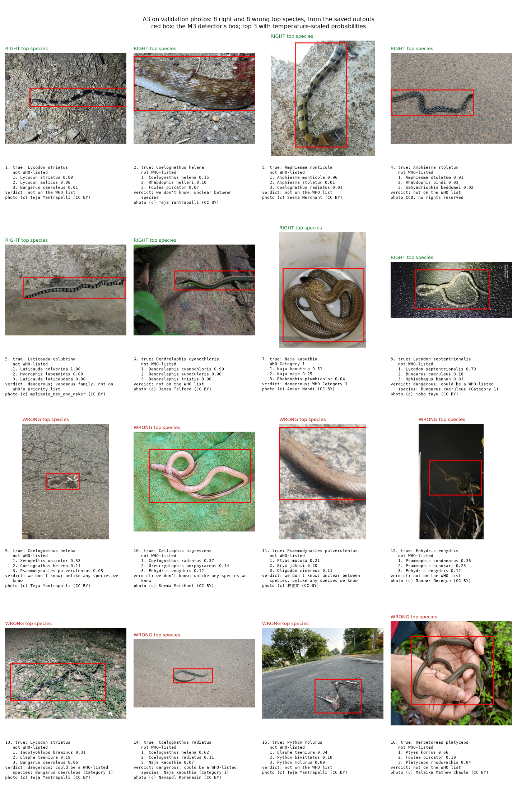

# Milestone 4: Full model training, tuning and stability

SerpentGuard AI · Group 5 · IIT Madras DS and AI Lab<br>
Team lead: Jayesh Bansal. Members: Vikas, Puneet Bajaj and Manas Rastogi.<br>
The signatures at the end are added at the team review.

## Summary

Milestone 3 left two problems: the model leaned on the scenery around the snake, and it named only 56 of our 158 measurable species well. Milestone 4 tried three ways of showing the model the snake on the 16% subset, trained the best recipes on every training photo, retrained the front end with photos that have no snake, and steadied video answers with a lock. We ship **A3**: the crop to the predicted mask's box, with the scenery swapped half the time in training. It runs in the Android app for photos, the live camera and video files; the recorded device checks used an emulator. Community review adds local evidence storage and a backend for shared votes. Every number comes from a saved result file; section 8 says where.

**Results at a glance.**

| Item | Value |
|---|---|
| Model we ship | A3: MobileViT-S, crop to the U-Net mask's box, scenery swapped half the time, all 49,782 training photos, epoch 24 of 30 |
| Validation, 17,151 photos | Top-1 66.4%, top-3 82.2%, macro-F1 0.481 (Milestone 3: 0.367) |
| G1, scenery | Swap gap 0.052, mark at most 0.084 (Milestone 3: 0.168). **Met** |
| G2, species at F1 0.5 or above | 87 of 158 measurable species, mark 80 (Milestone 3: 56). **Met** |
| G3, against B1 on its 62 species, photos from 2022 | Top-1 −0.081 (−0.100 to −0.064), macro-F1 −0.025 (−0.043 to −0.001). **Not met** |
| G4, non-snakes called a snake | 170 of 600 test photos (28.3%), mark at most 5% (Milestone 3's gate: 95.7%). **Not met** |
| G5, changes after the first answer on a real clip | At most 2, mark 1 (Milestone 3's vote: 9). **Not met** |
| Safety, WHO recall | Calibration lower bound 0.958, mark 0.95. **Met**; validation 0.9545 (0.938 to 0.969). Behind the app's own front end the app uses thresholds refitted for it: bound 0.954, validation 0.965 (0.953 to 0.977) (section 7.7) |
| Android emulator verification | The app runs A3 behind the M4 front end; 5 of 5 golden photos give the reference answer on Android, in 0.5 to 1.0 s each (run before the threshold refit of section 7.7; to repeat) |

What we learned, good and bad:

- **Training on every photo did most of the work.** Macro-F1 rose from 0.367 to 0.481, and the number of species at F1 0.5 or above from 56 to 87.
- **Swapping the scenery in training cut the model's reliance on it.** On the subset the swap gap fell from 0.168 to 0.063 at no cost in macro-F1 (section 5.2); the full A3 run reaches 0.052.
- **The detail crop did not help.** It cost 0.045 macro-F1 on the full data and doubled the time per frame.
- **The retrained front end calls far fewer non-snakes a snake** (28% against 96%), but still misses the 5% target and drops 1.7% of real snakes.
- **B1 is still better on the 62 species it knows**, by 8 points of top-1. Our lead over it is coverage of the other 122 species.

## 1. Introduction & Training Scope

**Where we stand.** We trained three recipes on the full training set, 49,782 photos of all 184 species, once each with one seed. The model we ship, A3, was picked by a rule written after the first run finished and before the other two did (section 5.2). A3 passes goal G1 (scenery), goal G2 (species reached) and the safety rule. It misses G3 (against the published model B1), G4 (false snakes) and G5 (video).

**Names.** A3 crops to the box around the snake's mask and pastes the snake onto another species' scenery half the time in training. A1 does the same with the detector's box, and H2 is A1 plus a detail crop, a second and closer look at a region the model picks itself. B1 is the published model of Bolon et al. (2022) [1], which can name 62 of our species. "The M3 model" is our Milestone 3 final model. Appendix A lists every code and term.

Table 1. Goals, judged once on the shipped model by [notebook 25](../../notebooks/25_m4_summary.ipynb) ([`goals.csv`](../../results/m4/summary/goals.csv)).

| Goal | Measure | Mark | A3 | Milestone 3 | Passed |
|---|---|---|---:|---:|---|
| G1 | Top-1 as is minus top-1 with the scenery swapped, same 15,977 photos | at most 0.084 (half of M3's gap) | 0.052 | 0.168 | Yes |
| G2 | Measurable species with validation F1 at least 0.5 | at least 80 of 158 | 87 | 56 | Yes |
| G3 | Ours minus B1 on B1's 62 species, photos uploaded from 2022, 95% photographer interval | top-1 and macro-F1 each higher, or the interval includes 0 | −0.081 / −0.025 | −0.109 / −0.125 | No |
| G4 | Share of non-snake test photos called a snake; validation snakes kept | at most 5%; at least 99% | 28.3%; 98.28% | 95.7%; 99.12% | No |
| G5 | Most changes of the shown species after the first answer, per real test clip | at most 1 | 2 | 9 | No |
| Safety | WHO recall, lower bound on calibration | at least 0.95 | 0.958 | 0.952 | Yes |

G3 is judged on the 11,931 validation photos uploaded from 2022 on, which B1 cannot have trained on. G5's Milestone 3 number uses its 4-of-6 vote. The safety thresholds are fitted until the calibration bound reaches 0.95, so that row shows the fit succeeded; the held-out check is validation recall, 0.954 (0.938 to 0.969). Both safety numbers use Milestone 3's crops: the calibration bound with no gate, the validation recall behind Milestone 3's box gate. The app's M4 front end crops differently and drops 1.72% of validation snakes (3.1% of sea snakes and sea kraits). On its crops A3's thresholds give a calibration bound of 0.947 without the gate and 0.937 behind it, so the app uses thresholds refitted for its front end, which reach 0.954 behind the gate (section 7.7).

**Why these marks.** We set them in the Milestone 4 design on 16 November 2026, before any Milestone 4 run. G1 halves the scenery gap, the TA's main concern at the Milestone 3 review. G2 asks that over half the measurable species reach F1 0.5. G3 accepts a tie within the photographer-bootstrap interval. G4 keeps 99% of real snakes, so the gate cannot pass by dropping snakes.

Table 2. The Milestone 1 targets that still apply. M3 model: [Milestone 3 report](../milestone%203/project-report.md), section 5.3; A3: [`decision_metrics.json`](../../results/m4/full/A3/decision_metrics.json).

| Target | Mark | M3 model | A3 | Met |
|---|---|---|---|---|
| WHO-listed validation photos called dangerous | at least 0.95 | 0.948 | 0.954 (0.938 to 0.969) | yes at the point estimate; the interval starts below 0.95 |
| WHO-listed photos called "not on the WHO list" | at most 2% | 2.1% | 1.5% | yes |
| Calibration error (ECE) after temperature scaling | at most 0.05 | 0.030 | 0.040 | yes |
| Species error among the 80% most confident photos | at most 5% | 26.8% | 22.5% | no |
| Unknown-species photos flagged | at least 70% | 7.5% | 28.2% | no |

**From the subset to full training.** Milestone 3 trained on a subset of 13,925 photos, 16.4% of the training photos (13,611 after the photographer caps). Milestone 4 trains the picked recipe on all 49,782 usable photos for 30 epochs instead of 20: the M3 model peaked at epoch 18 of 20, and there is 3.6 times as much data.

**Scope.** We keep Milestone 3's architecture and tuned settings (MobileViT-S, ArcFace head) and compare four input recipes on the subset, a detail crop at two scales, the rules of a new no-snake gate and ten settings of a new video lock. The phone app that runs the model, and the rest of the app, are in sections 7.10 and 10.

**Not in this report.**
- Validation loss, which was not logged; the training against validation gap is measured in accuracy instead (section 6).
- The full checkpoint state (section 8).
- An untuned model on the full data, Grad-CAM maps, the market products and a live camera test on a real snake.

Every number here is on validation photos, which also picked the epoch and the recipe. The snake test split is scored once, in Milestone 5.

## 2. Dataset Pipeline & Preprocessing Recap

Table 3. Data used in Milestone 4 ([Milestone 2 report](../milestone%202/project-report.md), section 1; [notebook 19](../../notebooks/19_non_snake_set.ipynb); [`clips.csv`](../../results/m4/video/clips.csv), [`negatives.csv`](../../results/m4/video/negatives.csv); [`video.csv`](../../results/m4/summary/video.csv)).

| Data | Source | Size |
|---|---|---|
| Snake photos | iNaturalist research grade, CC licences | 121,566 photos, 184 species, 15,842 photographers |
| Unknown-species pool | as above, species with under 20 usable photos | 815 photos of 97 species; 451 photos of 49 species scored |
| Non-snake photos | Open Images V7 (CC BY 2.0) [8], iNaturalist lookalikes (CC BY, CC0) | 2,999 photos (2,500 and 499), 11 categories, 2,639 owners |
| Real video clips | Wikimedia Commons | 10 clips of 7 species (4 dev, 6 test); 3 clips with no snake |
| Synthetic clips | our CC0 and CC BY validation photos, filmed with the Milestone 1 recipe | 46 (20 random species, 26 WHO-listed) |

**How many species.** Of the 289 snake species recorded in India on iNaturalist that we collected ([work log](../../work-contribution-log.md), Week 2), 281 had photos we may use, and the 184 with at least 20 such photos became our classes (Milestone 2 report, section 5). India has more than 300 snake species, as the TA noted, so the app covers 184 of India's 300 or more.

**Class distribution.** The largest class has 12,038 photos and the smallest 22, a ratio of 547, with a Gini coefficient of 0.73 (Milestone 2 report, section 5). The 208 classes, ratio of 916 and Gini coefficient of 0.76 quoted at the Milestone 2 review describe the dataset before the licence filter ([`split_report.json`](../../data/split_report.json)). Of the 184 species, 158 have at least five validation photos, enough to measure an F1, 18 have one to four (47 photos in all) and 8 have none, so validation holds 176 ([`classes.csv`](../../data/classes.csv)).

Table 4. WHO categories in the training split, before the caps ([`classes.csv`](../../data/classes.csv)).

| WHO category | Species | Training photos |
|---|---|---|
| Category 1 | 6 | 6,469 |
| Category 2 | 10 | 4,486 |
| Not listed | 168 | 74,112 |

Table 5. Splits for full training. Sources: [executed notebook 21](../../results/m4/full/executed/21_full_training_A3.ipynb), cell 7; `decision_metrics.json`; Milestone 2 report, section 11.

| Set | Photos | Species | Photographers | Role |
|---|---|---|---|---|
| Training list | 49,782 | 184 | 6,213 | training, after the caps |
| Calibration | 7,999 | 111 | | fitting every threshold |
| Validation | 17,151 | 176 | 2,249 | picking the epoch and the recipe; reporting |
| Unknown pool, scored half | 451 | 49 | | unknown-species flag |
| Test and test_extra | 5,144 and 13,389 | 148 and 162 | 460 and 1,894 | locked, never read |

**Isolation.** Milestone 2 split by photographer with `StratifiedGroupKFold` (7 folds, seed 42), so no photographer, observation or near copy crosses training, validation and the held-out fold. Full training also drops every calibration photographer, and the data code refuses the test splits. The non-snake set is split 60/20/20 by owner; its test split was scored once.

Table 6. Preprocessing in [`src/serpentguard/data.py`](../../src/serpentguard/data.py).

| Step | What it does |
|---|---|
| Exposure | CLAHE on lightness when mean brightness is under 60 or over 200, to lift night photos |
| Crop (A3) | to the U-Net mask's box plus 6%; a photo with no usable mask (5.7% of the training list) goes in whole |
| Letterbox | to 320 × 320 with grey padding (124, 116, 104), keeping a slender snake's shape |
| Normalise | ImageNet statistics, then a fixed layer maps the input to MobileViT-S's own 0 to 1 range |

A3's crops come from the Milestone 3 detector and U-Net, whose prediction file covered 39,526 photos; each run first predicted the 38,853 it lacked (notebook 21, cell 32). The app uses the retrained Milestone 4 pair (section 7.7).

**Imbalance.** Training keeps up to 50 photos per photographer per species and 1,000 per species; a sampler draws each photo with weight 1/√(class size), times 1.35 for WHO Category 2 and 1.6 for Category 1. Milestone 2 measured this on its 85,067 training photos: the caps cut the largest-to-smallest ratio from 876 to 100 and a sampled epoch to 15.6, and the effective number of classes rose from 31.9 to 118.6 (Milestone 2 report, section 9). The loss is not reweighted.

**Data governance.** Only credited CC photos appear in this repository. All-rights-reserved and no-derivatives photos stay in the private Kaggle raw datasets the pipeline rebuilds from; no model was trained or tested on them. Five of the ten real clips and one no-snake clip are CC BY-SA, outside the licences we meant to use for clips; they stay out of the repository and this report ([notebook 24](../../notebooks/24_video_lock.ipynb), cell 11).

## 3. Model Architecture Recap

The app's pipeline, per photo or clip frame ([notebook 24](../../notebooks/24_video_lock.ipynb), [`verify_inference.py`](../../scripts/verify_inference.py) and the app's `lib/inference/` follow it):

```text
photo or frame
  -> exposure fix
  -> M4 detector (YOLO26n) and M4 U-Net segmenter
  -> no-snake gate: box confidence >= 0.0050 and mask area >= 0.000048 of the photo, else "no snake found"
  -> crop to the mask's box plus 6%, letterbox to 320 x 320
  -> SnakeID: MobileViT-S encoder, 256-number embedding, species, genus, family and WHO heads
  -> decision rules: dangerous / not on the WHO list, still keep away / we don't know
  -> on a clip: the lock pools the last frames with a snake before it shows a species
```

Table 7. SnakeID. Output shapes from [notebook 12](../../notebooks/12_training.ipynb), cell 7, which builds the same architecture; layer sizes from [`models.py`](../../src/serpentguard/models.py).

| Part | What it does | Output per photo | Parameters |
|---|---|---|---|
| Input | the letterboxed RGB crop | 3 × 320 × 320 | |
| Encoder | MobileViT-S [2], ImageNet weights, classifier removed; the 10 × 10 × 640 map is averaged | 640 | 4.94 M (Milestone 3 report, section 2.1) |
| Embedding layer | linear 640 → 256, no bias, batch norm; scaled to length 1 for the species head | 256 | 164,352 |
| Species head (ArcFace [3]) | cosine to one direction per species, times s = 30 | 184 | 47,104 |
| Genus head | linear | 69 | 17,733 |
| Family head | linear | 13 | 3,341 |
| WHO head | linear: not listed, Category 2, Category 1 | 3 | 771 |
| Whole model | | | 5.2 M (notebook 12, cell 7) |

The other heads read the 256 features before normalisation. Each species' mean training embedding (its prototype) is kept for the unknown-species check. We did not record the encoder's layer count.

**Changes from the standard model.** The classifier is replaced by the embedding layer and four heads. Nothing is frozen; the encoder learns at a tenth of the new layers' rate. There are no adapters and no mask head. H2's detail crop adds no parameters: it crops where the top species' activation map reaches half its range, encodes the crop and averages the two feature vectors; in training it replaces half the batches.

**Front end.** The Milestone 4 detector (YOLO26n, 2,533,886 parameters) trained for 20 epochs at 320 px on 15,001 photos, 1,500 without a snake; the U-Net (6,628,945 parameters) for 15 epochs on 10,499 photos, 1,799 without a snake ([`m4_detector_run.json`](../../results/m4/gate/m4_detector_run.json), [`m4_segmenter_run.json`](../../results/m4/gate/m4_segmenter_run.json)). A3's checkpoint is 20,820,579 bytes in float32 ([`artifacts.md`](../../results/m4/artifacts.md)).

## 4. Complete Training Configuration

The loss, from `models.total_loss`:

```text
L = L_species + 0.3 * (L_genus + L_family) + 0.5 * L_WHO

L_species: cross-entropy over the 184 species on the ArcFace logits
           z_j = s * cos(theta_j)          for every species j other than the true one, y
           z_y = s * cos(theta_y + m)      (or s * (cos(theta_y) - m * sin(m)) when theta_y > pi - m)
           theta_j is the angle between the embedding and species j's direction; s = 30, m = 0.356
L_genus, L_family, L_WHO: plain cross-entropy (the WHO term's danger weight is 1, so it adds no extra penalty)
```

Table 8. Training configuration of A3. Settings from [`config.yaml`](../../results/m4/full/A3/config.yaml); optimizer, learning-rate factor, schedule, clipping and precision from [`train.py`](../../src/serpentguard/train.py); time from `final_metrics.json` and notebook 21, cell 32; versions from [`versions.json`](../../results/m4/full/A3/versions.json).

| Setting | A3 |
|---|---|
| Loss | as above; no label smoothing |
| Epoch picked by | validation macro-F1 over the 158 measurable species |
| Metrics | each evaluation: macro-F1, top-1, top-3, each head's training loss; after training: WHO recall and its calibration bound, false alarms, ECE, unknown-species flag, swap gap, F1 per species, comparison with B1 |
| Optimizer | AdamW, weight decay 0.00156, PyTorch's default betas |
| Learning rate | 9.53e-4 for the new layers, 9.53e-5 for the encoder |
| Schedule | linear warm-up over the first epoch, step by step, then cosine decay to 0 at the last step |
| Batch | 64 on one GPU, no gradient accumulation, so 64 effective; 777 steps an epoch (last partial batch dropped) |
| Epochs and steps | 30 epochs, 23,310 steps; best epoch kept (24) |
| Validation | every second epoch, 15 passes over 17,151 photos |
| Precision and clipping | float16 autocast with a dynamic loss scaler (GradScaler); gradient norm clipped at 5.0 |
| Augmentation | Milestone 2's augmentations (stronger for rare species) at strength 0.745 |
| Scenery swap | probability 0.5 with U-Net masks; donors from 3,000 snake-free sceneries of 184 species |
| Sampler and seed | weighted (section 2); seed 1 |
| Hardware | one Tesla T4 on Kaggle; peak GPU memory 10,780 MB |
| Time | 633 s an epoch at 78.6 photos a second; 1,433 s for all 15 validation passes; 5.8 h inside `train`; 6.2 h for the full pass, 6.9 h of session time by its end |
| Software | Python 3.13.16, PyTorch 2.11.0 with CUDA 13.0, timm 1.0.31, albumentations 2.0.8 |

A1 differs in its crop and its swap masks (SAM): 518 s an epoch, 4.7 h. H2 is A1 with the detail crop (threshold 0.5, half the batches): 624 s an epoch, 5.8 h (each run's `final_metrics.json`).

## 5. Hyperparameter Experiments

### 5.1 The search (Milestone 3)

Milestone 3 ran a random search on the subset ([notebook 14](../../notebooks/14_tuning.ipynb)) over learning rate (1e-4 to 1e-3, log scale), weight decay (1e-4 to 0.1, log scale), ArcFace margin (0.1 to 0.5) and augmentation strength (0.5 to 1.5): 24 trials of 8 epochs in one Optuna study [9], 15.7 GPU-hours, macro-F1 0.140 to 0.260, median 0.192 ([`h1_trials.csv`](../../results/m3/summary/h1_trials.csv)). fANOVA [10] attributes about 89% of the score differences to the learning rate and under 7% to each other setting (notebook 14, "What we found").

| Parallel coordinates of the 24 trials | Parameter importance (fANOVA) |
|---|---|
|  |  |

Table 9. The three best settings, retrained on the box crop for 20 epochs at seeds 1, 2 and 42 ([`model_runs.csv`](../../results/m3/summary/model_runs.csv)).

| Setting | Learning rate | Weight decay | ArcFace margin | Augmentation | Macro-F1, seeds 1 / 2 / 42 | Spread |
|---|---|---|---|---|---|---|
| Default recipe | 3e-4 | 0.05 | 0.3 | 1.0 | 0.311 (seed 42 only) | |
| Trial ranked 1 | 9.53e-4 | 1.56e-3 | 0.356 | 0.745 | 0.3669 / 0.3674 / 0.3660 | 0.0014 |
| Trial ranked 2 | 9.4e-4 | 1.5e-2 | 0.346 | 0.91 | 0.3626 / 0.3701 / 0.3563 | 0.0137 |
| Trial ranked 3 | 5.8e-4 | 4.6e-3 | 0.391 | 0.56 | 0.3546 / 0.3580 / 0.3528 | 0.0052 |

Trials 1 and 2 are within the 0.005 noise floor of each other, so stability decided: trial 1's seeds span 0.0014. Every Milestone 4 run uses its settings.

### 5.2 Structured comparisons (Milestone 4)

**Input recipes ("arms").** [Notebook 18](../../notebooks/18_background_arms.ipynb) trained three arms on the 16% subset and compared them with A0, the M3 model. An arm qualifies if its macro-F1 and WHO recall are within 0.005 and 0.006 of A0's; among those that qualify, the smallest swap gap wins ([`pick.json`](../../results/m4/arms/pick.json)).

Table 10. The arms on the subset ([`arms.csv`](../../results/m4/summary/arms.csv)). Top-1 is on the 15,977 validation photos with a mask.

| Arm | What the model sees | Macro-F1 | WHO recall | Top-1 | Top-1, scenery swapped | Swap gap | Qualifies |
|---|---|---:|---:|---:|---:|---:|---|
| A0 | the M3 model: detector's box crop | 0.367 | 0.948 | 0.628 | 0.460 | 0.168 | baseline |
| A1 | box crop, snake pasted onto another species' scenery half the time | 0.372 | 0.945 | 0.631 | 0.538 | 0.093 | yes |
| A2 | snake only, everything outside the mask grey | 0.333 | 0.959 | 0.595 | 0.589 | 0.006 | no (macro-F1) |
| A3 | crop to the predicted mask's box, scenery swapped half the time | 0.371 | 0.945 | 0.640 | 0.577 | 0.063 | **yes, wins** |

Removing the scenery entirely (A2) removes the shortcut, but it also loses 0.034 macro-F1. Swapping it keeps the accuracy and cuts the gap.

**Full runs and the shipping rule.** [Notebook 21](../../notebooks/21_full_training.ipynb) trained A1, H2 and A3 on all 49,782 training photos for 30 epochs ([`full_runs.csv`](../../results/m4/summary/full_runs.csv), [`classes.csv`](../../results/m4/summary/classes.csv)). Written at about 05:35 IST on 17 November, after A1 finished (05:18) and before H2 and A3 finished (about 13:30), the rule ships, among runs whose calibration bound reaches 0.95, the one passing most of G1 to G3; ties go to the smaller swap gap, then the higher macro-F1 ([notebook 25](../../notebooks/25_m4_summary.ipynb), cell 4).

Table 11. The three full runs.

| Measure | A1 (box crop, scenery swap) | H2 (A1 plus the detail crop) | **A3 (mask-box crop, scenery swap), shipped** |
|---|---:|---:|---:|
| Best epoch of 30 | 28 | 24 | **24** |
| Top-1 / top-3, all validation photos | 67.7% / 83.1% | 65.3% / 80.8% | **66.4% / 82.2%** |
| Macro-F1, 158 species | 0.481 | 0.437 | **0.481** |
| Swap gap (G1) | 0.075 | 0.080 | **0.052** |
| Species at F1 0.5 or above (G2) / at F1 0 | 87 / 23 | 74 / 27 | **87 / 20** |
| WHO lower bound, calibration | 0.956 | 0.951 | **0.958** |
| WHO recall, validation | 0.940 | 0.943 | **0.954** |
| False alarms, validation | 0.178 | 0.220 | **0.230** |
| Goals passed of G1 to G3 | 2 | 1 | **2** |

A1 and A3 tie on macro-F1 and on G2 and pass two goals each; A3's smaller swap gap (0.052 against 0.075) decides. Fewer of its species score zero, it was the arm the subset rule picked, and its crop is the one the app's front end produces.

**Head pilot and detail crop.** Open-vocabulary detectors could not find a snake's head and tail reliably: at most 4 right head boxes of 50, against a pass mark of 40 ([notebook 22](../../notebooks/22_head_pilot.ipynb), [`head_pilot.csv`](../../results/m4/summary/head_pilot.csv)). So [notebook 23](../../notebooks/23_head_arms.ipynb) let the model pick a second, closer crop itself (H2). On the subset it added 0.011 macro-F1 over A1. On the full data it lost 0.045 (0.437 against 0.481), 0.023 top-1 and 13 species at F1 0.5, and it doubled the laptop time per frame (162.3 ms against 80.7 ms) ([`heads.csv`](../../results/m4/summary/heads.csv)). It is not used.

**Gate and lock.** [Notebook 20](../../notebooks/20_no_snake_gate.ipynb) compared three gate rules (section 7.7); [notebook 24](../../notebooks/24_video_lock.ipynb) tried every pair of a 5- or 10-frame window and five margins on dev clips only (section 7.8).

### 5.3 What was not re-tuned

Nothing was searched again at full scale; the swap stayed at 0.5, and epochs moved from 20 to 30 without a comparison. With one seed per run, differences under the M3 seed spreads (0.0014 and 0.0137) are noise: A1 and A3 differ by 0.0003 in macro-F1. The fANOVA plot is our only learning-rate sensitivity evidence.

## 6. Generalization & Training Stability

Table 12. Techniques and their measured effect. "Not isolated" means no run changed that technique alone.

| Technique | Setting | Measured effect | Source |
|---|---|---|---|
| Scenery swap | half the training photos | A0 against A1 on the subset (swap added): swap gap 0.168 to 0.093, macro-F1 0.367 to 0.372 | `arms.csv` |
| Crop to the mask's box | A3 | gap 0.093 to 0.063 (subset), 0.075 to 0.052 (full); swap masks differ too | `arms.csv`, `full_runs.csv` |
| Augmentation, weight decay | strength 0.745; 0.00156 | tuned in the search; not isolated | `h1_trials.csv` |
| Caps, weighted sampler | section 2 | not isolated; macro-F1 0.226 under 30 training photos, 0.572 at 100 or more | `classes.csv` |
| Stability settings | 1-epoch warm-up, clipping at 5.0, GradScaler, batch norm | not isolated | `train.py`, `models.py` |

We set no dropout or DropPath, and did not try Mixup, CutMix or RandAugment.

**Training against validation.** `train.py` computes no validation loss, so we measured the gap in accuracy instead. We scored A3 on 1,499 of its own training photos and on 1,500 validation photos, both drawn the same way (an even draw across species, seed 42) and both through the training code's evaluation path: no augmentation, no scenery swap, the same crop. On the validation photos these predictions agree with the run's saved outputs on the top species for 99.3% of photos, so the comparison uses the same model and inputs. The even draw favours rare species, so both samples score below the full validation set.

Table 13. A3 on its own training photos and on validation photos.

| Species with | Training photos: macro-F1 | Validation: macro-F1 | Gap |
|---|---|---|---|
| fewer than 30 training photos | 0.888 | 0.272 | 0.62 |
| 30 to 99 | 0.750 | 0.409 | 0.34 |
| 100 or more | 0.666 | 0.489 | 0.18 |
| all (top-1) | 0.724 (0.701 to 0.747) | 0.471 (0.432 to 0.508) | 0.25 |

Rare species show high variance: the model nearly learns their few training photos and misses new ones. Common species show bias as well: even on photos it trained on, their macro-F1 is only 0.666, and the training loss was still falling at the last epoch. Averaging A1's and A3's predictions, a small bagging test on the saved validation outputs, raises macro-F1 from 0.481 to 0.497 (by 0.004 to 0.026) and top-1 from 0.664 to 0.690 (by 0.021 to 0.031), which fits the variance reading. Sources: [`train_vs_val.json`](../../results/m4/bias_variance/train_vs_val.json) and [`ensemble.json`](../../results/m4/bias_variance/ensemble.json), written by [`check_train_vs_val.py`](../../scripts/check_train_vs_val.py) and [`check_ensemble.py`](../../scripts/check_ensemble.py).

No run diverged; A1's and A3's total training loss falls at every evaluation. Over A3's last ten epochs it fell from 5.516 to 5.080 while validation macro-F1 stayed between 0.470 and 0.481. H2's falls to 7.554 at epoch 10, then rises to 8.887 by epoch 20, in every head.

**Beyond the training scenery.** The model leans less on scenery: of the photos A3 gets right, 13.1% stay right with the snake blanked out (M3 model: 17.8%), and Indian validation photos score 5.6 points of top-1 below the others (95% interval 1.0 to 10.2; M3 model: 15.6) ([`robustness_metrics.json`](../../results/m4/full/A3/robustness_metrics.json); M3: [`robustness_metrics.json`](../../results/m3/r1/H1_top1_s1/robustness_metrics.json)).

## 7. Results, Observations & Qualitative Outputs

### 7.1 Learning curves



Training loss per head (top, log scale) and validation scores (bottom) at the 15 evaluations of each run; black dots mark the kept epoch: A1 28, H2 24, A3 24 ([`metrics.jsonl`](../../results/m4/full/A3/metrics.jsonl); [`figures.md`](assets/figures.md)). There is no validation loss curve, because validation loss was not logged (section 6). A3's macro-F1 rises from 0.305 at epoch 2 to 0.479 at epoch 20, then stays between 0.470 and 0.481, while top-1 creeps from 0.664 at epoch 24 to 0.668 at epoch 30.

### 7.2 Baseline, untuned, tuned and published models

Table 14. Validation photos, macro-F1 over the 158 measurable species, one scoring function ([`baselines.csv`](../../results/m3/summary/baselines.csv), [`model_runs.csv`](../../results/m3/summary/model_runs.csv), `full_runs.csv`; published rows from Milestone 3 report section 3.5).

| Model | Trained on | Macro-F1 | Top-1 |
|---|---|---|---|
| B0: always the commonest species | nothing | 0.001 | 0.095 |
| B3: frozen MobileViT-S, nearest class average | nothing | 0.135 | 0.217 |
| B2: BioCLIP, species names | nothing of ours | 0.187 | 0.354 |
| B1: Bolon et al. 2022, labels mapped to ours | SnakeCLEF 2021 | 0.257 | 0.683 |
| Untuned: default recipe, whole photo, cross-entropy | subset, 13,611 photos | 0.256 | 0.534 |
| Untuned: default recipe, box crop, ArcFace | subset | 0.311 | 0.583 |
| Tuned: the M3 model | subset | 0.367 | 0.622 |
| Tuned: A3 | full list, 49,782 photos | 0.481 | 0.664 |
| Published: Bolon et al. 2022, own test set | 772 species, other photos | 0.922 | 0.960 |
| Published: SnakeCLEF 2023 winner [7] | 1,784 species, other photos | 0.536 | |
| Market products (Google Lens, Gemini, ChatGPT, iNaturalist) | | not measured | not measured |

We trained no untuned model on the full list (a run takes about six hours of free GPU time). Published rows use other species and photos and give context only. B1's macro-F1 is low because it cannot name 122 of our species; on its own species it beats us (section 7.3).

### 7.3 Against the published model on its own species (G3)

B1 knows 62 of our 184 species. On those species, in photos uploaded from 2022 (after its training data ends: 11,931 photos, 1,767 photographers), it still leads A3. Intervals are from 1,000 resamples of whole photographers, seed 42 ([`b1.csv`](../../results/m4/summary/b1.csv)).

Table 15. A3 against B1.

| Score, 2022 photos of B1's species | A3 | B1 | A3 minus B1 (95% interval) | Milestone 3 minus B1 |
|---|---:|---:|---:|---:|
| Top-1 | 70.7% | 78.8% | −0.081 (−0.100 to −0.064) | −0.109 |
| Macro-F1, B1's species only | 0.694 | 0.719 | −0.025 (−0.043 to −0.001) | −0.125 |
| Macro-F1, Milestone 3's whole-slice definition (reported, not judged) | 0.662 | 0.637 | +0.025 (+0.007 to +0.050) | −0.077 |

The gap closed by about a quarter on top-1 and by four fifths on macro-F1, but it did not close. When our species head may answer only with B1's 62 species, the top-1 gap is −0.028.

### 7.4 Species reached

Table 16. Species-level results on validation ([`classes.csv`](../../results/m4/summary/classes.csv)).

| Measure | M3 model | A3 |
|---|---|---|
| Measurable species at F1 0.3 / 0.5 / 0.7 or above, of 158 | 85 / 56 / 17 | 116 / 87 / 47 |
| Median F1 | 0.336 | 0.534 |
| Measurable species at F1 0 | 18 | 20 |
| Macro-F1, species with under 30 / 30 to 99 / 100 or more training photos | | 0.226 / 0.376 / 0.572 |

We average F1 over 158 species because an F1 from fewer than five photos is mostly noise; the other 26 are never counted as zero. On the 47 photos of the 18 species with one to four validation photos, A3's top-1 is 0.319 ([`final_metrics.json`](../../results/m4/full/A3/final_metrics.json)).

### 7.5 Verdicts and calibration

Table 17. A3's verdicts on the 17,151 validation photos, thresholds fitted on calibration photos only (`decision_metrics.json`).

| Measure | M3 model | A3 |
|---|---|---|
| Dangerous / not on the WHO list / we don't know | | 6,729 / 7,923 / 2,499 |
| "We don't know" share | 9.5% | 14.6% |
| False alarms (neither WHO-listed nor a viper or elapid, called dangerous) | 0.311 | 0.230 (0.212 to 0.250) |
| Unknown-species photos flagged, all / unknown genera (29 photos) | 7.5% | 28.2% / 55.2% |
| When unsure, a genus shown / right | | 76.5% / 83.7% |
| When unsure, a family shown / right | | 97.1% / 88.0% |


A3 is overconfident before temperature scaling [4]. Over 15 confidence bins, dividing its logits by T = 1.806, fitted on the 7,999 calibration photos, takes the expected calibration error from 0.142 to 0.040. Unscaled, the 10,308 photos above 0.933 confidence average 0.995 but are right on 90.3% ([`figures.md`](assets/figures.md)). For flagging unknown species the energy score is best (AUROC 0.787), ahead of the prototype distance in use (0.768) and the top probability (0.661) (`decision_metrics.json`, `u1`).

### 7.6 Sample predictions



Eight right and eight wrong, drawn species by species (seed 42) from the 2,600 CC0 and CC BY validation photos; five of the 16 panels are by one photographer. Red box: the M3 detector's. Credits under each panel and in [`sample_predictions_credits.csv`](assets/sample_predictions_credits.csv).

Wrong answers often stay in the genus (panel 14, *Coelognathus radiatus* read as *C. helena*, 0.62) or end as "we don't know" (panels 9 to 11). A krait lookalike in the top 3 makes a harmless top species dangerous (panels 8 and 13). A python flattened on a road (panel 15) is read as a rat snake with the true species third. A right species can still end in "we don't know" (panel 2, 0.15).

### 7.7 The no-snake gate (G4)

Milestone 3's front end called 95.7% of photos with no snake a snake. [Notebook 19](../../notebooks/19_non_snake_set.ipynb) collected 2,999 openly licensed non-snake photos. [Notebook 20](../../notebooks/20_no_snake_gate.ipynb) retrained the detector and U-Net with them and compared three gate rules, each cut-off fitted to keep 99% of calibration snakes (the chosen gate keeps 98.0%) ([`gates.csv`](../../results/m4/summary/gates.csv), [`gate_categories.csv`](../../results/m4/summary/gate_categories.csv)).

Table 18. The gate.

| Front end | Rule | Non-snakes called a snake (validation) | Snakes kept (validation) | Non-snakes called a snake (test, scored once) |
|---|---|---:|---:|---:|
| Milestone 3 | box | 95.3% | 99.1% | 95.7% |
| Milestone 4 | box | 39.2% | 99.0% | 40.7% |
| Milestone 4 | mask area | 28.0% | 98.3% | 28.3% |
| Milestone 4 | **both** (box score at least 0.004993 and mask area at least 0.0048%) | **27.3%** | **98.3%** | **28.3%** |

The app uses "both". It misses G4 (5%) and keeps 98.3% of snakes, not the 99% we aimed for. On test the picked gate calls 8.9% of people, 8.3% of hands and arms, 8.3% of T-shirts, 5.0% of dogs and 2.5% of cats a snake, but 28.3% of ropes, hoses and belts, 43.3% of other animals and 95% to 100% of lookalikes. Both cut-offs are close to zero while the lookalikes below score 0.91 to 0.94 on the box, so the gate in effect asks whether the retrained detector and U-Net fire at all; the box rule adds nothing to the mask rule on test (28.3% either way). The gate drops 3.1% of sea snakes and kraits.


The highest-scoring lookalike of each category among the 164 non-snake validation photos the gate passes.

**The app's front end differs from A3's training crops.** A3 trained on M3 crops; the app uses the M4 pair, whose boxes agree with M3's at a median IoU of 0.942 on 17,082 validation photos ([`gate_checks.csv`](../../results/m4/summary/gate_checks.csv)). On 300 validation photos drawn evenly across species (176 species, seed 42), A3's top-1 is 0.443 through the app's front end and 0.477 through its own crops, 3.3 points lower (paired exact test p = 0.052; laptop rerun of the M3 crops 0.480; [`front_end_shift.csv`](../../results/m4/summary/front_end_shift.csv)). **The safety numbers in Tables 1 and 2 were measured on M3 crops** (the calibration bound with no gate, the validation recall behind the M3 gate); the app's gate alone drops 1.72% of validation snakes.

**Safety behind the app's front end.** We ran all 7,999 calibration photos and 17,143 of the 17,151 validation photos (8 are no longer on iNaturalist) through the app's own path: the M4 detector and U-Net, the "both" gate, the crop to the cleaned mask's box and the fp32 ONNX classifier. A WHO-listed snake the gate drops counts as a miss. With A3's thresholds the calibration bound is 0.947 on the app's crops without the gate and 0.937 behind it, both under the 0.95 mark (0.958 on M3 crops). So we refitted the thresholds on those calibration photos with the same code (`decide.fit_thresholds`), raising its target in steps of 0.0025 until the bound behind the gate reached 0.95. The validation photos were not used for the refit. The app now uses the refitted thresholds (`app/assets/model/pipeline.json`). The record of the refit is in this repository; the scripts that ran it (`app_outputs.py`, `refit_search.py`, `eval_refit.py`, `apply_refit.py`) are not yet.

Table 18b. A3 behind the app's front end ([`decision_app_front_end.json`](../../results/m4/full/A3/decision_app_front_end.json)).

| Thresholds | Calibration bound, behind the gate | Validation WHO recall, behind the gate | False alarms (validation) | "We don't know" (validation) |
|---|---:|---:|---:|---:|
| A3's, fitted on M3 crops | 0.937 | 0.957 (0.943 to 0.970) | 22.3% | 2,670 |
| Refitted for the app's front end (target 0.96) | 0.954 | 0.965 (0.953 to 0.977) | 24.9% | 2,389 |

The refit lowers theta_d from 0.084 to 0.058 and raises theta_who from 0.139 to 0.192, so the app calls a photo dangerous a little sooner. That meets the safety rule behind the app's own front end and keeps the whole validation interval above 0.95, at 2.7 points more false alarms. Before the refit, the same code applied to A3's saved outputs reproduced the reported bound (0.958), and two separate implementations (`decide.py` and the app's Python reference) gave the same recall on the same photos.

### 7.8 Video: the lock (G5)

Milestone 3 showed a species when 4 of the last 6 frames agreed, and the answer on a real clip changed up to 9 times. [Notebook 24](../../notebooks/24_video_lock.ipynb) pools every output over the last frames with a snake. It shows "Checking…" until the pooled top species holds θ_conf and leads the runner-up by a margin, then locks it, and lets another species take over only after it has clearly led for one second. The confidence test runs after pooling; single frames are not filtered before it. "Dangerous" may show while checking. The window (5 frames) and margin (0.05) were tuned on development clips only ([`video_tuning.csv`](../../results/m4/summary/video_tuning.csv), [`video.csv`](../../results/m4/summary/video.csv)).

Table 19. A3 on real clips.

| Run | Clips | Answered | Median changes | Most changes | Median first answer | Final species right |
|---|---:|---:|---:|---:|---:|---:|
| Development, lock | 4 | 4 | 0 | 0 | 0.8 s | 3 of 4 |
| Test, lock | 6 | 5 | 0 | 2 | 0.5 s | 1 of 4 |
| Test, A3 with Milestone 3's vote rule | 6 | 6 | 3 | 17 | 0.4 s | 1 of 4 |

Table 20. The 6 real test clips under the lock ([`video_clips.csv`](../../results/m4/summary/video_clips.csv); verdicts from [`video_lock.csv`](../../results/m4/video/A3/video_lock.csv)).

| Clip | Species | Changes after the first answer | First answer (s) | Final species | Verdict at the end |
|---|---|---|---|---|---|
| naja_naja_ditmars_1915 | *Naja naja* | 2 | 0.5 | *Fowlea piscator*, wrong | dangerous |
| gonyosoma_oxycephalum_mulu | *Gonyosoma oxycephalum* | 0 | 0.5 | right | not on the WHO list |
| ahaetulla_borealis_kerala | *Ahaetulla borealis* | never answers | | none | none |
| ptyas_mucosa_swimming | *Ptyas mucosa* | 0 | 16.3 | *Daboia russelii*, wrong | dangerous |
| naja_cobra_2017 | *Naja* (genus only) | 0 | 0.5 | *Naja naja*, not scored | dangerous |
| naja_jaipur_charmer | *Naja* (genus only) | 0 | 0.5 | *Naja naja*, not scored | dangerous |

G5 fails on one clip with 2 changes, one clip never answers, and 1 of 4 species-scored clips ends right. No dangerous snake is missed on the six test clips: all three cobra clips end "dangerous", though one shows the wrong species, and the harmless *Ptyas mucosa* clip ends "dangerous", a false alarm.

**The lock does not stop false snakes.** With A3 behind the M4 gate, all three clips with no snake lock onto a snake and show "Dangerous" ([`video_negatives.csv`](../../results/m4/summary/video_negatives.csv)). The gate passes the chameleon on 294 of 301 frames, and the clip locks onto *Echis carinatus*. The eagle clip locks onto two sea snakes, and the river clip onto *Python bivittatus* for 8 of its 301 frames. We tested recorded clips only; A3's are a single look at the test clips, while the M3 model's were scored three times as the method changed (notebook 24).

### 7.9 Unexpected training dynamics

- **Plateau.** A3's macro-F1 stopped improving after epoch 20 while its training loss kept falling. We would not expect more epochs to raise macro-F1.
- **Small dips** at epoch 10 (0.427 to 0.422) and 14 (0.441 to 0.433), recovered at the next evaluation; with one seed we cannot tell them from noise.
- **H2.** Its training loss rises from epoch 12 in every head and its macro-F1 stays between 0.418 and 0.437 from epoch 8, though the detail crop helped on the subset (+0.011 macro-F1). Its crops come from its own activation map, so its inputs shift as it trains; we have not tested whether this causes the rise.
- **Class-specific underfitting.** 20 of the 158 measurable species have F1 0; species with under 30 training photos average 0.226.

### 7.10 The model in the app

The Flutter app runs A3 locally for a photo, the live camera or a video file; the recorded end-to-end device checks used an Android 15 ARM64 emulator. The path follows the team's Python reference (`reference_pipeline.py` in the model bundle), step by step:

| Step | What happens | Code |
|---|---|---|
| Decode | Photo read upright (EXIF rotation applied). On Android with `BitmapFactory`: Flutter's own decoder gave different pixels on 3 of the 5 golden photos, enough to move a detector score from 0.54 to 0.32 | `lib/inference/pipeline.dart` |
| Exposure fix | CLAHE on the LAB lightness when the mean brightness is below 60 or above 200 | `lib/inference/image_ops.dart` |
| Gate | Detector box score and U-Net mask area ("both", section 7.7) | same |
| Crop | Mask closed, small parts dropped, crop to its box plus 6% | same |
| Classifier | A3 in fp32 ONNX: species, WHO, genus and family heads and the embedding | `flutter_onnxruntime` 1.9.0 [6] |
| Decision | DR0 with A3's thresholds refitted for the app's front end (section 7.7), replacing the app's placeholder rule | `lib/inference/decision.dart` |
| Video and live camera | The lock of section 7.8, at most 10 frames a second | `lib/inference/video_lock.dart` |

The image steps are written in plain Dart following OpenCV's algorithms, so the app's tests need no native build. The cv2 wheel itself rounds `INTER_LINEAR` differently on ARM and x86. The app uses OpenCV's generic bit-exact version, which on the golden photos changes no answer and moves probabilities by under 0.001.

| Check | Result |
|---|---|
| The ONNX files against the repo's PyTorch path (`check_parity.py` in the model bundle) | 0 of 17,151 saved validation outputs give a different decision; whole path on 300 validation photos: same gate, crop, top species, verdict and message on all 300, probabilities within 0.00001. fp16 files changed 1 verdict of 300, so the app uses fp32 |
| Decision rules on 200 saved model outputs (`golden_decisions.json`) | 200 of 200: same verdict, reasons, message, genus fallback and top 3; probabilities within 1e-6. Recomputed at the refitted thresholds (20 rows change verdict), checked against the Python reference (200 of 200), and passing in `flutter test` |
| Image steps against cv2 5.0 on the 5 golden photos | Identical, except a one-level difference on under 0.1% of pixels in two INTER_AREA downscales |
| Whole path on Android (emulator, arm64, Android 15) against `golden_photos.json` | 5 of 5: same gate, crop, top 3, verdict and message; probabilities within 0.01; 0.5 to 1.0 s per photo. Run with A3's original thresholds; at the refitted ones the five verdicts stay the same and the expected probabilities were recomputed, and the device run is still to repeat |
| Video, *Naja naja* clip (Wikimedia Commons, CC BY 2.0) | "Dangerous: WHO Category 1, Spectacled (Indian) cobra" from the first frame, locked, 0 changes over 200 frames; 393 ms per frame. Measured with A3's original thresholds, not re-run after the refit |
| Video, *Gonyosoma oxycephalum* clip (Wikimedia Commons, CC BY-SA 2.0) | "Not on the WHO list, *Gonyosoma oxycephalum*", first answer at 0.4 s, 0 changes over 67 frames. Measured with A3's original thresholds, not re-run after the refit |

Both clips are test clips from section 7.8, and the app gives the answer notebook 24 recorded. The screen recordings are not in git, because they show other people's videos.

**Regional names.** The species list now carries names in Hindi, Marathi, Bengali, Tamil, Telugu, Kannada and Malayalam for 9 of the 16 WHO-listed species. The TA asked for regional names for all 184 species; this is a partial answer. The other 7 WHO-listed species, mostly from the north-east and Kashmir, have no name we were sure of, so they are left out rather than guessed. All the names are a draft until a native speaker of each language has checked them.

## 8. Training Artifacts & Reproducibility

Table 21. Artifacts behind A3; SHA-256 of each in [`artifacts.md`](../../results/m4/artifacts.md).

| Artifact | Stored in | Path | Bytes |
|---|---|---|---|
| A3 weights | Kaggle output `jayeshbansal497/sg-m4-full-a3` | `M4_FULL/best.pt` | 20,820,579 |
| A3 prototypes | same | `M4_FULL/prototypes.npz` | 348,630 |
| A3 validation and calibration outputs | same | `M4_FULL/val_outputs.npz`, `calib_outputs.npz` | 26,611,248 and 12,449,246 |
| Front-end predictions for training | same | `full/frontend_preds.csv` (78,379 rows) | 11,730,336 |
| M4 detector and U-Net | Kaggle output `puneetbajajiitm/sg-m4-gate` | `m4_front_end/detector/M4_detector.pt`, `m4_front_end/M4_segmenter.pt` | 5,407,301 and 26,796,107 |
| Thresholds; config with seed and dataset paths | this repo | [`decision_metrics.json`](../../results/m4/full/A3/decision_metrics.json), [`config.yaml`](../../results/m4/full/A3/config.yaml) | 13,662 and 824 |
| The app's thresholds, refitted for its front end (section 7.7) | this repo | [`decision_app_front_end.json`](../../results/m4/full/A3/decision_app_front_end.json), copied into `app/assets/model/pipeline.json` | 3,817 |
| Metric histories, manifests, executed notebooks | this repo | `results/m4/full/` | |
| The three models as fp32 ONNX for the app (54 MB) | the model bundle shared with the team, not in git | copied into `app/assets/models/` before a build | |

**The checkpoint.** The optimizer, scheduler, loss scaler and random-number states were not saved, so training cannot resume from `best.pt`; a run can only be repeated from the start with the seed in `config.yaml`.

**Access.**

> TO DO (Puneet Bajaj): give the TA access to the weights (Kaggle username or a release) and state where.

**Training code.** [`notebooks/21_full_training.ipynb`](../../notebooks/21_full_training.ipynb) runs the front end, a 500-photo trial pass, training through `train.train`, checks that the saved files load, verdicts, the comparison with B1 and the scenery test; its three executed copies are kept. There is no command-line entry point, and it needs the private datasets. [`results/README.md`](../../results/README.md) maps every number to its file. [Notebook 25](../../notebooks/25_m4_summary.ipynb) rebuilds every table in `results/m4/summary/` from those files on a laptop, and [notebook 27](../../notebooks/27_m4_figures.ipynb) draws the figures.

```text
# 1. every summary table checked against its source file, on a laptop, no GPU:
#    run notebooks/25_m4_summary.ipynb
# 2. download the shipped run (private; ask for access) and check the weights
kaggle kernels output jayeshbansal497/sg-m4-full-a3 -p sg-m4-full-a3
shasum -a 256 sg-m4-full-a3/M4_FULL/best.pt
# 3. run the shipped model on five credited validation photos and compare with the saved answers
python scripts/verify_inference.py --models <folder>
```

`verify_inference.py` exits with 1 if the gate's result, the top species or the verdict differs from [`verify_inference_expected.json`](../../scripts/verify_inference_expected.json), or a score moves by more than 0.01 ([`scripts/README.md`](../../scripts/README.md)). It applies A3's thresholds from `decision_metrics.json`, not the app's refitted ones; the app's own tests (`flutter test` and the golden files) check those.

The app's checks run from `app/` ([app README](../../app/README.md)):

```bash
flutter test                                           # unit and widget tests, including the 200 golden decisions
python3 tool/golden_defines.py > build/golden_defines.json
flutter test integration_test/golden_photos_test.dart -d <android device> --dart-define-from-file=build/golden_defines.json
```

On main on 19 November, `flutter test` passes 44 tests; 2 are skipped because they need the cv2 fixtures or a running voting server.

## 9. Key Findings and Bottlenecks

**What worked.** Full training with unchanged settings (macro-F1 0.367 to 0.481; 56 to 87 species at F1 0.5). The scenery swap, which cut the swap gap from 0.168 to 0.063 on the subset without lowering subset scores (Table 10). Temperature scaling (ECE 0.142 to 0.040). Non-snake photos in the front end's training (people called a snake: about 93% to 8.9%). Porting the model to the phone with golden test files, so the app gives the same answers as the repo's model at the app's thresholds (section 7.7).

**What did not.** Head crops: open-vocabulary detectors drew at most 4 right head boxes of 50. Snake-only input (A2): swap gap 0.006, but macro-F1 0.333, under the floor. Also the detail crop at full scale, the gate on lookalikes and animals, the video lock on clips with no snake, and the unknown-species flag.

**Bottlenecks.** GPU time: free Kaggle T4s, 12-hour sessions and three accounts, with about 6 h a run, so one seed per recipe. Private outputs cannot be read across accounts, so the non-snake test scoring ran afterwards on a laptop (notebook 21, cell 45). Each run first cropped 38,853 photos, and SAM masks cover only 77.3% of the full list (U-Net 94.3%). On a CPU the U-Net under float16 autocast takes 3,063 ms a frame against 64 ms in float32 ([`app_cost.json`](../../results/m4/arms/app_cost.json)). A3, the M4 detector and the U-Net are 53.0 MB as float32 files, against a 25 to 30 MB budget, and the app's debug build is 339 MB with every CPU architecture; a release build has not been measured. Species photographed by at most 10 people reach 0.261 top-1, against 0.667 for the rest.

**More tries at G3 and G4.** After the M4 runs we tried four ways to stop non-snakes, on validation only (the non-snake test split was not read again). Each rule was fitted to keep 99% of calibration snakes and scored on the 600 non-snake validation photos and the validation snakes.

| Rule | Non-snakes called a snake | Snakes kept |
|---|---:|---:|
| Today's gate, same 1,999 validation snakes | 27.3% | 98.8% |
| 1. A cut-off on the classifier's own scores (prototype cosine, logits, top probability) | 57% or more | 98.4% to 98.9% |
| 2. A snake / not-snake head (boosted trees) on A3's embedding and scores, no gate | 24.8% (21.5% to 28.2%) | 99.2% |
| 3. Detector and U-Net retrained with 1,317 more lookalike photos (notebook 20's protocol, all 17,151 validation snakes, where today's gate keeps 98.3%) | 28.7% | 97.7% |
| 4. The head of rule 2 on BioCLIP's features [12] as well as A3's, no gate | 13.7% (11.0% to 16.5%) | 99.5% |

Rule 4 halves the false snakes and keeps more snakes than the gate. It calls 5.6% of the 500 Open Images non-snakes (people, ropes, T-shirts, animals) a snake, but 54% of the 100 lookalikes. The same head trained on shuffled labels fails (AUROC 0.39), so the check can fail. It keeps 99.4% of the 1,625 snakes uploaded from 2022 and all 374 older ones; BioCLIP's training data includes iNaturalist photos up to 2020 and Encyclopedia of Life images gathered in 2023, so some of these photos may be in it. BioCLIP is 599 MB, too large for the phone, so the rule is not in the app. Five BioCLIP variants were compared on the same validation photos, so its numbers are optimistic until a new non-snake test set is scored. Retraining the front end on more lookalikes made it worse: it drops more real snakes, most of all the eel-like ones (sea snakes and sea kraits kept: 96.9% to 92.9%). Under rules 1 to 3 caecilians, glass lizards, eels and earthworms are still called a snake 60% to 100% of the time: the front end and A3 were trained to find a snake's shape, and these animals share it.

For G3, averaging A1's and A3's predictions ties B1 on macro-F1 (+0.009, −0.010 to +0.033) but still loses on top-1 (−0.049, −0.069 to −0.030), On the app's own crops A3 is at top-1 −0.087 against B1, and averaging each photo with its mirror image brings it back to −0.081. G3 stays missed. The scripts and results of these tries are not in this repository yet; the retraining is the private Kaggle run `puneetbajajiitm/sg-m5-gate-hard`.

**Still open.**
- G3, G4 and G5 are not met.
- The Android run of the five golden photos is to repeat at the refitted thresholds (section 7.10).
- The app has run only on an emulator: speed, memory and battery on a mid-range phone, and a real snake filmed with the live camera, are still to test.
- Regional names and first-aid text need review by native speakers, and the WHO text needs the licence decision from Milestone 3.

**Plans for Milestone 5.**
1. Refit the thresholds on calibration photos whenever the app's front end changes, as in section 7.7.
2. Fine-tune A3 on M4 front-end crops.
3. Stop non-snakes with a phone-sized snake / not-snake classifier, with lookalikes as their own class, taught by the BioCLIP head of rule 4 (more lookalikes in the gate's training made it worse, above). Judge it once on a new non-snake test set, and reject non-snakes before the video lock.
4. Try the energy score for the unknown flag (AUROC 0.787 against 0.768).
5. Log validation loss, save the full checkpoint state, and add two seeds of A3 if the quota allows.
6. Rare species overfit (training macro-F1 0.888 against 0.272 on validation): add regularisation (dropout, DropPath), more photos where licences allow, and test a two-model average within the app's size and time budget. Common species underfit too: try a longer schedule or a larger input before a larger encoder, since the package is already over its size budget.
7. Time the app on a mid-range Android phone and test it on real snake videos and the live camera.
8. Compare with Google Lens, Gemini, ChatGPT and iNaturalist on 50 fixed validation photos.
9. Freeze the thresholds and score the snake test split once.

## Response to earlier feedback

**Milestone 1**

| Asked | What we did | Number | Met | File |
|---|---|---|---|---|
| Segment the whole snake | SAM 2.1 masks; four segmenters; A3 crops to the U-Net mask's box; snake-only input lost | U-Net IoU 0.837; swap gap 0.052 | partly | `full_runs.csv` |
| Offline app under 25 to 30 MB; one scope | the app runs the three models offline (section 7.10) | 53.0 MB as float32 files | no (size) | `artifacts.md` |
| An unfamiliar snake never defaults to harmless | temperature scaling; "we don't know" | ECE 0.040; of 451 photos of species outside our 184, 149 (33.0%) get "not on the WHO list", 200 "dangerous", 102 "we don't know"; 18 of 19 photos of two WHO-listed unknown species called dangerous | partly | `decision_metrics.json` |
| Family-level venom inference | Viperidae, Elapidae and the keelback genus *Rhabdophis* count as dangerous; a family head sums vipers and elapids (dangerous at 0.5) | family shown on 97.1% of "we don't know" photos, right on 88.0% | partly (no family table) | `decide.py` |
| Say something when unsure | genus shown | shown 76.5%, right 83.7% | yes | `decision_metrics.json` |
| SOS and hospitals; offline community check | SOS, saved hospital list and community review in the app (section 10) | | partly | [app README](../../app/README.md) |
| Comparison matrix | Table 14 | market products not measured | partly | `baselines.csv` |
| Live camera | live camera and video in the app; lock tested on 10 recorded real clips | G5 fails | partly | `video_lock.csv` |

**Milestone 2**

| Asked | What we did | Number | Met | File |
|---|---|---|---|---|
| Preprocessing, sampler and loaders in code | `data.py` feeds every run | 49,782 photos | yes | `data.py` |
| Licence hygiene | credited CC photos only (section 2) | 2,999 non-snake photos, all CC BY 2.0, CC BY or CC0 | yes | notebook 19 |
| Learn the snake, not the scenery | scenery swap | swap gap 0.168 to 0.052; India gap 15.6 to 5.6 points | yes for scenery, on validation, one seed | `goals.csv` |
| Monitor classes from few photographers | measured once, on species with at most 10 training photographers (119 photos, 29 species) | top-1 0.261 against 0.667 | no per-epoch monitoring | `robustness_metrics.json` |
| Long-tail strategy | caps, sampler, genus and family fallback | macro-F1 0.226 (under 30 training photos) to 0.572 (100 or more); Tier 1 0.651, Tier 2 0.388 | partly | `final_metrics.json` |
| Hand check of 200 photos | not done | | no | |

**Milestone 3**

| Asked | What we did | Number | Met | File |
|---|---|---|---|---|
| Spread the work on GSpace | section 10 | | open | |
| Regional names for all species | names in 7 languages for 9 of the 16 WHO-listed species; draft until checked | 9 of 184 | partly | `app/tool/regional_names.csv` |
| Offline hospital locator | the last hospital list is saved for offline use; no regional bundle | | partly | [app README](../../app/README.md) |
| No box without a snake | non-snake set; retrained detector and U-Net; gate | test 95.7% to 28.3%; people 8.9%, T-shirts 8.3%, hands 8.3% | no (mark 5%) | `non_snake_test.json` |
| The 99.95% box figure | holds only on clean validation photos with a snake | 99.95% | corrected | Milestone 3 report, 2.2 |
| "184 of 184 Indian species" | 184 of the 289 species recorded in India on iNaturalist that we collected; India has over 300; the Milestone 3 deck now says "184 of India's 300+ species" | 184 | corrected | work log; Milestone 2 report, 5 |
| Seeds 1, 42, 123 on the slides | seeds 1, 2 and 42; seed 123 never ran; the Milestone 3 deck is corrected | 0.3669, 0.3674, 0.3660 | corrected | `model_runs.csv` |
| Shortcut learning | scenery swap; blur and attention regularisation not tried | blanked-snake photos still right 17.8% to 13.1% | partly | `robustness_metrics.json` |
| Confidence before aggregation; live camera | the lock's confidence test runs on pooled probabilities, after pooling, not per frame; live camera built, not yet tested on a real snake | 2 changes on one test clip | no | `video_lock.csv` |
| Why macro-F1 over 158 of 184 species | section 7.4 | rare species pooled 0.319 | answered | `final_metrics.json` |
| Full-data training | three runs | macro-F1 0.481 | yes | `full_runs.csv` |
| Course AI usage policy | Appendix B | | open | Appendix B |

**Promises made and dropped.**
- The 200-photo label hand check (Milestones 1 to 3) is dropped; label noise stays unmeasured.
- Class-balanced against focal loss (Milestone 2) was not compared.
- Per-epoch monitoring of few-photographer species (Milestone 2) was not added.
- Location re-ranking (Milestone 1) is dropped; the model takes no location.
- ByteTrack (Milestone 1) is dropped; the lock pools frames instead.
- LoRA (Milestone 1) is dropped; the encoder fine-tunes at a tenth of the learning rate.
- The single-stage YOLO comparison with Najm et al. (Milestone 1) is dropped.

## 10. Submission Housekeeping & Team Governance

**Submission.** This report, the slide deck as a PDF, the code in `src/`, `notebooks/`, `scripts/` and `app/`, the result files in `results/m4/`, and the models as private Kaggle outputs and the app's model bundle (section 8).

The [12-slide team presentation PDF](SerpentGuard_AI_M4_Presentation.pdf) follows this report's data and pipeline, includes source references and the final acknowledgment table, and distinguishes current decision fixtures from device/video checks recorded before the threshold refit. Coverage is 184 of India's 300+ species. The report stays in Markdown; the editable deck and a report PDF are not submission files in Git.

### 10.1 The app beyond the model

The TA asked at the Milestone 3 review for hospitals, vets and snake centres from cached data, offline messaging, regional names and maps cached on first connection. These were built into the phone app ([PR #21](https://github.com/Puneet-Bajaj-IITM/Group-5-DS-and-AI-Lab-Project/pull/21)) rather than as a separate server, so they run on the phone. Details and limits are in the [app README](../../app/README.md).

| Part | What it does | Status |
|---|---|---|
| SOS | Calls 112, 108 or 102 and texts the location to emergency contacts; an "I've been bitten" path. Opens the phone's dialler or SMS app, never calls on its own | built |
| Nearby hospitals | OpenStreetMap (Overpass, then Nominatim); the last list is saved for offline use. OpenStreetMap does not record anti-venom stock | built; no regional offline bundle |
| Vets and snake centres | Snake rescuers, forest offices and doctors are kept as contacts on the phone, entered by hand | no search |
| Map | OpenStreetMap tiles cached as you browse (30 days, up to 300 MB), showing you, hospitals, your sightings and alerts | built; no bulk district download (the tile policy forbids it) |
| Offline alerts | Opt-in Bluetooth alert: a 20-byte message with a random id, species, verdict, location rounded to about 100 m and the time; relayed up to 2 hops, expires after 60 minutes, ignored beyond 5 km, at most 3 sends an hour | built; works only while the app is open; iPhones can receive but not send |
| Regional names | section 7.10 | 9 of the 16 WHO-listed species |
| Route finding | | not built |

### 10.2 Community review (extra)

The merged implementation includes the [community backend and notebook 26 in PR #19](https://github.com/Puneet-Bajaj-IITM/Group-5-DS-and-AI-Lab-Project/pull/19) and the [offline app integration in PR #24](https://github.com/Puneet-Bajaj-IITM/Group-5-DS-and-AI-Lab-Project/pull/24). One sighting represents one encounter. A photo supplies one JPEG; the live camera can supply one to three selected stills with their time offsets. The user confirms sharing and makes a separate choice about training consent. The queue never submits simulated model predictions from the demo fallback.

| Layer | Implemented behaviour | Evidence |
|---|---|---|
| Android storage | SQLite stores local drafts, immutable sighting UUIDs, evidence digests, cached review images and pending votes. Capture works without an account; attaching drafts to an account requires confirmation. | `app/lib/services/voting_queue.dart` |
| Reconnect and sync | Foreground sync and Android WorkManager retry the same UUIDs and JPEG bytes. A shared SQLite lease prevents both workers draining the same job. Remembered tokens use secure storage. | `voting_background.dart`, `voting_session.dart` |
| Backend | A SQLAlchemy database stores users, sightings, evidence, votes and consensus revisions. Authenticated APIs provide upload, review feed, voting, consensus and curator approval. Self-votes are rejected. | `src/serpentguard/voting_api.py` |
| Review | One active vote per reviewer at species or genus level. Cached evidence supports offline review; vote edits reconcile conflicts against the reviewer's current server vote. | `app/test/voting_test.dart`, `voting_backend_test.dart` |
| Training export | Export requires explicit training consent, consensus and a curator grant approving the current revision. Later vote changes invalidate that approval. | `tests/test_voting_training.py` |

The current consensus prototype uses taxonomy-aware Bayesian likelihoods with fixed role assumptions: citizen support weight 1, verified rescuer 2 and expert 3. A species label must reach posterior confidence 0.85 and supporting weight 3. Otherwise the system tries genus-level consensus or leaves the sighting pending. Weight 3 is not a requirement for three distinct reviewers: one expert can supply that weight. The role accuracies and thresholds still need calibration with independent real reviewers; this implementation does not learn reviewer confusion matrices from annotation history.

[Notebook 26](../../notebooks/26_community_voting.ipynb) is saved with outputs for eight simulated scenarios, including pending cases, agreement, disagreement and genus fallback, plus assertions for replacement, repeated submissions, invalid inputs and threshold boundaries. The real-backend app test covers three-still upload, self-vote rejection, expert genus consensus and cached evidence/consensus after the server stops. These checks establish behaviour, not real-world annotation accuracy. Approved labels are exported for a separate reviewed experiment; the app does not retrain production models automatically. The [capture and API handoff](../voting-capture.md) gives the payloads and export commands.

Offline capture and cached review work without connectivity. Publishing evidence, receiving other reviewers' updates and synchronizing votes require the backend when signal returns. The backend is not an on-device notebook.

**Run the backend.** From the repository root, with `requirements-voting.txt` installed in the project environment:

```bash
PYTHONPATH=src .venv/bin/python -m serpentguard.voting_api --db outputs/community-voting.sqlite3 add-user citizen
PYTHONPATH=src .venv/bin/python -m serpentguard.voting_api --db outputs/community-voting.sqlite3 serve
```

Keep the printed account token private and provision a separate reviewer account for review. The [app README](../../app/README.md#offline-community-setup) describes emulator and USB access. Run the app's real-backend test with `SERPENTGUARD_PYTHON` set to the absolute path of the environment's Python executable; without it that test is skipped.

### 10.3 First-aid text and retrieval

The app shows fixed first-aid cards chosen by the verdict. A reviewed English, Hindi, Tamil and Telugu pack is not bundled yet, because the translations need review. Vikas tested hybrid retrieval of WHO passages for typed questions in English ([`m4-evaluation-and-android-handoff.md`](../m4-evaluation-and-android-handoff.md)): on 59 draft questions recall@3 was 47.5% for BM25, 49.2% for MiniLM-L3 and 50.8% for the two combined with reciprocal rank fusion [11]; on 20 paraphrases the combination fell to 15% against 45% for MiniLM-L3 alone. Retrieval stays an experiment and is not in the app.

**Work contribution log.** Weeks 4 and 5 are in [`work-contribution-log.md`](../../work-contribution-log.md), one row per technical work item with an evidence link.

Manas's Week 5 entries and app contribution summary follow merged PRs #22 and #28 to #30.

**GSpace thread.**

> TO DO (Puneet Bajaj): the Milestone 4 work assignment posted in the GSpace thread, with each member's reply when done, and a link or screenshot here.

**Team contributions.**

| Member | Work this milestone |
|---|---|
| Jayesh Bansal | The Flutter app ([PR #21](https://github.com/Puneet-Bajaj-IITM/Group-5-DS-and-AI-Lab-Project/pull/21)); the model in the app, video check and live-camera adapter, regional names ([PR #25](https://github.com/Puneet-Bajaj-IITM/Group-5-DS-and-AI-Lab-Project/pull/25)); section 7.10 |
| Vikas | Community backend, curator export and executed notebook 26 ([PR #19](https://github.com/Puneet-Bajaj-IITM/Group-5-DS-and-AI-Lab-Project/pull/19)); SQLite drafts, cached review, background sync and live-camera screen ([PR #24](https://github.com/Puneet-Bajaj-IITM/Group-5-DS-and-AI-Lab-Project/pull/24)); supplied Python model-bundle verification; English retrieval experiment (section 10.3); M3 slide corrections; this Markdown report update and M4 team presentation PDF ([PR #27](https://github.com/Puneet-Bajaj-IITM/Group-5-DS-and-AI-Lab-Project/pull/27)) |
| Puneet Bajaj | Arms, non-snake set and gate, full training, head pilot and detail crop, video lock, summary and figures ([PR #20](https://github.com/Puneet-Bajaj-IITM/Group-5-DS-and-AI-Lab-Project/pull/20)); the training against validation check; the model bundle for the app; the safety refit for the app's front end and the tries at G3 and G4 after the M4 runs; the training sections of this report |
| Manas Rastogi | Animated Flutter startup with Skip, fallback and direct SOS access, parallel startup and lazy secondary tabs, Android/iOS launcher branding and three widget tests ([PR #22](https://github.com/Puneet-Bajaj-IITM/Group-5-DS-and-AI-Lab-Project/pull/22)); Android CameraX concurrent-futures dependency fix ([PR #28](https://github.com/Puneet-Bajaj-IITM/Group-5-DS-and-AI-Lab-Project/pull/28)); contribution corrections in PRs #29 and #30 |

Kaggle runs: A1 on Puneet Bajaj's account, H2 on Vikas's, A3 on Jayesh Bansal's. The account owner is named as the account, not the author.

## Appendix A: Terms and codes

| Term or code | Meaning |
|---|---|
| A0 to A3, H2 | Input recipes ("arms"): A0 the M3 model unchanged; A1 box crop with scenery swap (SAM masks); A2 snake only; A3 crop to the U-Net mask's box with scenery swap, shipped; H2 is A1 plus the detail crop |
| M3 model | Our Milestone 3 final model, the best tuned setting at seed 1 |
| B0 to B5; G1 to G5 | Milestone 3's baselines (B1 is Bolon et al. 2022); the Milestone 4 goals (Table 1) |
| WHO-listed; Category 1, 2 | On the WHO South-East Asia list of medically important snakes for India [5]; Category 1 ranks above Category 2 |
| Tier 1, Tier 2 | Species with 400 or more photos; with 20 to 399 |
| swap gap | Top-1 as is minus top-1 with the snake moved onto another species' scenery, same photos |
| calibration set; lower bound | 7,999 training photos from photographers outside the subset and the training list, used to fit every threshold; the 5th percentile of WHO recall over 1,000 resamples of their photographers (seed 42) |
| photographer bootstrap | A 95% interval from 1,000 resamples of whole photographers (seed 42) |
| measurable species; macro-F1 | At least five validation photos (158 of 184); the mean per-species F1 over them |
| WHO recall; false alarm | WHO-listed snakes called dangerous; a snake neither WHO-listed nor a viper or elapid called dangerous |
| ECE; AUROC | Expected calibration error over 15 equal-width bins; the chance an unknown-species photo scores above a known one |
| energy score | Minus the log-sum-exp of the raw species logits |
| fANOVA | Splits the variance of search scores across the tuned settings |
| IoU; SAM; CLAHE | Intersection over union; Segment Anything, the large model that made the training masks; contrast-limited histogram equalisation |
| gate; front end | The rule deciding whether a photo holds a snake; the detector and U-Net ("M3" or "M4" pair) |
| detail crop; lock | A second, closer look at the region the activation map picks; the video rule that keeps the shown species until another leads for one second |
| DR0 | The decision rules that turn the model's outputs into a verdict, with thresholds fitted on the calibration set |

## Appendix B: AI usage

The course policy on AI use ([ai_policy.html](https://bsc-iitm.github.io/dsai-lab-project/ai_policy.html)) asks for the tools used, the significant prompts with the action taken, and the verification steps.

OpenAI Codex helped Jayesh Bansal draft earlier milestone notes, which the team reviewed and rewrote. Claude Code (Anthropic) helped him write the app code in PR #21 and PR #25, and section 7.10. The original Android emulator and video checks come from PR #25; the threshold refit and updated decision fixtures come from PR #26 and its saved records.


| Tool and problem | Prompt (paraphrased) | Relevant response | Action taken |
|---|---|---|---|
| Claude Code: plan for Milestone 4 | Make the model predict without learning the background, beat the existing solution on the classes it covers, stop calling non-snakes a snake, and show a video verdict only when confident | The goals G1 to G5 with pass marks, the scenery-swap arms A1 to A3, a non-snake photo set with a retrained gate, and a pooled video lock | We agreed the goals before any run, ran the arms on the subset and picked the shipped recipe by a fixed rule|
| Claude Code: full training | Run the full training on Kaggle across the team's accounts | Training notebooks, a short trial pass before each full run, and a separate script that rechecks each run's outputs | Three full runs were completed and checked; A3 was shipped by the fixed rule (sections 4 and 7) |

### Vikas: OpenAI Codex

The significant prompts below summarize the requests used in this work; they are not presented as a verbatim transcript.

| Prompt or constraint | Action taken | Verification and limits |
|---|---|---|
| Build taxonomy-aware voting in a notebook, then use local SQLite and a SQLAlchemy backend for the application. | Implemented the notebook, role-weighted consensus, authenticated evidence/votes, idempotent retries and curator export in PR #19. | Notebook 26 has outputs for eight scenarios and boundary assertions. Python tests cover consent, curator rights and approval invalidation. Reviewer accuracies remain assumptions requiring real annotations. |
| Treat live camera and photos separately and preserve offline evidence through reconnects. | Added live-camera capture, SQLite drafts/outbox, cached review, secure account storage and shared foreground/background sync leases in PR #24. | App tests exercise exact-byte retries, restarts, conflicts and the real SQLAlchemy backend. Physical-phone acceptance remains pending. |
| Verify the supplied model bundle and use saved evidence for slides and contribution records. | Added the bundle verifier, checked model/config hashes and the supplied Python reference, corrected the M3 slides, and prepared this M4 team presentation and Markdown update. | Five hashes, 200 decision fixtures and five checksum-verified photos passed in the supplied Python reference before the app threshold refit. This does not independently reproduce the 300-photo study or replace Android checks. Current app fixtures and pre-refit device runs are distinguished in section 7.10. |

Generated code and text were inspected against the repository, run outputs and named tests. Member review and signatures remain separate from automated checks; no signatures or unrecorded field results were added.

> TO DO (Puneet Bajaj, Manas Rastogi): your entries: the tools, the significant prompts and what you did with the answers, and how the output was checked.

## References

1. Bolon I. et al. (2022). [An artificial intelligence model to identify snakes from across the world](https://journals.plos.org/plosntds/article?id=10.1371/journal.pntd.0010647). *PLOS Neglected Tropical Diseases* 16(8): e0010647.
2. Mehta S., Rastegari M. (2022). [MobileViT](https://arxiv.org/abs/2110.02178). ICLR.
3. Deng J. et al. (2019). [ArcFace: additive angular margin loss for deep face recognition](https://arxiv.org/abs/1801.07698). CVPR.
4. Guo C. et al. (2017). [On calibration of modern neural networks](https://arxiv.org/abs/1706.04599). ICML.
5. World Health Organization, Regional Office for South-East Asia (2016). [Guidelines for the Management of Snakebites, 2nd edition](https://cdn.who.int/media/docs/default-source/searo/india/health-topic-pdf/who-guidance-on-management-of-snakebites.pdf). Cited by page; the text is not reproduced here.
6. ONNX Runtime. [flutter_onnxruntime 1.9.0](https://pub.dev/packages/flutter_onnxruntime), checked 19 November 2026.
7. [Overview of SnakeCLEF 2023](https://ceur-ws.org/Vol-3497/paper-168.pdf). LifeCLEF 2023 Working Notes, CEUR-WS Vol-3497, paper 168.
8. Kuznetsova A. et al. (2020). [The Open Images Dataset V4](https://arxiv.org/abs/1811.00982). *International Journal of Computer Vision* 128.
9. Akiba T. et al. (2019). [Optuna: a next-generation hyperparameter optimization framework](https://arxiv.org/abs/1907.10902). KDD.
10. Hutter F., Hoos H., Leyton-Brown K. (2014). [An efficient approach for assessing hyperparameter importance](https://proceedings.mlr.press/v32/hutter14.html). ICML.
11. Cormack G. V., Clarke C. L. A., Büttcher S. (2009). [Reciprocal rank fusion outperforms Condorcet and individual rank learning methods](https://cormack.uwaterloo.ca/cormack/cormacksigir09-rrf.pdf). SIGIR.
12. Stevens S. et al. (2024). [BioCLIP: a vision foundation model for the tree of life](https://arxiv.org/abs/2311.18803). CVPR.

<div style="page-break-before: always"></div>

# Team review and acknowledgment

Each team member signs one row after the review. By signing, each member confirms that they have reviewed this document, understand its contents and agree with the submission.

| Team member name | Roll Number | Signature / acknowledgment | Date |
|---|---|---|---|
| Jayesh Bansal | 24f100185 |  | 25/11/2026 |
| Vikas | 23f3001800 | Vikas | 25/11/2026 |
| Puneet Bajaj | 23f3002416 | Puneet Bajaj | Puneet Bajaj |
| Manas Rastogi | 22f3001477 | PENDING (review expanded report; earlier acknowledgment is in the work log) | PENDING |
