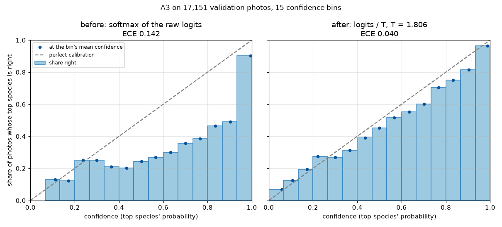
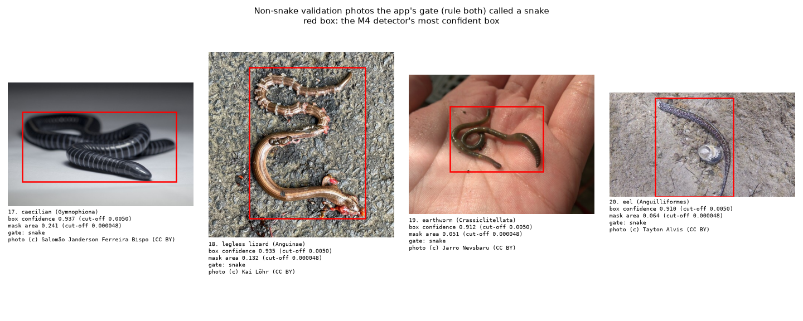

# Milestone 4: Model training

SerpentGuard AI · Group 5 · IIT Madras DS and AI Lab<br>
Team lead: Jayesh Bansal. Members: Vikas, Puneet Bajaj and Manas Rastogi.<br>
The signatures at the end are added at the team review.

## Summary

Milestone 3 left two problems: the model leaned on the scenery around the snake, and it named only 56 of our 158 measurable species well. Milestone 4 tried three ways of showing the model the snake on the 16% subset, trained the best recipes on every training photo, retrained the front end with photos that have no snake, and steadied video answers with a lock. We ship **A3**: the crop to the predicted mask's box, with the scenery swapped half the time in training. It now runs on the phone, from a photo, the live camera or a video file. Every number comes from a saved result file; section 10 says where.

**Results at a glance.**

| Item | Value |
|---|---|
| Model we ship | A3: MobileViT-S, crop to the U-Net mask's box, scenery swapped half the time, all 49,782 training photos, epoch 24 of 30 |
| Validation, 17,151 photos | Top-1 66.4%, top-3 82.2%, macro-F1 0.481 (Milestone 3: 0.367) |
| G1, scenery | Swap gap 0.052, mark at most 0.084 (Milestone 3: 0.168). **Met** |
| G2, species at F1 0.5 or above | 87 of 158 measurable species, mark 80 (Milestone 3: 56). **Met** |
| G3, against B1 on its 62 species, photos from 2022 | Top-1 −0.081 (−0.100 to −0.064), macro-F1 −0.025 (−0.043 to −0.001). **Not met** |
| G4, non-snakes called a snake | 170 of 600 test photos (28.3%), mark at most 5% (Milestone 3's gate: 95.7%). **Not met** |
| G5, changes after the first answer on a real clip | At most 2, mark 1 (Milestone 3's vote: 9). **Not met** |
| Safety, WHO recall | Calibration lower bound 0.958, mark 0.95. **Met**; validation 0.9545 (0.938 to 0.969) |
| On the phone | The app runs A3 behind the M4 front end; 5 of 5 golden photos give the reference answer on Android, in 0.5 to 1.0 s each |

What we learned, good and bad:

- **Training on every photo did most of the work.** Macro-F1 rose from 0.367 to 0.481, and the number of species at F1 0.5 or above from 56 to 87.
- **Swapping the scenery in training cut the model's reliance on it by two thirds** (swap gap 0.168 to 0.052), at no cost in accuracy.
- **The detail crop did not help.** It cost 0.045 macro-F1 on the full data and doubled the time per frame.
- **The retrained front end calls far fewer non-snakes a snake** (28% against 96%), but still misses the 5% target and drops 1.7% of real snakes.
- **B1 is still better on the 62 species it knows**, by 8 points of top-1. Our lead over it is coverage of the other 122 species.

## 1. Goals for Milestone 4

The goals were set at the end of Milestone 3 and are judged once, on the shipped model, by [notebook 25](../../notebooks/25_m4_summary.ipynb) ([`goals.csv`](../../results/m4/summary/goals.csv)).

| Goal | Measure | Mark | A3 | Milestone 3 | Passed |
|---|---|---|---:|---:|---|
| G1 | Top-1 as is minus top-1 with the scenery swapped, same 15,977 photos | at most 0.084 (half of M3's gap) | 0.052 | 0.168 | Yes |
| G2 | Measurable species with validation F1 at least 0.5 | at least 80 of 158 | 87 | 56 | Yes |
| G3 | Ours minus B1 on B1's 62 species, photos uploaded from 2022, 95% photographer interval | top-1 and macro-F1 each higher, or the interval includes 0 | −0.081 / −0.025 | −0.109 / −0.125 | No |
| G4 | Share of non-snake test photos called a snake | at most 5% | 28.3% | 95.7% | No |
| G5 | Most changes of the shown species after the first answer, per real test clip | at most 1 | 2 | 9 | No |
| Safety | WHO recall, lower bound on calibration | at least 0.95 | 0.958 | 0.952 | Yes |

The safety number is measured behind Milestone 3's box gate on its crops, not behind the app's M4 front end. That front end drops 1.72% of validation snakes (3.1% of sea snakes and sea kraits), so WHO recall behind it is still to be measured.

## 2. Showing the model the snake: the arms

[Notebook 18](../../notebooks/18_background_arms.ipynb) trained three arms on the 16% subset and compared them with Milestone 3's final model, A0. An arm qualifies if its macro-F1 and WHO recall are within 0.005 and 0.006 of A0's. Among those that qualify, the smallest swap gap wins ([`arms.csv`](../../results/m4/summary/arms.csv)).

| Arm | What the model sees | Macro-F1 | WHO recall | Top-1 | Swap gap | Qualifies |
|---|---|---:|---:|---:|---:|---|
| A0 | Milestone 3's final model, the detector's box crop | 0.367 | 0.948 | 62.8% | 0.168 | baseline |
| A1 | Box crop, snake pasted onto another species' scenery half the time | 0.372 | 0.945 | 63.1% | 0.093 | Yes |
| A2 | Snake only, everything outside the mask grey | 0.333 | 0.959 | 59.5% | 0.006 | No (macro-F1) |
| A3 | Crop to the predicted mask's box, scenery swapped half the time | 0.371 | 0.945 | 64.0% | 0.063 | **Yes, wins** |

Removing the scenery entirely (A2) removes the shortcut, but it also loses 0.034 macro-F1. Swapping it keeps the accuracy and halves the gap.

## 3. Training on every photo

[Notebook 21](../../notebooks/21_full_training.ipynb) trained three recipes on all 49,782 training photos for 30 epochs ([`full_runs.csv`](../../results/m4/summary/full_runs.csv), [`classes.csv`](../../results/m4/summary/classes.csv)).

| Run | Recipe | Best epoch | Top-1 | Top-3 | Macro-F1 | Swap gap | Species at F1 ≥ 0.5 | Species at F1 0 |
|---|---|---:|---:|---:|---:|---:|---:|---:|
| A1 | box crop, scenery swap | 28 | 67.7% | 83.1% | 0.481 | 0.075 | 87 | 23 |
| H2 | A1 plus the detail crop | 24 | 65.3% | 80.8% | 0.437 | 0.080 | 74 | 27 |
| **A3** | **mask-box crop, scenery swap** | **24** | **66.4%** | **82.2%** | **0.481** | **0.052** | **87** | **20** |

A1 and A3 tie on macro-F1 and on G2. A3 ships because its swap gap is the smaller (0.052 against 0.075), fewer species score zero, and it was the arm the subset rule picked. Its crop is also the one the app's front end produces.


**Calibration.** A3 is overconfident before temperature scaling. Dividing its logits by T = 1.806, fitted on the 7,999 calibration photos, takes the expected calibration error from 0.142 to 0.040 ([figures](assets/figures.md)).



**Rare species gain least.** Macro-F1 is 0.226 for species with fewer than 30 training photos, 0.376 for 30 to 99 and 0.572 for 100 or more.


## 4. Against the published model

B1 (Bolon et al. 2022 [1]) knows 62 of our 184 species. On those species, in photos uploaded from 2022 (after its training data ends: 11,931 photos), it still leads A3 ([`b1.csv`](../../results/m4/summary/b1.csv)):

| Score, 2022 photos of B1's species | A3 | B1 | A3 minus B1 (95% interval) | Milestone 3 minus B1 |
|---|---:|---:|---:|---:|
| Top-1 | 70.7% | 78.8% | −0.081 (−0.100 to −0.064) | −0.109 |
| Macro-F1, B1's species only | 0.694 | 0.719 | −0.025 (−0.043 to −0.001) | −0.125 |
| Macro-F1, Milestone 3's whole-slice definition (reported, not judged) | 0.662 | 0.637 | +0.025 (+0.007 to +0.050) | −0.077 |

The gap closed by about a quarter on top-1 and by four fifths on macro-F1, but it did not close. When our species head may answer only with B1's 62 species, the top-1 gap is −0.028.

## 5. The no-snake gate

Milestone 3's front end called 95.7% of photos with no snake a snake. [Notebook 19](../../notebooks/19_non_snake_set.ipynb) collected about 3,000 openly licensed non-snake photos. [Notebook 20](../../notebooks/20_no_snake_gate.ipynb) retrained the detector and U-Net with them and chose a gate on validation, aiming to keep 99% of calibration snakes (the chosen gate keeps 98.0%) ([`gates.csv`](../../results/m4/summary/gates.csv)).

| Front end | Rule | Non-snakes called a snake (validation) | Snakes kept (validation) | Non-snakes called a snake (test, scored once) |
|---|---|---:|---:|---:|
| Milestone 3 | box | 95.3% | 99.1% | 95.7% |
| Milestone 4 | box | 39.2% | 99.0% | 40.7% |
| Milestone 4 | **both** (box score at least 0.004993 and mask area at least 0.0048%) | **27.3%** | **98.3%** | **28.3%** |

The app uses "both". It misses G4 (5%) and keeps 98.3% of snakes, not the 99% we aimed for.



## 6. A closer look: head pilot and detail crop

Open-vocabulary detectors could not find a snake's head and tail reliably ([notebook 22](../../notebooks/22_head_pilot.ipynb)). So [notebook 23](../../notebooks/23_head_arms.ipynb) let the model pick a second, closer crop itself (H2). On the subset it added 0.011 macro-F1 over A1. On the full data it lost 0.045 (0.437 against 0.481) and 13 species at F1 0.5, and it doubled the laptop time per frame (162 ms against 81 ms) ([`heads.csv`](../../results/m4/summary/heads.csv)). It is not used.

## 7. Video: the lock

Milestone 3 showed a species when 4 of the last 6 frames agreed, and the answer on a real clip changed up to 9 times. [Notebook 24](../../notebooks/24_video_lock.ipynb) pools every output over the last frames with a snake. It shows "Checking…" until the pooled top species holds θ_conf and leads the runner-up by a margin, then locks it, and lets another species take over only after it has clearly led for one second. "Dangerous" may show while checking. The window (5 frames) and margin (0.05) were tuned on development clips only ([`video.csv`](../../results/m4/summary/video.csv)).

| A3 on real clips | Clips | Answered | Median changes | Most changes | Median first answer | Final species right |
|---|---:|---:|---:|---:|---:|---:|
| Development, lock | 4 | 4 | 0 | 0 | 0.8 s | 3 of 4 |
| Test, lock | 6 | 5 | 0 | 2 | 0.5 s | 1 of 4 |
| Test, Milestone 3's vote | 6 | 6 | 3 | 17 | 0.4 s | 1 of 4 |

**The lock does not stop false snakes.** With A3 behind the M4 gate, all three negative clips lock onto a snake and show "Dangerous" ([`video_negatives.csv`](../../results/m4/summary/video_negatives.csv)). The gate passes the chameleon on 294 of 301 frames, and the clip locks onto *Echis carinatus*. The eagle clip locks onto two sea snakes, and the river clip onto *Python bivittatus*.

## 8. The model in the app

The Flutter app runs A3 on the phone, offline, for a photo, the live camera or a video file. The path follows the team's Python reference (`reference_pipeline.py` in the model bundle), step by step:

| Step | What happens | Code |
|---|---|---|
| Decode | Photo read upright (EXIF rotation applied). On Android with `BitmapFactory`: Flutter's own decoder gave different pixels on 3 of the 5 golden photos, enough to move a detector score from 0.54 to 0.32 | `lib/inference/pipeline.dart` |
| Exposure fix | CLAHE on the LAB lightness when the mean brightness is below 60 or above 200 | `lib/inference/image_ops.dart` |
| Gate | Detector box score and U-Net mask area ("both", section 5) | same |
| Crop | Mask closed, small parts dropped, crop to its box plus 6% | same |
| Classifier | A3 in fp32 ONNX: species, WHO, genus and family heads and the embedding | `flutter_onnxruntime` 1.9.0 |
| Decision | DR0 with A3's thresholds, replacing the app's placeholder rule | `lib/inference/decision.dart` |
| Video and live camera | The lock of section 7, at most 10 frames a second | `lib/inference/video_lock.dart` |

The image steps are written in plain Dart following OpenCV's algorithms, so the app's tests need no native build. The cv2 wheel itself rounds `INTER_LINEAR` differently on ARM and x86. The app uses OpenCV's generic bit-exact version, which on the golden photos changes no answer and moves probabilities by under 0.001.

| Check | Result |
|---|---|
| Decision rules on 200 saved model outputs (`golden_decisions.json`) | 200 of 200: same verdict, reasons, message, genus fallback and top 3; probabilities within 1e-6 |
| Image steps against cv2 5.0 on the 5 golden photos | Identical, except a one-level difference on under 0.1% of pixels in two INTER_AREA downscales |
| Whole path on Android (emulator, arm64, Android 15) against `golden_photos.json` | 5 of 5: same gate, crop, top 3, verdict and message; probabilities within 0.01; 0.5 to 1.0 s per photo |
| Video, *Naja naja* clip (Wikimedia Commons, CC BY 2.0) | "Dangerous: WHO Category 1, Spectacled (Indian) cobra" from the first frame, locked, 0 changes over 200 frames; 393 ms per frame |
| Video, *Gonyosoma oxycephalum* clip (Wikimedia Commons, CC BY-SA 2.0) | "Not on the WHO list, *Gonyosoma oxycephalum*", first answer at 0.4 s, 0 changes over 67 frames |

Both clips are test clips from section 7, and the app gives the answer notebook 24 recorded. The screen recordings are not in git, because they show other people's videos.

**Regional names.** The species list now carries names in Hindi, Marathi, Bengali, Tamil, Telugu, Kannada and Malayalam for 9 of the 16 WHO-listed species. The other 7, mostly from the north-east and Kashmir, have no name we were sure of, so they are left out rather than guessed. All the names are a draft until a native speaker of each language has checked them.

## 9. Limitations and Milestone 5

- **G3, G4 and G5 are not met.** B1 still leads on its 62 species, the gate calls 28% of non-snakes a snake (and all three non-snake clips lock onto a snake), and one test clip changed its answer twice.
- **WHO recall behind the app's own front end is not measured.** The safety number in section 1 is behind Milestone 3's gate.
- **The app has run only on an emulator.** Speed, memory and battery on a mid-range phone, and a real snake filmed with the live camera, are still to test. The debug build is 339 MB, with every CPU architecture and 54 MB of models; a release build is smaller but has not been measured.
- **Rare species stay weak** (macro-F1 0.226 under 30 training photos), and 20 measurable species still score F1 0.
- **Regional names and first-aid text** need review by native speakers, and the WHO text needs the licence decision from Milestone 3.

**Milestone 5:** score A3 once on the locked test set, measure WHO recall behind the M4 front end, time the app on a phone, and test it on real snake videos.

## 10. Reproducibility

[`results/README.md`](../../results/README.md) maps every number to its file. [Notebook 25](../../notebooks/25_m4_summary.ipynb) rebuilds every table in `results/m4/summary/` from those files on a laptop, and [notebook 27](../../notebooks/27_m4_figures.ipynb) draws the figures. Model weights and saved outputs stay in the Kaggle runs listed with their SHA-256 in [`results/m4/artifacts.md`](../../results/m4/artifacts.md). The A3 run is `jayeshbansal497/sg-m4-full-a3`.

The app's checks run from `app/` ([app README](../../app/README.md)):

```bash
flutter test                                           # unit and widget tests, including the 200 golden decisions
python3 tool/golden_defines.py > build/golden_defines.json
flutter test integration_test/golden_photos_test.dart -d <android device> --dart-define-from-file=build/golden_defines.json
```

The three ONNX models (54 MB) are not in git; they are copied into `app/assets/models/` before a build.

## References

1. Bolon I. et al. (2022). [An artificial intelligence model to identify snakes from across the world](https://journals.plos.org/plosntds/article?id=10.1371/journal.pntd.0010647). *PLOS Neglected Tropical Diseases* 16(8): e0010647.
2. Mehta S., Rastegari M. (2022). [MobileViT](https://arxiv.org/abs/2110.02178). ICLR.
3. Deng J. et al. (2019). [ArcFace: additive angular margin loss for deep face recognition](https://arxiv.org/abs/1801.07698). CVPR.
4. Guo C. et al. (2017). [On calibration of modern neural networks](https://arxiv.org/abs/1706.04599). ICML.
5. World Health Organization, Regional Office for South-East Asia (2016). [Guidelines for the Management of Snakebites, 2nd edition](https://cdn.who.int/media/docs/default-source/searo/india/health-topic-pdf/who-guidance-on-management-of-snakebites.pdf). Cited by page; the text is not reproduced here.
6. ONNX Runtime. [flutter_onnxruntime 1.9.0](https://pub.dev/packages/flutter_onnxruntime), checked 19 November 2026.

## Team contributions

| Member | Work this milestone |
|---|---|
| Jayesh Bansal | The Flutter app ([PR #21](https://github.com/Puneet-Bajaj-IITM/Group-5-DS-and-AI-Lab-Project/pull/21)); the model in the app, video check and live-camera adapter, regional names ([PR #25](https://github.com/Puneet-Bajaj-IITM/Group-5-DS-and-AI-Lab-Project/pull/25)); section 8 |
| Vikas | Community voting backend and notebook 26 ([PR #19](https://github.com/Puneet-Bajaj-IITM/Group-5-DS-and-AI-Lab-Project/pull/19)); offline community voting and the live camera screen ([PR #24](https://github.com/Puneet-Bajaj-IITM/Group-5-DS-and-AI-Lab-Project/pull/24)) |
| Puneet Bajaj | Arms, non-snake set and gate, full training, head pilot and detail crop, video lock, summary and figures ([PR #20](https://github.com/Puneet-Bajaj-IITM/Group-5-DS-and-AI-Lab-Project/pull/20)); the model bundle for the app |
| Manas Rastogi | PENDING |

Kaggle runs: A1 on Puneet Bajaj's account, H2 on Vikas's, A3 on Jayesh Bansal's. The account owner is named as the account, not the author.

**AI assistance.** OpenAI Codex helped Jayesh Bansal draft earlier milestone notes, which the team reviewed and rewrote. Claude Code (Anthropic) helped him write the app code in PR #21 and PR #25, and section 8. Every number in section 8 comes from a test or run in PR #25.

<div style="page-break-before: always"></div>

# Team review and acknowledgment

Each team member signs one row after the review. By signing, each member confirms that they have reviewed this document, understand its contents and agree with the submission.

| Team member name | Roll Number | Signature / acknowledgment | Date |
|---|---|---|---|
| Jayesh Bansal | 24f100185 |  | 19/11/2026 |
| Vikas | 23f3001800 | PENDING | PENDING |
| Puneet Bajaj | 23f3002416 | PENDING | PENDING |
| Manas Rastogi | 22f3001477 | PENDING | PENDING |
