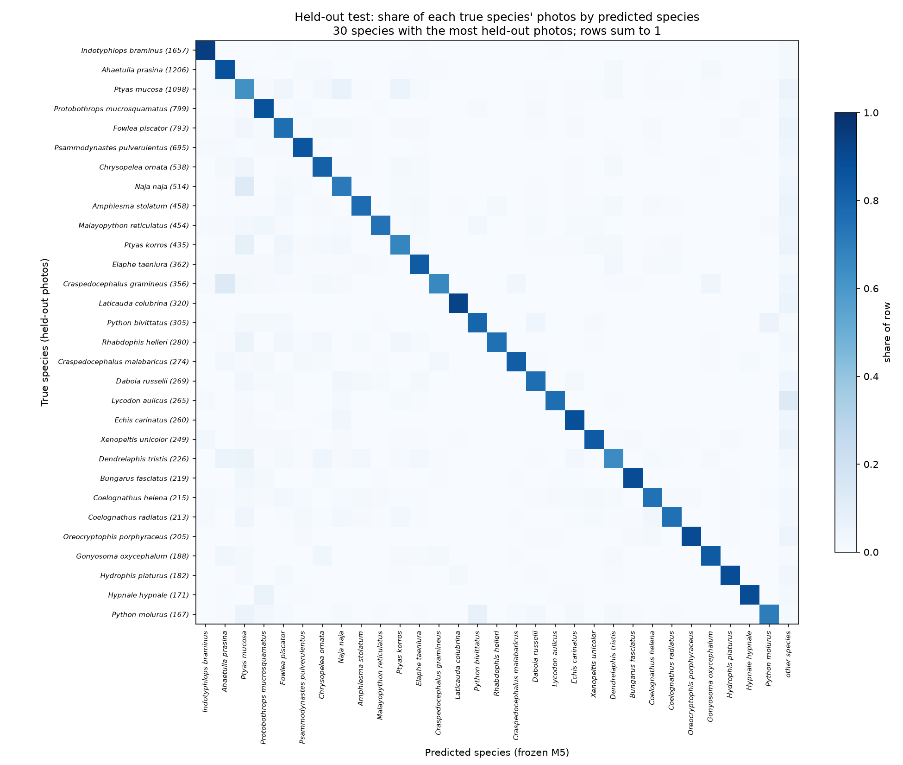

# Milestone 5: Evaluation of the frozen pipeline on the locked test split

SerpentGuard AI · Group 5 · IIT Madras DS and AI Lab 
Team lead: Jayesh Bansal. Members: Vikas, Puneet Bajaj and Manas Rastogi. 
The signatures at the end are added at the team review.

**Where the numbers come from.** Every number in this report names its source file. Paths are relative to
`results/m5/`. "M4 report" means `documentation/milestone 4/project-report.md`. Short names used below:

| Short name | File |
|---|---|
| RESULTS | `test/RESULTS.md` |
| FREEZE | `test/FREEZE.md` (section 8 is an addendum written before any test output was read) |
| scores | `test/test_scores.json` |
| per-species | `test/per_species_heldout.csv` |
| confusions | `test/confusions_heldout.csv` |
| analysis | `test/analysis_heldout.json` |
| predictions | `test/predictions_heldout.csv` (one row per held-out photo) |
| false snakes | `test/false_snakes_nonsnake_test.csv` |
| G5 frozen | `test/g5/results/g5_summary.csv`, `test/g5/results/negatives.csv` |
| report numbers | `report/data/report_numbers.json`, made by `report/scripts/report_numbers.py` |
| leakage | `report/data/leakage_detail.json`, made by `report/scripts/leakage_detail.py` |
| G3, G4, G5 notes | `g3/README.md`, `g4/README.md`, `g5/README.md` |

The two `report/scripts/` files only read saved outputs and metadata on a laptop CPU. They run no model. Before
anything else, `report_numbers.py` recomputes the frozen model's and B1's G3-slice scores from the per-photo file
and checks they equal `test_scores.json` exactly (report numbers, `instrument_check_g3_slice`: match). It also
recomputes the false-alarm share, 0.2155, which equals scores. Counts marked "(counted from ...)" were worked out
for this report from a per-photo or per-species file.

## 1. Introduction & Objectives

**Where Milestone 4 left us.** M4 shipped A3: a MobileViT-S classifier with an ArcFace head, trained on all 49,782
training photos on crops to the U-Net mask's box, with the scenery swapped half the time. A3 met G1 (scenery), G2
(species reached) and the safety rule on validation. It missed G3 (against the published model B1), G4 (non-snakes
called a snake, 28.3% on test against a mark of 5%) and G5 (video, 2 changes on one clip against a mark of 1) (M4
report, Table 1). M4 also found that the app's front end crops differ from A3's training crops (M4 report, section
7.7).

**Objectives for M5.**

1. Close G3, G4 and G5 where we could, on validation only.
2. Freeze the whole pipeline before reading any test photo.
3. Score the frozen pipeline once on the locked test split, against the same marks set in M4.
4. Analyse the errors and state the limits plainly.

**What changed since M4, and why.**

| Change | Why | Effect on validation | Source |
|---|---|---|---|
| Fine-tune A3 on the M4 front end's crops (M5_FT), 5 epochs at lr 2e-4 | A3 trained on M3 crops; the app uses M4 crops. On the app's crops A3's G3 top-1 gap was -0.087 against -0.081 on its own crops | M5_KD loses almost nothing on the app's crops (-0.062 against -0.061). The plain fine-tune alone did not move G3 (-0.078) | `g3/README.md` |
| Distil from B1 on its 62 species (kd weight 1, temperature 2) | B1 beats us on its own species; the student learns from its outputs on our training photos | G3 top-1 -0.083 (A3 on M4 crops) to -0.061 (M5_KD). A later pilot on the subset picked the same setting | `g3/README.md` |
| Mirror averaging (flip) and a training-frequency prior (tau = 0.5, fitted on calibration only) | The weighted sampler flattened species frequencies; validation and real use follow natural frequencies | M5_KD + flip + prior: G3 -0.012 and +0.002, both tied. No candidate passed G3 without the prior | `g3/README.md` |
| Snake check `distil_oi` (EfficientNet-B0, 3 classes, feature distillation from BioCLIP, extra non-snake photos) | The M4 gate called 28.3% of non-snake test photos a snake | 5.17% false snakes, 99.20% snakes kept, against 27.3% and 98.3% for the M4 gate | `g4/README.md` |
| Video lock in seconds, with a hold reset and the locked species always shown | The M4 lock counted frames and never expired, and the app screen showed a different species than the one scored (21 changes on screen where notebook 24 scored 2) | Dev clips: at most 1 change at 0.1, 0.25, 0.4 and 0.8 s a frame | `g5/README.md` |
| Safety thresholds refitted for the new classifier behind the app's gate | Each new model's own fitted thresholds gave a calibration bound of 0.941 to 0.944 behind the gate | Calibration bound 0.954 behind the gate; validation recall 0.963 (0.950 to 0.973) | `g3/README.md`, `g3/refit_new.json` |
| Validation loss logged at every evaluation; `last.pt` saves model, optimizer, scheduler, scaler and RNG; `train(..., resume=True)` | TA feedback on M4 | Validation loss tables per epoch for M5_FT and M5_KD; resume tested in a laptop dry run | `g3/README.md`, `g3/local_smoke/run.log` |

Two things we tried were left out. The G4 retry `distil_oi_v2` gave 5.67% false snakes on validation, worse than
`distil_oi` (`g4/README.md`). Averaging two classifiers did not pass G3 and would double the phone's classifier
cost (`g3/README.md`).

**Validation loss, now logged.** For M5_FT it falls from 6.665 at epoch 1 to 6.558 at epoch 4 and is flat at
epoch 5 (6.563), so we see no overfitting in 5 epochs. For M5_KD the total validation loss falls every epoch (9.797
to 8.931), but validation macro-F1 peaks at epoch 1 (0.478) and then drops to between 0.439 and 0.454 while top-1
rises to 0.70. The run keeps epoch 1 because it selects by macro-F1 (`g3/README.md`).

**The frozen pipeline** (FREEZE sections 2 and 3):

- species classifier M5_KD (epoch 1), averaged with its mirrored pass, plus the prior at tau 0.5; 20.8 MB, the same
  architecture and size as A3;
- the M4 detector and U-Net for the crop, and the app's ONNX gate;
- safety thresholds from `g3/refit_new.json`;
- snake check `distil_oi`, cut 0.2048 on P(snake);
- the video lock from `g5/results/chosen_settings.json`.

**Scope.** This report scores photos and recorded clips. It does not measure the app on a phone (section 7).

## 2. Evaluation Setup & Test Dataset

### 2.1 The held-out set

| Set | Size | What it is | Source |
|---|---:|---|---|
| Held-out snake photos (primary) | 18,533 | `test` (5,144, India, uploaded from 2022) + `test_extra` (13,389). Milestone 2 said `test` alone is too thin per class | FREEZE section 1 |
| `test` only (secondary row) | 5,144 | reported beside the primary row | FREEZE section 1 |
| G3 slice | 12,203 photos, 1,781 photographers | held-out photos uploaded from 2022 of B1's 62 species | RESULTS |
| Non-snake test photos | 600 | 500 Open Images, 100 iNaturalist lookalikes (notebook 19's test split) | FREEZE section 1; scores |
| Video | 22 new real test clips, 6 old test clips, 8 no-snake clips | 5 new and 3 old no-snake clips | `g5/README.md` |

**Composition** (report numbers, `composition`):

- 181 species appear; 165 have at least 5 photos and are "measurable". 2,281 photographers.
- Photos per species: median 28, from 1 to 1,657. The 10 largest species hold 44.3% of the photos.
- Largest species: *Indotyphlops braminus* 1,657, *Ahaetulla prasina* 1,206, *Ptyas mucosa* 1,098,
  *Protobothrops mucrosquamatus* 799, *Fowlea piscator* 793.
- WHO category: 1,502 photos of Category 1 species, 1,131 of Category 2, 15,900 not listed.
- Families: Colubridae 9,535, Viperidae 2,535, Elapidae 1,977, Typhlopidae 1,715, Pythonidae 926.
- Location: 7,109 photos from India (all 5,144 of `test` and 1,965 of `test_extra`) and 11,424 from outside India.

**Edge cases in the set.** 1,796 held-out photos have no usable U-Net mask, so the classifier sees a box or the
whole photo (analysis, `front_end`). 768 are sea snakes and sea kraits and 342 other water snakes; 1,715 are blind
snakes (scores, `G4/main/snakes_kept_by_group`). The non-snake set includes 100 lookalikes: caecilians, earthworms,
eels and legless lizards (scores).

### 2.2 Leakage checks

| Check (held-out against every other split) | Result | Source |
|---|---|---|
| Same iNaturalist observation in two splits | 0 | report numbers, `leakage` |
| Same file (SHA-1) | 0 | report numbers |
| Same perceptual hash (pHash), exact | 0 | report numbers |
| Photographers shared with train | 0 | leakage |
| Photographers shared with validation | 0 | leakage |
| Photographers shared with the unknown-species pool | 36 (4,124 held-out photos) | leakage |
| pHash within 8 bits of a training photo | 90 photos; 85 are a different species, 5 the same species | leakage |
| pHash within 8 bits of a validation photo | 15 photos; 1 the same species | leakage |

The calibration photos sit inside the `train` split of the metadata, so "train" above covers them. The
unknown-species pool holds species outside our 184; it is used only to test "we don't know" and never to train, so
the 36 shared photographers do not leak species labels. An 8-bit pHash match between two different species is a
chance collision of the hash. The 6 same-species pairs are listed in `leakage_detail.json`.
[TODO, OWNER: [OWNER]. Open the 6 same-species pairs and record whether any is the same snake.]

The non-snake test set was not fresh. Section 7.5 explains.

### 2.3 Baselines

All baselines are scored on the same photos with the same metric code.

| Baseline | What it is | Source |
|---|---|---|
| B1 | Bolon et al. (2022), ViT-L, published; can name 62 of our species | scores |
| A3 / M4 | our shipped M4 classifier on the same M4 crops, with A3's app thresholds | scores |
| M4 gate | the M4 detector + U-Net "both" gate, for G4 and as the safety front end | scores; M4 report |
| Always the most common training species | predicts *Indotyphlops braminus* for every photo | report numbers |
| Prior only | draws a species at random from the training frequencies, seed 42; uses no image | report numbers |

### 2.4 Environment, scripts and reproducibility

- **Hardware.** Kaggle kernel `jayeshbansal497/sg-m5-test` v1 on 2 x T4 GPUs, 48.5 minutes; then one run of
  `score_test.py --split test` on a laptop CPU (RESULTS).
- **Software.** PyTorch for the classifier and snake check in the kernel; ONNX Runtime on CPU for the gate call per
  photo; Python scoring on the laptop (FREEZE sections 3 and 7). [TODO, OWNER: [OWNER]. Add library versions from
  the kernel log.]
- **Preprocessing at evaluation** (FREEZE section 3). The classifier sees the M4 front end's crop: detector box at
  confidence 0.05 or more, U-Net mask, crop to the mask's box. It also sees the mirrored crop; the two logit vectors
  are averaged and the prior is added. The snake check sees the whole photo after the app's exposure fix,
  letterboxed to 256 px.
- **Reproducibility.** FREEZE lists every model file with its SHA-256, every threshold and every command. The
  scoring scripts were hashed into `test/FREEZE_scripts.sha256` when the kernel was pushed, before its output was
  read. The kernel code and raw outputs are in `test/kernel/` and `test/kernel_out/`.

### 2.5 Test protocol

1. **Freeze before test.** FREEZE was written and approved at 20:35 IST on 24 November 2026, before any test photo
   was opened. A crash may be fixed and rerun; a model, threshold or rule may not change.
2. **Instrument check on validation first.** `score_test.py --split val` had to reproduce every validation number in
   the goal READMEs. It first gave G2 = 82, not 81, because it took each species' F1 over the wrong photos. The
   scorer was fixed to the kernels' rule and then every number matched (FREEZE section 8, 20:49 IST;
   `test/val_dry_run.json`). In the kernel, 600 validation photos through the fresh front end matched the saved
   outputs (box and mask agreement 1.0, M5_KD top-1 agreement 1.000, A3 0.998); the snake check gave 0 flips on
   500 photos and the ONNX gate agreed on 300 (RESULTS).
3. **One scoring pass.** The kernel ran once and every step passed first time (RESULTS).
4. **Negative controls**, each of which must fail (RESULTS; report numbers):

   | Control | Result |
   |---|---|
   | G3, predictions shuffled | top-1 -0.744, macro-F1 -0.697 against B1 |
   | G2, predictions shuffled | 0 of 165 |
   | Safety, logits shuffled across photos | bound 0.378 |
   | G4, random score | 99.2% false snakes |
   | G4, scores shuffled across snakes and non-snakes | 97.2% false snakes |
   | G1, swapped predictions shuffled | gap 0.675 |
   | **G5, each clip's frames shuffled** | **did not fail: still at most 1 change** |

5. **Intervals.** Every interval is a 95% interval from 1,000 resamples of whole photographers (owners, for
   non-snake photos), seed 42 (RESULTS). One photographer often uploads many photos of the same snake, so resampling
   photos would make the intervals too narrow.

## 3. Metric Selection & Justification

| Metric | What it measures | Why we use it |
|---|---|---|
| Top-1 | share of photos whose first answer is right | what the user sees first |
| Macro-F1 over measurable species | mean F1 over species with at least 5 photos | weights every species equally; top-1 alone would reward getting the few common species right |
| G2: species with F1 at least 0.5 | how many species we name well | coverage of the long tail, our edge over B1 |
| G3: paired difference against B1 on its 62 species, photos from 2022 | are we as good as the published model where it can answer | B1 cannot have trained on photos from 2022 on; a tie within the photographer interval counts |
| WHO recall lower bound | share of WHO Category 1 and 2 snakes called "dangerous"; the 5th percentile over photographer resamples | the safety goal; a miss can kill, so the mark is on the lower bound |
| False alarms | share of harmless snakes (not WHO-listed, not viper or elapid) called "dangerous" | the cost side of safety |
| G4: false snakes and snakes kept | non-snake photos called a snake; real snakes the check passes | a check that drops real snakes would hurt safety, so both are marked |
| G1: scenery gap | top-1 as is minus top-1 with the scenery swapped | the TA's M3 concern: is the model looking at the snake or the background |
| G5: changes of the shown species per clip | stability of the video answer | a flickering answer cannot be trusted |

**False positives against false negatives.** For a snakebite app the two errors are not equal.

- A **false negative** is a venomous snake called "not on the WHO list" or "we don't know". The person may relax
  or skip hospital. This can kill. We hold it to a lower bound of at least 0.95 on recall.
- A **false positive** is a harmless snake called "dangerous". It causes fear, a wasted hospital trip, and
  sometimes a killed snake. It is a real cost, and it does not kill a person.

So every threshold is fitted to meet the recall bound first, and false alarms are whatever that leaves (FREEZE
section 3; `g3/README.md`). The same choice sets the snake check's cut at 99% of snakes kept, and the video hold
keeps "Dangerous" on screen once it appears (section 5.6). The price is a false-alarm rate of 21.6% on test (scores).

## 4. Quantitative Performance & Benchmarking

### 4.1 Goals on the test set

Table 1. Goals on validation and on test (RESULTS, "Goals"; scores, `subsets/all/goals`).

| Goal (mark) | Validation | Test, held-out set | Result |
|---|---|---|---|
| G1 scenery gap (at most 0.084) | 0.055 | 0.057 (0.701 as is, 0.645 swapped, 16,737 photos with a mask) | **Pass** |
| G2 species with F1 at least 0.5 (at least 80) | 81 of 158 | 89 of 165 | **Pass** |
| G3 top-1 against B1 (tied or higher) | -0.012 (-0.030 to +0.002), tied | -0.006 (-0.020 to +0.008), tied | **Pass** |
| G3 macro-F1 against B1 (tied or higher) | +0.002 (-0.014 to +0.025), tied | +0.006 (-0.017 to +0.028), tied | **Pass** |
| G4a non-snakes called a snake (at most 5%) | 5.17% (31 of 600), fail | 5.00% (30 of 600), 3.3% to 6.7% | **Pass, exactly at the mark** |
| G4b snakes kept (at least 99%) | 99.20% (17,013 of 17,151) | 99.31% (18,405 of 18,533), 99.15% to 99.47% | **Pass** |
| G5 at most 1 change per real test clip | dev clips: at most 1 | at most 1 on 22 new clips at all four frame speeds | **Pass** (tests the lock only, section 7.1) |
| Safety: WHO recall lower bound behind the app's gate (at least 0.95) | recall 0.962 (0.950 to 0.973), bound 0.952 | recall 0.944 (0.923 to 0.973), **bound 0.926** | **FAIL** |

- **Safety fails.** Even the point value, 0.944, is under the mark (section 5.2).
- **G3 is a tie on both measures.** RESULTS and scores label the macro-F1 standing "higher" because the difference
  is positive. Its interval includes 0, so we report it as tied. The rule passes either way.
- **G4 passes with no room.** One more false snake would fail it, and the same model failed by one photo on
  validation.

### 4.2 Against the baselines

Table 2. On the G3 slice (12,203 photos, B1's 62 species; macro-F1 over those species). Frozen and B1 from scores
(`subsets/all/G3`); naive rows from report numbers (`naive_baselines_g3_slice`).

| Model | Top-1 | Macro-F1 | Top-1 minus B1 |
|---|---:|---:|---|
| B1 (published) | 0.780 | 0.713 | |
| **Frozen M5** | **0.774** | **0.719** | -0.006 (-0.020 to +0.008) |
| M5_KD without flip or prior | 0.721 | 0.703 | -0.059 (-0.083 to -0.038) |
| A3 on M4 crops (M4) | 0.700 | 0.700 | -0.080 (-0.106 to -0.057) |
| Always the most common training species | 0.104 | 0.003 | -0.676 |
| Prior only (random draw from training frequencies) | 0.035 | 0.016 | -0.745 |

The prior-only baseline scores no better than shuffled predictions (0.035 top-1; report numbers). So the prior
correction helps only together with the image; on its own it carries no information.

Table 3. All 18,533 held-out photos (scores; report numbers, `naive_baselines_all_heldout`).

| Model | Top-1 | Macro-F1 (165 species) | G2 |
|---|---:|---:|---:|
| Frozen M5 | 0.714 | 0.462 | 89 |
| A3 on M4 crops | 0.666 | 0.481 | 91 |
| Always the most common training species | 0.089 | 0.001 | |
| Prior only | 0.030 | 0.006 | |

Table 4. The whole pipeline, before and after, on the same test photos (RESULTS, "Before / after").

| | A3 (shipped M4) | Frozen M5 |
|---|---|---|
| WHO recall behind the M4 gate | 0.933 (0.906 to 0.969), bound 0.909 | 0.944 (0.923 to 0.973), bound 0.926 |
| False alarms | 21.6% | 21.6% |
| Non-snakes called a snake | 28.3% (M4 gate, scored in M4) | 5.00% (snake check) |
| Snakes kept | 98.11% (gate drops 351) | 99.31% (check drops 128) |

M5 is better on top-1, G3, safety and false snakes. It is worse on macro-F1 over all species and reaches 2 fewer
species at F1 0.5. A3 also fails the safety bound on test (0.909), so the failure is not new in M5.

**With the snake check in front instead of the gate** (the app as it would ship with G4): WHO recall 0.960 (0.944
to 0.982), bound 0.946, false alarms 22.3% (RESULTS; scores). Closer, still under 0.95.

### 4.3 Validation against test

| | Validation | Test | Source |
|---|---|---|---|
| G3 top-1 / macro-F1 against B1 | -0.012 / +0.002 | -0.006 / +0.006 | RESULTS |
| G2 | 81 of 158 | 89 of 165 | RESULTS |
| WHO recall | 0.962 (0.950 to 0.973) | 0.944 (0.923 to 0.973) | RESULTS |
| False snakes | 5.17% | 5.00% | RESULTS |
| Snakes kept | 99.20% | 99.31% | RESULTS |

Every goal holds or improves from validation to test except safety, which drops by 1.8 points of recall.

### 4.4 Slices

| Slice | Photos | Frozen top-1 | A3 top-1 | Source |
|---|---:|---:|---:|---|
| `test` (India, from 2022) | 5,144 | 0.586 | 0.588 | analysis, `by_split` |
| `test_extra` | 13,389 | 0.763 | 0.696 | analysis |
| In India (both splits) | 7,109 | 0.604 | 0.608 | report numbers, `india_vs_outside` |
| Outside India | 11,424 | 0.782 | 0.703 | report numbers |
| Usable mask | 16,737 | 0.739 | 0.693 | analysis, `front_end` |
| No usable mask | 1,796 | 0.484 | 0.421 | analysis |
| Sea snakes and sea kraits | 768 | 0.820 | 0.815 | analysis, `water_snakes` |
| Other water snakes | 342 | 0.520 | 0.564 | analysis |

On `test` alone, G2 is 46 of 106, G3 top-1 is +0.027 (-0.003 to +0.042) and the safety bound is 0.910 (RESULTS;
scores, `subsets/test only`).

**Snakes kept by the snake check** (scores, `G4/main/snakes_kept_by_group`):

| Group | Photos | Kept | 95% interval |
|---|---:|---:|---|
| Sea snakes and sea kraits | 768 | 98.2% | 97.0% to 99.2% |
| Blind snakes | 1,715 | 98.9% | 98.2% to 99.5% |
| Shieldtails | 79 | 98.7% | 96.2% to 100% |
| Other water snakes | 342 | 98.5% | 96.7% to 99.7% |
| Vine snakes and bronzebacks | 2,081 | 99.6% | 99.2% to 99.8% |

**Non-snakes called a snake, by category** (scores, `G4/main/false_snake_by_category`; counts from false snakes):

| Category | Photos | Called a snake |
|---|---:|---:|
| Caecilian | 20 | 6 (30%) |
| Earthworm | 20 | 4 (20%) |
| Eel | 40 | 6 (15%) |
| Legless lizard | 20 | 2 (10%) |
| Other animal | 60 | 5 (8.3%) |
| Rope / hose / belt | 60 | 3 (5%) |
| Hand / arm | 60 | 2 (3.3%) |
| Person | 180 | 2 (1.1%) |
| Cat, dog, T-shirt | 140 | 0 |
| By source: iNaturalist lookalikes / Open Images | 100 / 500 | 18% / 2.4% |

**Video** (G5 frozen, `g5_summary.csv`, new test clips):

| Seconds per frame | Most changes | G5 | Median first answer | Final species right |
|---|---:|---|---:|---:|
| 0.1 | 1 | met | 0.6 s | 12 of 19 |
| 0.25 | 1 | met | 0.75 s | 13 of 19 |
| 0.4 | 1 | met | 1.2 s | 12 of 19 |
| 0.8 | 1 | met | 3.2 s | 10 of 19 |

When the new clips were first scored with A3 and its thresholds, one clip had 2 changes at 0.8 s (RESULTS;
`g5/README.md`).

## 5. Error Analysis

### 5.1 Error counts

| Error | Count | Source |
|---|---:|---|
| Species wrong (frozen classifier, all held-out photos) | 5,298 of 18,533 | report numbers, `errors` |
| **False negative for safety:** WHO-listed photo not called dangerous | 147 of 2,633 | analysis; report numbers |
| of which the M4 gate said "no snake" | 61 | report numbers |
| of which "not on the WHO list" | 60 | analysis |
| of which "we don't know" after the gate passed | 26 | 87 "we don't know" in analysis, minus 61 |
| **False positive for safety:** harmless snake called dangerous | 3,022 of 14,021 (21.6%) | report numbers |
| G4 false positive: non-snake called a snake | 30 of 600 | scores |
| G4 false negative: snake dropped by the check | 128 of 18,533 | analysis |

### 5.2 Safety misses by species

| Species | Missed photos |
|---|---:|
| *Naja naja* | 44 |
| *Craspedocephalus gramineus* | 39 |
| *Daboia russelii* | 15 |
| *Naja kaouthia* | 10 |
| *Echis carinatus* | 9 |
| *Craspedocephalus malabaricus* | 8 |
| *Bungarus caeruleus*, *Trimeresurus erythrurus* | 6 each |
| *Ophiophagus hannah* | 5 |
| 4 other species | 5 in all |

Source: analysis, `who_listed_missed_behind_gate`. Two confusions explain much of it. *Naja naja* is called *Ptyas
mucosa* (rat snake) on 63 photos, and *C. gramineus* is called *Ahaetulla prasina* (a harmless green vine snake) on
47 (confusions). Both pairs share a shape or a colour. The 61 gate drops are why the snake check helps safety: it
drops 128 snakes where the gate drops 351 (analysis, `front_end`).

### 5.3 Confusion matrix

Figure 1. Share of each true species' held-out photos by predicted species, for the 30 species with the most
held-out photos; any prediction outside the 30 goes to "other species". Made by `report/scripts/report_numbers.py`
from predictions. The diagonal is strong for blind snakes, sea kraits and most vipers. The weakest rows are *Ptyas
mucosa*, *Ptyas korros*, *Naja naja*, *C. gramineus* and *Dendrelaphis tristis*, which leak into each other and
into *A. prasina*.

**Top confusions over all species** (confusions): *A. oxyrhynca* to *A. prasina* 123, *A. borealis* to *A.
prasina* 76, *Ptyas mucosa* to *Naja naja* 75, *P. mucosa* to *P. korros* 67, *Naja naja* to *P. mucosa* 63, *A.
farnsworthi* to *A. prasina* 54, *C. gramineus* to *A. prasina* 47, *Dendrelaphis chairecacos* to *D. tristis* 46.

### 5.4 Worst species

33 of the 165 measurable species have F1 0 on test (analysis); A3 has 21 on the same photos (counted from
per-species). Examples (analysis, `worst_species_measurable`):

| Species | Photos | Most common wrong answer |
|---|---:|---|
| *Ahaetulla oxyrhynca* | 149 | *A. prasina*, 123 |
| *Ahaetulla farnsworthi* | 62 | *A. prasina*, 54 |
| *Dendrelaphis chairecacos* | 61 | *D. tristis*, 46 |
| *Ahaetulla malabarica* | 40 | *A. prasina*, 35 |
| *Ophiophagus kaalinga* | 20 | *O. hannah*, 11 |
| *Hydrophis lapemoides* | 15 | *Laticauda colubrina*, 10 |
| *Sahyadriophis uttaraghati* | 13 | *S. beddomei*, 9 |

Split by held-out photos per species, the frozen model's mean F1 against A3's is 0.269 against 0.318 for species
with 5 to 19 photos, 0.478 against 0.496 for 20 to 99, and 0.708 against 0.686 for 100 or more. It is worse than A3
on 74 species and better on 68 (counted from per-species). M5 gained on common species and lost on rare ones.

What works well: *Indotyphlops braminus* (1,657 photos) has F1 0.936, and *Ahaetulla prasina* (1,206) 0.761
against A3's 0.375 (per-species).

### 5.5 Misclassified test photos

Table 5. Ten wrong answers, the most confident one for each of ten different true species (report numbers,
`misclassified_examples`). Paths are inside the dataset `serpentguard-indian-snakes-clean`; the photos are not
copied here. "Confidence" is the classifier's softmax at temperature 1 after flip and prior. The decision rules use
temperature 1.585, so these values overstate how sure the app is.

| Path | True species | Predicted | Confidence | Verdict |
|---|---|---|---:|---|
| `test_extra/melanophidium_wynaudense/inaturalist_127981303.jpg` | *Melanophidium wynaudense* | *M. khairei* | 1.000 | not listed |
| `test_extra/herpetoreas_platyceps/inaturalist_675319185.jpg` | *Herpetoreas platyceps* | *Fowlea piscator* | 1.000 | not listed |
| `test/pseudoindotyphlops_porrectus/inaturalist_444478575.jpg` | *Pseudoindotyphlops porrectus* | *Indotyphlops braminus* | 1.000 | not listed |
| `test_extra/ovophis_monticola/inaturalist_543308183.jpg` | *Ovophis monticola* | *Protobothrops mucrosquamatus* | 1.000 | dangerous |
| `test/grypotyphlops_acutus/inaturalist_511981253.jpg` | *Grypotyphlops acutus* | *Indotyphlops braminus* | 1.000 | not listed |
| `test_extra/argyrophis_diardii/inaturalist_567938786.jpg` | *Argyrophis diardii* | *Indotyphlops braminus* | 1.000 | not listed |
| `test/craspedocephalus_anamallensis/inaturalist_389831604.jpg` | *Craspedocephalus anamallensis* | *C. malabaricus* | 1.000 | dangerous |
| `test/boiga_beddomei/inaturalist_725924808.jpg` | *Boiga beddomei* | *Pareas carinatus* | 1.000 | not listed |
| `test/python_molurus/inaturalist_408125173.jpg` | *Python molurus* | *Python bivittatus* | 1.000 | not listed |
| `test_extra/malayopython_reticulatus/inaturalist_316274856.jpg` | *Malayopython reticulatus* | *Macrovipera lebetinus* | 1.000 | dangerous |

Table 6. Five WHO-listed photos the app passed and still did not call dangerous, the most confident per species
(report numbers, `who_listed_missed_examples`).

| Path | True species | Predicted | Confidence | Verdict |
|---|---|---|---:|---|
| `test/craspedocephalus_gramineus/inaturalist_356023090.jpg` | *Craspedocephalus gramineus* | *Boiga cyanea* | 0.997 | not listed |
| `test/naja_naja/inaturalist_575788873.jpg` | *Naja naja* | *Ptyas mucosa* | 0.996 | not listed |
| `test_extra/trimeresurus_erythrurus/inaturalist_456301930.jpg` | *Trimeresurus erythrurus* | *Gonyosoma oxycephalum* | 0.996 | not listed |
| `test_extra/ophiophagus_hannah/inaturalist_165505048.jpg` | *Ophiophagus hannah* | *Euprepiophis mandarinus* | 0.993 | not listed |
| `test/bungarus_niger/inaturalist_744859007.jpg` | *Bungarus niger* | *Xenopeltis unicolor* | 0.987 | we don't know |

Most wrong answers in Table 5 name a close relative: another blind snake, another *Python*, another pit viper.
[TODO, OWNER: [OWNER]. Look at the 15 photos and note any with a wrong label, a hidden head, or a second animal.
Pick 4 to 6 right and wrong examples, with licences that allow showing them, for the slides.]

### 5.6 Video errors

- **No-snake clips still lock.** All 8 no-snake clips lock onto a species and end "Dangerous" with the frozen
  classifier, mostly *Naja naja* (RESULTS; G5 frozen, `negatives.csv`). The video path still uses the M4 gate, which
  passes most frames of these clips (for example 55 of 55 for the slug; `g5/README.md`). The snake check was not in
  the frozen video run (FREEZE section 5).
- **The "Dangerous" hold.** Once the pooled verdict says "dangerous", the screen keeps "Dangerous" until the lock
  changes. At 0.4 s a frame this shows all 9 of 9 dangerous-species clips as dangerous. It also ends 12 of 13
  safe-species clips on "Dangerous"; without the hold it would be 5 of 13 (G5 frozen, `g5_summary.csv`).

### 5.7 Root causes

- **Close relatives (capacity and data).** Most species errors go to a congener: *Ahaetulla*, *Dendrelaphis*,
  *Craspedocephalus*, blind snakes (section 5.3). These differ in scale counts or head detail that a 20.8 MB model
  at 320 px may not resolve. Rare species have few training photos to learn them from.
- **The prior, by design.** It moves answers toward common species. That closed G3 and costs rare species (section
  5.4).
- **Distribution shift.** Indian photos score 0.604 against 0.782 outside India (section 4.4), and the frozen model's
  gain over A3 is almost all outside India. About 62% of training photos come from outside India (the TA's M2 feedback,
  `m4-final/feedback/tracker.txt`).
- **Front end.** When the U-Net finds no mask, top-1 drops by 25 points (section 4.4), and the M4 gate drops 61
  WHO-listed photos (section 5.1).
- **Labels.** Some confusions among *Ahaetulla* species may be label problems on iNaturalist. We did not audit
  test labels (RESULTS). [TODO, OWNER:
  [OWNER]. Check 30 *A. oxyrhynca* and *A. borealis* photos called *A. prasina* against their iNaturalist pages.]
- **Lookalikes for G4.** Long thin animals with no legs (caecilians, eels, earthworms) score like snakes. iNaturalist
  has no more research-grade CC caecilian photos to train on (`g4/README.md`).

## 6. Robustness & Interpretability

### 6.1 Shortcut check: scenery swap (done)

G1 asks whether the model looks at the snake or at the scenery. We paste each snake onto another species' scenery
and measure top-1 again. On the 16,737 held-out photos with a mask, top-1 is 0.701 as is and 0.645 with the
scenery swapped: a gap of 0.057, under the mark of 0.084 (RESULTS; scores, `G1`). In M3 the gap was 0.168 (M4
report, Table 1). The control with the swapped predictions shuffled gives a gap of 0.675, so the test can fail
(RESULTS). G1 was measured on M5_KD without flip or prior, as on validation.

### 6.2 Out-of-distribution checks (numbers we already have)

- `test` against `test_extra`, and India against outside India: section 4.4.
- Non-snake lookalikes: section 4.4.
- Videos, including 8 no-snake clips: sections 4.4 and 5.6.

### 6.3 Stress tests

We ran the frozen pipeline, unchanged, on all 18,533 held-out snake photos and the 600 non-snakes, with each photo
damaged in one way at a time. The clean run through this harness reproduces `test_scores.json` exactly, so every
change below comes from the damage alone (`m5_extra/RESULTS_EXTRA.md`; `m5_extra/results/robustness.json`).
Top-1 intervals are photographer bootstrap, about ±0.005 to ±0.02 per row.

Table 6a. Change against the clean run for each kind of damage.

| Damage (mild / medium / strong) | Top-1 change | WHO recall | False alarms | Snakes kept | Non-snakes called a snake |
|---|---|---:|---:|---:|---:|
| None (clean) | 0.714 | 0.944 | 21.6% | 99.31% | 5.00% |
| Blur 0.5% / 1% / 2% of the side | -0.109 / -0.322 / -0.535 | 0.905 / 0.842 / 0.731 | 31 / 48 / 64% | 99.2 / 97.1 / 93.9% | 6.8 / 11.2 / 36.5% |
| Noise sd 10 / 25 / 50 | -0.057 / -0.248 / -0.522 | 0.946 / 0.949 / 0.927 | 29 / 51 / 79% | 98.3 / 97.7 / 95.6% | 8.2 / 17.8 / 42.3% |
| JPEG quality 30 / 10 | -0.061 / -0.238 | 0.939 / 0.909 | 29 / 44% | 97.2 / 99.1% | 6.5 / 27.3% |
| Darker x0.6 / x0.3 | -0.016 / -0.054 | 0.957 / 0.959 | 25 / 30% | 99.7 / 99.9% | 9.5 / 19.5% |
| Brighter x1.5 / x2.0 | -0.030 / -0.104 | 0.917 / 0.861 | 23 / 27% | 98.8 / 98.0% | 4.5 / 7.0% |
| Rotated 15 / 30 degrees | -0.005 / -0.008 | 0.946 / 0.945 | 22 / 22% | 99.4 / 99.4% | 6.3 / 7.8% |
| 10% / 25% of the photo covered | -0.136 / -0.263 | 0.826 / 0.599 | 29 / 27% | 98.1 / 96.2% | 7.5 / 9.5% |
| Half / quarter resolution | -0.037 / -0.171 | 0.927 / 0.901 | 26 / 38% | 99.4 / 99.0% | 5.7 / 7.5% |

Figure 6a (`m5_extra/figures/corruption_examples.png`) shows one photo under each kind of damage. It and
Figure 6b show iNaturalist photos with mixed licences, so they are kept out of this public repo and shared with
the team and the TA separately.

What this says:

- **Only rotation does no harm.** Even the mildest blur (about 1.7 px) costs 11 points of top-1, so a shaky or
  out-of-focus phone photo is the most likely way the app gets a species wrong.
- **Under noise and darkness, WHO recall holds for the wrong reason.** The model becomes unsure, and the rules
  then call more photos dangerous: at noise sd 50, 15,163 of 18,533 photos against 7,281 clean, with false alarms
  at 79%. The app stays cautious, but it stops being useful.
- **A covered snake is the real safety risk.** With 25% of the photo covered, WHO recall falls to 0.599, mostly
  because the pipeline says "no snake" or the gate drops the photo.
- **The snake check almost never misses a snake**: it keeps 94% or more in every condition. But on blurred, noisy
  or heavily compressed photos it calls 27 to 42% of non-snakes a snake.

Table 6b. Out-of-distribution summary (held-out set unless stated).

| Slice | Top-1 | Source |
|---|---:|---|
| `test` (India, 2022 on, 5,144 photos) | 0.586 | section 4.4 |
| `test_extra` (13,389 photos) | 0.763 | section 4.4 |
| Worst photo damage that keeps more than 0.6 top-1: brighter x2.0 | 0.610 | Table 6a |
| 25% of the photo covered | 0.451 | Table 6a |

Our own India photos sit as far below the rest as strong brightening does, so the domain gap is as large as a
moderate stress test.

### 6.4 Grad-CAM

Grad-CAM shows which part of the photo pushed the model towards its answer. We ran it on M5_KD for the frozen
answer's class on all 16,737 held-out photos with a U-Net mask, and asked one question: does more of the heat land on
the snake than the snake's share of the image? The snake covers 16.2% of the input on average. As a control, we ran
the same maps from a model with random weights (`m5_extra/results/gradcam.json`).

| Layer | Heat on the snake | Heat on the snake minus its area (95% CI) | Photos with more heat than area | Random weights |
|---|---:|---:|---:|---:|
| Final block (`final_conv`) | 0.060 | -0.102 (-0.106 to -0.098) | 11% | -0.066 |
| Stride-16 stage | 0.139 | -0.023 | 34% | -0.078 |
| Stride-8 stage (`stages.2`) | 0.230 | **+0.068 (+0.065 to +0.071)** | **71%** | -0.079 |

- **The final block's map is not usable.** The model averages that layer over the whole image, so its gradient is
  flat and the map peaks on the letterbox padding (64% of the heat). It scores below the random control, which is
  how we know the map is broken rather than the model.
- **At stride 8 the model looks at the snake.** The heat on the snake beats its area on 71% of photos, while the
  random control stays below area. Figure 6b (`m5_extra/figures/gradcam_grid_stride8.png`) shows 12 right and 12 wrong
  answers.
- **Right and wrong answers look alike** (+0.068 against +0.069). The confusions in section 5 do not come from
  the model looking away from the snake; the model looks at the right place and reads the pattern wrong, as with
  *Ptyas mucosa* and *Naja naja*.
- We chose the extra layers on 37 validation photos before touching test, after the final block looked wrong there.

### 6.5 Not tested

Video stability (G5) under damaged frames, and stress tests on a phone camera rather than damaged photos.

## 7. Limitations & Operational Constraints

### 7.1 Failure modes

- **Safety fails on test**: bound 0.926 against 0.95; point value 0.944 (section 4.1). The app must not be described
  as meeting the safety target.
- **G5 tests the lock only.** The G5 control did not fail: with each clip's frames shuffled, the lock still shows at
  most 1 change (RESULTS). The 3 s switch rule keeps the shown species stable whatever the frames say, so G5 cannot
  tell a good classifier from a scrambled one. The video answer is right on 12 of 19 clips at 0.4 s a frame (G5
  frozen).
- **No-snake videos lock and show "Dangerous"** (section 5.6).
- **Missing mask**: 25 points lower top-1 (section 4.4).

### 7.2 Choices made after looking at validation

- **The prior correction.** tau is fitted on calibration photos only, but we chose to try a prior at all after
  probing A3's validation G3 at a few tau values (`g3/README.md`, "Prior"). So the validation G3 pass was optimistic.
  Test confirms it, but only as a tie.
- **G4 negatives, chosen after seeing validation errors twice.** The Open Images negatives were added after `plain`
  and `distil` made errors on people, hands and ropes. The round-two lookalikes for `distil_oi_v2` were added after
  `distil_oi`'s 31 false snakes. The retry was worse (5.67%) and was not used. The 600 validation non-snakes were read
  by five trained variants, so every G4 validation number is optimistic (`g4/README.md`).
- **G4 passes exactly at the mark** (30 of 600), with an interval that spans 5%.
- **The video lock's selection rule changed once** after seeing dev numbers, before any test clip was scored
  (`g5/README.md`).

### 7.3 Latency and memory

| Model | Size | Laptop CPU, 1 thread | Source |
|---|---:|---:|---|
| Snake check, fp16 ONNX (256 px) | 8.1 MB | 23 ms | `g4/README.md`, `g4/results/latency.json` |
| Snake check, fp32 ONNX | 16.0 MB | 28 ms | same |
| Classifier (A3 architecture, fp32, 320 px; M5_KD is the same size) | 20.8 MB | 48 ms | same; `g3/README.md` |
| U-Net segmenter, fp32 | | 34 ms | `g4/README.md` |
| Detector | | 7 ms | `g4/README.md` |

These were measured on a busy laptop (load average about 14), so only the ratios mean much. Flip doubles the
classifier's time per photo (`g3/README.md`). The three M4 models take 53.0 MB as float32 files (M4 report,
"Response to earlier feedback").

[TODO, OWNER: [OWNER]. Measure on an Android phone: time per photo for the full pipeline with and without flip,
peak RAM, and app size with the snake check added.]

### 7.4 Bias and fairness

- **India against outside India.** Top-1 is 0.604 on Indian photos and 0.782 elsewhere (section 4.4). The app's
  users are in India, so the headline top-1 of 0.714 overstates what they will see.
- **Rare species.** Species with 5 to 19 held-out photos average F1 0.269 (section 5.4). Users who meet a rare
  species get worse answers, and M5 made this slightly worse.
- **Licences.** 89% of the new iNaturalist training negatives are CC BY-NC, as are many snake photos; that is fine
  for a course model and must be checked before any commercial use (`g4/README.md`). 20 of the new snake test clips
  and 3 no-snake clips are YouTube uploads labelled "Creative Commons Attribution" with no version, and the uploader
  is not always the author; they need review before we quote or show them (`g5/README.md`).

### 7.5 The non-snake test set was not fresh

- In M4 the old gate scored these 600 photos once (M4 report, Table 18).
- In M5 a laptop code check of the kernel script also passed them through the snake check before the kernel ran,
  because the script scores that set every time. That output was deleted unread; only photo counts were printed
  (`test/local_smoke/NOTE_nonsnake_deleted.txt`). The model and cut were already frozen (FREEZE at 20:35, note at
  20:45).

### 7.6 What we did not test

- On-device latency, fp16 on Android's CPU provider, and the Dart code for the snake check (none was written)
  (`g4/README.md`).
- The full app ONNX path on the test photos. The classifier ran in the kernel's PyTorch path; only the gate call
  used the app's ONNX path. On validation the two paths differed by less than 0.001 in G3 (RESULTS).
- G5 with the snake check as the video gate, and G5 on a phone (RESULTS).
- G1 on `test` alone and with flip and prior (RESULTS).
- Label quality of the test photos (RESULTS).

### 7.7 Ethics of a safety app

The app gives a verdict that a person may act on after a bite. It must say that it cannot replace medical care, and
that anyone bitten should go to hospital whatever the app says (the team's M1 reply to the TA,
`m4-final/feedback/tracker.txt`). "Not on the WHO list" must
never read as "safe": on test, 60 WHO-listed photos got that verdict (section 5.1). False alarms also have a cost:
a "Dangerous" label can get a harmless snake killed.

## 8. Actionable Insights

| Insight | Action | Evidence |
|---|---|---|
| The safety bound misses by 2.4 points; 61 of 147 misses are gate drops | Put the snake check in front of the classifier in the app (bound 0.946), then refit the thresholds on calibration behind the snake check, aiming at a bound of 0.95 | sections 4.2, 5.1 |
| "We don't know" covers 26 WHO-listed misses after the gate | In the app, show "we don't know" with the same caution as "dangerous": go to hospital if bitten | section 5.1 |
| *Naja naja* and *Ptyas mucosa* swap often (63 and 75 photos) | Show "cobra or rat snake, treat as dangerous" when the top two are this pair and close | confusions |
| *Ahaetulla* and *Dendrelaphis* congeners collapse to one species | Audit labels on 30 photos; if many are wrong, merge or relabel. Otherwise show the genus when unsure | section 5.4 |
| Caecilians, eels and earthworms are the G4 wall | Collect more of these photos (other sources than iNaturalist research grade) | section 4.4; `g4/README.md` |
| Rare species lose under the prior | Try a smaller tau, or a per-species tau for species with few photos, fitted on calibration only | section 5.4 |
| Close relatives need finer detail | Try a larger backbone or a higher input size, and check it against the phone budget | section 5.7 |
| No-snake videos lock | Use the snake check as the video gate | section 5.6 |
| The "Dangerous" hold ends 12 of 13 safe clips on "Dangerous" | Team decision: keep the hold, or show "dangerous" only while the current pool says so | section 5.6 |

## 9. Deployment Readiness

Table 7. Accuracy against speed and memory for the parts of the pipeline.

| Option | Accuracy on test | Laptop CPU time | Size | Source |
|---|---|---|---|---|
| A3 classifier, one pass | top-1 0.666, macro-F1 0.481 | 48 ms | 20.8 MB fp32 | scores; `g4/README.md` |
| Frozen M5_KD, flip + prior (two passes) | top-1 0.714, macro-F1 0.462 | about 96 ms (two passes of the same model; not measured) | 20.8 MB fp32 | scores; `g3/README.md` |
| M4 gate (detector + U-Net) | 28.3% false snakes, 98.11% kept | 41 ms (detector 7 + U-Net 34) | part of the 53.0 MB M4 bundle | M4 report; RESULTS; `g4/README.md` |
| Snake check `distil_oi`, fp16 | 5.00% false snakes, 99.31% kept | 23 ms | 8.1 MB | scores; `g4/README.md` |

**Compression done.**

- **Distillation from B1.** The 20.8 MB student learned from the ViT-L teacher's outputs on its 62 species; G3
  top-1 went from -0.083 to -0.061 on validation before flip and prior (`g3/README.md`).
- **Feature distillation from BioCLIP** into the 8.1 MB snake check. BioCLIP alone is 599 MB (`g4/README.md`;
  `../m5-targets/README.md`).
- **fp16 ONNX for the snake check**: 8.1 MB against 16.0 MB fp32; fp16 ONNX on the laptop against PyTorch in the kernel differs by at
  most 0.007 in P(snake), with 0 decisions flipped on 1,000 snakes and 600 non-snakes (`g4/README.md`).

**Still to do.**

- **int8 does not work for these models.** We tried dynamic int8 and static int8 (calibrated on 500
  calibration-split photos only). It breaks both models, so we keep fp16 (`m5_extra/results/compression.json`,
  `latency.json`; laptop CPU, 1 thread, median of 200 runs).

  | Model | Size | Laptop time | Result on test |
  |---|---:|---:|---|
  | Classifier fp32 | 20.8 MB | 47.9 ms | G3 -0.006 / +0.006, same as PyTorch |
  | Classifier fp16 | 10.6 MB | 73.4 ms | same as fp32 (top-1 agrees on 99.8% of the G3 slice) |
  | Classifier int8 dynamic | 5.8 MB | 71.7 ms | top-1 0.214; G3 fails |
  | Classifier int8 static | 6.2 MB | 66.7 ms | top-1 0.098; G3 fails |
  | Snake check fp32 / fp16 | 16.0 / 8.1 MB | 23.0 / 23.3 ms | 99.31% kept, 5.00% false snakes |
  | Snake check int8 dynamic | 4.3 MB | 35.8 ms | 16.8% kept |
  | Snake check int8 static | 4.8 MB | 13.4 ms | 98.3% kept, 37.7% false snakes; G4 fails |

  The int8 classifier is not even faster on the laptop, and its answers differ between the Kaggle machine (x86) and
  the laptop (ARM): the static version gives the same top class on only 38 of 64 photos.
- **fp16 classifier: checked.** It halves the file with no change to G3. With the fp16 classifier and the
  segmenter at fp16 too, the app's model files would be about 65.1 - 10.2 - 13.3 = 41.6 MB. That is still above the
  25-30 MB budget, and the fp16 segmenter has not been checked. [TODO, OWNER: [OWNER]. Export and check the fp16
  segmenter and detector.]
- **Snake check in the app (done; not yet run on a phone).** The app on this branch runs the snake check first and skips the detector, U-Net and classifier when it says no snake; M5_KD with mirror pass and prior; Dart against the Python reference matches on 200 validation decision rows and 15 photo inputs; `flutter test` 81 passed, 3 skipped (`documentation/milestone 5/app-m5.md`). [TODO, OWNER: Manas Rastogi. Run `integration_test/golden_photos_test.dart` on a phone.]
- [TODO, OWNER: [OWNER]. On-device latency and RAM (section 7.3).]

## 10. Summary & Conclusion

Table 8. Goals against the objectives set in M4 (RESULTS; scores).

| Objective | Goal and mark | M4 (A3) | M5 on test | Met |
|---|---|---|---|---|
| Learn the snake over the scenery | G1 gap at most 0.084 | 0.052 (validation) | 0.057 | Yes |
| Name most species well | G2 at least 80 species at F1 0.5 | 87 of 158 (validation) | 89 of 165 | Yes |
| Match the published model on its species | G3 tied or higher on top-1 and macro-F1 | -0.081 / -0.025, not met | -0.006 / +0.006, both tied | Yes |
| Do not call non-snakes a snake | G4 at most 5% false snakes, at least 99% kept | 28.3% / 98.28% | 5.00% / 99.31% | Yes, exactly at the mark |
| Stable video answer | G5 at most 1 change per real clip | 2 | 1 | Yes (lock only) |
| Never miss a venomous snake | WHO recall lower bound at least 0.95 | 0.909 on the same test photos | 0.926 | **No** |

The frozen M5 pipeline meets five of the six goals on the locked test split. It does not meet the one that matters
most for users: the safety bound is 0.926 against 0.95. G3 is a tie, G4 passes with no margin, and G5 measures only the
lock. The pipeline is better than M4 on top-1, G3, false snakes and safety, and worse on rare
species. The clearest next step is to put the snake check in front of the classifier and refit the safety
thresholds behind it, which already brings the bound to 0.946 without retraining.

## Response to Milestone 4 feedback

The TA's written feedback from the M4 review is summarised in `report/references/m4_review_feedback.md`. The first table
covers the model and evaluation points, which are done or measured in this report. The second covers the app and
team points; most are still open and have an owner.

**Model and evaluation**

| Feedback item | What we did | Where |
|---|---|---|
| G3 unmet | M5_KD (A3 fine-tuned on M4 crops, distilled from B1) with flip and prior: on test, top-1 -0.006 (-0.020 to +0.008) and macro-F1 +0.006 against B1 on its 62 species. Both intervals cross zero, so this is a tie, which is what G3 asks for | `g3/README.md`; section 4.1 |
| G4 unmet (28.3% false snakes) | New snake check `distil_oi`: 5.00% false snakes and 99.31% of snakes kept on test, a pass exactly at the mark. A retry with more lookalikes was worse and not used | `g4/README.md`; sections 4.4, 7.2 |
| G5 unmet (up to 2 changes) | Fixed the lock (seconds, expiry, locked species shown), retuned on dev clips, scored on 22 new clips: at most 1 change at all four speeds | `g5/README.md`; section 5.6 |
| Non-snake clips lock as "Dangerous" | Not fixed. The video lock does not yet use the snake check, so no-snake clips can still lock | sections 5.6, 7.1 |
| Align training crops with the M4 front end | Fine-tuned on the M4 front end's crops; on the app's crops the G3 gap is -0.062 against -0.061 on training crops (A3: -0.087 against -0.081). A 25-point drop remains when there is no mask | `g3/README.md`; section 4.4 |
| Rare-species overfitting | Not solved. Species with 5 to 19 test photos average F1 0.269 (A3 0.318); 33 species have F1 0 | section 5.4 |
| Log validation loss | `train.py` logs `val_loss_*` at every evaluation; per-epoch tables for M5_FT and M5_KD | `g3/README.md` |
| Full checkpoint states | `last.pt` holds model, optimizer, scheduler, scaler and RNG; resume tested in the laptop dry run; hashes in FREEZE | `g3/README.md`; FREEZE |
| Compress the 53.0 MB bundle toward 25-30 MB | Not reached. Adding the snake check made the app's model files 65.1 MB (classifier 20.8, segmenter 26.5, detector 9.7, snake check 8.1). Distillation, the fp16 snake check and an fp16 classifier (10.6 MB, no accuracy change) are done. int8 breaks both models, so it is not used | section 9 |
| Locked test evaluation with error and limitation analysis | Frozen, scored once, with instrument checks and negative controls; error analysis in section 5, limitations in section 7 | FREEZE, RESULTS; sections 2, 5, 7 |
| 3.5 GB Gemma model on the phone | [TODO, OWNER: Manas Rastogi. State what replaced it (for example retrieval only, or a server call) and its size on the phone.] | section 7.3 |

**App and team**

| Feedback item | Status | Owner |
|---|---|---|
| Live camera detection | Open | Manas Rastogi, Jayesh Bansal |
| Uploaded video at about 1 frame/s behind a blocking bar; stream frames | Open | Jayesh Bansal |
| Bounding boxes on images and video | Open | Jayesh Bansal |
| Video lock that updates when panning across several snakes | The M5 lock can switch species after 3 s of a new species leading; not tested on multi-snake clips | Jayesh Bansal |
| Test on a physical mid-range phone | Open; section 7.3 latency and RAM depend on it | Manas Rastogi |
| Readable location names instead of coordinates | Open | Jayesh Bansal |
| Replace the green startup video | Open | Manas Rastogi |
| Live camera demo video | Open | Manas Rastogi, Jayesh Bansal |
| Rescuer and vet contact search and routing | Open | [TODO, OWNER: team. Assign.] |
| Two-phone Bluetooth alert test | Open | [TODO, OWNER: team. Assign.] |
| Regional names for 9 of 16 WHO-listed species | Open | [TODO, OWNER: team. Assign.] |
| Manas's unpushed code | [TODO, OWNER: Manas Rastogi. Push and give the commit.] | Manas Rastogi |
| Report sign-offs (M4 and M5) and Appendix entries | Open; see Appendix A and the sign-off table | every member |
| Pokedex mode for humans (M6 bonus) | Planned for Milestone 6 | team |

## Appendix A: AI usage

[TODO, OWNER: each member. Fill in the tools used, the significant prompts, the action taken and how the output was
checked, as the course AI usage policy asks. Follow the format of the M4 report, Appendix B.]

| Member | Tool | Prompt (paraphrased) | Action taken | Verification |
|---|---|---|---|---|
| Jayesh Bansal | | | | |
| Vikas | | | | |
| Puneet Bajaj | | | | |
| Manas Rastogi | | | | |

## References

1. Bolon I. et al. (2022). [An artificial intelligence model to identify snakes from across the world](https://journals.plos.org/plosntds/article?id=10.1371/journal.pntd.0010647). *PLOS Neglected Tropical Diseases* 16(8): e0010647.
2. Stevens S. et al. (2024). [BioCLIP: a vision foundation model for the tree of life](https://arxiv.org/abs/2311.18803). CVPR.
3. Tan M., Le Q. (2019). [EfficientNet: rethinking model scaling for convolutional neural networks](https://arxiv.org/abs/1905.11946). ICML.
4. Hinton G., Vinyals O., Dean J. (2015). [Distilling the knowledge in a neural network](https://arxiv.org/abs/1503.02531). NeurIPS Deep Learning Workshop.
5. Mehta S., Rastegari M. (2022). [MobileViT](https://arxiv.org/abs/2110.02178). ICLR.

# Team review and acknowledgment

Each team member signs one row after the review. By signing, each member confirms that they have reviewed this
document, understand its contents and agree with the submission.

| Team member name | Roll Number | Signature / acknowledgment | Date |
|---|---|---|---|
| Jayesh Bansal | 24f100185 | [TODO, OWNER: Jayesh Bansal] | |
| Vikas | 23f3001800 | [TODO, OWNER: Vikas] | |
| Puneet Bajaj | 23f3002416 | [TODO, OWNER: Puneet Bajaj] | |
| Manas Rastogi | 22f3001477 | [TODO, OWNER: Manas Rastogi] | |
