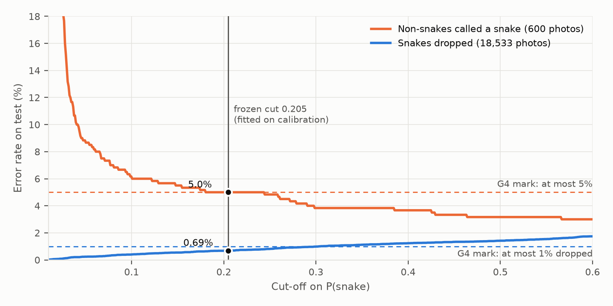
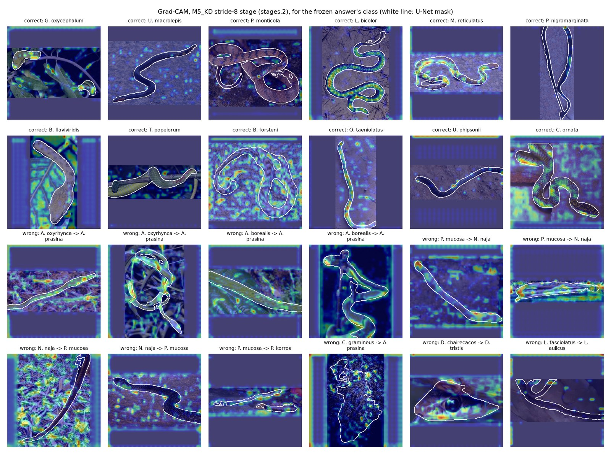
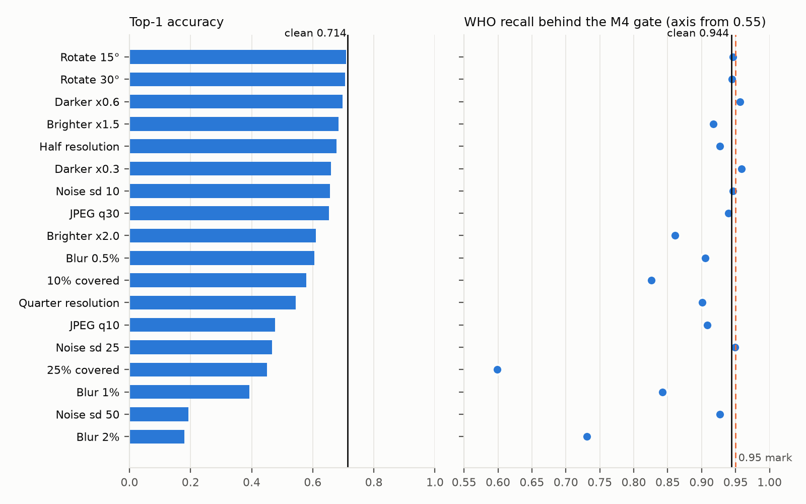
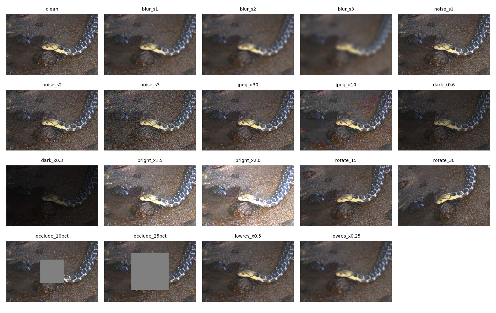

# Milestone 5: Evaluation of the frozen pipeline on the locked test split

SerpentGuard AI · Group 5 · IIT Madras DS and AI Lab 
Team lead: Jayesh Bansal. Members: Vikas, Puneet Bajaj and Manas Rastogi. 
The signatures at the end are added at the team review.

## Summary

At the end of Milestone 4 our pipeline could name a snake from a photo, but it missed three of its five goals. It
lost to the published model B1 on B1's own species (G3). It called 28.3% of non-snake photos a snake (G4). And its
video answer changed twice on one clip (G5). In Milestone 5 we worked on those three on validation only. We then
froze the whole pipeline, models, thresholds and rules, before any test photo was opened, and scored it once on
the locked test split: 18,533 held-out snake photos, 600 non-snake photos and 22 new real video clips.

The frozen pipeline meets five of the six goals on test. It ties B1 on B1's species (top-1 -0.006, interval -0.020
to +0.008). It calls 5.00% of non-snakes a snake while keeping 99.31% of snakes. Its video answer changes at most
once per clip. It fails the goal that matters most to a user: the lower bound on recall of WHO-listed venomous
snakes is **0.926**, against a mark of 0.95. Even the point value, 0.944, is under the mark. The error analysis says
why. Most species errors go to a close relative. Indian photos score 18 points lower than photos from elsewhere. A
blurred or partly covered snake hurts more than any other damage we tried. And putting the new snake check in front
of the classifier, which the app on this branch already does, lifts the safety bound to 0.946 with no retraining.

| Goal | Mark | Test result | Met |
|---|---|---|---|
| G1 scenery gap | at most 0.084 | 0.057 | yes |
| G2 species with F1 at least 0.5 | at least 80 | 89 of 165 | yes |
| G3 against B1, on B1's 62 species | tie or beat, on top-1 and macro-F1 | top-1 -0.006 (-0.020 to +0.008), macro-F1 +0.006 (-0.017 to +0.028) | yes, tied |
| G4 non-snakes called a snake / snakes kept | at most 5% / at least 99% | 5.00% / 99.31% | yes, exactly at the mark |
| G5 changes of the shown species per clip | at most 1 | at most 1 at all four frame speeds | yes (tests the lock only) |
| Safety: WHO recall lower bound | at least 0.95 | 0.926 | **no** |

**Where the numbers come from.** Every number in this report comes from a file in
[`results/m5/`](../../results/m5/README.md), and paths below are relative to that folder. The folder README says
which file answers which question. "M4 report" means `documentation/milestone 4/project-report.md`.
`results/m5/check_numbers.py` rechecks the headline numbers against those files on a laptop.

## 1. Introduction & Objectives

### 1.1 Where Milestone 4 left us

M4 shipped A3: a MobileViT-S classifier with an ArcFace head, trained on all 49,782 training photos, on crops to the
U-Net mask's box, with the scenery swapped half the time. On validation, A3 met G1 (scenery), G2 (species reached)
and the safety rule. It missed three goals (M4 report, Table 1):

- G3: it lost to B1 by 0.081 in top-1;
- G4: the gate called 28.3% of non-snake test photos a snake, against a mark of 5%;
- G5: one clip changed its answer twice, against a mark of 1.

M4 also found that the crops the app feeds the classifier differ from the crops A3 trained on (M4 report, section
7.7).

### 1.2 Objectives

1. Close G3, G4 and G5 where we could, using validation only.
2. Freeze the whole pipeline before reading any test photo.
3. Score the frozen pipeline once on the locked test split, against the marks set in M4.
4. Analyse the errors and state the limits plainly.

### 1.3 What changed since M4, and why

| Change | Why | Effect on validation | Source |
|---|---|---|---|
| Fine-tune A3 for 5 epochs on the M4 front end's crops, lr 2e-4 (M5_FT) | A3 trained on M3 crops, but the app uses M4 crops. On the app's crops A3's G3 top-1 gap was -0.087, against -0.081 on its own crops | On the app's crops M5_KD now loses almost nothing against its training-path crops (-0.062 against -0.061). The fine-tune alone did not move G3 (-0.078) | `g3/README.md` |
| Distil from B1 on its 62 species, kd weight 1, temperature 2 (M5_KD) | B1 beats us on its own species, so the student learns from B1's outputs on our training photos | G3 top-1 -0.083 (A3 on M4 crops) to -0.061. A later pilot on the subset picked the same setting | `g3/README.md` |
| Average with the mirrored crop (flip), and add a training-frequency prior (tau 0.5, fitted on calibration only) | The weighted sampler flattened species frequencies, while validation and real use follow natural frequencies | M5_KD + flip + prior: G3 -0.012 and +0.002, both tied. No candidate passed G3 without the prior | `g3/README.md` |
| A separate snake check, `distil_oi`: EfficientNet-B0, 3 classes, feature distillation from BioCLIP, extra non-snake photos | The M4 gate called 28.3% of non-snake test photos a snake | 5.17% false snakes and 99.20% of snakes kept, against 27.3% and 98.3% for the M4 gate | `g4/README.md` |
| A video lock that works in seconds, expires, and always shows the locked species | The M4 lock counted frames and never expired. The app screen also showed a different species from the one scored: 21 changes on screen where notebook 24 scored 2 | Dev clips: at most 1 change at 0.1, 0.25, 0.4 and 0.8 s a frame | `g5/README.md` |
| Safety thresholds refitted for the new classifier, behind the app's gate | Each new model's own thresholds gave a calibration bound of only 0.941 to 0.944 behind the gate | Calibration bound 0.954 behind the gate; validation recall 0.963 (0.950 to 0.973) | `g3/README.md`, `g3/refit_new.json` |
| Validation loss logged at every evaluation; `last.pt` saves the model, optimizer, scheduler, scaler and RNG states; `train(..., resume=True)` | The TA's M4 feedback | Per-epoch validation loss for M5_FT and M5_KD; resume tested in a laptop dry run | `g3/README.md`, `tests/test_distillation.py` |

We tried two more things and left them out. The G4 retry `distil_oi_v2` gave 5.67% false snakes on validation,
worse than `distil_oi` (`g4/README.md`). Averaging two classifiers did not pass G3 and would double the phone's
classifier cost (`g3/README.md`).

**Validation loss, now logged.** For M5_FT it falls from 6.665 at epoch 1 to 6.558 at epoch 4 and is flat at epoch
5 (6.563), so we see no overfitting in 5 epochs. For M5_KD the total validation loss falls every epoch, from 9.797 to
8.931. But validation macro-F1 peaks at epoch 1 (0.478) and then drops to between 0.439 and 0.454 while top-1 rises
to 0.70. Distillation pulls the model toward B1's species at the cost of the others. The run keeps epoch 1 because
it selects by macro-F1.

### 1.4 The frozen pipeline

A photo goes through these steps, in this order on the phone (`test/FREEZE.md`, sections 2 and 3):

1. **The snake check** (`distil_oi`, 8.1 MB) says whether there is a snake: P(snake) at least 0.2048.
2. **The M4 detector and U-Net** find the snake and cut the crop to the mask's box.
3. **The species classifier** (M5_KD, epoch 1, 20.8 MB, the same architecture and size as A3) runs on the crop and
   on its mirror image. The two outputs are averaged and the prior is added.
4. **The decision rules**, with the refitted thresholds from `g3/refit_new.json`, turn the outputs into
   "dangerous", "not on the WHO list" or "we don't know".
5. **In video**, the lock from `g5/results/chosen_settings.json` pools the frames and holds the answer.

The frozen safety goal was scored behind the M4 gate, as in M4. Section 4.2 also gives the number behind the snake
check.

**Scope.** This report scores photos and recorded clips. It does not measure the app on a phone (section 7.3).

## 2. Evaluation Setup & Test Dataset

### 2.1 The held-out set

| Set | Size | What it is |
|---|---:|---|
| Held-out snake photos (primary) | 18,533 | `test` (5,144 photos, India, uploaded from 2022) plus `test_extra` (13,389). Milestone 2 found `test` alone too thin per class |
| `test` only (secondary row) | 5,144 | reported beside the primary row |
| G3 slice | 12,203 photos, 1,781 photographers | held-out photos uploaded from 2022, of B1's 62 species |
| Non-snake test photos | 600 | 500 from Open Images and 100 iNaturalist lookalikes (notebook 19's test split) |
| Video | 22 new real test clips, 6 old test clips, 8 no-snake clips | of the no-snake clips, 5 are new and 3 old |

Source: `test/FREEZE.md` section 1; `g5/README.md`.

**Composition** (`report/data/report_numbers.json`, `composition`):

- 181 species appear, and 165 of them have at least 5 photos, which makes them "measurable". 2,281 photographers.
- Photos per species: median 28, range 1 to 1,657. The 10 largest species hold 44.3% of the photos.
- Largest species: *Indotyphlops braminus* 1,657, *Ahaetulla prasina* 1,206, *Ptyas mucosa* 1,098,
  *Protobothrops mucrosquamatus* 799, *Fowlea piscator* 793.
- WHO category: 1,502 photos of Category 1 species, 1,131 of Category 2, 15,900 not listed.
- Families: Colubridae 9,535, Viperidae 2,535, Elapidae 1,977, Typhlopidae 1,715, Pythonidae 926.
- Location: 7,109 photos from India (all 5,144 of `test` and 1,965 of `test_extra`) and 11,424 from outside India.

**Hard cases in the set.** 1,796 held-out photos have no usable U-Net mask, so the classifier sees a box or the whole
photo (`test/analysis_heldout.json`, `front_end`). 768 are sea snakes and sea kraits, 342 are other water snakes and
1,715 are blind snakes. The non-snake set includes 100 lookalikes: caecilians, earthworms, eels and legless lizards.

**Preprocessing at evaluation** (FREEZE section 3). The classifier sees the M4 front end's crop: a detector box at
confidence 0.05 or more, the U-Net mask, and a crop to the mask's box. It also sees the mirrored crop. The snake check
sees the whole photo after the app's exposure fix, letterboxed to 256 px.

### 2.2 Leakage checks

A test score means little if the same snake, or the same photographer's series, also sits in training. We checked
the held-out set against every other split (`report/data/report_numbers.json`, `leakage`;
`report/data/leakage_detail.json`).

| Check | Result |
|---|---|
| Same iNaturalist observation in two splits | 0 |
| Same file (SHA-1) | 0 |
| Same perceptual hash (pHash), exact | 0 |
| Photographers shared with train | 0 |
| Photographers shared with validation | 0 |
| Photographers shared with the unknown-species pool | 36 (4,124 held-out photos) |
| pHash within 8 bits of a training photo | 90 photos: 85 of a different species, 5 of the same species |
| pHash within 8 bits of a validation photo | 15 photos: 1 of the same species |

The calibration photos sit inside the metadata's `train` split, so "train" covers them. The unknown-species pool holds
species outside our 184. It is used only to test "we don't know", never to train, so the 36 shared photographers leak
no species label. An 8-bit pHash match between two different species is a chance collision of the hash. The 6
same-species pairs are listed in `leakage_detail.json`.

> **To do (Jayesh Bansal):** open the 6 same-species pairs and record whether any of them is the same snake.

The non-snake test set was not fresh (section 7.5).

### 2.3 Baselines

Every baseline is scored on the same photos with the same metric code.

| Baseline | What it is |
|---|---|
| B1 | Bolon et al. (2022), the published ViT-L; it can name 62 of our species |
| A3 (M4) | our shipped M4 classifier on the same M4 crops, with A3's app thresholds |
| M4 gate | the M4 detector and U-Net "both" rule, for G4 and as the safety front end |
| Most common species | predicts *Indotyphlops braminus*, the commonest training species, for every photo |
| Prior only | draws a species at random from the training frequencies (seed 42) and never looks at the image |

### 2.4 Environment and reproducibility

- **Hardware.** One pass of Kaggle kernel `sg-m5-test` v1 on Jayesh's account, 2 x Tesla T4, 48.5 minutes. Then one
  run of `score_test.py --split test` on a laptop CPU.
- **Software in the kernel** (`test/kernel_out/out/versions.json`): Python 3.13.16, PyTorch 2.11.0 with CUDA 13.0,
  timm 1.0.31, Ultralytics 8.4.202, ONNX Runtime 1.31.1, segmentation-models-pytorch 0.6.0, NumPy 2.1.3, pandas
  2.3.3. The classifier and the snake check ran in PyTorch. The gate call for each photo ran in ONNX Runtime on CPU,
  as the app does.
- **Software on the laptop.** Python 3.12.0 with the versions pinned in `requirements-m3.txt` (NumPy 2.5.4, pandas
  3.1.0, scikit-learn 1.9.1, ONNX Runtime 1.31.1).
- **Reproducibility.** FREEZE lists every model file with its SHA-256, every threshold and every command. We hashed
  the scoring scripts into `test/FREEZE_scripts.sha256` when the kernel was pushed, before reading its output; the
  scripts in `test/kernel/` are those exact bytes, and `shasum -c` passes on all seven. The raw kernel outputs are
  in `test/kernel_out/`.
- **The report's own numbers.** `report/scripts/report_numbers.py` computes the derived counts on a laptop from the
  per-photo file. Before anything else it recomputes the frozen model's and B1's G3-slice scores and the false-alarm
  share (0.2155), and checks that both equal `test_scores.json`. `check_numbers.py` then checks the report's headline
  numbers against the result files.

### 2.5 Test protocol

1. **Freeze before test.** We wrote FREEZE at 20:35 IST on 24 November 2026, before any test photo was opened, and
   Puneet approved it the same day. After that a crash could be fixed and rerun, but no model, threshold or rule could change.
2. **Check the scorer on validation first.** `score_test.py --split val` had to reproduce every validation number
   in the goal READMEs. It first gave G2 = 82, not 81, because it took each species' F1 over the wrong photos. We
   fixed the scorer to the kernels' rule, and then every number matched (FREEZE section 8, written at 20:49 IST
   before any test output was read; `test/val_dry_run.json`). Inside the kernel, 600 validation photos sent through
   the fresh front end matched the saved outputs: box and mask agreement 1.0, M5_KD top-1 agreement 1.000, A3 0.998.
   The snake check gave 0 flips on 500 photos and the ONNX gate agreed on 300.
3. **One scoring pass.** The kernel ran once, and every step passed first time.
4. **Negative controls.** Each must fail; otherwise the test cannot tell a good model from a broken one.

   | Control | Result |
   |---|---|
   | G3, predictions shuffled | top-1 -0.744, macro-F1 -0.697 against B1 |
   | G2, predictions shuffled | 0 of 165 |
   | Safety, logits shuffled across photos | bound 0.378 |
   | G4, random score | 99.2% false snakes |
   | G4, scores shuffled across snakes and non-snakes | 97.2% false snakes |
   | G1, swapped predictions shuffled | gap 0.675 |
   | **G5, each clip's frames shuffled** | **did not fail: still at most 1 change** |

5. **Intervals.** Every interval is a 95% interval from 1,000 resamples of whole photographers (owners, for
   non-snake photos), seed 42. One photographer often uploads many photos of the same snake, so resampling single
   photos would make the intervals too narrow.

Source: `test/RESULTS.md`; `report/data/report_numbers.json`.

## 3. Metric Selection & Justification

| Metric | What it measures | Why we use it |
|---|---|---|
| Top-1 | share of photos whose first answer is right | it is what the user sees first |
| Macro-F1 over measurable species | mean F1 over species with at least 5 photos | it weighs every species equally; top-1 alone rewards getting the few common species right |
| G2: species with F1 at least 0.5 | how many species we name well | coverage of the long tail, where we can do more than B1 |
| G3: paired difference against B1, on its 62 species, photos from 2022 | are we as good as the published model where it can answer | B1 cannot have trained on photos from 2022 on; a tie within the photographer interval counts |
| WHO recall lower bound | share of WHO Category 1 and 2 snakes called "dangerous": the 5th percentile over photographer resamples | the safety goal; a miss can kill, so the mark is on the lower bound, not the average |
| False alarms | share of harmless snakes (not WHO-listed, not a viper or elapid) called "dangerous" | the cost side of safety |
| G4: false snakes and snakes kept | non-snake photos called a snake; real snakes the check lets through | a check that drops real snakes would hurt safety, so both halves are marked |
| G1: scenery gap | top-1 as is minus top-1 with the scenery swapped | the TA's M3 question: is the model looking at the snake or at the background? |
| G5: changes of the shown species per clip | how steady the video answer is | a flickering answer cannot be trusted |

**False negatives and false positives are not equal here.** A false negative is a venomous snake called "not on the
WHO list" or "we don't know". The person may relax or skip hospital, and that can kill. So we hold recall to a lower
bound of at least 0.95. A false positive is a harmless snake called "dangerous". It causes fear, a wasted hospital
trip, and sometimes a killed snake. That is a real cost, but it does not kill a person.

So every threshold is fitted to meet the recall bound first, and false alarms are whatever that leaves (FREEZE
section 3; `g3/README.md`). The same choice sets the snake check's cut at 99% of snakes kept, and makes the video
screen keep "Dangerous" once it has appeared (section 5.6). The price is a false-alarm rate of 21.6% on test.

## 4. Quantitative Performance & Benchmarking

### 4.1 Goals on the test set

Table 1. Goals on validation and on test (`test/RESULTS.md`, "Goals"; `test/test_scores.json`, `subsets/all/goals`).

| Goal (mark) | Validation | Test, held-out set | Result |
|---|---|---|---|
| G1 scenery gap (at most 0.084) | 0.055 | 0.057 (0.701 as is, 0.645 swapped, 16,737 photos with a mask) | **Pass** |
| G2 species with F1 at least 0.5 (at least 80) | 81 of 158 | 89 of 165 | **Pass** |
| G3 top-1 against B1 (tied or higher) | -0.012 (-0.030 to +0.002), tied | -0.006 (-0.020 to +0.008), tied | **Pass** |
| G3 macro-F1 against B1 (tied or higher) | +0.002 (-0.014 to +0.025), tied | +0.006 (-0.017 to +0.028), tied | **Pass** |
| G4a non-snakes called a snake (at most 5%) | 5.17% (31 of 600), fail | 5.00% (30 of 600), 3.3% to 6.7% | **Pass, exactly at the mark** |
| G4b snakes kept (at least 99%) | 99.20% (17,013 of 17,151) | 99.31% (18,405 of 18,533), 99.15% to 99.47% | **Pass** |
| G5 at most 1 change per real test clip | dev clips: at most 1 | at most 1 on 22 new clips at all four frame speeds | **Pass** (tests the lock only, section 7.1) |
| Safety: WHO recall lower bound behind the app's gate (at least 0.95) | recall 0.962 (0.950 to 0.973), bound 0.952 | recall 0.944 (0.923 to 0.973), **bound 0.926** | **FAIL** |

- **Safety fails**, and not narrowly: even the point value, 0.944, is under the mark (section 5.2).
- **G3 is a tie on both measures.** The scorer labels the macro-F1 standing "higher" because the difference is
  positive. Its interval contains 0, so we report it as tied. The goal passes either way.
- **G4 passes with no room.** One more false snake would fail it, and the same model failed by one photo on
  validation.

### 4.2 Against the baselines and against M4

Table 2. On the G3 slice: 12,203 photos of B1's 62 species, macro-F1 over those species (`test/test_scores.json`,
`subsets/all/G3`; naive rows from `report/data/report_numbers.json`, `naive_baselines_g3_slice`).

| Model | Top-1 | Macro-F1 | Top-1 minus B1 |
|---|---:|---:|---|
| B1 (published) | 0.780 | 0.713 | |
| **Frozen M5** | **0.774** | **0.719** | -0.006 (-0.020 to +0.008) |
| M5_KD without flip or prior | 0.721 | 0.703 | -0.059 (-0.083 to -0.038) |
| A3 on M4 crops (M4) | 0.700 | 0.700 | -0.080 (-0.106 to -0.057) |
| Most common training species | 0.104 | 0.003 | -0.676 |
| Prior only (random draw from training frequencies) | 0.035 | 0.016 | -0.745 |

The prior on its own scores no better than shuffled predictions (top-1 0.035). It helps only when combined with the
image; alone it carries no information about the snake.

Table 3. All 18,533 held-out photos (`test/test_scores.json`; `report/data/report_numbers.json`,
`naive_baselines_all_heldout`).

| Model | Top-1 | Macro-F1 (165 species) | G2 |
|---|---:|---:|---:|
| Frozen M5 | 0.714 | 0.462 | 89 |
| A3 on M4 crops | 0.666 | 0.481 | 91 |
| Most common training species | 0.089 | 0.001 | |
| Prior only | 0.030 | 0.006 | |

Table 4. The whole pipeline before and after, on the same test photos (`test/RESULTS.md`, "Before / after").

| | A3 (shipped in M4) | Frozen M5 |
|---|---|---|
| WHO recall behind the M4 gate | 0.933 (0.906 to 0.969), bound 0.909 | 0.944 (0.923 to 0.973), bound 0.926 |
| False alarms | 21.6% | 21.6% |
| Non-snakes called a snake | 28.3% (M4 gate, scored in M4) | 5.00% (snake check) |
| Snakes kept | 98.11% (the gate drops 351) | 99.31% (the check drops 128) |

M5 is better on top-1, G3, safety and false snakes. It is worse on macro-F1 over all species, and it reaches 2 fewer
species at F1 0.5. A3 also fails the safety bound on these photos (0.909), so the safety failure is not new in M5.

**With the snake check in front instead of the gate**, which is how the app on this branch runs: WHO recall 0.960
(0.944 to 0.982), bound 0.946, false alarms 22.3%. That is closer, and still under 0.95.

### 4.3 Configurations and settings we compared

The test split scores only the frozen pipeline. The comparisons that chose it were all made on validation, and each
goal folder holds the full tables.

| Question | What we compared | What won | Where |
|---|---|---|---|
| Which species classifier closes G3? | 13 candidates: A3, the fine-tune and the distilled model, each with and without flip and prior, and two-model averages | M5_KD + flip + prior, the only pass (G3 -0.012 / +0.002) | `g3/README.md`, "G3 for each candidate" |
| Which distillation setting? | no kd; kd weight 1 at temperature 2; kd weight 3 at temperature 4 (pilot on the 16% subset) | weight 1, T 2: G3 -0.024 against -0.067 without kd; weight 3 costs 9 points of macro-F1 | `g3/README.md`, "The distillation pilot" |
| Which snake check? | plain, BioCLIP distillation, distillation + Open Images negatives, the same at another seed, a retry with more lookalikes, and a shuffled-label control | `distil_oi`: 5.17% false snakes (plain 9.67%, distil 8.33%, retry 5.67%) | `g4/README.md`, "Variants" |
| Which video lock settings? | 360 settings of window, margin, switch time, gate share and minimum frames, at three frame speeds | window 0.5 s, margin 0.05, switch 3 s, min frames 1 | `g5/README.md`, "Retune" |
| How strict a lock confidence? | 0.287, 0.4, 0.5, 0.6 | 0.287: higher values reject no-snake clips but leave up to 27 of 50 dev clips unanswered | `g5/README.md`, problem 4 |

### 4.4 Validation against test

| | Validation | Test |
|---|---|---|
| G3 top-1 / macro-F1 against B1 | -0.012 / +0.002 | -0.006 / +0.006 |
| G2 | 81 of 158 | 89 of 165 |
| WHO recall | 0.962 (0.950 to 0.973) | 0.944 (0.923 to 0.973) |
| False snakes | 5.17% | 5.00% |
| Snakes kept | 99.20% | 99.31% |

Source: `test/RESULTS.md`. Every goal holds or improves from validation to test except safety, which drops by 1.8
points of recall. Safety had no room to fall: the validation interval's lower end already sat on the mark (0.950).
Test recall, 0.944, is below even that lower end.

### 4.5 Slices

| Slice | Photos | Frozen top-1 | A3 top-1 |
|---|---:|---:|---:|
| `test` (India, from 2022) | 5,144 | 0.586 | 0.588 |
| `test_extra` | 13,389 | 0.763 | 0.696 |
| In India (both splits) | 7,109 | 0.604 | 0.608 |
| Outside India | 11,424 | 0.782 | 0.703 |
| Usable mask | 16,737 | 0.739 | 0.693 |
| No usable mask | 1,796 | 0.484 | 0.421 |
| Sea snakes and sea kraits | 768 | 0.820 | 0.815 |
| Other water snakes | 342 | 0.520 | 0.564 |

Source: `test/analysis_heldout.json` (`by_split`, `front_end`, `water_snakes`); `report/data/report_numbers.json`
(`india_vs_outside`). On `test` alone, macro-F1 is 0.401, G2 is 46 of 106, G3 top-1 is +0.027 (-0.003 to +0.042)
and the safety bound is 0.910 (`test/test_scores.json`, `subsets/test only`).

**Snakes kept by the snake check** (`test/test_scores.json`, `G4/main/snakes_kept_by_group`):

| Group | Photos | Kept | 95% interval |
|---|---:|---:|---|
| Sea snakes and sea kraits | 768 | 98.2% | 97.0% to 99.2% |
| Blind snakes | 1,715 | 98.9% | 98.2% to 99.5% |
| Shieldtails | 79 | 98.7% | 96.2% to 100% |
| Other water snakes | 342 | 98.5% | 96.7% to 99.7% |
| Vine snakes and bronzebacks | 2,081 | 99.6% | 99.2% to 99.8% |

**Non-snakes called a snake, by category** (`G4/main/false_snake_by_category`; counts from
`test/false_snakes_nonsnake_test.csv`):

| Category | Photos | Called a snake |
|---|---:|---:|
| Caecilian | 20 | 6 (30%) |
| Earthworm | 20 | 4 (20%) |
| Eel | 40 | 6 (15%) |
| Legless lizard | 20 | 2 (10%) |
| Other animal | 60 | 5 (8.3%) |
| Rope / hose / belt | 60 | 3 (5%) |
| Hand / arm | 60 | 2 (3.3%) |
| Person | 180 | 2 (1.1%) |
| Cat, dog, T-shirt | 140 | 0 |
| By source: iNaturalist lookalikes / Open Images | 100 / 500 | 18% / 2.4% |

Figure 1 shows why G4 has no margin. The cut came from the calibration snakes: it is the highest value that keeps 99%
of them. On test it lands at the left edge of the plateau where 5.0% of non-snakes pass. Any cut from 0.245 to 0.303
would have met both marks on test, with 4.8% to 3.8% false snakes and 0.8% to 1.0% of snakes dropped. We report this
only to explain the result. Choosing a cut now would mean fitting it on test, and the frozen cut stays.

Figure 1. Share of non-snake test photos called a snake (orange) and of held-out snakes dropped (blue) at each
cut-off on P(snake). The dashed lines are the G4 marks, and the dots are the frozen cut, 0.205. Made by
`report/scripts/report_figures.py` from `test/predictions_nonsnake_test.csv` and the held-out predictions file.

**Video** (`test/g5/results/g5_summary.csv`, the 22 new test clips, frozen classifier):

| Seconds per frame | Most changes | G5 | Median first answer | Final species right |
|---|---:|---|---:|---:|
| 0.1 | 1 | met | 0.6 s | 12 of 19 |
| 0.25 | 1 | met | 0.75 s | 13 of 19 |
| 0.4 | 1 | met | 1.2 s | 12 of 19 |
| 0.8 | 1 | met | 3.2 s | 10 of 19 |

When the new clips were first scored with A3 and its thresholds, one clip changed twice at 0.8 s a frame
(`g5/README.md`, section 5). The frozen classifier does not.

## 5. Error Analysis

### 5.1 Error counts

| Error | Count | Source |
|---|---:|---|
| Species wrong (frozen classifier, all held-out photos) | 5,298 of 18,533 | `report_numbers.json`, `errors` |
| **False negative for safety:** WHO-listed photo not called dangerous | 147 of 2,633 | `analysis_heldout.json`; `report_numbers.json` |
| of which the M4 gate said "no snake" | 61 | `report_numbers.json` |
| of which "not on the WHO list" | 60 | `analysis_heldout.json` |
| of which "we don't know" after the gate passed | 26 | 87 "we don't know" in `analysis_heldout.json`, minus the 61 |
| **False positive for safety:** harmless snake called dangerous | 3,022 of 14,021 (21.6%) | `report_numbers.json` |
| G4 false positive: non-snake called a snake | 30 of 600 | `test_scores.json` |
| G4 false negative: snake dropped by the check | 128 of 18,533 | `analysis_heldout.json` |

### 5.2 Safety misses by species

| Species | Missed photos |
|---|---:|
| *Naja naja* | 44 |
| *Craspedocephalus gramineus* | 39 |
| *Daboia russelii* | 15 |
| *Naja kaouthia* | 10 |
| *Echis carinatus* | 9 |
| *Craspedocephalus malabaricus* | 8 |
| *Bungarus caeruleus*, *Trimeresurus erythrurus* | 6 each |
| *Ophiophagus hannah* | 5 |
| 4 other species | 5 in all |

Source: `test/analysis_heldout.json`, `who_listed_missed_behind_gate`.

Two confusions explain much of this. *Naja naja* is called *Ptyas mucosa* (the rat snake) on 63 photos, and *C.
gramineus* is called *Ahaetulla prasina* (a harmless green vine snake) on 47 (`test/confusions_heldout.csv`). Each
pair shares a body shape or a colour. The other big share is the 61 gate drops. This is why the snake check helps
safety: it drops 128 snakes where the gate drops 351.

### 5.3 Confusion matrix

Figure 2. Share of each true species' held-out photos by predicted species, for the 30 species with the most
held-out photos; a prediction outside the 30 goes to "other species". Made by `report/scripts/report_numbers.py`.

The diagonal is strong for blind snakes, sea kraits and most vipers. The weakest rows are *Ptyas mucosa*, *Ptyas
korros*, *Naja naja*, *C. gramineus* and *Dendrelaphis tristis*, which leak into each other and into *A. prasina*.

The largest confusions over all species (`test/confusions_heldout.csv`): *A. oxyrhynca* to *A. prasina* 123, *A.
borealis* to *A. prasina* 76, *Ptyas mucosa* to *Naja naja* 75, *P. mucosa* to *P. korros* 67, *Naja naja* to *P.
mucosa* 63, *A. farnsworthi* to *A. prasina* 54, *C. gramineus* to *A. prasina* 47, *Dendrelaphis chairecacos* to
*D. tristis* 46.

### 5.4 Where the model does well and where it does badly

33 of the 165 measurable species have F1 0 on test (`test/analysis_heldout.json`). A3 has 21 on the same photos
(counted from `test/per_species_heldout.csv`). Examples (`worst_species_measurable`):

| Species | Photos | Most common wrong answer |
|---|---:|---|
| *Ahaetulla oxyrhynca* | 149 | *A. prasina*, 123 |
| *Ahaetulla farnsworthi* | 62 | *A. prasina*, 54 |
| *Dendrelaphis chairecacos* | 61 | *D. tristis*, 46 |
| *Ahaetulla malabarica* | 40 | *A. prasina*, 35 |
| *Ophiophagus kaalinga* | 20 | *O. hannah*, 11 |
| *Hydrophis lapemoides* | 15 | *Laticauda colubrina*, 10 |
| *Sahyadriophis uttaraghati* | 13 | *S. beddomei*, 9 |

Split by the number of held-out photos per species, the frozen model's mean F1 against A3's is:

| Held-out photos per species | Frozen M5 | A3 |
|---|---:|---:|
| 5 to 19 | 0.269 | 0.318 |
| 20 to 99 | 0.478 | 0.496 |
| 100 or more | 0.708 | 0.686 |

M5 is worse than A3 on 74 species and better on 68 (counted from `test/per_species_heldout.csv`). It gained on common
species and lost on rare ones. That is the prior doing what it is built to do (section 5.7).

The model does best on the common, distinctive species. *Indotyphlops braminus* (1,657 photos) has F1 0.936. *Ahaetulla
prasina* (1,206) has 0.761, against A3's 0.375. Part of that gain is paid for by the other *Ahaetulla* species, which
now collapse into it (section 5.3).

### 5.5 Sample outputs

Figure 3 shows 12 right and 12 wrong answers on held-out photos. The wrong ones were picked from the largest
confusions above. Each tile also shows the Grad-CAM map (section 6.4) and the U-Net mask.

Figure 3. Held-out photos as the classifier sees them (the crop to the mask's box, letterboxed), with the frozen
answer and the Grad-CAM map at the stride-8 stage. The white line is the U-Net mask. Top two rows: right answers.
Bottom two rows: wrong answers, written as true species -> predicted species. All 24 photos are Creative Commons; each
photographer and licence is in `report/figures/photo_credits.csv`.

Table 5. Ten wrong answers: the most confident one for each of ten different true species
(`report/data/report_numbers.json`, `misclassified_examples`). Paths are inside the dataset
`serpentguard-indian-snakes-clean`. "Confidence" is the classifier's softmax at temperature 1 after flip and prior.
The decision rules use temperature 1.585, so these values overstate how sure the app is.

| Path | True species | Predicted | Confidence | Verdict |
|---|---|---|---:|---|
| `test_extra/melanophidium_wynaudense/inaturalist_127981303.jpg` | *Melanophidium wynaudense* | *M. khairei* | 1.000 | not listed |
| `test_extra/herpetoreas_platyceps/inaturalist_675319185.jpg` | *Herpetoreas platyceps* | *Fowlea piscator* | 1.000 | not listed |
| `test/pseudoindotyphlops_porrectus/inaturalist_444478575.jpg` | *Pseudoindotyphlops porrectus* | *Indotyphlops braminus* | 1.000 | not listed |
| `test_extra/ovophis_monticola/inaturalist_543308183.jpg` | *Ovophis monticola* | *Protobothrops mucrosquamatus* | 1.000 | dangerous |
| `test/grypotyphlops_acutus/inaturalist_511981253.jpg` | *Grypotyphlops acutus* | *Indotyphlops braminus* | 1.000 | not listed |
| `test_extra/argyrophis_diardii/inaturalist_567938786.jpg` | *Argyrophis diardii* | *Indotyphlops braminus* | 1.000 | not listed |
| `test/craspedocephalus_anamallensis/inaturalist_389831604.jpg` | *Craspedocephalus anamallensis* | *C. malabaricus* | 1.000 | dangerous |
| `test/boiga_beddomei/inaturalist_725924808.jpg` | *Boiga beddomei* | *Pareas carinatus* | 1.000 | not listed |
| `test/python_molurus/inaturalist_408125173.jpg` | *Python molurus* | *Python bivittatus* | 1.000 | not listed |
| `test_extra/malayopython_reticulatus/inaturalist_316274856.jpg` | *Malayopython reticulatus* | *Macrovipera lebetinus* | 1.000 | dangerous |

Table 6. Five WHO-listed photos that the gate passed and that were still not called dangerous: the most confident one
per species (`report/data/report_numbers.json`, `who_listed_missed_examples`).

| Path | True species | Predicted | Confidence | Verdict |
|---|---|---|---:|---|
| `test/craspedocephalus_gramineus/inaturalist_356023090.jpg` | *Craspedocephalus gramineus* | *Boiga cyanea* | 0.997 | not listed |
| `test/naja_naja/inaturalist_575788873.jpg` | *Naja naja* | *Ptyas mucosa* | 0.996 | not listed |
| `test_extra/trimeresurus_erythrurus/inaturalist_456301930.jpg` | *Trimeresurus erythrurus* | *Gonyosoma oxycephalum* | 0.996 | not listed |
| `test_extra/ophiophagus_hannah/inaturalist_165505048.jpg` | *Ophiophagus hannah* | *Euprepiophis mandarinus* | 0.993 | not listed |
| `test/bungarus_niger/inaturalist_744859007.jpg` | *Bungarus niger* | *Xenopeltis unicolor* | 0.987 | we don't know |

Most wrong answers in Table 5 name a close relative: another blind snake, another *Python*, another pit viper. Table 6
is more worrying. Each of those five is a venomous snake called a harmless one, with a confidence of 0.987 or more.
High confidence does not protect against the worst error.

> **To do (Jayesh Bansal):** look at the 15 photos in Tables 5 and 6 and note any with a wrong label, a hidden head
> or a second animal.

### 5.6 Video errors

- **No-snake clips still lock.** With the frozen classifier, all 8 no-snake clips lock onto a species and end on
  "Dangerous", mostly *Naja naja* (`test/RESULTS.md`; `test/g5/results/negatives.csv`). The video path still uses the
  M4 gate, which passes most frames of these clips; for the slug, 55 of 55 (`g5/README.md`). The snake check was not
  part of the frozen video run (FREEZE section 5).
- **The "Dangerous" hold.** Once the pooled verdict says "dangerous", the screen keeps "Dangerous" until the lock
  changes. At 0.4 s a frame this shows all 9 dangerous-species clips as dangerous. But it also ends 12 of 13
  safe-species clips on "Dangerous", where without the hold it would be 5 of 13 (`test/g5/results/g5_summary.csv`).

### 5.7 Why the model gets things wrong

- **Close relatives (capacity and data).** Most species errors go to a congener: *Ahaetulla*, *Dendrelaphis*,
  *Craspedocephalus*, the blind snakes (section 5.3). These species differ in scale counts or head detail that a
  20.8 MB model at 320 px may not resolve, and the rare ones have few training photos to learn them from.
- **The prior, by design.** It moves answers toward common species. That closed G3, and it costs the rare species
  (section 5.4).
- **Distribution shift.** Indian photos score 0.604 against 0.782 outside India (section 4.5), and almost all of the
  frozen model's gain over A3 is outside India. About 63% of the training split's 85,067 photos were taken outside
  India (`metadata.csv`, `in_india`).
- **The front end.** When the U-Net finds no mask, top-1 drops by 25 points (section 4.5), and the M4 gate drops 61
  WHO-listed photos (section 5.1).
- **Labels.** Some confusions among *Ahaetulla* species may be label problems on iNaturalist. We did not audit the
  test labels.
- **Lookalikes for G4.** Long, thin, legless animals (caecilians, eels, earthworms) score like snakes, and
  iNaturalist has no more research-grade CC caecilian photos to train on (`g4/README.md`).

> **To do (owner to be agreed):** check 30 *A. oxyrhynca* and *A. borealis* photos called *A. prasina* against their
> iNaturalist pages.

## 6. Robustness & Interpretability

### 6.1 Shortcut check: the scenery swap

G1 asks whether the model looks at the snake or at the scenery. We paste each snake onto another species' scenery and
measure top-1 again. On the 16,737 held-out photos with a mask, top-1 is 0.701 as is and 0.645 with the scenery
swapped: a gap of 0.057, under the mark of 0.084. In M3 the gap was 0.168 (M4 report, Table 1). The control with the
swapped predictions shuffled gives a gap of 0.675, so the test can fail. G1 was measured on M5_KD without flip or
prior, as on validation (`test/test_scores.json`, `G1`).

### 6.2 Out-of-distribution slices

- `test` against `test_extra`, and India against outside India: section 4.5.
- Non-snake lookalikes: section 4.5.
- Videos, including 8 no-snake clips: sections 4.5 and 5.6.

### 6.3 Stress tests

A phone photo is often blurred, dark, partly covered or small. We ran the frozen pipeline, unchanged, on all 18,533
held-out snake photos and the 600 non-snakes, damaging each photo in one way at a time (Figure 5). The clean run
through this harness reproduces `test_scores.json` exactly, so every change below comes from the damage alone
(`robustness/README.md`; `robustness/results/robustness.json`). The top-1 intervals are paired photographer
bootstraps, about ±0.005 to ±0.02 per row.

Figure 4. Top-1 (left) and WHO recall behind the M4 gate (right) under each kind of damage, sorted by top-1. The black
line is the clean run; the dashed line is the 0.95 safety mark. Made by `report/scripts/report_figures.py` from
`robustness/results/robustness_table.csv`.

Table 7. Change against the clean run for each kind of damage.

| Damage (mild / medium / strong) | Top-1 change | WHO recall | False alarms | Snakes kept | Non-snakes called a snake |
|---|---|---:|---:|---:|---:|
| None (clean) | 0.714 | 0.944 | 21.6% | 99.31% | 5.00% |
| Blur 0.5% / 1% / 2% of the side | -0.109 / -0.322 / -0.535 | 0.905 / 0.842 / 0.731 | 31 / 48 / 64% | 99.2 / 97.1 / 93.9% | 6.8 / 11.2 / 36.5% |
| Noise sd 10 / 25 / 50 | -0.057 / -0.248 / -0.522 | 0.946 / 0.949 / 0.927 | 29 / 51 / 79% | 98.3 / 97.7 / 95.6% | 8.2 / 17.8 / 42.3% |
| JPEG quality 30 / 10 | -0.061 / -0.238 | 0.939 / 0.909 | 29 / 44% | 97.2 / 99.1% | 6.5 / 27.3% |
| Darker x0.6 / x0.3 | -0.016 / -0.054 | 0.957 / 0.959 | 25 / 30% | 99.7 / 99.9% | 9.5 / 19.5% |
| Brighter x1.5 / x2.0 | -0.030 / -0.104 | 0.917 / 0.861 | 23 / 27% | 98.8 / 98.0% | 4.5 / 7.0% |
| Rotated 15 / 30 degrees | -0.005 / -0.008 | 0.946 / 0.945 | 22 / 22% | 99.4 / 99.4% | 6.3 / 7.8% |
| 10% / 25% of the photo covered | -0.136 / -0.263 | 0.826 / 0.599 | 29 / 27% | 98.1 / 96.2% | 7.5 / 9.5% |
| Half / quarter resolution | -0.037 / -0.171 | 0.927 / 0.901 | 26 / 38% | 99.4 / 99.0% | 5.7 / 7.5% |

Figure 5. One photo under each kind of damage, as the pipeline received it. The photo (*Fowlea piscator*, CC BY-NC) is
credited in `report/figures/photo_credits.csv`.

What this says:

- **Only rotation does no harm.** Even the mildest blur, about 1.7 px, costs 11 points of top-1. A shaky or
  out-of-focus phone photo is the most likely way the app gets a species wrong.
- **Under noise and darkness, WHO recall holds for the wrong reason.** The model becomes unsure, and the rules then
  call more photos dangerous. At noise sd 50, 15,163 of 18,533 photos are called dangerous against 7,281 clean, and
  false alarms reach 79%. The app stays cautious, but it stops being useful.
- **A covered snake is the real safety risk.** With 25% of the photo covered, WHO recall falls to 0.599, mostly
  because the pipeline says "no snake" or the gate drops the photo. The square sits in the centre of the photo, which
  is often where the snake is (Figure 5).
- **The snake check almost never misses a snake**: it keeps 94% or more in every condition. But on blurred, noisy or
  heavily compressed photos it calls 27 to 42% of non-snakes a snake.

Our own Indian photos, undamaged (`test`, top-1 0.586), score about as low as photos that are mildly blurred (0.606)
or strongly brightened (0.610). So the domain gap costs as much as moderate damage does.

### 6.4 Grad-CAM: where the model looks

Grad-CAM shows which part of the photo pushed the model toward its answer. We ran it on M5_KD for the class of the
frozen answer, on all 16,737 held-out photos with a U-Net mask, and asked one question: does more of the heat land on
the snake than the snake's share of the image? On average the snake covers 16.2% of the input. As a control we made
the same maps from a model with random weights (`robustness/results/gradcam.json`).

| Layer | Heat on the snake | Heat on the snake minus its area (95% CI) | Photos with more heat than area | Random weights |
|---|---:|---:|---:|---:|
| Final block (`final_conv`) | 0.060 | -0.102 (-0.106 to -0.098) | 11% | -0.066 |
| Stride-16 stage | 0.139 | -0.023 | 34% | -0.078 |
| Stride-8 stage (`stages.2`) | 0.230 | **+0.068 (+0.065 to +0.071)** | **71%** | -0.079 |

- **The final block's map is not usable.** The model averages that layer over the whole image, so its gradient is
  flat and the map peaks on the letterbox padding (64% of the heat). It scores below the random control, which is how
  we know the map is broken rather than the model.
- **At stride 8 the model looks at the snake.** The heat on the snake beats its area on 71% of photos, while the
  random control stays below area. Figure 3 shows these maps.
- **Right and wrong answers look alike** (+0.068 against +0.069). So the confusions in section 5 do not come from the
  model looking away from the snake. It looks at the right place and reads the pattern wrong, as with *Ptyas mucosa*
  and *Naja naja*.
- We chose the extra layers on 37 validation photos, after the final block looked wrong there, and before touching
  test.

### 6.5 Not tested

Video stability (G5) under damaged frames, and stress tests with a real phone camera rather than damaged photos.

## 7. Limitations & Operational Constraints

### 7.1 Failure modes

- **Safety fails on test**: bound 0.926 against 0.95, point value 0.944 (section 4.1). The app must not be described
  as meeting the safety target.
- **G5 tests the lock only.** The G5 control did not fail: with each clip's frames shuffled, the lock still shows at
  most 1 change. The 3 s switch rule keeps the shown species steady whatever the frames say, so G5 cannot tell a good
  classifier from a scrambled one. The video answer is right on 12 of 19 clips at 0.4 s a frame.
- **No-snake videos lock and show "Dangerous"** (section 5.6).
- **A missing mask** costs 25 points of top-1 (section 4.5).

### 7.2 Choices made after looking at validation

- **The prior.** Tau is fitted on calibration photos only, but we decided to try a prior at all after probing A3's
  validation G3 at a few tau values (`g3/README.md`, "The prior"). So the validation G3 pass was optimistic. Test
  confirms it, but only as a tie.
- **G4 negatives, chosen after seeing validation errors twice.** We added the Open Images negatives after the first
  two variants made errors on people, hands and ropes. We added the round-two lookalikes for `distil_oi_v2` after
  `distil_oi`'s 31 false snakes. The retry was worse (5.67%) and was not used. Five trained variants read the same 600
  validation non-snakes, so every G4 validation number is optimistic (`g4/README.md`).
- **G4 passes exactly at the mark** (30 of 600), with an interval that spans 5%.
- **The video lock's selection rule changed once**, after we saw dev numbers and before any test clip was scored
  (`g5/README.md`).

### 7.3 Latency and memory

| Model | Size | Laptop CPU, 1 thread |
|---|---:|---:|
| Snake check, fp16 ONNX (256 px) | 8.1 MB | 23 ms |
| Snake check, fp32 ONNX | 16.0 MB | 28 ms |
| Classifier (A3's architecture, fp32, 320 px; M5_KD is the same size) | 20.8 MB | 48 ms |
| U-Net segmenter, fp32 | | 34 ms |
| Detector | | 7 ms |

Source: `g4/README.md`, `g4/results/latency.json`. These were measured on a busy laptop (load average about 14), so
only the ratios mean much. Flip doubles the classifier's time per photo. The three M4 models take 53.0 MB as float32
files (M4 report, "Response to earlier feedback").

> **To do (Manas Rastogi):** on an Android phone, measure the time per photo for the full pipeline with and without
> flip, the peak RAM, and the app size with the snake check added.

### 7.4 Bias and fairness

- **India against outside India.** Top-1 is 0.604 on Indian photos and 0.782 elsewhere (section 4.5). The app's users
  are in India, so the headline top-1 of 0.714 overstates what they will see.
- **Rare species.** Species with 5 to 19 held-out photos average F1 0.269 (section 5.4). A user who meets a rare
  species gets a worse answer, and M5 made this slightly worse.
- **Licences.** 89% of the new iNaturalist training negatives are CC BY-NC, as are many snake photos. That is fine for
  a course model and must be checked before any commercial use (`g4/README.md`). 20 of the new snake test clips and 3
  no-snake clips are YouTube uploads labelled "Creative Commons Attribution" with no version, and the uploader is not
  always the author. They need review before we quote or show them (`g5/README.md`).

### 7.5 The non-snake test set was not fresh

- In M4 the old gate scored these 600 photos once (M4 report, Table 18).
- In M5, a laptop code check of the kernel script also passed them through the snake check before the kernel ran,
  because the script scores that set every time. That output was deleted unread, and only photo counts were printed
  (`test/NOTE_nonsnake_deleted.txt`). The model and cut were already frozen: FREEZE at 20:35, the note at 20:45.

### 7.6 What we did not test

- On-device latency, fp16 on Android's CPU provider, and the app on a phone (section 9).
- The full app ONNX path on the test photos. The classifier ran in the kernel's PyTorch path, and only the gate call
  used the app's ONNX path. On validation the two paths differed by less than 0.001 in G3.
- G5 with the snake check as the video gate, and G5 on a phone.
- G1 on `test` alone, and G1 with flip and prior.
- The label quality of the test photos.

### 7.7 Ethics of a safety app

The app gives a verdict that a person may act on after a bite. It must say that it cannot replace medical care, and
that anyone bitten should go to hospital whatever the app says. "Not on the WHO list" must never read as "safe": on
test, 60 WHO-listed photos got that verdict (section 5.1). False alarms have a cost too: a "Dangerous" label can get a
harmless snake killed.

## 8. Actionable Insights

| Insight | Action | Evidence |
|---|---|---|
| The safety bound misses by 2.4 points, and 61 of the 147 misses are gate drops | Put the snake check in front of the classifier (bound 0.946; the app on this branch does this), then refit the thresholds on calibration behind the snake check, aiming at 0.95 | sections 4.2, 5.1 |
| "We don't know" hides 26 WHO-listed misses after the gate | In the app, show "we don't know" with the same caution as "dangerous": go to hospital if bitten | section 5.1 |
| *Naja naja* and *Ptyas mucosa* swap often (63 and 75 photos) | When the top two are this pair and close, show "cobra or rat snake, treat as dangerous" | section 5.3 |
| *Ahaetulla* and *Dendrelaphis* congeners collapse into one species | Audit the labels on 30 photos. If many are wrong, merge or relabel; otherwise show the genus when unsure | section 5.4 |
| The calibration rule leaves G4 no margin: the frozen cut sits at the edge of the band that meets both marks | Fit the cut with a small margin on calibration, and confirm it on non-snake photos the model has never seen, since these 600 are now used | Figure 1 |
| Caecilians, eels and earthworms are what is left of G4 | Collect more of these photos, from sources other than iNaturalist research grade | section 4.5; `g4/README.md` |
| Rare species lose under the prior | Try a smaller tau, or a per-species tau for species with few photos, fitted on calibration only | section 5.4 |
| Blur costs the most accuracy | Ask the user to retake a blurred photo before answering, and train with stronger blur augmentation | section 6.3 |
| Close relatives need finer detail | Try a larger backbone or a higher input size, and check it against the phone budget | section 5.7 |
| No-snake videos lock | Use the snake check as the video gate | section 5.6 |
| The "Dangerous" hold ends 12 of 13 safe clips on "Dangerous" | Team decision: keep the hold, or show "dangerous" only while the current pool says so | section 5.6 |

## 9. Deployment Readiness

Table 8. Accuracy against speed and size for the parts of the pipeline.

| Option | Accuracy on test | Laptop CPU time | Size |
|---|---|---|---|
| A3 classifier, one pass | top-1 0.666, macro-F1 0.481 | 48 ms | 20.8 MB fp32 |
| Frozen M5_KD, flip + prior (two passes) | top-1 0.714, macro-F1 0.462 | about 96 ms (two passes of the same model; not measured) | 20.8 MB fp32 |
| M4 gate (detector + U-Net) | 28.3% false snakes, 98.11% kept | 41 ms (detector 7 + U-Net 34) | part of the 53.0 MB M4 bundle |
| Snake check `distil_oi`, fp16 | 5.00% false snakes, 99.31% kept | 23 ms | 8.1 MB |

Source: `test/test_scores.json`; `g4/README.md`; M4 report.

**Compression we did.**

- **Distillation from B1.** The 20.8 MB student learned from the ViT-L teacher's outputs on its 62 species. G3 top-1
  went from -0.083 to -0.061 on validation, before flip and prior (`g3/README.md`).
- **Feature distillation from BioCLIP** into the 8.1 MB snake check. BioCLIP alone is 599 MB (`g4/README.md`).
- **fp16 ONNX for the snake check**: 8.1 MB against 16.0 MB in fp32. fp16 ONNX on the laptop and PyTorch in the
  kernel differ by at most 0.007 in P(snake), with 0 decisions flipped on 1,000 snakes and 600 non-snakes
  (`g4/README.md`).
- **fp16 classifier: checked.** It halves the file with no change to G3.
- **int8 does not work for these models.** We tried dynamic int8 and static int8 (calibrated on 500 calibration-split
  photos only). It breaks both models, so we keep fp16 (`robustness/results/compression.json`, `latency.json`; laptop
  CPU, 1 thread, median of 200 runs).

  | Model | Size | Laptop time | Result on test |
  |---|---:|---:|---|
  | Classifier fp32 | 20.8 MB | 47.9 ms | G3 -0.006 / +0.006, the same as PyTorch |
  | Classifier fp16 | 10.6 MB | 73.4 ms | the same as fp32 (top-1 agrees on 99.8% of the G3 slice) |
  | Classifier int8 dynamic | 5.8 MB | 71.7 ms | top-1 0.214; G3 fails |
  | Classifier int8 static | 6.2 MB | 66.7 ms | top-1 0.098; G3 fails |
  | Snake check fp32 / fp16 | 16.0 / 8.1 MB | 23.0 / 23.3 ms | 99.31% kept, 5.00% false snakes |
  | Snake check int8 dynamic | 4.3 MB | 35.8 ms | 16.8% kept |
  | Snake check int8 static | 4.8 MB | 13.4 ms | 98.3% kept, 37.7% false snakes; G4 fails |

  The int8 classifier is not even faster on the laptop. Its answers also differ between the Kaggle machine (x86) and
  the laptop (ARM): the static version gives the same top class on only 38 of 64 photos.

**The snake check in the app** (done, not yet run on a phone). The app on this branch runs the snake check first and
skips the detector, U-Net and classifier when it says no snake. It runs M5_KD with the mirror pass and the prior. The
Dart code matches the Python reference on 200 validation decision rows and 15 photo inputs, and `flutter test` gives
81 passed and 3 skipped (`documentation/milestone 5/app-m5.md`).

**Still to do.**

- **Size.** The app's model files are 65.1 MB: classifier 20.8, segmenter 26.5, detector 9.7 and snake check 8.1.
  With the fp16 classifier and an fp16 segmenter they would be about 65.1 - 10.2 - 13.3 = 41.6 MB. That is still
  above the 25 to 30 MB budget, and the fp16 segmenter has not been checked.

> **To do (owner to be agreed):** export and check the fp16 segmenter and detector.

> **To do (Manas Rastogi):** run `integration_test/golden_photos_test.dart` on a phone, and measure on-device latency
> and RAM (section 7.3).

## 10. Summary & Conclusion

Table 9. Goals against the objectives set in M4 (`test/RESULTS.md`; `test/test_scores.json`). The M4 column gives
the M4 report's numbers, except safety, which is A3 scored on these same test photos.

| Objective | Goal and mark | M4 (A3) | M5 on test | Met |
|---|---|---|---|---|
| Learn the snake, not the scenery | G1 gap at most 0.084 | 0.052 (validation) | 0.057 | Yes |
| Name most species well | G2 at least 80 species at F1 0.5 | 87 of 158 (validation) | 89 of 165 | Yes |
| Match the published model on its species | G3 tied or higher on top-1 and macro-F1 | -0.081 / -0.025, not met | -0.006 / +0.006, both tied | Yes |
| Do not call non-snakes a snake | G4 at most 5% false snakes, at least 99% kept | 28.3% / 98.28% | 5.00% / 99.31% | Yes, exactly at the mark |
| A steady video answer | G5 at most 1 change per real clip | 2 | 1 | Yes (lock only) |
| Never miss a venomous snake | WHO recall lower bound at least 0.95 | 0.909 on the same test photos | 0.926 | **No** |

The frozen M5 pipeline meets five of the six goals on the locked test split. It does not meet the one that matters
most for users: the safety bound is 0.926 against 0.95. The other five pass with less room than the table suggests.
G3 is a tie, G4 sits exactly on its mark, and G5 measures only the lock. Against M4 the pipeline is better on top-1,
G3, false snakes and safety, and worse on rare species.

The errors point to three things the model does not yet handle: close relatives, Indian photos, and blurred or
covered snakes. Grad-CAM shows that the model looks at the snake even when it is wrong, so these are failures of
reading the snake, not of finding it. The clearest next step needs no retraining. Put the snake check in front of the
classifier, as the app already does, and refit the safety thresholds behind it. That alone brings the bound from
0.926 to 0.946. We expect the refit to close the rest of the gap, but we have not tested it.

## Response to Milestone 4 feedback

The TA's written feedback from the M4 review is summarised in `report/references/m4_review_feedback.md`. The first
table covers the model and evaluation points, which this report addresses. The second covers the app and team points.
Most of those are still open and have an owner.

**Model and evaluation**

| Feedback item | What we did | Where |
|---|---|---|
| G3 unmet | M5_KD (A3 fine-tuned on M4 crops, distilled from B1) with flip and prior. On test: top-1 -0.006 (-0.020 to +0.008) and macro-F1 +0.006 against B1 on its 62 species. Both intervals cross zero, so this is a tie, which is what G3 asks for | `g3/README.md`; section 4.1 |
| G4 unmet (28.3% false snakes) | A new snake check, `distil_oi`: 5.00% false snakes and 99.31% of snakes kept on test, a pass exactly at the mark. A retry with more lookalikes was worse and not used | `g4/README.md`; sections 4.5, 7.2 |
| G5 unmet (up to 2 changes) | Fixed the lock (seconds, expiry, the locked species shown), retuned it on dev clips, and scored it on 22 new clips: at most 1 change at all four speeds | `g5/README.md`; section 5.6 |
| Non-snake clips lock as "Dangerous" | Not fixed. The video lock does not yet use the snake check, so no-snake clips can still lock | sections 5.6, 7.1 |
| Align the training crops with the M4 front end | Fine-tuned on the M4 front end's crops. On the app's crops the G3 gap is -0.062, against -0.061 on training crops (A3: -0.087 against -0.081). A 25-point drop remains when there is no mask | `g3/README.md`; section 4.5 |
| Rare-species overfitting | Not solved. Species with 5 to 19 test photos average F1 0.269 (A3 0.318), and 33 species have F1 0 | section 5.4 |
| Log validation loss | `train.py` logs `val_loss_*` at every evaluation; per-epoch tables for M5_FT and M5_KD | `g3/README.md` |
| Full checkpoint states | `last.pt` holds the model, optimizer, scheduler, scaler and RNG states; resume was tested in the laptop dry run; hashes in FREEZE | `g3/README.md`; FREEZE |
| Compress the 53.0 MB bundle toward 25 to 30 MB | Not reached. Adding the snake check made the app's model files 65.1 MB (classifier 20.8, segmenter 26.5, detector 9.7, snake check 8.1). Distillation, the fp16 snake check and an fp16 classifier (10.6 MB, no change in accuracy) are done. int8 breaks both models, so it is not used | section 9 |
| A locked test evaluation with error and limitation analysis | Frozen, scored once, with instrument checks and negative controls; errors in section 5, limitations in section 7 | FREEZE, RESULTS; sections 2, 5, 7 |
| A 3.5 GB Gemma model on the phone | See the to-do below | section 7.3 |

> **To do (Manas Rastogi):** state what replaced the Gemma model (for example retrieval only, or a server call) and
> its size on the phone.

**App and team**

| Feedback item | Status | Owner |
|---|---|---|
| Live camera detection | Open | Manas Rastogi, Jayesh Bansal |
| Uploaded video at about 1 frame/s behind a blocking bar; stream the frames | Open | Jayesh Bansal |
| Bounding boxes on images and video | Open | Jayesh Bansal |
| A video lock that updates when panning across several snakes | The M5 lock can switch species after a new species has led for 3 s; not tested on multi-snake clips | Jayesh Bansal |
| Test on a physical mid-range phone | Open; the latency and RAM in section 7.3 depend on it | Manas Rastogi |
| Readable location names instead of coordinates | Open | Jayesh Bansal |
| Replace the green startup video | Open | Manas Rastogi |
| Live camera demo video | Open | Manas Rastogi, Jayesh Bansal |
| Rescuer and vet contact search and routing | Open | to be assigned |
| Two-phone Bluetooth alert test | Open | to be assigned |
| Regional names for 9 of 16 WHO-listed species | Open | to be assigned |
| Manas's unpushed code | Open: push it and give the commit | Manas Rastogi |
| Report sign-offs (M4 and M5) and Appendix entries | Open; see Appendix A and the sign-off table | every member |
| Pokedex mode for humans (M6 bonus) | Planned for Milestone 6 | team |

## Appendix A: AI usage

> **To do (each member):** fill in the tools used, the significant prompts, the action taken and how the output was
> checked, as the course AI usage policy asks. Follow the format of the M4 report, Appendix B.

| Member | Tool | Prompt (paraphrased) | Action taken | Verification |
|---|---|---|---|---|
| Jayesh Bansal | | | | |
| Vikas | | | | |
| Puneet Bajaj | | | | |
| Manas Rastogi | | | | |

## Appendix B: Terms used in this report

| Term | Meaning |
|---|---|
| A3 | The M4 classifier: MobileViT-S with an ArcFace head, trained on crops to the U-Net mask's box |
| M5_FT | A3 fine-tuned for 5 epochs on the M4 front end's crops. Not used |
| M5_KD | M5_FT's recipe plus distillation from B1. Its epoch 1 is the frozen classifier |
| Flip | Running the classifier on the crop and on its mirror image, and averaging the two |
| Prior | Adding tau x log(training count) to each species' logit; tau = 0.5, fitted on calibration photos |
| `distil_oi` | The frozen snake check: EfficientNet-B0 with feature distillation from BioCLIP and Open Images negatives |
| B1 | Bolon et al. (2022), the published ViT-L baseline; it knows 62 of our 184 species |
| M4 gate | The M4 detector + U-Net rule that says "no snake" when the box or the mask is too weak |
| Held-out set | `test` (5,144 photos) plus `test_extra` (13,389) |
| G3 slice | Held-out photos uploaded from 2022, of B1's 62 species |
| Measurable species | A species with at least 5 held-out photos (165 of them) |
| Calibration photos | 7,999 training-split photos from photographers outside training, used only to fit thresholds, tau and the snake check's cut |
| FREEZE | `results/m5/test/FREEZE.md`, the record of every model, threshold and rule, written before test |

## References

1. Bolon I. et al. (2022). [An artificial intelligence model to identify snakes from across the world](https://journals.plos.org/plosntds/article?id=10.1371/journal.pntd.0010647). *PLOS Neglected Tropical Diseases* 16(8): e0010647.
2. Stevens S. et al. (2024). [BioCLIP: a vision foundation model for the tree of life](https://arxiv.org/abs/2311.18803). CVPR.
3. Tan M., Le Q. (2019). [EfficientNet: rethinking model scaling for convolutional neural networks](https://arxiv.org/abs/1905.11946). ICML.
4. Hinton G., Vinyals O., Dean J. (2015). [Distilling the knowledge in a neural network](https://arxiv.org/abs/1503.02531). NeurIPS Deep Learning Workshop.
5. Mehta S., Rastegari M. (2022). [MobileViT](https://arxiv.org/abs/2110.02178). ICLR.
6. Selvaraju R. R. et al. (2017). [Grad-CAM: visual explanations from deep networks via gradient-based localization](https://arxiv.org/abs/1610.02391). ICCV.

# Team review and acknowledgment

Each team member signs one row after the review. By signing, each member confirms that they have reviewed this
document, understand its contents and agree with the submission.

| Team member name | Roll Number | Signature / acknowledgment | Date |
|---|---|---|---|
| Jayesh Bansal | 24f100185 | | |
| Vikas | 23f3001800 | | |
| Puneet Bajaj | 23f3002416 | | |
| Manas Rastogi | 22f3001477 | | |
